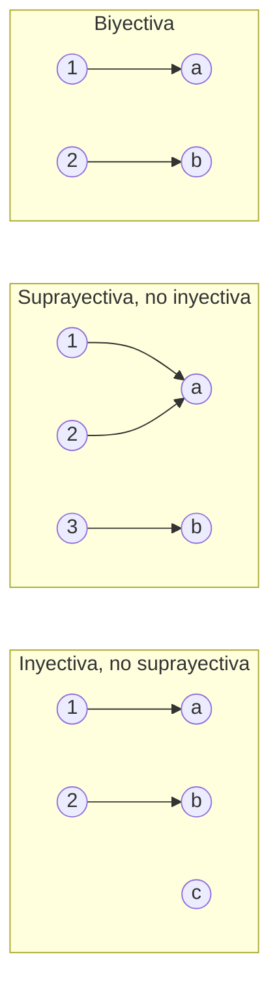

# Álgebra Superior I - Relaciones y funciones

## 2.4 Funciones inyectivas, suprayectivas y biyectivas.

---

La clasificación de funciones según cómo se relacionan los elementos del dominio y el codominio es fundamental en toda la matemática. Determina si una función puede invertirse, si preserva o colapsa información, y cuántos elementos tienen la misma imagen. En algoritmos y estructuras de datos, estas propiedades determinan si una función hash puede usarse para recuperación exacta, o si un encoder puede tener decoder.

### 1. Función inyectiva

$f: A \to B$ es **inyectiva** (uno a uno) si elementos distintos del dominio tienen imágenes distintas:

$$\forall x_1, x_2 \in A,\quad x_1 \neq x_2 \Rightarrow f(x_1) \neq f(x_2)$$

La forma contrapositiva es más práctica para demostraciones:

$$f(x_1) = f(x_2) \Rightarrow x_1 = x_2$$

**Ejemplos:**

- $f(x) = 2x+1$ es inyectiva: $2x_1+1 = 2x_2+1 \Rightarrow x_1 = x_2$.
- $g(x) = x^2$ sobre $\mathbb{R}$ **no** es inyectiva: $g(-1) = g(1) = 1$.
- $g(x) = x^2$ sobre $[0,\infty)$ **sí** es inyectiva.

**Test gráfico:** Toda recta horizontal corta la gráfica en a lo sumo un punto.

### 2. Función suprayectiva

$f: A \to B$ es **suprayectiva** (también llamada sobreyectiva o sobre) si todo elemento del codominio es imagen de algún elemento del dominio:

$$\forall b \in B,\quad \exists\, a \in A : f(a) = b \quad \Longleftrightarrow \quad \mathrm{Im}(f) = B$$

**Ejemplos:**

- $f: \mathbb{R} \to \mathbb{R}$, $f(x) = x^3$ es suprayectiva (todo real es un cubo real).
- $f: \mathbb{R} \to \mathbb{R}$, $f(x) = e^x$ **no** es suprayectiva: como $e^x > 0$ para todo $x$, ni el cero ni los negativos tienen preimagen.
- $f: \mathbb{R} \to (0,\infty)$, $f(x) = e^x$ **sí** es suprayectiva (ajustando el codominio).

### 3. Función biyectiva

$f: A \to B$ es **biyectiva** si es simultáneamente inyectiva y suprayectiva. Esto equivale a decir que existe exactamente un $a \in A$ para cada $b \in B$ tal que $f(a) = b$.

$$f \text{ biyectiva} \iff f \text{ tiene función inversa } f^{-1}: B \to A$$

### 4. Tabla resumen

| Tipo         | Cada fibra $f^{-1}(\{b\})$ tiene | Si $A$ y $B$ son finitos | Inversa                |
| ------------ | -------------------------------- | ------------------------ | ---------------------- |
| Inyectiva    | a lo sumo un elemento            | $\lvert A \rvert \leq \lvert B \rvert$     | inversa izquierda      |
| Suprayectiva | al menos un elemento             | $\lvert A \rvert \geq \lvert B \rvert$     | inversa derecha        |
| Biyectiva    | exactamente un elemento          | $\lvert A \rvert = \lvert B \rvert$         | inversa bilateral      |

Las inversas por un lado se estudian en el subtema 2.3.

### 5. Cómo demostrar cada propiedad

**Inyectividad.** Se supone $f(x_1) = f(x_2)$ y se deduce $x_1 = x_2$. Para refutarla basta exhibir dos elementos distintos con la misma imagen.

**Suprayectividad.** Se toma un $b \in B$ arbitrario y se construye explícitamente un $a \in A$ con $f(a) = b$, normalmente despejando. Hay que verificar que el $a$ construido **pertenece al dominio**: ese es el paso que suele olvidarse.

**Ejemplo completo.** Sea $f: \mathbb{R} \setminus \{1\} \to \mathbb{R} \setminus \{2\}$ con $f(x) = \dfrac{2x}{x - 1}$.

- *Inyectiva.* Si $\dfrac{2x_1}{x_1 - 1} = \dfrac{2x_2}{x_2 - 1}$, al multiplicar en cruz queda $2x_1 x_2 - 2x_1 = 2x_1 x_2 - 2x_2$, de donde $x_1 = x_2$.
- *Suprayectiva.* Dado $y \neq 2$, de $y = \dfrac{2x}{x-1}$ se despeja $x = \dfrac{y}{y - 2}$, que existe porque $y \neq 2$. Además $x \neq 1$, pues $\dfrac{y}{y-2} = 1$ implicaría $0 = -2$. Por lo tanto $x$ está en el dominio y $f(x) = y$.
- *Conclusión.* $f$ es biyectiva y $f^{-1}(y) = \dfrac{y}{y-2}$.

**El principio del palomar.** Si $A$ y $B$ son finitos con $|A| > |B|$, ninguna función $f: A \to B$ es inyectiva: si se reparten más palomas que nidos, algún nido recibe al menos dos. Aunque es casi evidente, tiene consecuencias poco obvias:

- En cualquier grupo de 367 personas hay dos que cumplen años el mismo día.
- Una función hash $h$ que envía cadenas arbitrarias en valores de 64 bits no puede ser inyectiva: hay infinitas cadenas y solo $2^{64}$ valores posibles, de modo que las **colisiones** son inevitables y toda tabla hash debe manejarlas.
- Ningún algoritmo de compresión sin pérdida puede reducir el tamaño de **todos** los archivos: hay $2^n$ archivos de $n$ bits y solo $2^n - 1$ archivos de menos de $n$ bits.

### 6. Cardinalidad y biyecciones

Dos conjuntos $A$ y $B$ tienen la **misma cardinalidad** si y solo si existe una biyección $f: A \to B$.

**Resultados importantes:**

- $|\mathbb{N}| = |\mathbb{Z}| = |\mathbb{Q}|$ (todos son **numerables**) — existen biyecciones entre ellos.
- $|\mathbb{R}| > |\mathbb{N}|$ — $\mathbb{R}$ es **no numerable** (argumento diagonal de Cantor).
- $|\mathcal{P}(A)| > |A|$ para todo conjunto $A$ (teorema de Cantor): el conjunto potencia siempre es estrictamente más grande.

> **Conexión con CC.** La distinción numerable/no numerable es crucial en teoría de la computación: el conjunto de programas posibles es numerable (cada programa es una cadena finita), pero el conjunto de funciones $\mathbb{N} \to \mathbb{N}$ no lo es. Esto implica que existen funciones no computables — resultado que se formaliza en Autómatas y Lenguajes Formales (Sem. 4, tema 7).

### Ejercicios propuestos

1. Clasifica cada función como inyectiva, suprayectiva, biyectiva o ninguna:
   - (a) $f: \mathbb{R} \to \mathbb{R}$, $f(x) = x^3 - x$
   - (b) $f: \mathbb{N} \to \mathbb{N}$, $f(n) = 2n$
   - (c) $f: \mathbb{Z} \to \mathbb{Z}$, $f(n) = n + 1$

2. Con $\mathbb{N} = \{0, 1, 2, \ldots\}$, demuestra que $f: \mathbb{N} \to \mathbb{Z}$ definida por $f(n) = (-1)^n \lceil n/2 \rceil$ es biyectiva. Calcula primero $f(0), \ldots, f(6)$ para ver el patrón.

3. ¿Es posible tener $f: A \to B$ inyectiva con $|A| > |B|$ si $A$ y $B$ son finitos? ¿Y suprayectiva con $|A| < |B|$?

4. Demuestra que $f: \mathbb{R} \to \mathbb{R}$ con $f(x) = \dfrac{x}{1 + |x|}$ es inyectiva y que su imagen es el intervalo $(-1, 1)$. Concluye que $\mathbb{R}$ y $(-1, 1)$ tienen la misma cardinalidad.

5. **Palomar.** Demuestra que si se eligen 6 números distintos de $\{1, 2, \ldots, 10\}$, dos de ellos suman 11. Sugerencia: agrupa los números en cinco parejas que suman 11.

6. Sean $A = \{1, 2, 3\}$ y $B = \{a, b\}$. ¿Cuántas funciones $A \to B$ hay? ¿Cuántas son inyectivas? ¿Cuántas son suprayectivas?

### Ver también

- **2.3** Composición e inversa — la biyectividad es condición necesaria y suficiente para que exista $f^{-1}$.
- **2.5** Cardinalidad — las biyecciones son el criterio formal para comparar tamaños de conjuntos.
- **Autómatas y Lenguajes Formales 7.1 y 7.2** (Sem. 4) — indecidibilidad y el problema de la detención.

### Referencias

- Hernández, E. (2001). _Álgebra y Análisis_. Addison-Wesley Iberoamericana. Cap. 2.
- Rosen, K. H. (2019). _Discrete Mathematics and Its Applications_ (8.ª ed.). McGraw-Hill. Secciones 2.3, 2.5.
- Sipser, M. (2013). _Introduction to the Theory of Computation_ (3.ª ed.). Cengage. Cap. 4.
