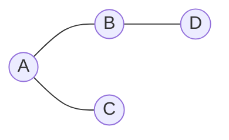
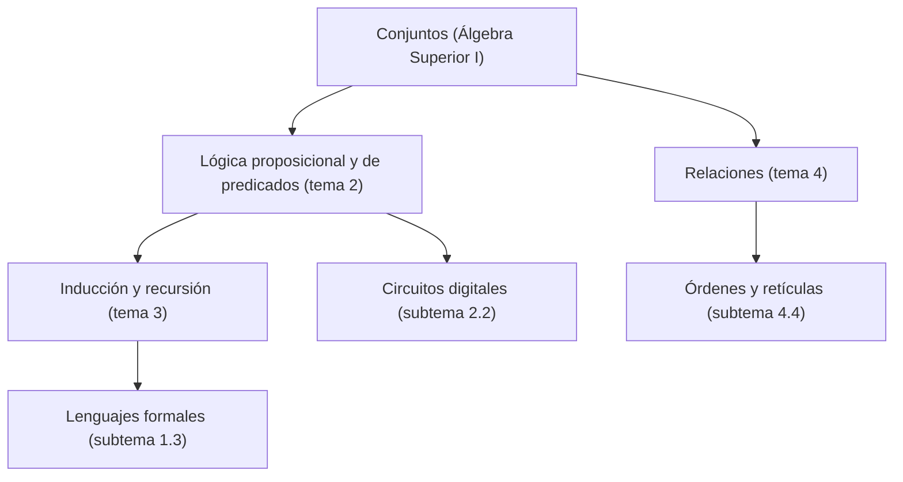

# Estructuras Discretas - Introducción

## 1.1 ¿Qué son las estructuras discretas?

---

Una **estructura discreta** es un objeto matemático formado por elementos separados y distinguibles, que se pueden contar o al menos enumerar uno por uno: conjuntos finitos, sucesiones, cadenas de símbolos, relaciones, gráficas, árboles. Se oponen a las estructuras **continuas** del cálculo, como la recta real, donde entre dos puntos siempre hay infinitos otros. Las ciencias de la computación son discretas por naturaleza, y este curso ofrece el lenguaje y las técnicas de demostración para razonar sobre ellas con precisión.

### 1. Discreto frente a continuo

| Aspecto                | Discreto                                       | Continuo                                    |
| ---------------------- | ---------------------------------------------- | ------------------------------------------- |
| Conjunto típico        | $\mathbb{N}$, $\mathbb{Z}$, cadenas de bits     | $\mathbb{R}$, intervalos                     |
| Cambio                 | por pasos: de $n$ a $n + 1$                    | infinitesimal: derivadas                    |
| Herramienta de conteo  | sumas y combinatoria                           | integrales                                  |
| Técnica de demostración típica | inducción, conteo, casos                | límites y aproximación                      |
| Ejemplo                | número de caminos en una red                   | velocidad de un objeto que cae              |

La frontera no es rígida: los números de punto flotante son un conjunto finito, y por lo tanto discreto, con el que una computadora **aproxima** a los reales. Muchas sorpresas de la programación numérica, como que `0.1 + 0.2 == 0.3` sea falso en la mayoría de los lenguajes, vienen de olvidar esa diferencia.

### 2. Por qué la computación es discreta

Una computadora digital tiene un número finito de bits de memoria y avanza por pasos de reloj. Cada estado de la máquina es una cadena finita de bits, y un programa la transforma paso a paso. Por eso las preguntas fundamentales de la computación son discretas:

- **¿Es correcto este algoritmo?** Se responde con lógica e inducción sobre el número de pasos o el tamaño de la entrada.
- **¿Cuánto tarda?** Se responde contando operaciones, con sumas, recurrencias y combinatoria.
- **¿Cómo representar los datos?** Con conjuntos, relaciones, árboles y gráficas.
- **¿Qué puede y qué no puede calcularse?** Con lenguajes formales y autómatas.

### 3. Las estructuras básicas

| Estructura         | Qué modela                                     | Ejemplo en computación                         |
| ------------------ | ---------------------------------------------- | ---------------------------------------------- |
| Conjunto           | una colección sin orden ni repetición          | los usuarios registrados en un sistema         |
| Sucesión o cadena  | una colección ordenada                         | un arreglo, un archivo, una contraseña         |
| Relación           | vínculos entre elementos                       | una tabla de una base de datos                 |
| Función            | asignación de un valor a cada elemento         | una tabla hash, un programa determinista       |
| Gráfica            | objetos conectados por aristas                 | una red social, un mapa de rutas               |
| Árbol              | jerarquía sin ciclos                           | el sistema de archivos, el DOM de una página   |
| Álgebra booleana   | valores verdadero y falso con sus operaciones  | circuitos digitales, condiciones de un `if`    |

Las primeras cinco se construyen con el lenguaje de conjuntos de Álgebra Superior I. Las gráficas y los árboles se definen a partir de conjuntos y relaciones: una gráfica es un par $G = (V, E)$ donde $V$ es un conjunto de vértices y $E$ un conjunto de aristas, cada una formada por un par de vértices.

**Ejemplo: tres formas de ver la misma estructura.** La gráfica con vértices $V = \{A, B, C, D\}$ y aristas $E = \{\{A, B\}, \{A, C\}, \{B, D\}\}$ puede dibujarse, describirse como relación simétrica, o guardarse en un programa como **lista de adyacencia**:



```python
grafo = {
    'A': ['B', 'C'],
    'B': ['A', 'D'],
    'C': ['A'],
    'D': ['B'],
}
# grado de cada vertice: numero de vecinos
print({v: len(vecinos) for v, vecinos in grafo.items()})  # {'A': 2, 'B': 2, 'C': 1, 'D': 1}
```

### 4. Infinito pero discreto

Discreto no significa finito. El conjunto $\mathbb{N}$ es infinito, pero sus elementos se pueden listar uno por uno: es **numerable** (Álgebra Superior I, subtema 2.5). Lo mismo pasa con el conjunto de todas las cadenas finitas sobre un alfabeto, y por lo tanto con el conjunto de todos los programas posibles. Esta observación lleva a uno de los resultados más profundos de la computación: como hay una cantidad numerable de programas pero una cantidad no numerable de problemas de decisión, existen problemas que **ningún** programa resuelve.

### 5. El papel de la demostración

En matemáticas discretas los ejemplos sirven para formar intuición, pero no para establecer verdades generales. Considere el polinomio $p(n) = n^2 + n + 41$: produce un número primo para $n = 0, 1, 2, \ldots, 39$, cuarenta casos seguidos. Sin embargo $p(40) = 1681 = 41^2$ no es primo. Ningún número finito de pruebas reemplaza una demostración.

Las técnicas de demostración que se usarán a lo largo del curso son:

- **Demostración directa:** de las hipótesis se deduce la conclusión paso a paso.
- **Contrapositiva:** para probar $p \rightarrow q$ se prueba $\neg q \rightarrow \neg p$.
- **Contradicción:** se supone que la conclusión es falsa y se llega a un absurdo.
- **Casos:** se divide el problema en situaciones que cubren todas las posibilidades.
- **Inducción:** para afirmaciones sobre todos los naturales o sobre estructuras definidas recursivamente (tema 3).
- **Contraejemplo:** para refutar una afirmación universal basta un caso en que falle.

### 6. Mapa del curso



> **Conexión con CC.** Casi todas las materias posteriores de la carrera dependen de este curso: Estructuras de Datos usa árboles y gráficas, Autómatas y Lenguajes Formales parte de las gramáticas del subtema 1.3, Lógica Computacional profundiza el tema 2, y Bases de Datos se construye sobre las relaciones del tema 4.

### Ejercicios propuestos

1. Clasifique como discreto o continuo, y justifique: el número de alumnos inscritos, la temperatura de un salón, el conjunto de números de punto flotante de 64 bits, el tiempo que tarda un programa en milisegundos, el conjunto de todas las cadenas binarias.

2. Escriba la gráfica de la sección 3 como un conjunto de pares ordenados, es decir, como una relación sobre $V$. ¿Cuántos pares tiene? ¿Qué propiedad de las relaciones refleja que las aristas no tengan dirección?

3. Encuentre un contraejemplo para cada afirmación:
   - (a) Todo número impar mayor que 1 es primo.
   - (b) $2^n > n^2$ para todo $n \geq 1$.
   - (c) Si $a^2 = b^2$, entonces $a = b$.

4. ¿Cuántas cadenas binarias de longitud 8 hay? ¿Cuántos subconjuntos tiene un conjunto de 8 elementos? Explique por qué la respuesta es la misma.

5. Modele con una estructura discreta cada situación y diga cuál usaría: los cursos de la carrera y sus requisitos; los amigos en una red social; las carpetas de un disco duro; los turnos de un torneo de ajedrez.

### Ver también

- **1.2** Panorama de las matemáticas discretas — las áreas principales con ejemplos.
- **1.3** Introducción a los lenguajes formales — primera estructura discreta estudiada en detalle.
- **Álgebra Superior I 1.1 y 2.5** — conjuntos y cardinalidad, el lenguaje base del curso.
- **Gráficas y Juegos 1.1** (Sem. 2) — teoría de gráficas a fondo.

### Referencias

- Rosen, K. H. (2019). _Discrete Mathematics and Its Applications_ (8.ª ed.). McGraw-Hill. Cap. 1.
- Epp, S. S. (2011). _Discrete Mathematics with Applications_ (4.ª ed.). Brooks/Cole. Cap. 1.
- Lehman, E., Leighton, F. T., & Meyer, A. R. (2017). _Mathematics for Computer Science_. MIT. Cap. 1.
