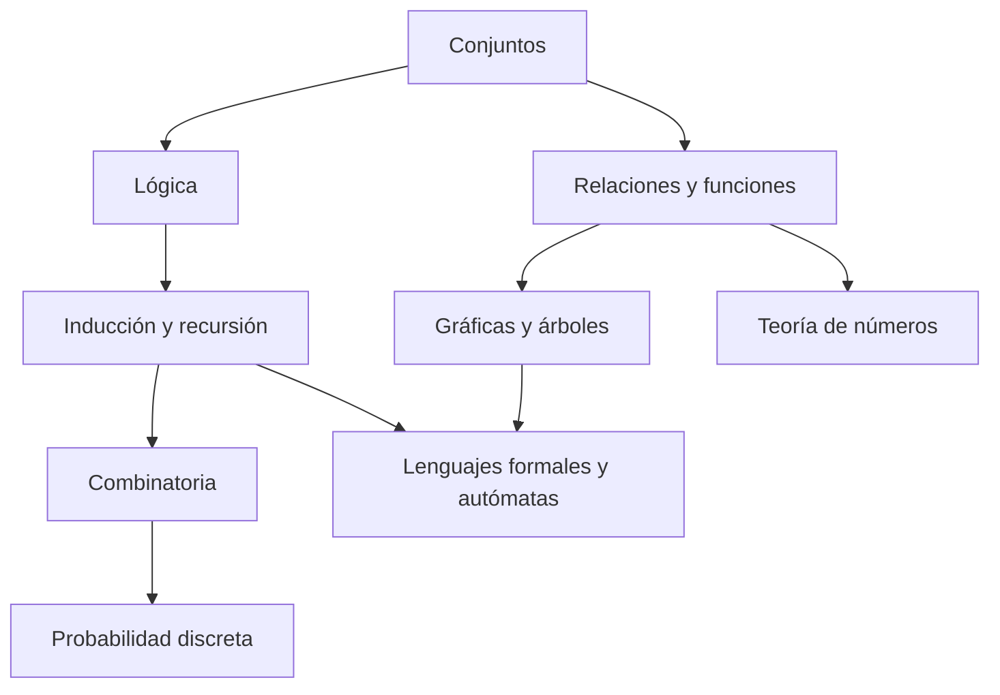

# Estructuras Discretas - Introducción

## 1.2 Panorama de las matemáticas discretas.

---

Las matemáticas discretas no son una sola teoría sino una familia de áreas que comparten el interés por objetos contables y las técnicas para razonar sobre ellos. Este subtema recorre las áreas principales, cada una con una idea central, un ejemplo y la parte de la computación donde se usa. Varias se estudian a fondo en este curso; otras se retoman en materias posteriores.

### 1. Lógica

La lógica estudia la forma de los razonamientos válidos. Sus objetos son **proposiciones**, enunciados que son verdaderos o falsos, combinadas con conectivos: $\neg$ (no), $\land$ (y), $\lor$ (o), $\rightarrow$ (si... entonces) y $\leftrightarrow$ (si y solo si).

**Ejemplo.** La fórmula $(p \land q) \rightarrow r$ se lee: si $p$ y $q$, entonces $r$. Su tabla de verdad tiene $2^3 = 8$ filas, y solo es falsa cuando $p$ y $q$ son verdaderas y $r$ es falsa.

**En computación:** las condiciones de los programas, el diseño de circuitos, la verificación formal de software y los lenguajes de consulta. Se estudia en el tema 2 de este curso y en Lógica Computacional (Sem. 4).

### 2. Conjuntos, relaciones y funciones

Es el lenguaje común de todas las demás áreas. Un conjunto agrupa objetos, una relación los vincula y una función asigna a cada uno un valor.

**Ejemplo.** La relación "es requisito de" entre los cursos de una carrera es una relación sobre el conjunto de cursos. Que no tenga ciclos es lo que permite ordenar los cursos en semestres.

**En computación:** bases de datos relacionales, tipos de datos, especificaciones. Los conjuntos y funciones se estudian en Álgebra Superior I; las relaciones, en el tema 4 de este curso.

### 3. Inducción y recursión

Las estructuras discretas suelen construirse paso a paso: los naturales a partir del 0 y el sucesor, las listas a partir de la lista vacía, los árboles a partir de hojas. La **recursión** define objetos de esta manera, y la **inducción** demuestra propiedades de ellos.

**Ejemplo.** La suma $1 + 2 + \cdots + n$ puede definirse recursivamente como $S(1) = 1$ y $S(n) = S(n-1) + n$, y por inducción se demuestra que $S(n) = \frac{n(n+1)}{2}$.

**En computación:** algoritmos recursivos, estructuras de datos, demostraciones de corrección. Es el tema 3 de este curso.

### 4. Combinatoria

La combinatoria cuenta. Sus herramientas básicas son los principios de la suma y del producto, las permutaciones y combinaciones, y el principio del palomar.

**Ejemplo.** Una contraseña de 8 caracteres con 62 símbolos posibles admite $62^8 \approx 2.2 \times 10^{14}$ valores. Un atacante que prueba mil millones por segundo tarda en promedio poco más de un día en encontrarla.

**El principio del palomar.** Si se colocan $n + 1$ objetos en $n$ cajas, alguna caja recibe al menos dos. De aquí se deduce, por ejemplo, que toda función hash de cadenas largas a valores cortos tiene colisiones.

**En computación:** análisis de algoritmos, probabilidad, seguridad. Se estudia en Álgebra Superior I (tema 3) y en Probabilidad I (Sem. 3).

### 5. Teoría de números

Estudia los enteros: divisibilidad, primos, máximo común divisor y aritmética modular. La relación de congruencia $a \equiv b \pmod{m}$ identifica a los enteros que dejan el mismo residuo al dividirlos entre $m$.

**Ejemplo.** En aritmética módulo 12, la de un reloj, se cumple $9 + 5 \equiv 2 \pmod{12}$.

**En computación:** criptografía de clave pública, funciones hash, códigos de verificación como el dígito de control de una tarjeta. Se estudia en Álgebra Superior II (Sem. 2) y en Criptografía y Seguridad (Sem. 8).

### 6. Gráficas y árboles

Una gráfica modela objetos conectados. Un árbol es una gráfica conexa sin ciclos.

**Ejemplo.** Leonhard Euler demostró en 1736 que no es posible recorrer los siete puentes de Königsberg pasando una sola vez por cada uno. El argumento solo usa el número de puentes que llega a cada zona de la ciudad: si más de dos zonas tienen un número impar de puentes, el paseo es imposible.

**En computación:** redes, rutas más cortas, dependencias entre tareas, estructuras de datos jerárquicas. Se estudia en Gráficas y Juegos (Sem. 2) y Estructuras de Datos (Sem. 2).

### 7. Lenguajes formales y autómatas

Un **lenguaje formal** es un conjunto de cadenas sobre un alfabeto finito. Las **gramáticas** describen cómo generar las cadenas de un lenguaje y los **autómatas** cómo reconocerlas.

**Ejemplo.** Las cadenas de paréntesis balanceados, como `(()())`, forman un lenguaje que se describe con la gramática $S \rightarrow (S)S \mid \varepsilon$.

**En computación:** compiladores, expresiones regulares, validación de formatos. Se introduce en el subtema 1.3 y se estudia en Autómatas y Lenguajes Formales (Sem. 4) y Compiladores (Sem. 7).

### 8. Probabilidad discreta

Estudia experimentos con un número finito o numerable de resultados, como lanzar dados o elegir al azar un elemento de una lista.

**Ejemplo.** En un grupo de 23 personas, la probabilidad de que dos cumplan años el mismo día ya supera el 50 %. Es la base del llamado **ataque de cumpleaños** contra funciones hash.

**En computación:** algoritmos aleatorizados, análisis del caso promedio, aprendizaje automático. Se estudia en Probabilidad I (Sem. 3).

### 9. Cómo se relacionan

Las flechas indican dependencias conceptuales, no un orden obligatorio. Lo que todas comparten es el método: definiciones precisas, demostraciones rigurosas y algoritmos que se pueden ejecutar.

> **Conexión con CC.** Un mismo problema suele tocar varias áreas a la vez. Diseñar un sistema de rutas para entregas a domicilio requiere gráficas para el mapa, combinatoria para estimar cuántas rutas hay, lógica para expresar las restricciones del problema y teoría de algoritmos para saber si una solución óptima puede encontrarse en tiempo razonable.

### Ejercicios propuestos

1. Construya la tabla de verdad de $(p \land q) \rightarrow r$ y verifique que es falsa en exactamente una fila.

2. Una placa de automóvil tiene tres letras de un alfabeto de 26 seguidas de cuatro dígitos. ¿Cuántas placas distintas hay?

3. Demuestre con el principio del palomar que en cualquier grupo de 13 personas hay al menos dos que nacieron en el mismo mes.

4. Calcule $7^{100} \bmod 10$, es decir, el último dígito de $7^{100}$. Sugerencia: observe el patrón de los últimos dígitos de $7^1, 7^2, 7^3, \ldots$

5. Para cada situación indique qué área de las matemáticas discretas es la más útil y por qué: (a) decidir si un archivo de configuración tiene la sintaxis correcta; (b) estimar cuántos intentos necesita un ataque de fuerza bruta; (c) encontrar el camino más corto entre dos ciudades.

### Ver también

- **1.1** ¿Qué son las estructuras discretas? — motivación y técnicas de demostración.
- **1.3** Introducción a los lenguajes formales — primera área estudiada en detalle.
- **2.1** Lógica proposicional — sintaxis y semántica de las fórmulas.
- **Álgebra Superior I 3.2** — combinatoria: permutaciones y combinaciones.

### Referencias

- Rosen, K. H. (2019). _Discrete Mathematics and Its Applications_ (8.ª ed.). McGraw-Hill.
- Lehman, E., Leighton, F. T., & Meyer, A. R. (2017). _Mathematics for Computer Science_. MIT.
- Sipser, M. (2013). _Introduction to the Theory of Computation_ (3.ª ed.). Cengage. Cap. 0.
