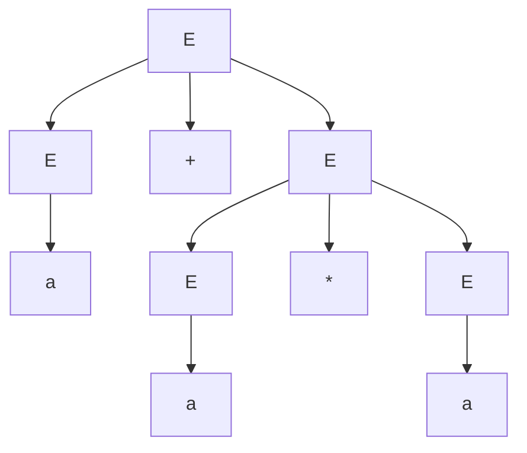

# Estructuras Discretas - Introducción

## 1.3 Introducción a los lenguajes formales: expresiones y mecanismos para su descripción (gramáticas y árboles de derivación).

---

Un programa, una dirección de correo, un número de teléfono o una molécula de ADN son, desde el punto de vista matemático, cadenas de símbolos. Los **lenguajes formales** estudian conjuntos de cadenas y las maneras finitas de describirlos, aunque el conjunto sea infinito. Son la base de los compiladores, de las expresiones regulares y de la teoría de la computación. Este subtema introduce el vocabulario y los dos mecanismos de descripción principales: las expresiones regulares y las gramáticas, con sus árboles de derivación.

### 1. Alfabetos, cadenas y lenguajes

- Un **alfabeto** $\Sigma$ es un conjunto finito y no vacío de símbolos. Por ejemplo $\Sigma = \{0, 1\}$, o $\Sigma = \{a, b, c\}$, o el conjunto de caracteres ASCII.
- Una **cadena** o palabra sobre $\Sigma$ es una sucesión finita de símbolos de $\Sigma$, como $w = aabba$.
- La **longitud** $|w|$ es el número de símbolos: $|aabba| = 5$.
- La **cadena vacía** $\varepsilon$ es la única cadena de longitud 0.
- $\Sigma^n$ es el conjunto de cadenas de longitud $n$, y $\Sigma^*$ el conjunto de **todas** las cadenas, incluida $\varepsilon$:

$$\Sigma^* = \Sigma^0 \cup \Sigma^1 \cup \Sigma^2 \cup \cdots$$

- Un **lenguaje** sobre $\Sigma$ es cualquier subconjunto $L \subseteq \Sigma^*$.

**Ejemplos sobre $\Sigma = \{a, b\}$:**

| Lenguaje                                       | Algunos elementos            | ¿Finito? |
| ---------------------------------------------- | ---------------------------- | -------- |
| $L_1 = \{a, ab, abb\}$                          | $a$, $ab$, $abb$             | sí       |
| $L_2 = \{w \mid w \text{ empieza con } a\}$     | $a$, $ab$, $aab$, $abba$     | no       |
| $L_3 = \{a^n b^n \mid n \geq 0\}$               | $\varepsilon$, $ab$, $aabb$  | no       |
| $\varnothing$                                   | ninguno                      | sí       |
| $\{\varepsilon\}$                               | solo la cadena vacía         | sí       |

Aquí $a^n$ denota la cadena formada por $n$ letras $a$. Note que $\varnothing \neq \{\varepsilon\}$: el primero no tiene cadenas y el segundo tiene una.

Si $|\Sigma| = k$, hay exactamente $k^n$ cadenas de longitud $n$. El conjunto $\Sigma^*$ es infinito pero numerable: basta listar las cadenas por longitud y, dentro de cada longitud, en orden alfabético.

### 2. Operaciones

**Concatenación de cadenas.** Si $u = ab$ y $v = ba$, entonces $uv = abba$. Es asociativa, tiene a $\varepsilon$ como neutro y cumple $|uv| = |u| + |v|$, pero no es conmutativa: $vu = baab$.

**Operaciones con lenguajes.** Como los lenguajes son conjuntos, admiten unión, intersección y complemento respecto de $\Sigma^*$. Además:

- **Concatenación:** $L_1 L_2 = \{uv \mid u \in L_1,\; v \in L_2\}$.
- **Potencias:** $L^0 = \{\varepsilon\}$ y $L^{n+1} = L^n L$.
- **Cerradura de Kleene:** $L^* = L^0 \cup L^1 \cup L^2 \cup \cdots$, todas las concatenaciones de cero o más cadenas de $L$.
- **Cerradura positiva:** $L^+ = L^1 \cup L^2 \cup \cdots$, al menos una cadena.

**Ejemplo.** Con $L_1 = \{a, ab\}$ y $L_2 = \{b, \varepsilon\}$ se obtiene $L_1 L_2 = \{ab, a, abb\}$, pues $ab$ aparece dos veces, como $a \cdot b$ y como $ab \cdot \varepsilon$.

### 3. Expresiones regulares

Una **expresión regular** describe un lenguaje combinando símbolos con tres operaciones: unión, concatenación y estrella. Se definen recursivamente:

- $\varnothing$, $\varepsilon$ y cada símbolo $a \in \Sigma$ son expresiones regulares.
- Si $r$ y $s$ lo son, también lo son la unión $r + s$, que a veces se escribe $r \mid s$, la concatenación $rs$ y la estrella $r^*$.

La estrella tiene la mayor precedencia, luego la concatenación y al final la unión, igual que en aritmética la potencia precede al producto y este a la suma.

| Expresión        | Lenguaje que describe                                   |
| ---------------- | ------------------------------------------------------- |
| $a^*$            | $\varepsilon, a, aa, aaa, \ldots$                       |
| $ab^*$           | una $a$ seguida de cualquier número de $b$              |
| $(ab)^*$         | $\varepsilon, ab, abab, \ldots$                         |
| $(a + b)^* abb$  | cadenas que terminan en $abb$                           |
| $a^* b a^* b a^*$ | cadenas con exactamente dos letras $b$                 |

Los lenguajes que se pueden describir así se llaman **regulares**. No todos los lenguajes lo son: $L_3 = \{a^n b^n \mid n \geq 0\}$ no es regular, porque reconocerlo exige "contar" cuántas $a$ se han leído sin límite, y una expresión regular no tiene esa memoria. La demostración formal se verá en Autómatas y Lenguajes Formales.

**En código.** Los lenguajes de programación incluyen bibliotecas de expresiones regulares con más operadores, como `+` para "una o más veces", `?` para "opcional" y clases como `[0-9]`:

```python
import re

termina_en_abb = re.compile(r'[ab]*abb')
print(bool(termina_en_abb.fullmatch('babb')))    # True
print(bool(termina_en_abb.fullmatch('abba')))    # False

codigo_postal = re.compile(r'[0-9]{5}')          # cinco digitos
print(bool(codigo_postal.fullmatch('62780')))    # True
```

### 4. Gramáticas

Una **gramática** describe un lenguaje mediante reglas de reescritura. Formalmente es una cuádrupla $G = (V, \Sigma, P, S)$ donde:

- $V$ es un conjunto finito de **variables** o símbolos no terminales, que se escriben con mayúsculas;
- $\Sigma$ es el alfabeto de símbolos **terminales**, que forman las cadenas del lenguaje;
- $P$ es un conjunto finito de **producciones** de la forma $\alpha \rightarrow \beta$, y
- $S \in V$ es el **símbolo inicial**.

Una **derivación** parte de $S$ y en cada paso reemplaza un lado izquierdo de una producción por su lado derecho. Se escribe $\alpha \Rightarrow \beta$ para un paso. El lenguaje $L(G)$ generado por la gramática es el conjunto de cadenas **formadas solo por terminales** que pueden derivarse desde $S$.

**Ejemplo 1.** La gramática con producciones

$$S \rightarrow aSb \mid \varepsilon$$

donde la barra separa alternativas, genera exactamente $L_3 = \{a^n b^n \mid n \geq 0\}$. Por ejemplo:

$$S \Rightarrow aSb \Rightarrow aaSbb \Rightarrow aabb$$

Cada aplicación de $S \rightarrow aSb$ agrega una $a$ a la izquierda y una $b$ a la derecha, y la producción $S \rightarrow \varepsilon$ termina la derivación. Así, una gramática describe un lenguaje que ninguna expresión regular puede describir.

**Ejemplo 2.** La gramática

$$S \rightarrow aA \qquad A \rightarrow bA \mid \varepsilon$$

genera $\{ab^n \mid n \geq 0\}$, el mismo lenguaje que la expresión regular $ab^*$. Una derivación de $abb$ es $S \Rightarrow aA \Rightarrow abA \Rightarrow abbA \Rightarrow abb$.

**Notación BNF.** En la documentación de lenguajes de programación las gramáticas se escriben en la **forma de Backus-Naur**, con los no terminales entre picoparéntesis:

```
<entero>  ::= <digito> | <digito> <entero>
<digito>  ::= 0 | 1 | 2 | 3 | 4 | 5 | 6 | 7 | 8 | 9
```

### 5. Árboles de derivación

Un **árbol de derivación** muestra la estructura de una derivación sin importar el orden en que se aplicaron las producciones. La raíz es el símbolo inicial, cada nodo interno es una variable cuyos hijos son el lado derecho de la producción aplicada, y las hojas, leídas de izquierda a derecha, forman la cadena derivada.

Considere la gramática de expresiones aritméticas

$$E \rightarrow E + E \mid E * E \mid (E) \mid a$$

La cadena $a + a * a$ tiene el siguiente árbol, que agrupa la multiplicación primero:



Pero la misma cadena tiene otro árbol, en el que la raíz aplica $E \rightarrow E * E$ y la suma queda agrupada primero, como si fuera $(a + a) * a$. Una gramática en la que alguna cadena tiene dos árboles de derivación distintos se llama **ambigua**. La ambigüedad es un problema serio en un compilador, porque los dos árboles corresponden a dos significados distintos: con $a = 2$, uno da $2 + 4 = 6$ y el otro $4 \cdot 2 = 8$.

**Eliminando la ambigüedad.** La siguiente gramática genera las mismas expresiones pero obliga a que el producto se agrupe antes que la suma, introduciendo un no terminal por nivel de precedencia:

$$E \rightarrow E + T \mid T \qquad T \rightarrow T * F \mid F \qquad F \rightarrow (E) \mid a$$

Con ella, $a + a * a$ tiene un único árbol: la raíz $E$ se expande como $E + T$, y el producto queda dentro de $T$.

### 6. La jerarquía de Chomsky

Noam Chomsky clasificó las gramáticas según la forma permitida de sus producciones. Cada clase genera una familia de lenguajes estrictamente más grande que la siguiente, y cada una corresponde a un tipo de máquina reconocedora:

| Tipo | Gramática                   | Forma de las producciones                  | Reconocedor               | Ejemplo de lenguaje            |
| ---- | --------------------------- | ------------------------------------------ | ------------------------- | ------------------------------ |
| 3    | regular                     | $A \rightarrow aB$ o $A \rightarrow a$     | autómata finito           | $ab^*$                         |
| 2    | libre de contexto           | $A \rightarrow \beta$                      | autómata de pila          | $\{a^n b^n\}$                  |
| 1    | sensible al contexto        | $\alpha A \gamma \rightarrow \alpha \beta \gamma$ | autómata linealmente acotado | $\{a^n b^n c^n\}$       |
| 0    | sin restricciones           | $\alpha \rightarrow \beta$                 | máquina de Turing         | lenguajes recursivamente enumerables |

La sintaxis de casi todos los lenguajes de programación se describe con gramáticas libres de contexto, mientras que los componentes léxicos, como identificadores y números, se describen con expresiones regulares.

> **Conexión con CC.** Un compilador procesa el código fuente en dos etapas que corresponden a este subtema. El **analizador léxico** divide el texto en componentes usando expresiones regulares; el **analizador sintáctico** construye el árbol de derivación usando una gramática libre de contexto. Herramientas como ANTLR o Bison generan ese analizador automáticamente a partir de la gramática. Si la gramática es ambigua, el compilador no sabría qué árbol construir.

### Ejercicios propuestos

1. Sea $\Sigma = \{0, 1\}$. ¿Cuántas cadenas hay en $\Sigma^4$? ¿Cuántas cadenas de longitud a lo sumo 4 hay en $\Sigma^*$?

2. Con $L_1 = \{a, b\}$ y $L_2 = \{\varepsilon, a\}$, calcule $L_1 L_2$, $L_2 L_1$ y $L_2^2$.

3. Escriba expresiones regulares sobre $\{a, b\}$ para:
   - (a) Las cadenas que contienen la subcadena $aa$.
   - (b) Las cadenas de longitud par.
   - (c) Las cadenas que no contienen dos $b$ seguidas.

4. Escriba una gramática para el lenguaje de los palíndromos sobre $\{a, b\}$, es decir, cadenas que se leen igual al derecho y al revés, y derive $abba$.

5. Con la gramática no ambigua de la sección 5, construya el árbol de derivación de $(a + a) * a$.

6. Demuestre que la gramática $S \rightarrow SS \mid (S) \mid \varepsilon$, que genera los paréntesis balanceados, es ambigua, encontrando una cadena con dos árboles distintos.

### Ver también

- **1.1** ¿Qué son las estructuras discretas? — las cadenas como estructura discreta básica.
- **3.2** Definiciones recursivas — las expresiones regulares y las gramáticas son definiciones recursivas de conjuntos.
- **3.3** Inducción estructural — demuestra propiedades de todas las cadenas de un lenguaje.
- **Autómatas y Lenguajes Formales 1.2 a 1.9** (Sem. 4) — cadenas, lenguajes, expresiones regulares, gramáticas y árboles de derivación a fondo.
- **Compiladores** (Sem. 7) — análisis léxico y sintáctico.

### Referencias

- Sipser, M. (2013). _Introduction to the Theory of Computation_ (3.ª ed.). Cengage. Cap. 0 a 2.
- Hopcroft, J., Motwani, R., & Ullman, J. (2007). _Introduction to Automata Theory, Languages, and Computation_ (3.ª ed.). Pearson. Cap. 1 a 5.
- Aho, A., Lam, M., Sethi, R., & Ullman, J. (2006). _Compilers: Principles, Techniques, and Tools_ (2.ª ed.). Pearson. Cap. 2 y 4.
