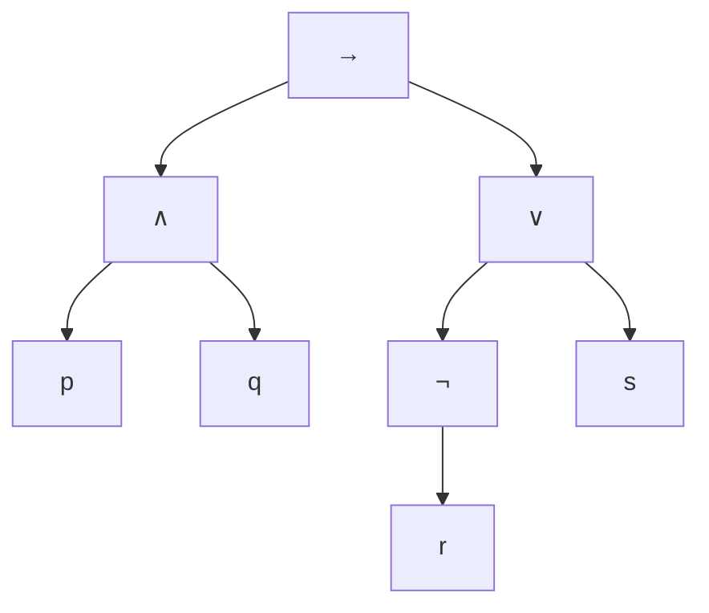
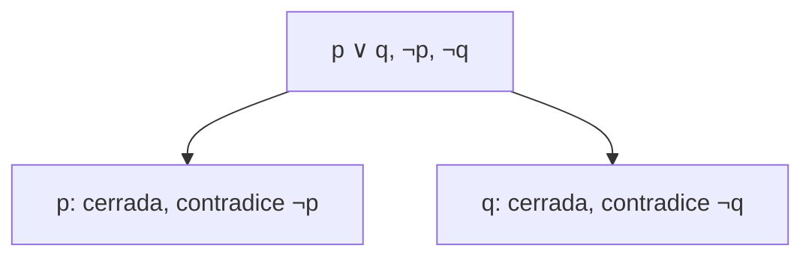

# Estructuras Discretas - Lógica matemática

## 2.1 Lógica proposicional: sintaxis, semántica, equivalencia lógica, análisis de argumentos correctos (interpretaciones, derivaciones y/o tableaux semánticos).

---

La lógica proposicional estudia cómo se combinan enunciados que son verdaderos o falsos y cuándo una conclusión se sigue necesariamente de unas premisas. Separa con cuidado dos niveles: la **sintaxis**, que dice qué cadenas de símbolos son fórmulas, y la **semántica**, que dice qué significan. Sobre esa base se definen la equivalencia lógica y la validez de argumentos, y se estudian tres métodos para analizarlos: interpretaciones, derivaciones y tableaux semánticos.

### 1. Proposiciones y conectivos

Una **proposición** es un enunciado que es verdadero o falso, pero no ambas cosas. "7 es primo" y "París es la capital de Italia" son proposiciones. En cambio, "¿qué hora es?" no lo es, y tampoco la desigualdad $x > 3$, porque su verdad depende de $x$.

Las proposiciones que no se descomponen en otras más simples se llaman **atómicas** y se representan con variables proposicionales $p, q, r, \ldots$ Las demás se forman con **conectivos**:

| Conectivo      | Símbolo             | Se lee                 | En programación |
| -------------- | ------------------- | ---------------------- | --------------- |
| Negación       | $\neg p$            | no $p$                 | `!p`, `not p`   |
| Conjunción     | $p \land q$         | $p$ y $q$              | `p && q`        |
| Disyunción     | $p \lor q$          | $p$ o $q$              | `p \|\| q`      |
| Implicación    | $p \rightarrow q$   | si $p$, entonces $q$   | no tiene operador propio |
| Bicondicional  | $p \leftrightarrow q$ | $p$ si y solo si $q$ | `p == q`        |

La disyunción es **inclusiva**: $p \lor q$ es verdadera también cuando ambas lo son. La disyunción exclusiva se escribe $p \oplus q$ y equivale a $\neg(p \leftrightarrow q)$.

### 2. Sintaxis

Las **fórmulas bien formadas** se definen recursivamente:

1. Cada variable proposicional es una fórmula, y también lo son las constantes $\top$ (verdadero) y $\bot$ (falso).
2. Si $\varphi$ es una fórmula, $\neg \varphi$ también lo es.
3. Si $\varphi$ y $\psi$ son fórmulas, también lo son $(\varphi \land \psi)$, $(\varphi \lor \psi)$, $(\varphi \rightarrow \psi)$ y $(\varphi \leftrightarrow \psi)$.
4. Nada más es una fórmula.

En forma de gramática, como en el subtema 1.3:

```
F → p | q | r | ⊤ | ⊥ | ¬F | (F ∧ F) | (F ∨ F) | (F → F) | (F ↔ F)
```

**Precedencia.** Para ahorrar paréntesis se acuerda que $\neg$ liga más fuerte que $\land$, este más que $\lor$, este más que $\rightarrow$ y este más que $\leftrightarrow$. La implicación agrupa a la derecha: $p \rightarrow q \rightarrow r$ significa $p \rightarrow (q \rightarrow r)$. Así, $\neg p \land q \rightarrow r$ significa $((\neg p) \land q) \rightarrow r$.

**Árbol sintáctico.** Toda fórmula tiene un único árbol que muestra su estructura. Para $(p \land q) \rightarrow (\neg r \lor s)$:



El conectivo de la raíz se llama **conectivo principal**. La unicidad del árbol es lo que permite definir el significado de una fórmula por recursión sobre su estructura.

### 3. Semántica

Una **interpretación** es una asignación de un valor de verdad, $V$ o $F$, a cada variable proposicional. El valor de una fórmula compuesta se calcula a partir de los de sus partes según las tablas:

| $p$ | $q$ | $\neg p$ | $p \land q$ | $p \lor q$ | $p \rightarrow q$ | $p \leftrightarrow q$ |
| --- | --- | -------- | ----------- | ---------- | ----------------- | --------------------- |
| V   | V   | F        | V           | V          | V                 | V                     |
| V   | F   | F        | F           | V          | F                 | F                     |
| F   | V   | V        | F           | V          | V                 | F                     |
| F   | F   | V        | F           | F          | V                 | V                     |

**Sobre la implicación.** $p \rightarrow q$ solo es falsa cuando $p$ es verdadera y $q$ falsa. Que sea verdadera con $p$ falsa se entiende como una promesa: "si apruebas, te doy un premio" no se incumple cuando no apruebas, des o no el premio. Además:

- La **recíproca** de $p \rightarrow q$ es $q \rightarrow p$, y **no** es equivalente a ella.
- La **contrapositiva** es $\neg q \rightarrow \neg p$, y **sí** es equivalente.

Una fórmula con $n$ variables tiene $2^n$ interpretaciones posibles, una por fila de su tabla de verdad. Según sus valores, una fórmula es:

- **Tautología** o válida, si es verdadera en todas las interpretaciones. Ejemplo: $p \lor \neg p$. Se escribe $\models \varphi$.
- **Contradicción** o insatisfacible, si es falsa en todas. Ejemplo: $p \land \neg p$.
- **Satisfacible**, si es verdadera en al menos una. Ejemplo: $p \rightarrow q$.
- **Contingente**, si es satisfacible pero no tautología.

Note que $\varphi$ es tautología si y solo si $\neg \varphi$ es contradicción.

**Ejemplo.** La tabla de $(p \rightarrow q) \land p \rightarrow q$ muestra que es tautología:

| $p$ | $q$ | $p \rightarrow q$ | $(p \rightarrow q) \land p$ | $(p \rightarrow q) \land p \rightarrow q$ |
| --- | --- | ----------------- | --------------------------- | ----------------------------------------- |
| V   | V   | V                 | V                           | V                                         |
| V   | F   | F                 | F                           | V                                         |
| F   | V   | V                 | F                           | V                                         |
| F   | F   | V                 | F                           | V                                         |

```python
from itertools import product

def tabla(formula, variables):
    """Imprime la tabla de verdad de una formula dada como funcion de Python."""
    for valores in product([True, False], repeat=len(variables)):
        fila = dict(zip(variables, valores))
        print(fila, formula(**fila))

implica = lambda a, b: (not a) or b
tabla(lambda p, q: implica(implica(p, q) and p, q), ['p', 'q'])
```

### 4. Equivalencia lógica

Dos fórmulas $\varphi$ y $\psi$ son **lógicamente equivalentes**, $\varphi \equiv \psi$, si tienen el mismo valor en todas las interpretaciones. Equivalentemente, si $\varphi \leftrightarrow \psi$ es tautología.

| Ley                    | Equivalencia                                                                  |
| ---------------------- | ----------------------------------------------------------------------------- |
| Doble negación         | $\neg \neg p \equiv p$                                                         |
| Conmutativas           | $p \land q \equiv q \land p$ y $p \lor q \equiv q \lor p$                       |
| Asociativas            | $(p \land q) \land r \equiv p \land (q \land r)$, y lo mismo con $\lor$          |
| Distributivas          | $p \land (q \lor r) \equiv (p \land q) \lor (p \land r)$ y $p \lor (q \land r) \equiv (p \lor q) \land (p \lor r)$ |
| De Morgan              | $\neg(p \land q) \equiv \neg p \lor \neg q$ y $\neg(p \lor q) \equiv \neg p \land \neg q$ |
| Idempotencia           | $p \land p \equiv p$ y $p \lor p \equiv p$                                      |
| Absorción              | $p \land (p \lor q) \equiv p$ y $p \lor (p \land q) \equiv p$                   |
| Identidad              | $p \land \top \equiv p$ y $p \lor \bot \equiv p$                                |
| Dominación             | $p \lor \top \equiv \top$ y $p \land \bot \equiv \bot$                          |
| Tercero excluido y no contradicción | $p \lor \neg p \equiv \top$ y $p \land \neg p \equiv \bot$          |
| Implicación            | $p \rightarrow q \equiv \neg p \lor q$                                          |
| Contrapositiva         | $p \rightarrow q \equiv \neg q \rightarrow \neg p$                              |
| Bicondicional          | $p \leftrightarrow q \equiv (p \rightarrow q) \land (q \rightarrow p)$          |
| Exportación            | $(p \land q) \rightarrow r \equiv p \rightarrow (q \rightarrow r)$              |

Estas leyes son el reflejo exacto de las leyes de conjuntos de Álgebra Superior I (subtema 1.2): $\land$ corresponde a $\cap$, $\lor$ a $\cup$, $\neg$ al complemento, $\top$ al universo y $\bot$ al vacío.

**Ejemplo de razonamiento algebraico.** Simplificar $\neg(p \rightarrow q) \lor q$:

$$
\begin{aligned}
\neg(p \rightarrow q) \lor q &\equiv \neg(\neg p \lor q) \lor q && \text{implicación} \\
&\equiv (p \land \neg q) \lor q && \text{De Morgan y doble negación} \\
&\equiv (p \lor q) \land (\neg q \lor q) && \text{distributiva} \\
&\equiv (p \lor q) \land \top \equiv p \lor q && \text{tercero excluido e identidad}
\end{aligned}
$$

**Formas normales.** Toda fórmula es equivalente a una en **forma normal disyuntiva**, que es una disyunción de conjunciones de literales, como $(p \land \neg q) \lor (\neg p \land q)$, y a una en **forma normal conjuntiva**, que es una conjunción de disyunciones de literales, como $(p \lor q) \land (\neg p \lor \neg q)$. Un **literal** es una variable o su negación. La forma disyuntiva se lee directamente de la tabla de verdad: una conjunción por cada fila verdadera.

### 5. Argumentos y consecuencia lógica

Un **argumento** consta de premisas $\varphi_1, \ldots, \varphi_n$ y una conclusión $\psi$. Es **correcto**, o **válido**, si en toda interpretación que hace verdaderas a todas las premisas, la conclusión también es verdadera. Se escribe

$$\varphi_1, \ldots, \varphi_n \models \psi$$

y se dice que $\psi$ es **consecuencia lógica** de las premisas. Equivalentemente, el argumento es válido si y solo si la fórmula $(\varphi_1 \land \cdots \land \varphi_n) \rightarrow \psi$ es tautología, y también si y solo si el conjunto $\{\varphi_1, \ldots, \varphi_n, \neg \psi\}$ es insatisfacible.

La validez depende solo de la **forma** del argumento, no de que las premisas sean verdaderas en el mundo real. Hay tres métodos para analizarla.

#### 5.1 Método de interpretaciones

Se busca una interpretación que haga verdaderas las premisas y falsa la conclusión, llamada **contraejemplo**. Si existe, el argumento es inválido; si se demuestra que no puede existir, es válido. Con tablas de verdad se revisan todas las filas, aunque el costo crece como $2^n$.

**Ejemplo de argumento inválido (falacia de afirmar el consecuente):**

- Premisa 1: si llueve, el piso está mojado, $p \rightarrow q$.
- Premisa 2: el piso está mojado, $q$.
- Conclusión: llueve, $p$.

La interpretación $p = F$, $q = V$ hace verdaderas ambas premisas y falsa la conclusión: el piso puede estar mojado por otra razón. El argumento es inválido.

**Búsqueda dirigida de contraejemplos.** Para $p \rightarrow q, \; q \rightarrow r \models p \rightarrow r$, un contraejemplo necesitaría $p \rightarrow r$ falsa, es decir $p = V$ y $r = F$. Para que $p \rightarrow q$ sea verdadera con $p = V$ se necesita $q = V$, y entonces $q \rightarrow r$ es falsa. No hay contraejemplo: el argumento, llamado **silogismo hipotético**, es válido.

#### 5.2 Derivaciones

Un sistema de **deducción natural** permite demostrar la validez construyendo una cadena de pasos, cada uno justificado por una premisa o por una **regla de inferencia** aplicada a pasos anteriores:

| Regla                    | De                                          | Se concluye        |
| ------------------------ | ------------------------------------------- | ------------------ |
| Modus ponens             | $\varphi \rightarrow \psi$ y $\varphi$       | $\psi$             |
| Modus tollens            | $\varphi \rightarrow \psi$ y $\neg \psi$     | $\neg \varphi$     |
| Silogismo hipotético     | $\varphi \rightarrow \psi$ y $\psi \rightarrow \chi$ | $\varphi \rightarrow \chi$ |
| Silogismo disyuntivo     | $\varphi \lor \psi$ y $\neg \varphi$         | $\psi$             |
| Introducción de $\land$  | $\varphi$ y $\psi$                           | $\varphi \land \psi$ |
| Eliminación de $\land$   | $\varphi \land \psi$                         | $\varphi$, y también $\psi$ |
| Introducción de $\lor$   | $\varphi$                                    | $\varphi \lor \psi$ |
| Casos                    | $\varphi \lor \psi$, $\varphi \rightarrow \chi$ y $\psi \rightarrow \chi$ | $\chi$ |

Además se puede sustituir cualquier subfórmula por otra equivalente según la tabla de la sección 4.

**Ejemplo.** Demostrar $p \rightarrow q, \; \neg r \rightarrow \neg q, \; \neg r \models \neg p$:

| Paso | Fórmula                    | Justificación                |
| ---- | -------------------------- | ---------------------------- |
| 1    | $p \rightarrow q$          | premisa                      |
| 2    | $\neg r \rightarrow \neg q$ | premisa                     |
| 3    | $\neg r$                   | premisa                      |
| 4    | $\neg q$                   | modus ponens, 2 y 3          |
| 5    | $\neg p$                   | modus tollens, 1 y 4         |

Las derivaciones son **correctas**: si existe una derivación, el argumento es válido. También son **completas**: todo argumento válido tiene una derivación. Encontrarla, sin embargo, requiere ingenio.

#### 5.3 Tableaux semánticos

Un **tableau** es un método sistemático de búsqueda de contraejemplos. Para analizar $\varphi_1, \ldots, \varphi_n \models \psi$ se parte de la lista $\varphi_1, \ldots, \varphi_n, \neg \psi$ y se descomponen las fórmulas según dos tipos de reglas:

| Tipo                           | Fórmula                       | Efecto                                                  |
| ------------------------------ | ----------------------------- | ------------------------------------------------------- |
| extiende la rama               | $\varphi \land \psi$           | agrega $\varphi$ y $\psi$                                |
| extiende la rama               | $\neg(\varphi \lor \psi)$      | agrega $\neg \varphi$ y $\neg \psi$                      |
| extiende la rama               | $\neg(\varphi \rightarrow \psi)$ | agrega $\varphi$ y $\neg \psi$                         |
| extiende la rama               | $\neg \neg \varphi$            | agrega $\varphi$                                         |
| bifurca la rama                | $\varphi \lor \psi$            | una rama con $\varphi$ y otra con $\psi$                 |
| bifurca la rama                | $\varphi \rightarrow \psi$     | una rama con $\neg \varphi$ y otra con $\psi$            |
| bifurca la rama                | $\neg(\varphi \land \psi)$     | una rama con $\neg \varphi$ y otra con $\neg \psi$       |

Las reglas que extienden corresponden a fórmulas que exigen que **todas** sus partes sean verdaderas; las que bifurcan, a fórmulas para las que **basta** que una parte lo sea.

Una rama se **cierra** cuando contiene una fórmula y su negación, porque representa una situación imposible. Si **todas** las ramas se cierran, no hay contraejemplo y el argumento es válido. Si queda una rama abierta con todas sus fórmulas descompuestas, sus literales dan un contraejemplo.

**Ejemplo.** Analizar el silogismo disyuntivo $p \lor q, \; \neg p \models q$. Se parte de $p \lor q$, $\neg p$ y la negación de la conclusión, $\neg q$, y se bifurca por $p \lor q$:



Ambas ramas se cierran, así que el argumento es válido.

**Ejemplo con rama abierta.** Para la falacia $p \rightarrow q, \; q \models p$ se parte de $p \rightarrow q$, $q$ y $\neg p$. La regla de la implicación abre una rama con $\neg p$ y otra con $q$. Ninguna se cierra: la primera contiene $q$ y $\neg p$, que no se contradicen. Esa rama da el contraejemplo $p = F$, $q = V$ encontrado antes.

> **Conexión con CC.** Decidir si una fórmula proposicional es satisfacible es el problema **SAT**, el primer problema que se demostró NP-completo. Aun así, los **SAT solvers** modernos resuelven fórmulas con millones de variables y se usan para verificar circuitos, planificar tareas, encontrar errores en software y resolver acertijos como el sudoku. En programación, conocer las equivalencias evita errores: la condición `!(a && b)` es `!a || !b`, no `!a && !b`.

### Ejercicios propuestos

1. Construya el árbol sintáctico de $\neg p \lor q \rightarrow r \land \neg s$ usando las reglas de precedencia, y escriba la fórmula con todos sus paréntesis.

2. Clasifique como tautología, contradicción o contingente:
   - (a) $(p \rightarrow q) \leftrightarrow (\neg q \rightarrow \neg p)$
   - (b) $(p \lor q) \land \neg p \land \neg q$
   - (c) $p \rightarrow (q \rightarrow p)$
   - (d) $(p \rightarrow q) \rightarrow p$

3. Demuestre con leyes de equivalencia que $(p \rightarrow r) \land (q \rightarrow r) \equiv (p \lor q) \rightarrow r$.

4. Encuentre la forma normal disyuntiva de la fórmula cuya tabla es verdadera exactamente cuando un número impar de $p, q, r$ son verdaderas.

5. Decida si cada argumento es válido. Si lo es, dé una derivación; si no, un contraejemplo.
   - (a) Si estudio, apruebo. No aprobé. Por lo tanto, no estudié.
   - (b) Si el programa compila, entonces no tiene errores de sintaxis. El programa no compila. Por lo tanto, tiene errores de sintaxis.
   - (c) $p \lor q$, $p \rightarrow r$, $q \rightarrow r$. Por lo tanto, $r$.

6. Use un tableau para decidir si $p \rightarrow (q \land r), \; \neg r \models \neg p$.

7. Modifique la función `tabla` para que diga si la fórmula es tautología, contradicción o contingente.

### Ver también

- **1.3** Lenguajes formales — las fórmulas son un lenguaje generado por una gramática.
- **2.2** Aplicaciones a circuitos digitales — las mismas leyes, implementadas con compuertas.
- **2.3** Lógica de predicados — agrega cuantificadores y variables sobre objetos.
- **3.3** Inducción estructural — demuestra propiedades de todas las fórmulas.
- **Álgebra Superior I 1.2** — leyes de conjuntos y su correspondencia con la lógica.
- **Lógica Computacional 2.1 a 2.6** (Sem. 4) — sintaxis, semántica, tableaux y resolución a fondo.

### Referencias

- Rosen, K. H. (2019). _Discrete Mathematics and Its Applications_ (8.ª ed.). McGraw-Hill. Cap. 1.
- Huth, M., & Ryan, M. (2004). _Logic in Computer Science_ (2.ª ed.). Cambridge University Press. Cap. 1.
- Smullyan, R. M. (1995). _First-Order Logic_. Dover. (Presentación clásica de los tableaux.)
- Ben-Ari, M. (2012). _Mathematical Logic for Computer Science_ (3.ª ed.). Springer. Cap. 2 a 4.
