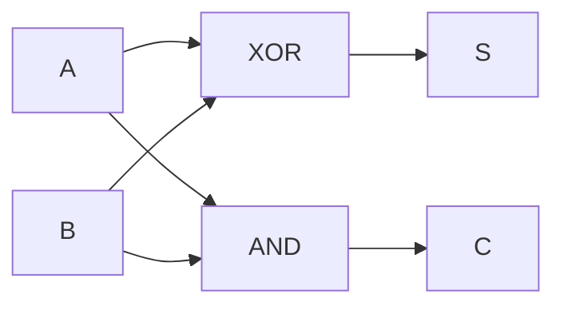
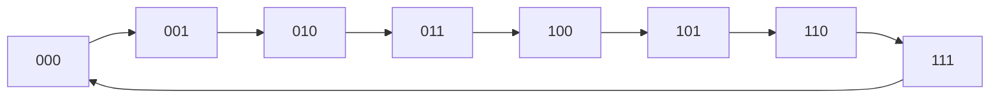

# Estructuras Discretas - Lógica matemática

## 2.2 Aplicaciones a circuitos digitales. Componentes básicos. Minimización de funciones booleanas. Contadores. Multiplexores.

---

En 1938 Claude Shannon mostró que los circuitos de interruptores obedecen exactamente las leyes de la lógica proposicional. Desde entonces, todo procesador se diseña escribiendo funciones lógicas y traduciéndolas a compuertas. En este subtema se ve esa traducción: el álgebra booleana como versión algebraica de la lógica, las compuertas básicas, la simplificación de funciones con mapas de Karnaugh y dos bloques fundamentales del hardware, el multiplexor y el contador.

### 1. Álgebra booleana

En diseño digital se escribe $1$ por verdadero y $0$ por falso, y los conectivos se denotan algebraicamente:

| Lógica              | Álgebra booleana   | Nombre de la compuerta |
| ------------------- | ------------------ | ---------------------- |
| $\neg A$            | $\overline{A}$     | NOT                    |
| $A \land B$         | $A \cdot B$ o $AB$ | AND                    |
| $A \lor B$          | $A + B$            | OR                     |
| $A \oplus B$        | $A \oplus B$       | XOR                    |
| $\neg(A \land B)$   | $\overline{AB}$    | NAND                   |
| $\neg(A \lor B)$    | $\overline{A + B}$ | NOR                    |

Con esta notación, las equivalencias del subtema 2.1 se escriben como identidades algebraicas. Las más usadas en simplificación son:

$$A + AB = A \qquad A + \overline{A}B = A + B \qquad AB + A\overline{B} = A \qquad \overline{AB} = \overline{A} + \overline{B} \qquad \overline{A + B} = \overline{A}\,\overline{B}$$

Hay que tener cuidado con dos diferencias respecto de la aritmética: $1 + 1 = 1$, y además vale la distributividad de la suma sobre el producto, $A + BC = (A + B)(A + C)$.

**Tablas de las compuertas de dos entradas:**

| $A$ | $B$ | AND | OR | XOR | NAND | NOR |
| --- | --- | --- | -- | --- | ---- | --- |
| 0   | 0   | 0   | 0  | 0   | 1    | 1   |
| 0   | 1   | 0   | 1  | 1   | 1    | 0   |
| 1   | 0   | 0   | 1  | 1   | 1    | 0   |
| 1   | 1   | 1   | 1  | 0   | 0    | 0   |

**Compuertas universales.** Con compuertas NAND solamente se puede construir cualquier circuito, pues:

$$\overline{A} = \overline{AA} \qquad AB = \overline{\overline{AB}} \qquad A + B = \overline{\overline{A}\,\overline{B}}$$

Lo mismo vale para NOR. Por eso los fabricantes de circuitos integrados pueden basar toda una tecnología en un solo tipo de compuerta.

### 2. De la tabla de verdad al circuito

Una **función booleana** de $n$ variables asigna 0 o 1 a cada una de las $2^n$ combinaciones de entrada. Hay $2^{2^n}$ funciones distintas de $n$ variables: 16 de dos variables y 256 de tres.

Un **minitérmino** es un producto que contiene cada variable una vez, negada o no, y vale 1 en exactamente una fila de la tabla. Toda función es la suma de los minitérminos de sus filas con valor 1: es su **forma canónica de suma de productos**, la forma normal disyuntiva del subtema 2.1. Se abrevia numerando las filas en binario: $f = \sum m(1, 3)$ significa que $f$ vale 1 en las filas 1 y 3.

**Ejemplo: el medio sumador.** Sumar dos bits $A$ y $B$ produce un bit de suma $S$ y un bit de acarreo $C$:

| $A$ | $B$ | $C$ | $S$ |
| --- | --- | --- | --- |
| 0   | 0   | 0   | 0   |
| 0   | 1   | 0   | 1   |
| 1   | 0   | 0   | 1   |
| 1   | 1   | 1   | 0   |

De la tabla, $S = \overline{A}B + A\overline{B} = A \oplus B$ y $C = AB$. El circuito necesita una compuerta XOR y una AND:



**El sumador completo** agrega un acarreo de entrada $C_{in}$:

$$S = A \oplus B \oplus C_{in} \qquad C_{out} = AB + C_{in}(A \oplus B)$$

Encadenando $n$ sumadores completos, conectando el $C_{out}$ de cada uno al $C_{in}$ del siguiente, se obtiene un sumador de números de $n$ bits. Así suma la unidad aritmética de un procesador.

### 3. Minimización de funciones booleanas

La forma canónica suele ser larga. Simplificarla reduce el número de compuertas, el costo, el consumo de energía y el retardo del circuito. La idea central es la identidad

$$XA + X\overline{A} = X$$

dos productos que difieren solo en una variable se combinan y esa variable desaparece.

#### 3.1 Mapas de Karnaugh

Un **mapa de Karnaugh** acomoda la tabla de verdad en una cuadrícula en la que celdas vecinas difieren en exactamente una variable. Para lograrlo, filas y columnas se ordenan en **código Gray**: $00, 01, 11, 10$. El mapa se considera cíclico: la primera y la última columna también son vecinas.

El procedimiento es:

1. Colocar un 1 en cada celda donde la función vale 1.
2. Agrupar los unos en rectángulos de $1, 2, 4, 8, \ldots$ celdas vecinas, lo más grandes posible, usando la menor cantidad de grupos que cubra todos los unos. Los grupos pueden traslaparse.
3. Cada grupo da un producto formado por las variables que **no cambian** dentro del grupo.

**Ejemplo con tres variables.** $f(A, B, C) = \sum m(1, 3, 5, 6, 7)$. Las columnas corresponden a $AB$ y las filas a $C$:

| $C$ \ $AB$ | 00 | 01 | 11 | 10 |
| ---------- | -- | -- | -- | -- |
| 0          | 0  | 0  | 1  | 0  |
| 1          | 1  | 1  | 1  | 1  |

La fila $C = 1$ completa es un grupo de 4 en el que solo $C$ se mantiene: da el término $C$. La celda $AB = 11$, $C = 0$ se agrupa con la de abajo, formando un grupo de 2 en el que $A = 1$ y $B = 1$ se mantienen: da $AB$. Resultado:

$$f = C + AB$$

La forma canónica tenía cinco productos de tres literales; la mínima tiene dos términos.

**Ejemplo con cuatro variables.** $g(A, B, C, D) = \sum m(0, 2, 5, 7, 8, 10, 13, 15)$, con columnas $CD$ y filas $AB$:

| $AB$ \ $CD$ | 00 | 01 | 11 | 10 |
| ----------- | -- | -- | -- | -- |
| 00          | 1  | 0  | 0  | 1  |
| 01          | 0  | 1  | 1  | 0  |
| 11          | 0  | 1  | 1  | 0  |
| 10          | 1  | 0  | 0  | 1  |

Las cuatro esquinas son vecinas entre sí por la ciclicidad del mapa: forman un grupo con $B = 0$ y $D = 0$, que da $\overline{B}\,\overline{D}$. Los cuatro unos del centro tienen $B = 1$ y $D = 1$, y dan $BD$. Por lo tanto

$$g = \overline{B}\,\overline{D} + BD = \overline{B \oplus D}$$

Las variables $A$ y $C$ resultaron irrelevantes.

**Condiciones indiferentes.** Si ciertas combinaciones de entrada nunca ocurren, por ejemplo los códigos 10 a 15 en un circuito que recibe dígitos decimales en binario, en esas celdas se escribe una $X$ y pueden tratarse como 0 o como 1, lo que convenga para formar grupos más grandes.

#### 3.2 Más allá de cuatro variables

Los mapas de Karnaugh son prácticos hasta cuatro variables, quizás cinco o seis. Para más, se usa el **método de Quine-McCluskey**, que hace la misma combinación de términos en forma de tabla y puede programarse. Encontrar la expresión mínima es, en general, un problema computacionalmente difícil, así que las herramientas industriales usan heurísticas como el algoritmo Espresso.

### 4. Multiplexores

Un **multiplexor** (MUX) de $2^k$ a 1 tiene $2^k$ entradas de datos, $k$ entradas de selección y una salida: copia a la salida la entrada de datos cuyo número, en binario, está en las líneas de selección. Es un interruptor controlado digitalmente.

**MUX 2 a 1:** con selección $S$ y datos $D_0$, $D_1$:

$$f = \overline{S}\,D_0 + S\,D_1$$

**MUX 4 a 1:** con selección $S_1 S_0$ y datos $D_0, \ldots, D_3$:

$$f = \overline{S_1}\,\overline{S_0}\,D_0 + \overline{S_1}\,S_0\,D_1 + S_1\,\overline{S_0}\,D_2 + S_1\,S_0\,D_3$$

Para cada valor de $S_1 S_0$ exactamente uno de los cuatro productos puede ser distinto de cero, y deja pasar la entrada correspondiente.

**Un MUX implementa cualquier función.** Si las variables de la función se conectan a las líneas de selección y en las entradas de datos se fijan los valores de su tabla de verdad, la salida es la función. Por ejemplo, XOR se implementa con un MUX 4 a 1 con $D_0 = 0$, $D_1 = 1$, $D_2 = 1$ y $D_3 = 0$. Por eso los dispositivos programables como los FPGA están formados por miles de pequeñas tablas de búsqueda que funcionan como multiplexores.

El circuito inverso, el **demultiplexor**, dirige una entrada hacia una de varias salidas, y el **decodificador** activa exactamente una de sus $2^k$ salidas según el número binario de su entrada. Los decodificadores seleccionan qué celda de memoria se lee a partir de su dirección.

### 5. Circuitos secuenciales y contadores

En un circuito **combinacional**, como los anteriores, la salida depende solo de las entradas actuales. En un circuito **secuencial** también depende de un **estado** guardado en elementos de memoria, de modo que la misma entrada puede producir salidas distintas en momentos distintos.

| Característica | Combinacional            | Secuencial                         |
| -------------- | ------------------------ | ---------------------------------- |
| Salida         | función de las entradas  | función de las entradas y el estado |
| Memoria        | no                       | sí, con flip-flops                 |
| Ejemplos       | sumadores, multiplexores | contadores, registros, procesadores |

El elemento de memoria básico es el **flip-flop D**: en cada pulso del reloj copia su entrada $D$ a su salida $Q$ y la conserva hasta el siguiente pulso. El diseño de un circuito secuencial consiste en escribir, para cada flip-flop, una función booleana que da su **siguiente estado** a partir del estado actual.

**Contador binario de 3 bits.** Recorre los estados $000, 001, 010, \ldots, 111$ y vuelve a $000$. Con flip-flops $Q_2 Q_1 Q_0$, al sumar 1 el bit menos significativo siempre cambia, y cada bit cambia cuando todos los bits menos significativos valen 1:

$$D_0 = \overline{Q_0} \qquad D_1 = Q_1 \oplus Q_0 \qquad D_2 = Q_2 \oplus (Q_1 Q_0)$$



```python
q2, q1, q0 = 0, 0, 0
for pulso in range(9):
    print(pulso, f"{q2}{q1}{q0}")
    d0 = 1 - q0
    d1 = q1 ^ q0
    d2 = q2 ^ (q1 & q0)
    q2, q1, q0 = d2, d1, d0       # todos los flip-flops cambian en el mismo pulso
```

La última línea actualiza los tres bits **a la vez**, como en un circuito síncrono, donde todos los flip-flops responden al mismo pulso de reloj. Si se actualizaran uno por uno, las ecuaciones usarían valores ya modificados y el contador fallaría.

**Contador módulo $N$.** Para contar de 0 a $N - 1$ con $N$ que no es potencia de 2, se detecta el estado $N - 1$ con una compuerta y se fuerza el regreso a 0. Un contador módulo 10 es la base de los relojes digitales y de los contadores de eventos.

> **Conexión con CC.** Los circuitos de este subtema se describen hoy con **lenguajes de descripción de hardware** como Verilog o VHDL, y herramientas de síntesis aplican automáticamente la minimización y la traducción a compuertas. Un procesador moderno tiene miles de millones de transistores, pero su diseño sigue partiendo de funciones booleanas, multiplexores para elegir operandos, sumadores para la aritmética y contadores como el contador de programa que indica la siguiente instrucción.

### Ejercicios propuestos

1. Demuestre que NOR es universal construyendo NOT, AND y OR solo con compuertas NOR.

2. Escriba la tabla de verdad del sumador completo y verifique las fórmulas de $S$ y $C_{out}$.

3. Minimice con un mapa de Karnaugh $f(A, B, C) = \sum m(0, 1, 2, 4, 5)$.

4. Minimice $g(A, B, C, D) = \sum m(1, 3, 5, 7, 9, 11, 13, 15)$. ¿Qué observa?

5. Implemente $f(A, B) = A \rightarrow B$ con un multiplexor 4 a 1, indicando qué valor va en cada entrada de datos.

6. Diseñe un contador de 2 bits que cuente hacia atrás: $11, 10, 01, 00, 11, \ldots$ Escriba las ecuaciones de $D_1$ y $D_0$ y simúlelo en Python.

7. Un circuito recibe un dígito decimal codificado en 4 bits, de 0000 a 1001, y debe encender una luz si el dígito es mayor o igual que 5. Use condiciones indiferentes para minimizarlo.

### Ver también

- **2.1** Lógica proposicional — las leyes de equivalencia son las identidades del álgebra booleana.
- **Álgebra Superior I 1.2** — operaciones con conjuntos, otra realización del álgebra booleana.
- **Introducción a las Ciencias de la Computación 1.2 y 1.5** — arquitectura de Von Neumann y representación digital de la información.
- **Organización y Arquitectura de Computadoras 3 y 4** (Sem. 4) — álgebra booleana, circuitos combinacionales y secuenciales a fondo.

### Referencias

- Harris, D. M., & Harris, S. L. (2013). _Digital Design and Computer Architecture_ (2.ª ed.). Morgan Kaufmann. Cap. 2 y 3.
- Mano, M. M., & Ciletti, M. D. (2017). _Digital Design_ (6.ª ed.). Pearson.
- Rosen, K. H. (2019). _Discrete Mathematics and Its Applications_ (8.ª ed.). McGraw-Hill. Cap. 12.
