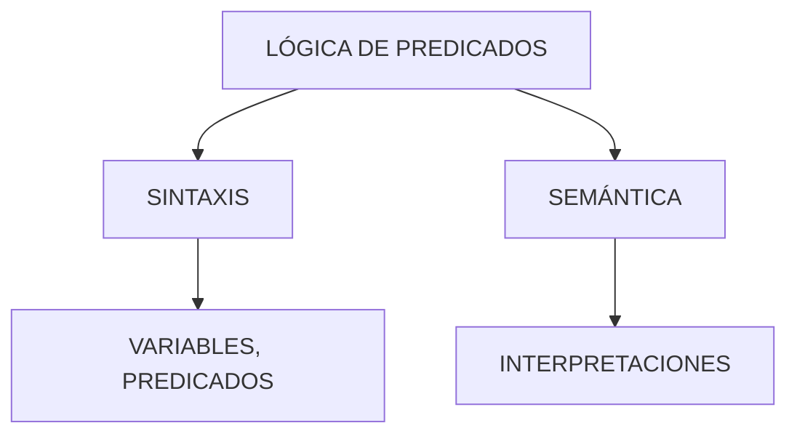

# Estructuras Discretas - Lógica Matemática

## 2.3 Introducción a la lógica de predicados: sintaxis, especificación formal, semántica informal en micromundos.

---

### 1. Definición Básica

La **lógica de predicados** (o lógica de primer orden) extiende la lógica proposicional introduciendo:

- **Variables**: $x, y, z$ (representan objetos)
- **Predicados**: $P(x), Q(x,y)$ (relaciones entre objetos)
- **Cuantificadores**:
  - $\forall$ (universal: "para todo")
  - $\exists$ (existencial: "existe")

**Ejemplo**:  
$\forall x \ (Perro(x) \rightarrow TieneCola(x))$

### 2. Sintaxis Formal

### Gramática BNF para Fórmulas Bien Formadas

```
<fórmula> ::= <átomo> | ¬<fórmula> | <fórmula>∧<fórmula> |
              ∀<variable><fórmula> | ∃<variable><fórmula>
<átomo> ::= <pred>(<término>,...)
<término> ::= <constante> | <variable>
```

### Componentes Clave:

- **Constantes**: $a, b$ (objetos específicos)
- **Funciones**: $f(x)$ (transforman términos)
- **Átomos**: $Padre(juan, pepe)$

### 3. Semántica Informal en Micromundos

### Ejemplo: Mundo de Bloques

- **Dominio**: {bloqueA, bloqueB, mesa}
- **Predicados**:
  - $Sobre(x,y)$ ( bloque $x$ está sobre $y$ )
  - $ColorRojo(x)$

**Fórmulas Válidas**:

1. $\exists x \ Sobre(x, mesa)$
2. $\forall x \ (ColorRojo(x) \rightarrow \neg Sobre(x, mesa))$

### 4. Especificación Formal

### Estructura de Interpretación $\mathcal{I} = (D, \cdot^\mathcal{I})$

- **Dominio $D$**: Conjunto no vacío ( ej. $D = \{1, 2, 3\}$ )
- **Interpretación de predicados**: $P^\mathcal{I} \subseteq D^n$

**Ejemplo**:

```
D = {1, 2, 3}
Par^I = {2}
Menor^I = {(1,2), (1,3), (2,3)}
```

### 5. Equivalencias Lógicas

1. $\neg \forall x P(x) \equiv \exists x \neg P(x)$
2. $\forall x (P(x) \land Q(x)) \equiv \forall x P(x) \land \forall x Q(x)$
3. $\exists x (P(x) \lor Q(x)) \equiv \exists x P(x) \lor \exists x Q(x)$

### 6. Ejemplo en Código (Python-like)

```python
def verifica_predicado(dominio, predicado):
    return all(predicado(x) for x in dominio)

### ¿Todos los números son pares?
print(verifica_predicado([2,4,6], lambda x: x%2==0))  # True
```

### 7. Aplicaciones

- Bases de datos (SQL: `SELECT * WHERE...`)
- Inteligencia Artificial (sistemas expertos)
- Verificación formal de software

### 8. Diagramas Conceptuales



### Recursos adicionales

- Libro recomendado: _Mathematical Logic for Computer Science_ — M. Ben-Ari

### Conclusión

La lógica de predicados permite representar conocimiento más allá de proposiciones simples, modelando relaciones y propiedades en contextos específicos. Su dominio es clave para el razonamiento formal en ciencias computacionales y matemáticas.

### Ver también

- **2.1** Lógica proposicional — lógica de predicados como extensión.
- **Lógica Computacional 3.1** (Sem. 4) — lógica de predicados en especificación formal.
- **Álgebra Superior I 2.1** — relaciones y predicados como análogos.

### Referencias

- Rosen, K. H. (2019). _Discrete Mathematics and Its Applications_ (8.ª ed.). McGraw-Hill. Cap. 1.
- Epp, S. S. (2011). _Discrete Mathematics with Applications_ (4.ª ed.). Brooks/Cole. Cap. 3.
