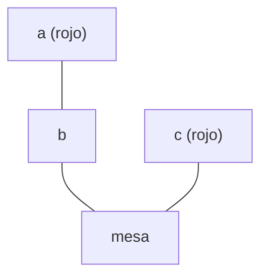

# Estructuras Discretas - Lógica matemática

## 2.3 Introducción a la lógica de predicados: sintaxis, especificación formal, semántica informal en micromundos.

---

La lógica proposicional trata cada enunciado como un bloque indivisible, y por eso no puede expresar el razonamiento más clásico: "todos los humanos son mortales, Sócrates es humano, luego Sócrates es mortal". Las tres proposiciones son distintas para ella, y ninguna regla las conecta. La **lógica de predicados**, o lógica de primer orden, abre los enunciados para hablar de objetos, de sus propiedades y relaciones, y de cuántos objetos cumplen algo. Es el lenguaje en que se escriben las especificaciones formales de programas y las consultas a bases de datos.

### 1. Los ingredientes

- **Dominio o universo:** el conjunto de objetos de los que se habla, como los números naturales, las personas o los bloques sobre una mesa.
- **Constantes:** nombres de objetos concretos, como $0$, $\mathit{socrates}$ o $a$.
- **Variables:** $x, y, z, \ldots$ que recorren el dominio.
- **Símbolos de función:** operaciones que producen objetos a partir de objetos, como $\mathit{suc}(x)$, $x + y$ o $\mathit{padre}(x)$.
- **Símbolos de predicado:** propiedades o relaciones que son verdaderas o falsas, como $\mathit{Humano}(x)$, $x < y$ o $\mathit{Sobre}(x, y)$.
- **Conectivos:** los de la lógica proposicional, $\neg, \land, \lor, \rightarrow, \leftrightarrow$.
- **Cuantificadores:** el **universal** $\forall x$, *para todo $x$*, y el **existencial** $\exists x$, *existe al menos un $x$*.

El razonamiento de Sócrates se escribe

$$\forall x\, (\mathit{Humano}(x) \rightarrow \mathit{Mortal}(x)), \quad \mathit{Humano}(\mathit{socrates}) \;\models\; \mathit{Mortal}(\mathit{socrates})$$

### 2. Sintaxis

La sintaxis tiene dos niveles, ambos definidos recursivamente.

**Términos**, que nombran objetos:

1. Toda constante y toda variable es un término.
2. Si $f$ es un símbolo de función de $n$ argumentos y $t_1, \ldots, t_n$ son términos, entonces $f(t_1, \ldots, t_n)$ es un término.

**Fórmulas**, que afirman algo:

1. Si $P$ es un símbolo de predicado de $n$ argumentos y $t_1, \ldots, t_n$ son términos, $P(t_1, \ldots, t_n)$ es una **fórmula atómica**. También lo es $t_1 = t_2$.
2. Si $\varphi$ y $\psi$ son fórmulas, también lo son $\neg \varphi$, $(\varphi \land \psi)$, $(\varphi \lor \psi)$, $(\varphi \rightarrow \psi)$ y $(\varphi \leftrightarrow \psi)$.
3. Si $\varphi$ es una fórmula y $x$ una variable, $\forall x\, \varphi$ y $\exists x\, \varphi$ son fórmulas.

```
<término> ::= <constante> | <variable> | <función>(<término>, ..., <término>)
<fórmula> ::= <predicado>(<término>, ..., <término>) | <término> = <término>
            | ¬<fórmula> | (<fórmula> ∧ <fórmula>) | (<fórmula> ∨ <fórmula>)
            | (<fórmula> → <fórmula>) | ∀<variable> <fórmula> | ∃<variable> <fórmula>
```

La diferencia es esencial: $\mathit{padre}(x)$ es un término y denota a una persona; $\mathit{Padre}(x, y)$ es una fórmula y afirma que $x$ es padre de $y$. Un término nunca es verdadero ni falso.

#### 2.1 Alcance, variables libres y ligadas

En $\forall x\, \varphi$, la fórmula $\varphi$ es el **alcance** del cuantificador. Una aparición de una variable es **ligada** si está en el alcance de un cuantificador sobre esa variable, y **libre** en otro caso.

**Ejemplo.** En $\exists y\, (x < y)$ la variable $y$ está ligada y $x$ está libre. La fórmula dice algo sobre $x$, *hay un número mayor que $x$*, y su verdad depende del valor de $x$. Una fórmula sin variables libres se llama **enunciado**: tiene un valor de verdad fijo una vez elegida la interpretación.

Las variables ligadas pueden renombrarse sin cambiar el significado: $\forall x\, P(x)$ y $\forall z\, P(z)$ dicen lo mismo, igual que los nombres de las variables locales de una función.

### 3. Semántica informal en micromundos

Para saber si un enunciado es verdadero hay que fijar una **interpretación**: un dominio no vacío y el significado de cada constante, función y predicado. Un **micromundo** es una interpretación pequeña y concreta en la que se puede verificar todo a mano.

**El mundo de bloques.** El dominio tiene tres bloques y una mesa, $D = \{a, b, c, \mathit{mesa}\}$. El bloque $a$ está sobre $b$, $b$ sobre la mesa y $c$ sobre la mesa. Los bloques $a$ y $c$ son rojos.



Los predicados se interpretan como conjuntos de objetos o de tuplas:

- $\mathit{Bloque} = \{a, b, c\}$
- $\mathit{Rojo} = \{a, c\}$
- $\mathit{Sobre} = \{(a, b), (b, \mathit{mesa}), (c, \mathit{mesa})\}$

Una fórmula atómica es verdadera si la tupla correspondiente pertenece al conjunto: $\mathit{Sobre}(a, b)$ es verdadera y $\mathit{Sobre}(b, a)$ es falsa. Para los cuantificadores:

- $\forall x\, \varphi(x)$ es verdadero si $\varphi$ es verdadera **para cada** objeto del dominio;
- $\exists x\, \varphi(x)$ es verdadero si $\varphi$ es verdadera **para al menos un** objeto.

| Enunciado                                                              | Lectura                                         | Valor |
| ---------------------------------------------------------------------- | ----------------------------------------------- | ----- |
| $\exists x\, \mathit{Sobre}(x, \mathit{mesa})$                          | algo está sobre la mesa                         | V     |
| $\forall x\, (\mathit{Rojo}(x) \rightarrow \mathit{Bloque}(x))$         | todo lo rojo es un bloque                       | V     |
| $\forall x\, (\mathit{Bloque}(x) \rightarrow \mathit{Rojo}(x))$         | todos los bloques son rojos                     | F, $b$ no es rojo |
| $\exists x\, (\mathit{Rojo}(x) \land \mathit{Sobre}(x, \mathit{mesa}))$ | hay un bloque rojo sobre la mesa                | V, $c$ |
| $\forall x\, (\mathit{Bloque}(x) \rightarrow \exists y\, \mathit{Sobre}(x, y))$ | todo bloque está sobre algo             | V     |
| $\exists x\, (\mathit{Bloque}(x) \land \neg \exists y\, \mathit{Sobre}(y, x))$ | hay un bloque sin nada encima           | V, $a$ y $c$ |

El mismo enunciado puede cambiar de valor al cambiar de mundo. Si se pinta de rojo el bloque $b$, el tercer enunciado se vuelve verdadero. Un enunciado verdadero en **todas** las interpretaciones se llama **válido**; es el análogo de las tautologías.

**Verificación en código.** En un dominio finito, $\forall$ es la función `all` y $\exists$ es `any`:

```python
D = ['a', 'b', 'c', 'mesa']
bloque = {'a', 'b', 'c'}
rojo = {'a', 'c'}
sobre = {('a', 'b'), ('b', 'mesa'), ('c', 'mesa')}

# Para todo x: Bloque(x) -> existe y: Sobre(x, y)
print(all((x not in bloque) or any((x, y) in sobre for y in D) for x in D))   # True

# Existe x: Bloque(x) y no existe y: Sobre(y, x)
print(any(x in bloque and not any((y, x) in sobre for y in D) for x in D))    # True
```

En dominios infinitos, como $\mathbb{N}$, no se puede verificar caso por caso: hay que demostrar.

### 4. Especificación formal

**Especificar** es traducir un enunciado en lenguaje natural a una fórmula precisa. Los patrones básicos son:

| Español                       | Fórmula                                                      |
| ----------------------------- | ------------------------------------------------------------ |
| Todos los $P$ son $Q$         | $\forall x\, (P(x) \rightarrow Q(x))$                        |
| Algún $P$ es $Q$              | $\exists x\, (P(x) \land Q(x))$                              |
| Ningún $P$ es $Q$             | $\forall x\, (P(x) \rightarrow \neg Q(x))$                   |
| No todos los $P$ son $Q$      | $\exists x\, (P(x) \land \neg Q(x))$                         |
| Hay exactamente un $P$        | $\exists x\, (P(x) \land \forall y\, (P(y) \rightarrow y = x))$ |

**Un error frecuente.** "Algún perro ladra" **no** es $\exists x\, (\mathit{Perro}(x) \rightarrow \mathit{Ladra}(x))$. Esa fórmula es verdadera en cuanto existe algo que no es perro, porque una implicación con antecedente falso es verdadera. Con $\exists$ va la conjunción; con $\forall$ va la implicación.

**Especificaciones de programas.** Sea $A$ un arreglo de longitud $n$ con posiciones $0, \ldots, n-1$:

- $A$ está ordenado de menor a mayor: $\forall i\, (0 \leq i < n - 1 \rightarrow A[i] \leq A[i+1])$.
- $m$ es el máximo de $A$: $\exists i\, (0 \leq i < n \land A[i] = m) \land \forall j\, (0 \leq j < n \rightarrow A[j] \leq m)$.
- $A$ no tiene elementos repetidos: $\forall i\, \forall j\, (0 \leq i < n \land 0 \leq j < n \land i \neq j \rightarrow A[i] \neq A[j])$.

Escribir así lo que un programa debe cumplir elimina la ambigüedad del lenguaje natural y permite verificarlo con herramientas automáticas.

### 5. Equivalencias con cuantificadores

**Negación de cuantificadores** (leyes de De Morgan generalizadas):

$$\neg \forall x\, \varphi \equiv \exists x\, \neg \varphi \qquad \neg \exists x\, \varphi \equiv \forall x\, \neg \varphi$$

Para refutar que *todos los $x$ cumplen $\varphi$* basta un contraejemplo. Para negar *existe un $x$ que cumple $\varphi$* hay que mostrar que ninguno lo cumple.

**Ejemplo.** La negación de "todo estudiante aprobó algún examen", $\forall x\, (E(x) \rightarrow \exists y\, A(x, y))$, se calcula empujando la negación hacia adentro:

$$\exists x\, (E(x) \land \forall y\, \neg A(x, y))$$

es decir, "hay un estudiante que no aprobó ningún examen".

**Distribución.** El cuantificador universal distribuye sobre $\land$ y el existencial sobre $\lor$:

$$\forall x\, (\varphi \land \psi) \equiv \forall x\, \varphi \land \forall x\, \psi \qquad \exists x\, (\varphi \lor \psi) \equiv \exists x\, \varphi \lor \exists x\, \psi$$

Pero **no** al revés: "todo número es par o impar" es verdadero, mientras que "todo número es par o todo número es impar" es falso.

**Orden de los cuantificadores.** Cuantificadores del mismo tipo conmutan, pero $\forall$ y $\exists$ no. En $\mathbb{N}$:

- $\forall x\, \exists y\, (x < y)$: para cada número hay uno mayor. **Verdadero**, pues basta $y = x + 1$, que depende de $x$.
- $\exists y\, \forall x\, (x < y)$: hay un número mayor que todos. **Falso**.

En el primero el $y$ puede elegirse después de conocer $x$. En el segundo debe servir uno solo para todos.

> **Conexión con CC.** El lenguaje SQL es esencialmente lógica de predicados sobre un dominio finito: la cláusula `WHERE` es una fórmula, `EXISTS` es el cuantificador existencial, y "todos" se expresa con la doble negación `NOT EXISTS ... NOT EXISTS`, aplicando las leyes de esta sección. Los asistentes de demostración y los verificadores de programas, como Dafny, permiten escribir especificaciones como las de la sección 4 y comprueban automáticamente que el código las cumple.

### Ejercicios propuestos

1. En la fórmula $\forall x\, (P(x, y) \rightarrow \exists y\, Q(x, y))$, identifique qué apariciones de cada variable son libres y cuáles ligadas.

2. Evalúe en el mundo de bloques:
   - (a) $\forall x\, (\mathit{Rojo}(x) \rightarrow \exists y\, \mathit{Sobre}(x, y))$
   - (b) $\exists x\, \exists y\, (\mathit{Sobre}(x, y) \land \mathit{Rojo}(y))$
   - (c) $\forall x\, \neg \mathit{Sobre}(x, x)$

3. Traduzca a lógica de predicados, con el dominio y los predicados que considere necesarios:
   - (a) Todo número par mayor que 2 es suma de dos primos.
   - (b) Ningún programa con errores pasa todas las pruebas.
   - (c) Cada estudiante tiene exactamente un número de cuenta.

4. Escriba la negación de *para todo $\varepsilon > 0$ existe $\delta > 0$ tal que para todo $x$, si $|x| < \delta$ entonces $|f(x)| < \varepsilon$*, empujando la negación hasta los predicados atómicos.

5. Escriba la especificación de *el arreglo $B$ es una permutación del arreglo $A$* usando el predicado $\mathit{cuenta}(A, v)$, que da el número de veces que aparece $v$ en $A$.

6. Construya un micromundo en el que $\forall x\, \exists y\, R(x, y)$ sea verdadero pero $\exists y\, \forall x\, R(x, y)$ sea falso, y verifíquelo con código.

### Ver también

- **2.1** Lógica proposicional — conectivos, interpretaciones y equivalencias que aquí se generalizan.
- **3.1** Los números naturales — los axiomas de Peano son enunciados de primer orden.
- **4.1** Relaciones — los predicados de dos argumentos son relaciones binarias.
- **Álgebra Superior I 1.1** — las definiciones por comprensión usan predicados.
- **Lógica Computacional 3.1 a 3.5** (Sem. 4) — sintaxis y semántica formal de la lógica de primer orden.
- **Fundamentos de Bases de Datos** (Sem. 5) — cálculo relacional y SQL.

### Referencias

- Rosen, K. H. (2019). _Discrete Mathematics and Its Applications_ (8.ª ed.). McGraw-Hill. Secciones 1.4 y 1.5.
- Barwise, J., & Etchemendy, J. (2002). _Language, Proof and Logic_. CSLI. (Introduce la lógica con micromundos de bloques.)
- Ben-Ari, M. (2012). _Mathematical Logic for Computer Science_ (3.ª ed.). Springer. Cap. 7.
- Huth, M., & Ryan, M. (2004). _Logic in Computer Science_ (2.ª ed.). Cambridge University Press. Cap. 2.
