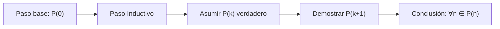

# Estructuras Discretas - Inducción y recursión

## 3.1 Los números naturales: axiomas de Peano, principios de inducción.

---

### 1. Axiomas de Peano

Los **números naturales** $(\mathbb{N})$ se definen mediante 5 axiomas fundamentales:

1. **Cero es natural**: $0 \in \mathbb{N}$
2. **Sucesor**: Todo $n \in \mathbb{N}$ tiene un sucesor $S(n) \in \mathbb{N}$
3. **Inyectividad**: Si $S(n) = S(m)$ entonces $n = m$
4. **Cero no es sucesor**: $\nexists n \in \mathbb{N} \mid S(n) = 0$
5. **Inducción**: Si $0 \in A$ y $n \in A \Rightarrow S(n) \in A$, entonces $A = \mathbb{N}$

**Ejemplo de recursión**:  
Definición de suma:

- $n + 0 = n$
- $n + S(m) = S(n + m)$

### 2. Principio de Inducción Matemática

#### Forma Estándar

Para probar $\forall n \in \mathbb{N} \ P(n)$:

1. **Base**: Probar $P(0)$
2. **Paso inductivo**: Asumir $P(k)$ (H.I.) y probar $P(k+1)$

**Ejemplo**:  
Demostrar que $1 + 2 + \cdots + n = \frac{n(n+1)}{2}$:

1. **Base**: $n=1 \Rightarrow 1 = \frac{1 \cdot 2}{2}$ ✓
2. **Paso**:

$$ \underbrace{1 + \cdots + k}_{= \frac{k(k+1)}{2}} + (k+1) = \frac{(k+1)(k+2)}{2} $$

#### Inducción Fuerte

Variante donde se asume $\forall m < k \ P(m)$ para probar $P(k)$.

### 3. Implementación Recursiva

```python
def factorial(n):
    if n == 0:  # Caso base
        return 1
    else:       # Paso recursivo
        return n * factorial(n-1)
```

### 4. Teoremas Clave

- **Existencia y unicidad**: Las definiciones recursivas son válidas (Teorema de Recursión).
- **Equivalencia**: Inducción simple ⇔ Inducción fuerte ⇐⇒ Buen orden ( $\mathbb{N}$ es bien ordenado ).

### 5. Ejemplo Avanzado

**Problema**: Torres de Hanoi ($n$ discos requieren $2^n - 1$ movimientos).  
**Demostración por inducción**:

1. **Base**: $n=1 \Rightarrow 1$ movimiento.
2. **Paso**:
   - Mover $k$ discos: $T(k) = 2T(k-1) + 1$
   - Hipótesis: $T(k) = 2^k - 1$

### 6. Diagrama de Inducción



### 7. Aplicaciones

- Algoritmos recursivos (ej: mergesort).
- Estructuras de datos (árboles, grafos).
- Análisis de complejidad.

### Recursos Adicionales

- Libro: "Concrete Mathematics" - Graham, Knuth, Patashnik.
- Herramientas: Coq (asistente de pruebas formales).

### Ver también

- **Álgebra Superior I 3.1** — axiomas de Peano e inducción desde la perspectiva algebraica.
- **3.2** Definiciones recursivas — la recursión como espejo de la inducción.
- **3.3** Inducción estructural — generalización de la inducción numérica.

### Referencias

- Rosen, K. H. (2019). _Discrete Mathematics and Its Applications_ (8.ª ed.). McGraw-Hill. Cap. 5.
- Epp, S. S. (2011). _Discrete Mathematics with Applications_ (4.ª ed.). Brooks/Cole. Cap. 5.
