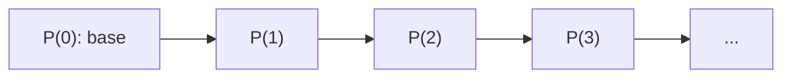

# Estructuras Discretas - Inducción y recursión

## 3.1 Los números naturales: axiomas de Peano, principios de inducción.

---

Los números naturales son la estructura discreta por excelencia: empiezan en un punto y avanzan de uno en uno, sin saltos ni regresos. Giuseppe Peano mostró en 1889 que toda la aritmética puede construirse a partir de un cero, una operación de sucesor y un principio de inducción. Esa construcción es exactamente la que usa la computación: los naturales se definen como un tipo de datos recursivo, sus operaciones como funciones recursivas, y sus propiedades se demuestran por inducción. En este curso, a diferencia de Álgebra Superior I, se toma $\mathbb{N} = \{0, 1, 2, \ldots\}$, la convención habitual en computación.

### 1. Axiomas de Peano

Los naturales son un conjunto $\mathbb{N}$ con un elemento distinguido $0$ y una función **sucesor** $S: \mathbb{N} \to \mathbb{N}$ que cumplen:

1. $0 \in \mathbb{N}$.
2. Si $n \in \mathbb{N}$, entonces $S(n) \in \mathbb{N}$.
3. $0$ no es sucesor de ningún natural: $S(n) \neq 0$ para todo $n$.
4. $S$ es inyectiva: si $S(n) = S(m)$, entonces $n = m$.
5. **Inducción:** si $A \subseteq \mathbb{N}$ cumple $0 \in A$ y, para todo $n$, $n \in A$ implica $S(n) \in A$, entonces $A = \mathbb{N}$.

Se escribe $1 = S(0)$, $2 = S(S(0))$, y así sucesivamente. Cada axioma descarta una "falsa" versión de los naturales:

| Sin el axioma | Estructura que lo satisface todo lo demás                    |
| ------------- | ------------------------------------------------------------ |
| 3             | un ciclo, como un reloj: $0 \to 1 \to 2 \to 0$               |
| 4             | una cadena que se une a sí misma: $0 \to 1 \to 2 \to 3 \to 2$ |
| 5             | $\mathbb{N}$ más una copia extra de $\mathbb{Z}$ "al final", que nunca se alcanza desde 0 |

El axioma de inducción es el que garantiza que **todo** natural se alcanza desde $0$ aplicando el sucesor un número finito de veces.

**Los naturales como tipo de datos.** En un lenguaje funcional, los axiomas se convierten en una declaración de tipo:

```typescript
type Nat = { tipo: 'cero' } | { tipo: 'suc'; pred: Nat };

const cero: Nat = { tipo: 'cero' };
const suc = (n: Nat): Nat => ({ tipo: 'suc', pred: n });
const dos = suc(suc(cero));
```

Los axiomas 3 y 4 se cumplen automáticamente porque los dos constructores producen valores distintos y `suc` guarda su argumento. El axioma 5 corresponde a que todo valor de tipo `Nat` se construye en un número finito de pasos.

### 2. Definiciones recursivas de la aritmética

**Teorema de recursión.** Dados un valor $a$ y una función $g$, existe una única función $f: \mathbb{N} \to \mathbb{N}$ tal que

$$f(0) = a \qquad f(S(n)) = g(n, f(n))$$

Es decir, para definir una función en todos los naturales basta decir cuánto vale en $0$ y cómo obtener su valor en $S(n)$ a partir del valor en $n$. Así se definen las operaciones:

$$
\begin{aligned}
m + 0 &= m & m + S(n) &= S(m + n) \\
m \cdot 0 &= 0 & m \cdot S(n) &= m \cdot n + m \\
m^0 &= 1 & m^{S(n)} &= m^n \cdot m
\end{aligned}
$$

**Ejemplo de cálculo.** $2 + 2 = 2 + S(1) = S(2 + 1) = S(2 + S(0)) = S(S(2 + 0)) = S(S(2)) = 4$.

```python
def suma(m, n):
    return m if n == 0 else suma(m, n - 1) + 1          # m + S(k) = S(m + k)

def producto(m, n):
    return 0 if n == 0 else suma(producto(m, n - 1), m)  # m * S(k) = m * k + m
```

**Demostrar con las definiciones.** Las propiedades de la aritmética, que se usan desde la primaria, se convierten en teoremas. Por ejemplo, la definición dice que $m + 0 = m$, pero no que $0 + m = m$. Esto hay que demostrarlo por inducción sobre $m$:

- *Base:* $0 + 0 = 0$ por la definición.
- *Paso:* si $0 + k = k$, entonces $0 + S(k) = S(0 + k) = S(k)$.

Con la misma técnica se demuestran la asociatividad y la conmutatividad de la suma y del producto, y la distributividad.

### 3. Principio de inducción

Del axioma 5, tomando $A = \{n \in \mathbb{N} \mid P(n)\}$, se obtiene el principio usado en las demostraciones:

> Si $P(0)$ es verdadera y para todo $k \in \mathbb{N}$ se cumple $P(k) \rightarrow P(k + 1)$, entonces $P(n)$ es verdadera para todo $n \in \mathbb{N}$.

En lógica de predicados:

$$\big(P(0) \land \forall k\, (P(k) \rightarrow P(k+1))\big) \rightarrow \forall n\, P(n)$$

La suposición $P(k)$ dentro del paso se llama **hipótesis de inducción**.



Cada flecha es una instancia del paso inductivo: como fichas de dominó, la base derriba la primera y el paso garantiza que cada una derriba a la siguiente.

**Ejemplo: Torres de Hanoi.** Hay que pasar $n$ discos de un poste a otro, moviendo uno a la vez y sin poner nunca un disco sobre otro más pequeño. Para mover $n$ discos se mueven los $n - 1$ de arriba al poste auxiliar, luego el más grande a su destino, y después los $n - 1$ encima de él. Si $T(n)$ es el número de movimientos:

$$T(0) = 0 \qquad T(n + 1) = 2T(n) + 1$$

*Afirmación:* $T(n) = 2^n - 1$ para todo $n \geq 0$.

- *Base:* $T(0) = 0 = 2^0 - 1$.
- *Paso:* si $T(k) = 2^k - 1$, entonces $T(k+1) = 2(2^k - 1) + 1 = 2^{k+1} - 1$. $\square$

Con 64 discos, la leyenda dice que el mundo terminará al completar la tarea: a un movimiento por segundo tomaría unos 585 mil millones de años.

### 4. Variantes del principio

**Base distinta de cero.** Si $P(n_0)$ es verdadera y $P(k) \rightarrow P(k+1)$ para todo $k \geq n_0$, entonces $P(n)$ vale para todo $n \geq n_0$. Por ejemplo, $2^n > n^2$ es falso para $n = 2, 3, 4$ pero verdadero para todo $n \geq 5$.

**Inducción fuerte.** Si para todo $k$ se cumple que

$$\big(\forall m < k,\; P(m)\big) \rightarrow P(k)$$

entonces $P(n)$ vale para todo $n$. Aquí la hipótesis es que la propiedad vale para **todos** los anteriores, no solo para el inmediato. No hace falta un caso base separado: para $k = 0$ la hipótesis es vacía y hay que probar $P(0)$ sin ayuda.

*Ejemplo.* Todo natural $n \geq 1$ puede escribirse como suma de potencias de 2 distintas, que es su representación binaria. Si $n$ es par, $n = 2m$ con $m < n$, y basta duplicar cada potencia de la representación de $m$. Si $n$ es impar, $n = 2m + 1$ y se agrega $2^0$ a la representación duplicada de $m$. Ambos casos usan la hipótesis para $m = \lfloor n/2 \rfloor$, que no es el inmediato anterior.

**Principio del buen orden.** Todo subconjunto no vacío de $\mathbb{N}$ tiene un mínimo. Se usa en demostraciones por **contraejemplo mínimo**: si $P$ fallara, habría un menor $n$ en el que falla, y se deduce una contradicción.

Los tres principios, inducción simple, inducción fuerte y buen orden, son **equivalentes**: cada uno se demuestra a partir de cualquiera de los otros. Se elige el que haga más natural la demostración.

### 5. Inducción y corrección de programas

Para demostrar que un ciclo es correcto se usa un **invariante**: una afirmación que vale antes de la primera iteración y que cada iteración conserva. Que valga después de cualquier número de iteraciones es exactamente una demostración por inducción sobre el número de iteraciones.

```python
def potencia(b, e):
    resultado, i = 1, 0
    # Invariante: resultado == b ** i  y  0 <= i <= e
    while i < e:
        resultado *= b
        i += 1
    return resultado      # al salir, i == e, luego resultado == b ** e
```

- *Base:* antes del ciclo, `resultado` $= 1 = b^0$ e `i` $= 0$.
- *Paso:* si `resultado` $= b^i$ al iniciar una iteración, al terminarla vale $b^i \cdot b = b^{i+1}$, y la variable `i` también aumentó en 1.
- *Terminación:* la cantidad $e - i$ es un natural que disminuye en cada iteración, y por el buen orden no puede disminuir indefinidamente.

> **Conexión con CC.** Los asistentes de demostración como Coq, Lean e Isabelle definen los naturales exactamente con los axiomas de Peano y generan automáticamente el principio de inducción a partir de la definición del tipo. Con ellos se han verificado formalmente compiladores completos, como CompCert, y sistemas operativos, como seL4.

### Ejercicios propuestos

1. Calcule $2 \cdot 3$ usando únicamente las definiciones recursivas de la suma y el producto, mostrando cada paso.

2. Demuestre por inducción que $S(m) + n = S(m + n)$ y úselo para demostrar que $m + n = n + m$.

3. Demuestre que $1 + 3 + 5 + \cdots + (2n - 1) = n^2$ para todo $n \geq 1$.

4. Demuestre por inducción que $n^3 - n$ es divisible entre 6 para todo $n \in \mathbb{N}$.

5. Demuestre que $2^n > n^2$ para todo $n \geq 5$. ¿Dónde se usa que $n \geq 5$ en el paso inductivo?

6. Con $F_0 = 0$, $F_1 = 1$ y $F_{n+2} = F_{n+1} + F_n$, demuestre por inducción fuerte que $F_n < \left(\frac{5}{3}\right)^n$ para todo $n \geq 1$.

7. Escriba un invariante para el siguiente ciclo y demuestre que la función regresa $1 + 2 + \cdots + n$:

```python
def suma_hasta(n):
    s, i = 0, 0
    while i < n:
        i += 1
        s += i
    return s
```

### Ver también

- **2.3** Lógica de predicados — el principio de inducción es un enunciado de primer orden.
- **3.2** Definiciones recursivas — el teorema de recursión generalizado a listas y árboles.
- **3.3** Inducción estructural — la inducción para estructuras distintas de $\mathbb{N}$.
- **Álgebra Superior I 3.1** — el principio de inducción con ejemplos algebraicos.
- **Estructuras de Datos 3.1** (Sem. 2) — demostraciones de corrección basadas en invariantes.

### Referencias

- Rosen, K. H. (2019). _Discrete Mathematics and Its Applications_ (8.ª ed.). McGraw-Hill. Cap. 5.
- Lehman, E., Leighton, F. T., & Meyer, A. R. (2017). _Mathematics for Computer Science_. MIT. Cap. 5.
- Graham, R., Knuth, D., & Patashnik, O. (1994). _Concrete Mathematics_ (2.ª ed.). Addison-Wesley. Cap. 1.
- Pierce, B. C., et al. (2024). _Software Foundations, Vol. 1: Logical Foundations_. (Libro en línea con Coq.)
