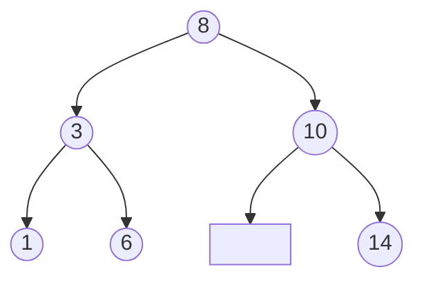

# Estructuras Discretas - Inducción y recursión

## 3.2 Definiciones recursivas: definición de conjuntos y funciones mediante uso de patrones, ejemplos con estructuras de datos no numéricas (listas, árboles, expresiones lógicas, etc.).

---

Los naturales del subtema 3.1 son solo el primer ejemplo de una idea muy general: un conjunto infinito puede describirse con un número finito de reglas que dicen cómo construir sus elementos a partir de otros más simples. Las listas, los árboles, las fórmulas lógicas y los programas mismos se definen así. Y una vez que se sabe cómo se construyen los elementos, las funciones sobre ellos se definen dando una ecuación por cada forma posible del argumento, es decir, por **patrones**.

### 1. Definición recursiva de conjuntos

Una **definición recursiva** de un conjunto $A$ consta de:

1. **Cláusulas base:** ciertos elementos pertenecen a $A$.
2. **Cláusulas recursivas:** reglas que, a partir de elementos de $A$, producen nuevos elementos de $A$.
3. **Cláusula de cierre:** nada más pertenece a $A$. Es decir, $A$ es el **menor** conjunto que satisface las cláusulas 1 y 2.

La cláusula de cierre suele omitirse, pero es esencial: sin ella, el conjunto de todos los enteros también "satisface" la definición de los naturales pares dada a continuación.

**Ejemplo: los naturales pares.** $0 \in P$, y si $n \in P$ entonces $n + 2 \in P$.

**Ejemplo: las cadenas sobre un alfabeto $\Sigma$.** La cadena vacía $\varepsilon \in \Sigma^*$, y si $w \in \Sigma^*$ y $a \in \Sigma$, entonces $aw \in \Sigma^*$.

**Ejemplo: los palíndromos sobre $\Sigma$.**

- $\varepsilon$ es palíndromo, y cada símbolo $a \in \Sigma$ también.
- Si $w$ es palíndromo y $a \in \Sigma$, entonces $awa$ es palíndromo.

Así, $abba$ es palíndromo porque $\varepsilon$ lo es, luego $b\varepsilon b = bb$, luego $abba$. Esta definición es exactamente la gramática $S \rightarrow aSa \mid bSb \mid a \mid b \mid \varepsilon$ del subtema 1.3: las gramáticas son definiciones recursivas de lenguajes.

**Ejemplo: un conjunto de puntos.** El menor conjunto $S \subseteq \mathbb{N}^2$ con $(0, 0) \in S$ y tal que $(a, b) \in S$ implica $(a + 1, b + 1) \in S$ y $(a + 2, b) \in S$. Sus elementos son exactamente los pares con $a \geq b$ y $a - b$ par, lo cual se demuestra con la inducción estructural del subtema 3.3.

### 2. Listas

Una **lista** de elementos de un conjunto $X$ se define así:

- $[\,]$, la lista vacía, es una lista.
- Si $x \in X$ y $\ell$ es una lista, entonces $x :: \ell$ es una lista, cuya **cabeza** es $x$ y cuya **cola** es $\ell$.

El operador $::$ se llama *cons*. La lista $[1, 2, 3]$ es una abreviatura de $1 :: (2 :: (3 :: [\,]))$.

Toda lista tiene **exactamente una** de las dos formas, vacía o $x :: \ell$, y en el segundo caso $x$ y $\ell$ están determinados. Eso permite definir funciones dando una ecuación por cada forma, lo que se llama **definición por patrones**:

$$
\begin{aligned}
\mathit{long}([\,]) &= 0 & \mathit{long}(x :: \ell) &= 1 + \mathit{long}(\ell) \\
\mathit{suma}([\,]) &= 0 & \mathit{suma}(x :: \ell) &= x + \mathit{suma}(\ell) \\
[\,] \mathbin{+\!\!+} m &= m & (x :: \ell) \mathbin{+\!\!+} m &= x :: (\ell \mathbin{+\!\!+} m) \\
\mathit{rev}([\,]) &= [\,] & \mathit{rev}(x :: \ell) &= \mathit{rev}(\ell) \mathbin{+\!\!+} [x]
\end{aligned}
$$

donde $\mathbin{+\!\!+}$ es la concatenación de listas.

**Evaluación paso a paso:**

$$
\mathit{rev}([1, 2]) = \mathit{rev}([2]) \mathbin{+\!\!+} [1] = (\mathit{rev}([\,]) \mathbin{+\!\!+} [2]) \mathbin{+\!\!+} [1] = [2] \mathbin{+\!\!+} [1] = [2, 1]
$$

En Python, a partir de la versión 3.10, la instrucción `match` permite escribir las definiciones con la misma forma:

```python
def longitud(lista):
    match lista:
        case []:
            return 0
        case [x, *cola]:
            return 1 + longitud(cola)

def reversa(lista):
    match lista:
        case []:
            return []
        case [x, *cola]:
            return reversa(cola) + [x]

print(longitud([4, 7, 1]), reversa([1, 2, 3]))   # 3 [3, 2, 1]
```

### 3. Árboles binarios

Un **árbol binario** con etiquetas en $X$ se define así:

- $\textsf{vacío}$ es un árbol binario.
- Si $T_1$ y $T_2$ son árboles binarios y $x \in X$, entonces $\textsf{nodo}(T_1, x, T_2)$ es un árbol binario, con subárbol izquierdo $T_1$, raíz $x$ y subárbol derecho $T_2$.



El árbol del dibujo es $\textsf{nodo}(\textsf{nodo}(\textsf{nodo}(\textsf{vacío}, 1, \textsf{vacío}), 3, \textsf{nodo}(\textsf{vacío}, 6, \textsf{vacío})), 8, \textsf{nodo}(\textsf{vacío}, 10, \textsf{nodo}(\textsf{vacío}, 14, \textsf{vacío})))$. El recuadro vacío indica que el 10 no tiene hijo izquierdo.

Funciones definidas por patrones:

$$
\begin{aligned}
\mathit{tam}(\textsf{vacío}) &= 0 & \mathit{tam}(\textsf{nodo}(T_1, x, T_2)) &= 1 + \mathit{tam}(T_1) + \mathit{tam}(T_2) \\
\mathit{alt}(\textsf{vacío}) &= -1 & \mathit{alt}(\textsf{nodo}(T_1, x, T_2)) &= 1 + \max(\mathit{alt}(T_1), \mathit{alt}(T_2)) \\
\mathit{inorden}(\textsf{vacío}) &= [\,] & \mathit{inorden}(\textsf{nodo}(T_1, x, T_2)) &= \mathit{inorden}(T_1) \mathbin{+\!\!+} [x] \mathbin{+\!\!+} \mathit{inorden}(T_2)
\end{aligned}
$$

Con la convención $\mathit{alt}(\textsf{vacío}) = -1$, un árbol de un solo nodo tiene altura 0. Para el árbol del dibujo, $\mathit{tam} = 6$, $\mathit{alt} = 2$ y el recorrido en inorden es $[1, 3, 6, 8, 10, 14]$: está ordenado porque es un **árbol binario de búsqueda**.

```typescript
type Arbol<T> = { tipo: 'vacio' } | { tipo: 'nodo'; izq: Arbol<T>; valor: T; der: Arbol<T> };

function altura<T>(a: Arbol<T>): number {
  switch (a.tipo) {
    case 'vacio': return -1;
    case 'nodo':  return 1 + Math.max(altura(a.izq), altura(a.der));
  }
}
```

TypeScript verifica que el `switch` cubra los dos casos del tipo: si se agregara una tercera forma de árbol, el compilador señalaría que falta un patrón.

### 4. Expresiones lógicas

Las fórmulas proposicionales del subtema 2.1 se definieron recursivamente, y por eso las funciones sobre ellas también se definen por patrones. Un **intérprete** evalúa una fórmula dada una asignación $v$ de valores de verdad:

$$
\begin{aligned}
\mathit{eval}(p, v) &= v(p) \\
\mathit{eval}(\neg \varphi, v) &= \text{no } \mathit{eval}(\varphi, v) \\
\mathit{eval}(\varphi \land \psi, v) &= \mathit{eval}(\varphi, v) \text{ y } \mathit{eval}(\psi, v) \\
\mathit{eval}(\varphi \lor \psi, v) &= \mathit{eval}(\varphi, v) \text{ o } \mathit{eval}(\psi, v)
\end{aligned}
$$

Otras funciones útiles son el número de conectivos, el conjunto de variables que aparecen y la **profundidad**, es decir, la altura del árbol sintáctico.

```python
from dataclasses import dataclass

@dataclass
class Var:  nombre: str
@dataclass
class No:   f: object
@dataclass
class Y:    izq: object; der: object
@dataclass
class O:    izq: object; der: object

def evalua(f, v):
    match f:
        case Var(n):    return v[n]
        case No(g):     return not evalua(g, v)
        case Y(a, b):   return evalua(a, v) and evalua(b, v)
        case O(a, b):   return evalua(a, v) or evalua(b, v)

def variables(f):
    match f:
        case Var(n):    return {n}
        case No(g):     return variables(g)
        case Y(a, b) | O(a, b):
            return variables(a) | variables(b)

formula = Y(O(No(Var('p')), Var('q')), Var('r'))      # (¬p ∨ q) ∧ r
print(evalua(formula, {'p': True, 'q': False, 'r': True}))   # False
print(variables(formula))                                      # {'p', 'q', 'r'}
```

Este patrón, un tipo con una variante por regla de construcción y funciones con un caso por variante, es el **árbol de sintaxis abstracta** que usan todos los compiladores e intérpretes.

### 5. Cuándo una definición recursiva está bien hecha

Para que una definición por patrones defina realmente una función, se necesita:

- **Exhaustividad:** que haya un caso para cada forma posible del argumento.
- **Reducción:** que cada llamada recursiva se haga sobre una parte **estrictamente más pequeña** del argumento, como la cola de una lista o un subárbol. Esto garantiza que el cálculo termina.
- **Construcción única:** que cada elemento se construya de una sola manera, para que no haya dos ecuaciones aplicables con resultados distintos.

**Un contraejemplo.** La "definición" $f(n) = f(n + 1) + 1$ no define ninguna función de $\mathbb{N}$ en $\mathbb{N}$: la llamada recursiva es sobre un argumento mayor. Y la regla $g(n) = 1 + g(n / 2)$ con $g(0) = 0$ falla con $n$ impar si se usa división exacta, porque el argumento deja de ser natural.

### 6. Recursión mutua

A veces dos conjuntos o funciones se definen uno en términos del otro. Por ejemplo, para decidir la paridad de la longitud de una lista:

$$
\begin{aligned}
\mathit{par}([\,]) &= \mathit{verdadero} & \mathit{par}(x :: \ell) &= \mathit{impar}(\ell) \\
\mathit{impar}([\,]) &= \mathit{falso} & \mathit{impar}(x :: \ell) &= \mathit{par}(\ell)
\end{aligned}
$$

La recursión mutua aparece de forma natural en las gramáticas, donde una expresión puede contener términos y un término puede contener una expresión entre paréntesis, como en la gramática no ambigua del subtema 1.3.

> **Conexión con CC.** Los formatos de datos más usados son recursivos: un documento JSON es un número, una cadena, un booleano, `null`, un arreglo de documentos JSON o un objeto cuyos valores son documentos JSON. Un sistema de archivos es un árbol cuyas carpetas contienen archivos y carpetas. Por eso las funciones que procesan estos datos, desde un validador hasta un comando que calcula el tamaño de una carpeta, son recursivas y siguen la forma de la definición.

### Ejercicios propuestos

1. Dé una definición recursiva del conjunto de cadenas sobre $\{a, b\}$ que tienen el mismo número de letras $a$ que de $b$. Verifique que $abba$ y $baab$ pertenecen a él.

2. Defina por patrones las funciones $\mathit{maximo}$, que da el mayor elemento de una lista no vacía de números, y $\mathit{pertenece}(y, \ell)$, que dice si $y$ aparece en la lista $\ell$.

3. Evalúe paso a paso $\mathit{rev}([1, 2, 3])$ usando las ecuaciones de la sección 2.

4. Defina por patrones la función $\mathit{hojas}(T)$, que cuenta los nodos de un árbol binario cuyos dos subárboles son vacíos, y la función $\mathit{espejo}(T)$, que intercambia los subárboles izquierdo y derecho en todos los niveles.

5. Extienda el intérprete de la sección 4 con la implicación y la doble implicación, y agregue una función `profundidad`.

6. Explique por qué la siguiente definición no es adecuada y corríjala: $h([\,]) = 0$, $h([x]) = x$, $h(x :: y :: \ell) = h(x :: \ell) + h(y :: y :: \ell)$.

### Ver también

- **1.3** Lenguajes formales — las gramáticas son definiciones recursivas de lenguajes.
- **2.1** Lógica proposicional — las fórmulas se definen recursivamente.
- **3.1** Los números naturales — el caso más simple de definición recursiva.
- **3.3** Inducción estructural — demuestra propiedades de las funciones definidas aquí.
- **Introducción a las Ciencias de la Computación 4.3 y 4.6** — listas simples, funciones y recursión.
- **Estructuras de Datos 6 a 8** (Sem. 2) — listas, pilas y colas como tipos de datos abstractos.

### Referencias

- Rosen, K. H. (2019). _Discrete Mathematics and Its Applications_ (8.ª ed.). McGraw-Hill. Sección 5.3.
- Hutton, G. (2016). _Programming in Haskell_ (2.ª ed.). Cambridge University Press. Cap. 6 y 8.
- Felleisen, M., Findler, R. B., Flatt, M., & Krishnamurthi, S. (2018). _How to Design Programs_ (2.ª ed.). MIT Press. Partes II y III.
