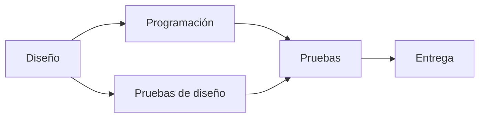

# Estructuras Discretas - Relaciones

## 4.1 Definiciones básicas, relaciones binarias y n-arias, aplicaciones.

---

Una relación formaliza la idea de que ciertos objetos están vinculados entre sí: un alumno está inscrito en un curso, un número divide a otro, una página enlaza a otra, una tarea debe hacerse antes que otra. Matemáticamente, una relación es simplemente el conjunto de las tuplas de objetos que están vinculados. Con esa definición tan sencilla se modelan las bases de datos, las gráficas dirigidas, las funciones y los órdenes, que se estudian en los subtemas siguientes.

### 1. Relaciones binarias

Dados dos conjuntos $A$ y $B$, una **relación binaria** de $A$ en $B$ es cualquier subconjunto

$$R \subseteq A \times B$$

Si $(a, b) \in R$ se dice que $a$ está relacionado con $b$ y se escribe $a \mathrel{R} b$. Cuando $A = B$ se habla de una **relación sobre** $A$.

**Ejemplos.**

- Con $A = \{\text{Ana}, \text{Luis}, \text{Eva}\}$ y $B = \{\text{Cálculo}, \text{Lógica}\}$, la relación "está inscrito en" puede ser $R = \{(\text{Ana}, \text{Cálculo}), (\text{Ana}, \text{Lógica}), (\text{Eva}, \text{Lógica})\}$. Luis no aparece: no está inscrito en nada.
- Sobre $\mathbb{Z}^+$, la relación de divisibilidad $a \mid b$ si existe $k \in \mathbb{Z}$ con $b = ak$. Por ejemplo $3 \mid 12$ pero $5 \nmid 12$.
- Sobre $\mathbb{R}$, la relación $x^2 + y^2 = 1$, cuyo dibujo en el plano es la circunferencia unitaria.
- Sobre cualquier conjunto $A$: la relación vacía $\varnothing$, la **relación universal** $A \times A$ y la **identidad** $I_A = \{(a, a) \mid a \in A\}$.

**Cuántas relaciones hay.** Si $|A| = m$ y $|B| = n$, entonces $|A \times B| = mn$, y cada relación es un subconjunto de $A \times B$. Por lo tanto hay $2^{mn}$ relaciones de $A$ en $B$. Sobre un conjunto de solo 3 elementos ya hay $2^9 = 512$ relaciones distintas.

### 2. Dominio, imagen e inversa

Para $R \subseteq A \times B$:

- El **dominio** de $R$ es $\{a \in A \mid \exists b,\; a \mathrel{R} b\}$, los elementos que se relacionan con algo.
- La **imagen** o rango de $R$ es $\{b \in B \mid \exists a,\; a \mathrel{R} b\}$.
- La **relación inversa** es $R^{-1} = \{(b, a) \mid (a, b) \in R\} \subseteq B \times A$.

En el ejemplo de inscripciones, el dominio es $\{\text{Ana}, \text{Eva}\}$, la imagen es $\{\text{Cálculo}, \text{Lógica}\}$, y $R^{-1}$ es la relación "tiene inscrito a" de cursos en alumnos.

**Las funciones son relaciones.** Una función $f: A \to B$ es una relación de $A$ en $B$ en la que cada $a \in A$ se relaciona con **exactamente un** $b$. En las relaciones generales un elemento puede relacionarse con varios o con ninguno. Este punto de vista se desarrolla en Álgebra Superior I (subtemas 2.1 y 2.2).

### 3. Relaciones n-arias

Una **relación n-aria** sobre los conjuntos $A_1, \ldots, A_n$ es un subconjunto

$$R \subseteq A_1 \times A_2 \times \cdots \times A_n$$

Sus elementos son **tuplas** $(a_1, \ldots, a_n)$, y el número $n$ se llama **grado** o aridad de la relación. Las relaciones binarias son el caso $n = 2$.

**Ejemplos.**

- La relación ternaria $\{(x, y, z) \in \mathbb{N}^3 \mid x + y = z\}$ contiene a $(2, 3, 5)$ y no a $(2, 3, 6)$.
- La relación ternaria *el vuelo $v$ sale de la ciudad $o$ hacia la ciudad $d$*.
- La relación de grado 4 formada por los registros (matrícula, nombre, carrera, semestre) de los alumnos de una facultad.

### 4. Aplicación: el modelo relacional de bases de datos

En 1970 Edgar Codd propuso modelar las bases de datos como relaciones $n$ arias, y ese **modelo relacional** es la base de casi todos los sistemas de bases de datos actuales. Una **tabla** es una relación: cada columna corresponde a un conjunto, llamado **dominio del atributo**, y cada fila a una tupla.

**Tabla Alumnos:**

| matrícula | nombre | carrera     |
| --------- | ------ | ----------- |
| 101       | Ana    | Computación |
| 102       | Luis   | Matemáticas |
| 103       | Eva    | Computación |

**Tabla Inscripciones:**

| matrícula | curso   |
| --------- | ------- |
| 101       | Cálculo |
| 101       | Lógica  |
| 103       | Lógica  |

Como una relación es un **conjunto**, no tiene filas repetidas ni un orden entre ellas. Una **llave** es un atributo, o conjunto de atributos, cuyo valor identifica a cada tupla: la matrícula en la tabla de alumnos.

Las consultas se expresan con operaciones de **álgebra relacional**, todas definidas con la teoría de conjuntos:

| Operación      | Notación                 | Qué hace                                                    | En SQL                      |
| -------------- | ------------------------ | ----------------------------------------------------------- | --------------------------- |
| Selección      | $\sigma_{\text{condición}}(R)$ | las tuplas de $R$ que cumplen una condición            | `WHERE`                     |
| Proyección     | $\pi_{\text{atributos}}(R)$    | solo las columnas indicadas, eliminando repetidos       | `SELECT DISTINCT columnas`  |
| Unión, diferencia | $R \cup S$, $R - S$    | operaciones de conjuntos entre relaciones del mismo tipo     | `UNION`, `EXCEPT`           |
| Producto       | $R \times S$             | todas las combinaciones de tuplas                           | `FROM R, S`                 |
| Reunión        | $R \bowtie S$            | combina tuplas que coinciden en los atributos comunes        | `JOIN`                      |

**Ejemplo.** "Nombres de los alumnos inscritos en Lógica":

$$\pi_{\text{nombre}}\big(\sigma_{\text{curso} = \text{Lógica}}(\text{Alumnos} \bowtie \text{Inscripciones})\big) = \{\text{Ana}, \text{Eva}\}$$

```sql
SELECT DISTINCT a.nombre
FROM Alumnos a JOIN Inscripciones i ON a.matricula = i.matricula
WHERE i.curso = 'Lógica';
```

La reunión de dos relaciones binarias seguida de una proyección que elimina el atributo común es exactamente la **composición** de relaciones del subtema 4.3.

### 5. Aplicación: gráficas dirigidas

Una relación binaria $R$ sobre un conjunto finito $A$ es lo mismo que una **gráfica dirigida**: los vértices son los elementos de $A$ y hay una flecha de $a$ a $b$ cuando $a \mathrel{R} b$. Así, *la página $a$ enlaza a la página $b$* define la gráfica de la web, y *la tarea $a$ debe terminar antes que la tarea $b$* define una gráfica de dependencias.



Las propiedades de las relaciones, que se estudian en el subtema 4.2, se leen directamente en el dibujo. Por ejemplo, una relación es reflexiva si cada vértice tiene un lazo, y simétrica si cada flecha tiene su flecha de regreso.

### 6. Representación en programas

Una relación finita puede guardarse de tres formas, con distintas ventajas:

| Representación          | Espacio para $\lvert A \rvert = n$ | ¿$a \mathrel{R} b$? | Ventaja                              |
| ----------------------- | --------------------------- | ------------------- | ------------------------------------ |
| Conjunto de pares       | proporcional a $\lvert R \rvert$     | rápida con hash     | sencilla y compacta si hay pocos pares |
| Matriz booleana         | $n^2$                       | inmediata           | operaciones como productos de matrices |
| Lista de adyacencia     | $n + \lvert R \rvert$                | recorrer una lista  | recorrer los vecinos de un elemento  |

```python
A = [1, 2, 3, 4]
pares = {(a, b) for a in A for b in A if b % a == 0}       # divisibilidad
matriz = [[int((a, b) in pares) for b in A] for a in A]
adyacencia = {a: [b for b in A if (a, b) in pares] for a in A}

print(sorted(pares))
print(matriz)          # [[1, 1, 1, 1], [0, 1, 0, 1], [0, 0, 1, 0], [0, 0, 0, 1]]
print(adyacencia)      # {1: [1, 2, 3, 4], 2: [2, 4], 3: [3], 4: [4]}
```

> **Conexión con CC.** Además de las bases de datos, las relaciones aparecen en los lenguajes de programación lógica como Prolog, donde un programa es un conjunto de relaciones y una consulta pregunta qué tuplas pertenecen a ellas, y en las redes sociales, cuyas relaciones "sigue a" o "es amigo de" se almacenan en bases de datos de gráficas.

### Ejercicios propuestos

1. Sean $A = \{1, 2, 3\}$ y $B = \{a, b\}$. ¿Cuántas relaciones de $A$ en $B$ hay? ¿Cuántas de ellas son funciones de $A$ en $B$?

2. Escriba por extensión la relación $R = \{(x, y) \in A \times A \mid x < y\}$ con $A = \{1, 2, 3, 4\}$, su inversa, su matriz y su dibujo como gráfica dirigida.

3. Dé el dominio y la imagen de la relación $\{(x, y) \in \mathbb{R}^2 \mid y^2 = x\}$. ¿Es una función de $\mathbb{R}$ en $\mathbb{R}$?

4. Con las tablas de la sección 4, escriba en álgebra relacional y en SQL: (a) las matrículas de los alumnos de Computación; (b) los cursos en que hay al menos un alumno de Computación.

5. Proponga un modelo con relaciones para una biblioteca: libros, socios y préstamos. Indique el grado de cada relación y una llave para cada una.

### Ver también

- **4.2** Relaciones binarias: propiedades y representación — reflexividad, simetría, transitividad, matrices y digráficas.
- **4.3** Operaciones con relaciones binarias — composición y cerraduras.
- **4.4** Relaciones de orden — órdenes parciales y ordenación topológica.
- **Álgebra Superior I 1.3 y 2.1** — producto cartesiano, relaciones, dominio e imagen.
- **Fundamentos de Bases de Datos** (Sem. 5) — modelo relacional y álgebra relacional a fondo.

### Referencias

- Rosen, K. H. (2019). _Discrete Mathematics and Its Applications_ (8.ª ed.). McGraw-Hill. Secciones 9.1 y 9.2.
- Codd, E. F. (1970). A relational model of data for large shared data banks. _Communications of the ACM_, 13(6), 377-387.
- Silberschatz, A., Korth, H. F., & Sudarshan, S. (2019). _Database System Concepts_ (7.ª ed.). McGraw-Hill. Cap. 2.
