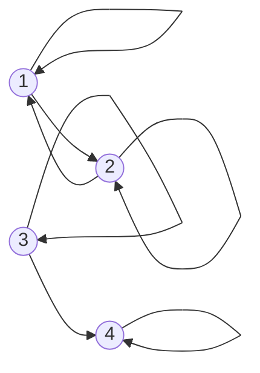

# Estructuras Discretas - Relaciones

## 4.2 Relaciones binarias: propiedades (reflexividad, simetría, transitividad, etc.), representación mediante matrices y digráficas.

---

Las relaciones que aparecen en la práctica no son conjuntos de pares arbitrarios: la igualdad, el orden, la divisibilidad o "ser amigo de" tienen propiedades estructurales que permiten razonar sobre ellas. En este subtema se definen esas propiedades, se aprende a reconocerlas en las dos representaciones más útiles, la matriz booleana y la digráfica, y se ve cómo sus combinaciones dan lugar a las relaciones de equivalencia y de orden.

### 1. Propiedades

Sea $R$ una relación sobre un conjunto $A$.

| Propiedad      | Definición                                                                        |
| -------------- | --------------------------------------------------------------------------------- |
| Reflexiva      | $a \mathrel{R} a$ para todo $a \in A$                                              |
| Irreflexiva    | $a \mathrel{R} a$ para ningún $a \in A$                                            |
| Simétrica      | si $a \mathrel{R} b$, entonces $b \mathrel{R} a$                                    |
| Antisimétrica  | si $a \mathrel{R} b$ y $b \mathrel{R} a$, entonces $a = b$                           |
| Asimétrica     | si $a \mathrel{R} b$, entonces no $b \mathrel{R} a$                                 |
| Transitiva     | si $a \mathrel{R} b$ y $b \mathrel{R} c$, entonces $a \mathrel{R} c$                 |

**Ejemplos y contraejemplos.**

| Relación                              | Refl. | Irrefl. | Sim. | Antisim. | Trans. |
| ------------------------------------- | ----- | ------- | ---- | -------- | ------ |
| $=$ sobre cualquier conjunto          | sí    | no      | sí   | sí       | sí     |
| $\leq$ sobre $\mathbb{Z}$              | sí    | no      | no   | sí       | sí     |
| $<$ sobre $\mathbb{Z}$                 | no    | sí      | no   | sí       | sí     |
| divisibilidad sobre $\mathbb{Z}^+$     | sí    | no      | no   | sí       | sí     |
| divisibilidad sobre $\mathbb{Z}$       | sí    | no      | no   | no       | sí     |
| $\equiv \pmod{3}$ sobre $\mathbb{Z}$   | sí    | no      | sí   | no       | sí     |
| "es amigo de" en una red social       | no    | sí      | sí   | no       | no     |
| "es padre de" entre personas          | no    | sí      | no   | sí       | no     |

Algunas observaciones que suelen confundir:

- **Reflexiva e irreflexiva no son opuestas.** Una relación puede no ser ninguna de las dos: $\{(1, 1)\}$ sobre $\{1, 2\}$ tiene un lazo pero no todos.
- **Simétrica y antisimétrica no son opuestas.** La identidad es ambas cosas, y $\{(1, 2), (2, 1), (2, 3)\}$ no es ninguna.
- **La divisibilidad sobre $\mathbb{Z}$** sí es reflexiva, pues $a = a \cdot 1$, pero no es antisimétrica: $2 \mid -2$ y $-2 \mid 2$ con $2 \neq -2$. Por eso se estudia como orden parcial solo sobre $\mathbb{Z}^+$.
- **Las propiedades universales se cumplen por vacuidad.** La relación vacía sobre un conjunto no vacío es simétrica, antisimétrica, asimétrica y transitiva, porque no hay pares que violen las condiciones, pero no es reflexiva.
- **Asimétrica equivale a antisimétrica e irreflexiva.**

### 2. Representación con matrices booleanas

Si $A = \{a_1, \ldots, a_n\}$, la **matriz** de $R$ es la matriz $M_R$ de $n \times n$ con

$$(M_R)_{ij} = \begin{cases} 1 & \text{si } a_i \mathrel{R} a_j \\ 0 & \text{si no} \end{cases}$$

**Ejemplo.** Para $A = \{1, 2, 3, 4\}$ y la relación de divisibilidad:

$$
M_{\mid} = \begin{pmatrix} 1 & 1 & 1 & 1 \\ 0 & 1 & 0 & 1 \\ 0 & 0 & 1 & 0 \\ 0 & 0 & 0 & 1 \end{pmatrix}
$$

Las propiedades se leen en la matriz:

| Propiedad      | Condición sobre $M_R$                                                     |
| -------------- | ------------------------------------------------------------------------- |
| Reflexiva      | toda la diagonal es 1                                                     |
| Irreflexiva    | toda la diagonal es 0                                                     |
| Simétrica      | $M_R = M_R^T$                                                             |
| Antisimétrica  | si $i \neq j$, no ocurre que $(M_R)_{ij} = (M_R)_{ji} = 1$                  |
| Transitiva     | $M_R \odot M_R \leq M_R$ entrada por entrada                               |

Aquí $\odot$ es el **producto booleano**, el producto de matrices con $\lor$ en lugar de suma y $\land$ en lugar de producto, que representa la composición $R \circ R$ (Álgebra Superior I, subtema 2.1). La condición de transitividad dice que siempre que hay un camino de dos pasos de $a_i$ a $a_j$, también hay un paso directo.

En el ejemplo, la diagonal llena muestra que la divisibilidad es reflexiva, la matriz triangular superior con diagonal 1 muestra que es antisimétrica, y se puede verificar que $M_{\mid} \odot M_{\mid} = M_{\mid}$, de modo que es transitiva.

### 3. Representación con digráficas

La **digráfica** de $R$ tiene un vértice por cada elemento de $A$ y una flecha de $a$ a $b$ por cada par $(a, b) \in R$. Un par $(a, a)$ se dibuja como un **lazo**.

**Ejemplo.** La relación $R = \{(1, 1), (1, 2), (2, 1), (2, 2), (3, 3), (3, 4), (4, 4)\}$ sobre $\{1, 2, 3, 4\}$:



| Propiedad      | Condición en la digráfica                                                 |
| -------------- | ------------------------------------------------------------------------- |
| Reflexiva      | todo vértice tiene lazo                                                   |
| Irreflexiva    | ningún vértice tiene lazo                                                 |
| Simétrica      | toda flecha entre vértices distintos tiene su flecha de regreso           |
| Antisimétrica  | ningún par de vértices distintos tiene flechas en ambos sentidos          |
| Transitiva     | siempre que hay un camino $a \to b \to c$, hay también una flecha $a \to c$ |

En el ejemplo, $R$ es reflexiva y transitiva. No es simétrica, por la flecha $3 \to 4$ sin regreso, ni antisimétrica, por el par $1 \leftrightarrows 2$.

### 4. Combinaciones importantes

| Clase de relación     | Propiedades                                 | Ejemplo                       | Se estudia en                 |
| --------------------- | ------------------------------------------- | ----------------------------- | ----------------------------- |
| Equivalencia          | reflexiva, simétrica, transitiva            | congruencia módulo $n$        | Álgebra Superior I, 2.6       |
| Orden parcial         | reflexiva, antisimétrica, transitiva        | $\subseteq$, divisibilidad en $\mathbb{Z}^+$ | subtema 4.4       |
| Orden estricto        | irreflexiva y transitiva                    | $<$, "es subconjunto propio"  | subtema 4.4                   |
| Preorden              | reflexiva y transitiva                      | "es alcanzable desde" en una red | subtema 4.3                |

Una relación de equivalencia **parte** a $A$ en clases ajenas, y en su matriz, ordenando los elementos por clase, aparecen bloques de unos sobre la diagonal. Un orden parcial **jerarquiza** los elementos, y su digráfica no tiene ciclos salvo los lazos.

### 5. Verificación automática

```python
from itertools import product

def propiedades(A, R):
    return {
        'reflexiva':     all((a, a) in R for a in A),
        'irreflexiva':   all((a, a) not in R for a in A),
        'simetrica':     all((b, a) in R for (a, b) in R),
        'antisimetrica': all(a == b for (a, b) in R if (b, a) in R),
        'transitiva':    all((a, d) in R for (a, b), (c, d) in product(R, R) if b == c),
    }

A = {1, 2, 3, 4}
divide = {(a, b) for a in A for b in A if b % a == 0}
print(propiedades(A, divide))
```

La comprobación de transitividad revisa todas las parejas de pares, lo que cuesta del orden de $|R|^2$ operaciones. Con matrices se hace con un producto booleano, del orden de $n^3$ operaciones.

> **Conexión con CC.** Las propiedades de las relaciones son contratos que el código debe respetar. En Java, el método `equals` debe definir una relación de equivalencia: si no es simétrica o transitiva, colecciones como `HashSet` se comportan de forma errática. Del mismo modo, la función de comparación que se pasa a un algoritmo de ordenamiento debe definir un orden; si no es transitiva, por ejemplo al comparar números de punto flotante que incluyen `NaN`, el resultado del ordenamiento no está garantizado.

### Ejercicios propuestos

1. Para cada relación sobre $\{1, 2, 3\}$, determine cuáles de las seis propiedades cumple:
   - (a) $\{(1, 1), (2, 2), (3, 3), (1, 2)\}$
   - (b) $\{(1, 2), (2, 1)\}$
   - (c) $\{(1, 2), (2, 3), (1, 3)\}$
   - (d) $\{(1, 1), (1, 2), (2, 1), (2, 2), (3, 3)\}$

2. Dé un ejemplo de una relación sobre $\{1, 2, 3\}$ que sea simétrica y transitiva pero no reflexiva. Explique por qué el argumento *de $a \mathrel{R} b$ y $b \mathrel{R} a$ se sigue $a \mathrel{R} a$ por transitividad, luego es reflexiva* es incorrecto.

3. Escriba la matriz y la digráfica de la relación $R = \{(a, b) \mid a + b \text{ es par}\}$ sobre $\{1, 2, 3, 4, 5\}$. ¿Qué tipo de relación es? Describa sus clases.

4. ¿Cuántas relaciones reflexivas hay sobre un conjunto de $n$ elementos? ¿Cuántas simétricas? ¿Cuántas antisimétricas? Sugerencia: piense en qué entradas de la matriz pueden elegirse libremente.

5. Calcule $M_R \odot M_R$ para la relación del ejemplo de la sección 3 y verifique que es transitiva.

6. Use la función `propiedades` para clasificar todas las 512 relaciones sobre $\{1, 2, 3\}$. ¿Cuántas son de equivalencia? Compare con el número de Bell $B_3$.

### Ver también

- **4.1** Definiciones básicas — relaciones binarias, inversa y representaciones.
- **4.3** Operaciones con relaciones — cerraduras reflexiva, simétrica y transitiva.
- **4.4** Relaciones de orden — órdenes parciales y totales.
- **Álgebra Superior I 2.6** — relaciones de equivalencia y particiones.
- **Gráficas y Juegos 9.1** (Sem. 2) — digráficas.

### Referencias

- Rosen, K. H. (2019). _Discrete Mathematics and Its Applications_ (8.ª ed.). McGraw-Hill. Secciones 9.1 y 9.3.
- Epp, S. S. (2011). _Discrete Mathematics with Applications_ (4.ª ed.). Brooks/Cole. Cap. 8.
- Bloch, J. (2018). _Effective Java_ (3.ª ed.). Addison-Wesley. Ítems 10 y 14.
