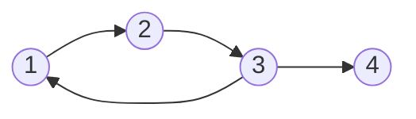

# Estructuras Discretas - Relaciones

## 4.3 Operaciones con relaciones binarias: operaciones conjuntistas, composición, cerraduras (algoritmo de Warshall).

---

Las relaciones se combinan para formar otras: como son conjuntos, admiten unión, intersección y complemento, y además se pueden **componer**, encadenando un vínculo con otro. Con la composición se responde una pregunta central en computación: ¿se puede llegar de un elemento a otro siguiendo la relación varias veces? La respuesta es la **cerradura transitiva**, y el algoritmo de Warshall la calcula de forma eficiente.

### 1. Operaciones conjuntistas

Si $R$ y $S$ son relaciones de $A$ en $B$, también lo son $R \cup S$, $R \cap S$, $R - S$ y el complemento $\overline{R} = (A \times B) - R$. En términos de matrices booleanas, se calculan entrada por entrada:

| Operación     | Matriz                                   |
| ------------- | ---------------------------------------- |
| $R \cup S$    | $M_R \lor M_S$                           |
| $R \cap S$    | $M_R \land M_S$                          |
| $R - S$       | $M_R \land \neg M_S$                     |
| $\overline{R}$ | $\neg M_R$                              |
| $R^{-1}$      | $M_R^T$                                  |

**Ejemplo.** Sobre $\mathbb{Z}$, la unión de $<$ y $=$ es $\leq$, la intersección de $\leq$ y $\geq$ es $=$, y el complemento de $<$ es $\geq$.

**Qué propiedades se conservan.** Si $R$ y $S$ son reflexivas, $R \cup S$ y $R \cap S$ también lo son. Si son simétricas, también. Si son transitivas, $R \cap S$ es transitiva, pero $R \cup S$ puede no serlo: sobre $\{1, 2, 3\}$, $\{(1, 2)\}$ y $\{(2, 3)\}$ son transitivas, pero su unión no contiene a $(1, 3)$.

### 2. Composición

Si $R \subseteq A \times B$ y $S \subseteq B \times C$, la **composición** es

$$S \circ R = \{(a, c) \in A \times C \mid \exists\, b \in B,\; a \mathrel{R} b \;\text{y}\; b \mathrel{S} c\}$$

Se lee *primero $R$, luego $S$*, con la misma convención que la composición de funciones, $(g \circ f)(x) = g(f(x))$.

**Ejemplo.** Si $R$ es "es padre o madre de" y $S$ es la misma relación, $S \circ R$ es "es abuelo o abuela de". Si $R$ es *el vuelo sale de la ciudad $a$ y llega a $b$*, entonces $R \circ R$ relaciona las ciudades conectadas con exactamente una escala.

**Con matrices.** Si $A$, $B$ y $C$ son finitos,

$$M_{S \circ R} = M_R \odot M_S$$

donde $\odot$ es el producto booleano: $(M_R \odot M_S)_{ik} = \bigvee_j \big((M_R)_{ij} \land (M_S)_{jk}\big)$. El orden de los factores es el de lectura: primero $R$, luego $S$.

**Propiedades.**

- Es asociativa: $T \circ (S \circ R) = (T \circ S) \circ R$.
- No es conmutativa en general.
- La identidad $I_A$ es neutra: $R \circ I_A = R = I_B \circ R$.
- $(S \circ R)^{-1} = R^{-1} \circ S^{-1}$.

**Potencias.** Para una relación sobre $A$ se define $R^1 = R$ y $R^{n+1} = R^n \circ R$. En la digráfica, $a \mathrel{R^n} b$ significa que hay un **camino de exactamente $n$ flechas** de $a$ a $b$. Esto se demuestra por inducción sobre $n$: un camino de $n + 1$ flechas es un camino de $n$ seguido de una flecha más.

**Transitividad y potencias.** Una relación $R$ es transitiva si y solo si $R^2 \subseteq R$, es decir, si todo camino de dos flechas tiene un atajo de una. En ese caso $R^n \subseteq R$ para todo $n \geq 1$.

### 3. Cerraduras

Si una relación no tiene cierta propiedad, se le pueden agregar los pares mínimos necesarios para que la tenga. La **cerradura** de $R$ respecto de una propiedad es la **menor** relación que contiene a $R$ y tiene esa propiedad.

| Cerradura    | Fórmula                          | Con matrices                |
| ------------ | -------------------------------- | --------------------------- |
| Reflexiva    | $R \cup I_A$                     | poner unos en la diagonal   |
| Simétrica    | $R \cup R^{-1}$                  | $M_R \lor M_R^T$            |
| Transitiva   | $R^+ = R \cup R^2 \cup R^3 \cup \cdots$ | ver abajo             |

**La cerradura transitiva.** $a \mathrel{R^+} b$ si y solo si hay un camino de **al menos una** flecha de $a$ a $b$ en la digráfica de $R$. Que $R^+$ es la menor relación transitiva que contiene a $R$ se ve así: es transitiva, porque concatenar dos caminos da un camino; y cualquier relación transitiva que contenga a $R$ debe contener todos los atajos de los caminos, es decir, a $R^+$.

Si $|A| = n$, un camino sin repetir vértices tiene a lo sumo $n$ flechas, así que la unión infinita se detiene:

$$R^+ = R \cup R^2 \cup \cdots \cup R^n$$

Calcular esta unión con productos booleanos cuesta del orden de $n^4$ operaciones. El algoritmo de Warshall lo hace en $n^3$.

**La cerradura reflexiva y transitiva** $R^* = R^+ \cup I_A$ admite además caminos de cero flechas. Es la relación *se puede llegar de $a$ a $b$*.

### 4. Algoritmo de Warshall

La idea es construir $R^+$ permitiendo, poco a poco, más vértices intermedios en los caminos. Sea $W_k$ la matriz en la que $(W_k)_{ij} = 1$ si existe un camino de $a_i$ a $a_j$ cuyos vértices **intermedios** están todos en $\{a_1, \ldots, a_k\}$. Entonces:

- $W_0 = M_R$, porque sin intermedios solo hay flechas directas.
- $W_n = M_{R^+}$, porque con todos los vértices disponibles están todos los caminos.
- Para pasar de $W_{k-1}$ a $W_k$: un camino de $a_i$ a $a_j$ con intermedios hasta $a_k$, o bien no pasa por $a_k$, o bien pasa por él y se divide en un camino de $a_i$ a $a_k$ y otro de $a_k$ a $a_j$, ambos con intermedios hasta $a_{k-1}$:

$$(W_k)_{ij} = (W_{k-1})_{ij} \lor \big((W_{k-1})_{ik} \land (W_{k-1})_{kj}\big)$$

```python
def warshall(M):
    """Cerradura transitiva de la relacion con matriz booleana M (lista de listas)."""
    n = len(M)
    W = [fila[:] for fila in M]         # copia: no modifica la matriz original
    for k in range(n):                  # se permite a_k como vertice intermedio
        for i in range(n):
            if W[i][k]:                 # solo importan los i que llegan a k
                for j in range(n):
                    W[i][j] = W[i][j] or W[k][j]
    return W
```

Son tres ciclos anidados de $n$ pasos cada uno, del orden de $n^3$ operaciones. El orden de los ciclos importa: el ciclo de $k$ debe ser el exterior.

**Ejemplo.** Sobre $A = \{1, 2, 3, 4\}$, sea $R = \{(1, 2), (2, 3), (3, 1), (3, 4)\}$:



$$
W_0 = \begin{pmatrix} 0 & 1 & 0 & 0 \\ 0 & 0 & 1 & 0 \\ 1 & 0 & 0 & 1 \\ 0 & 0 & 0 & 0 \end{pmatrix}
$$

- $k = 1$: la columna 1 indica que solo el 3 llega al 1. Se agrega a la fila 3 la fila 1: aparece $(3, 2)$.
- $k = 2$: llegan al 2 el 1 y ahora el 3. A sus filas se agrega la fila 2: aparecen $(1, 3)$ y $(3, 3)$.
- $k = 3$: llegan al 3 el 1, el 2 y el 3. A sus filas se agrega la fila 3, que ya es $(1, 1, 1, 1)$.
- $k = 4$: el 4 no tiene salidas, así que no cambia nada.

$$
W_4 = M_{R^+} = \begin{pmatrix} 1 & 1 & 1 & 1 \\ 1 & 1 & 1 & 1 \\ 1 & 1 & 1 & 1 \\ 0 & 0 & 0 & 0 \end{pmatrix}
$$

Los vértices 1, 2 y 3 forman un ciclo, así que cada uno alcanza a todos, incluido él mismo, y a 4. Desde 4 no se alcanza nada.

### 5. Aplicaciones

- **Alcanzabilidad.** En una red de computadoras o de carreteras, $R^+$ dice qué pares de nodos están conectados.
- **Dependencias.** Si $R$ es *el módulo $a$ importa directamente al módulo $b$*, entonces $R^+$ es *el módulo $a$ depende de $b$*. Si algún módulo depende de sí mismo, hay una dependencia circular.
- **Bases de datos.** Las consultas recursivas, como "todos los jefes, directos o indirectos, de un empleado", calculan una cerradura transitiva. En SQL se escriben con `WITH RECURSIVE`.
- **Rutas más cortas.** El algoritmo de Floyd-Warshall tiene exactamente la misma estructura, pero en lugar de "¿hay camino?" calcula "¿cuál es la distancia mínima?", reemplazando $\lor$ por $\min$ y $\land$ por $+$.

> **Conexión con CC.** El recolector de basura de un lenguaje como Java o Python determina qué objetos siguen siendo accesibles calculando, en esencia, la cerradura reflexiva y transitiva de la relación *el objeto $a$ tiene una referencia al objeto $b$* a partir de las variables del programa. Los objetos que quedan fuera de ella se pueden liberar.

### Ejercicios propuestos

1. Sobre $\{1, 2, 3\}$, sean $R = \{(1, 2), (2, 3), (3, 1)\}$ y $S = \{(1, 1), (2, 1), (3, 3)\}$. Calcule $S \circ R$, $R \circ S$ y $R^2$, por extensión y con matrices.

2. Demuestre que $R$ es transitiva si y solo si $R \circ R \subseteq R$.

3. Encuentre las cerraduras reflexiva, simétrica y transitiva de $R = \{(1, 2), (2, 3), (3, 3)\}$ sobre $\{1, 2, 3, 4\}$.

4. Aplique el algoritmo de Warshall, mostrando cada $W_k$, a la relación $\{(1, 4), (2, 1), (2, 3), (3, 1), (4, 2)\}$ sobre $\{1, 2, 3, 4\}$.

5. ¿La cerradura simétrica de una relación transitiva es transitiva? Demuéstrelo o dé un contraejemplo. ¿Y la cerradura transitiva de una relación simétrica es simétrica?

6. Modifique `warshall` para que, además, diga si la relación tiene ciclos, es decir, si algún elemento está relacionado consigo mismo en $R^+$.

7. Implemente el cálculo de $R^+$ como $R \cup R^2 \cup \cdots \cup R^n$ con productos booleanos y compare su tiempo con el de `warshall` para matrices aleatorias de $100 \times 100$.

### Ver también

- **4.1** Definiciones básicas — la composición generaliza la reunión de tablas.
- **4.2** Propiedades de relaciones — las cerraduras agregan propiedades.
- **4.4** Relaciones de orden — la cerradura reflexiva y transitiva de una relación sin ciclos es un orden parcial.
- **Álgebra Superior I 2.1 y 2.3** — composición de relaciones y de funciones.
- **Gráficas y Juegos 1.7 y 1.8** (Sem. 2) — caminos y conexidad.

### Referencias

- Rosen, K. H. (2019). _Discrete Mathematics and Its Applications_ (8.ª ed.). McGraw-Hill. Secciones 9.1 y 9.4.
- Warshall, S. (1962). A theorem on Boolean matrices. _Journal of the ACM_, 9(1), 11-12.
- Cormen, T. H., Leiserson, C. E., Rivest, R. L., & Stein, C. (2022). _Introduction to Algorithms_ (4.ª ed.). MIT Press. Cap. 23.
