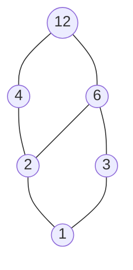
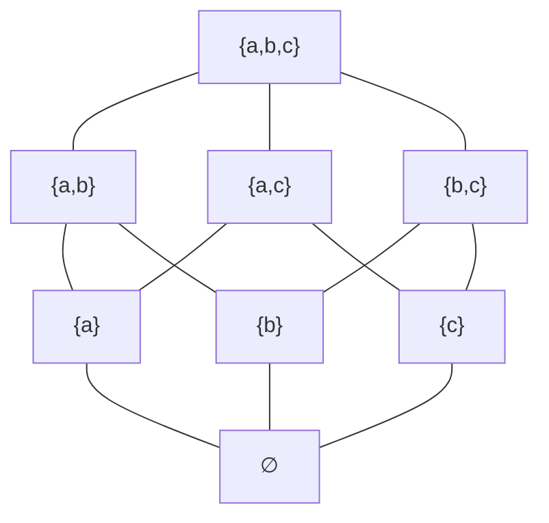
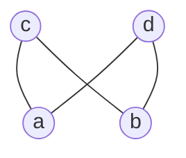

# Estructuras Discretas - Relaciones

## 4.4 Relaciones de orden: órdenes parciales y lineales, ordenación topológica, elementos minimales y maximales, retículas.

---

Muchas situaciones exigen ordenar: tareas que dependen de otras, versiones de un archivo, conjuntos contenidos unos en otros, números que se dividen entre sí. A diferencia del orden de los números reales, en estos casos no siempre se pueden comparar dos elementos: ninguna de dos tareas independientes va antes que la otra. Los **órdenes parciales** capturan esta situación. En este subtema se estudian, junto con sus diagramas, sus elementos extremos, el problema de convertirlos en una lista compatible y las retículas, en las que siempre existen el "mayor de los menores" y el "menor de los mayores".

### 1. Órdenes parciales

Una relación $\preceq$ sobre un conjunto $A$ es un **orden parcial** si es:

1. **Reflexiva:** $a \preceq a$.
2. **Antisimétrica:** si $a \preceq b$ y $b \preceq a$, entonces $a = b$.
3. **Transitiva:** si $a \preceq b$ y $b \preceq c$, entonces $a \preceq c$.

El par $(A, \preceq)$ se llama **conjunto parcialmente ordenado**. Se escribe $a \prec b$ si $a \preceq b$ y $a \neq b$. Esta relación $\prec$ es un **orden estricto**: irreflexivo y transitivo.

**Ejemplos.**

- $(\mathbb{Z}, \leq)$, el orden usual.
- $(\mathcal{P}(X), \subseteq)$, los subconjuntos de $X$ ordenados por contención.
- $(\mathbb{Z}^+, \mid)$, los enteros positivos ordenados por divisibilidad.
- Las cadenas sobre un alfabeto ordenadas por "es prefijo de": $ab \preceq abba$.
- Las tareas de un proyecto con "debe terminar antes que", agregando la reflexividad.

Dos elementos son **comparables** si $a \preceq b$ o $b \preceq a$. En $(\mathbb{Z}^+, \mid)$, 2 y 6 son comparables pero 2 y 3 no. De ahí el nombre "parcial".

### 2. Órdenes lineales

Un orden parcial es **lineal** o **total** si cualesquiera dos elementos son comparables. $(\mathbb{Z}, \leq)$ y $(\mathbb{R}, \leq)$ son lineales; $(\mathcal{P}(X), \subseteq)$ no lo es si $X$ tiene al menos dos elementos.

**Orden lexicográfico.** El orden de los diccionarios es lineal: para cadenas $u$ y $v$, $u$ va antes que $v$ si $u$ es prefijo de $v$, o si en la primera posición en que difieren el símbolo de $u$ es menor. Así $ab < abc < abd < b$. Es el orden que usan los lenguajes de programación para comparar cadenas.

Un orden lineal sobre $A$ es **buen orden** si todo subconjunto no vacío tiene mínimo. $(\mathbb{N}, \leq)$ es un buen orden; $(\mathbb{Z}, \leq)$ no lo es, porque $\mathbb{Z}$ mismo no tiene mínimo. Los buenos órdenes son los que justifican las demostraciones por inducción y la terminación de los algoritmos (subtema 3.1).

### 3. Diagramas de Hasse

La digráfica de un orden parcial tiene muchas flechas redundantes: lazos en todos los vértices y todas las flechas que se deducen por transitividad. El **diagrama de Hasse** las elimina:

- se omiten los lazos;
- se dibuja solo la relación de **cobertura**: $b$ **cubre** a $a$ si $a \prec b$ y no existe $c$ con $a \prec c \prec b$, y
- los elementos mayores se dibujan más arriba, y por eso no se necesitan flechas.

**Ejemplo: los divisores de 12 ordenados por divisibilidad.**



No hay arista de 1 a 4 porque 2 está entre ellos, ni de 2 a 12 porque 4 y 6 están entre ellos. La relación completa se recupera: $a \preceq b$ si y solo si se puede subir de $a$ a $b$ por las aristas.

**Ejemplo: los subconjuntos de $\{a, b, c\}$.** Su diagrama de Hasse es un cubo: cada subconjunto está unido a los que tienen exactamente un elemento más.



### 4. Elementos extremos y cotas

Sea $(A, \preceq)$ un orden parcial.

| Concepto       | Definición                                                    |
| -------------- | ------------------------------------------------------------- |
| Elemento maximal | $m$ tal que no existe $x$ con $m \prec x$                   |
| Elemento minimal | $m$ tal que no existe $x$ con $x \prec m$                   |
| Máximo         | $M$ tal que $x \preceq M$ para todo $x \in A$                 |
| Mínimo         | $m$ tal que $m \preceq x$ para todo $x \in A$                 |

La diferencia es sutil pero importante: **maximal** significa "nadie está por encima", y **máximo** significa "está por encima de todos". Un máximo es maximal, pero no al revés.

**Ejemplo.** En $A = \{2, 3, 4, 6, 8, 9\}$ con la divisibilidad:

- Los minimales son 2 y 3: ningún elemento de $A$ los divide.
- Los maximales son 6, 8 y 9: no dividen a ningún otro elemento de $A$.
- No hay mínimo, porque 2 no divide a 3, ni máximo, porque hay tres maximales.

En cambio, en los divisores de 12 el mínimo es 1 y el máximo es 12.

**Propiedades.** Si existen, el máximo y el mínimo son únicos, por antisimetría. Todo orden parcial **finito** y no vacío tiene al menos un elemento minimal y uno maximal: basta empezar en cualquier elemento y bajar mientras se pueda, lo que termina porque el conjunto es finito y no hay ciclos. En conjuntos infinitos esto falla: $(\mathbb{Z}, \leq)$ no tiene minimales.

**Cotas, supremo e ínfimo.** Sea $S \subseteq A$.

- Una **cota superior** de $S$ es un $u \in A$ con $s \preceq u$ para todo $s \in S$. La menor de las cotas superiores, si existe, es el **supremo** $\sup S$.
- Una **cota inferior** de $S$ es un $\ell \in A$ con $\ell \preceq s$ para todo $s \in S$. La mayor de ellas, si existe, es el **ínfimo** $\inf S$.

En $(\mathbb{Z}^+, \mid)$: las cotas superiores de $\{4, 6\}$ son sus múltiplos comunes y $\sup\{4, 6\} = \mathrm{mcm}(4, 6) = 12$. Las cotas inferiores son los divisores comunes e $\inf\{4, 6\} = \mathrm{mcd}(4, 6) = 2$.

### 5. Ordenación topológica

Un **orden topológico** de un orden parcial finito $(A, \preceq)$ es una lista de todos sus elementos en la que, si $a \prec b$, entonces $a$ aparece antes que $b$. Equivalentemente, es un orden lineal que extiende al orden parcial, llamado **extensión lineal**.

**Teorema.** Todo orden parcial finito tiene al menos un orden topológico.

*Demostración por inducción sobre $|A|$.* Si $A$ es vacío, la lista vacía sirve. Si no, $A$ tiene un elemento minimal $m$. El conjunto $A - \{m\}$ con el mismo orden es un orden parcial más pequeño, que por hipótesis tiene un orden topológico $L$. La lista que empieza con $m$ y sigue con $L$ es un orden topológico de $A$, pues nada está estrictamente por debajo de $m$. $\square$

La demostración es un algoritmo: **repetir, tomar un minimal y quitarlo**. El **algoritmo de Kahn** lo implementa sobre la gráfica de dependencias, llevando la cuenta de cuántos predecesores le quedan a cada elemento:

```python
from collections import deque

def orden_topologico(sucesores):
    """sucesores[a] = elementos que deben ir despues de a. Devuelve una lista o None si hay ciclo."""
    pendientes = {a: 0 for a in sucesores}
    for a in sucesores:
        for b in sucesores[a]:
            pendientes[b] += 1
    listos = deque(a for a in sucesores if pendientes[a] == 0)   # los minimales
    orden = []
    while listos:
        a = listos.popleft()
        orden.append(a)
        for b in sucesores[a]:
            pendientes[b] -= 1
            if pendientes[b] == 0:          # b se volvio minimal
                listos.append(b)
    return orden if len(orden) == len(sucesores) else None

materias = {
    'Álgebra I': ['Álgebra II'],
    'Álgebra II': ['Álgebra Lineal I'],
    'Discretas': ['Estructuras de Datos', 'Autómatas'],
    'Intro CC': ['Estructuras de Datos'],
    'Estructuras de Datos': ['Autómatas'],
    'Álgebra Lineal I': [],
    'Autómatas': [],
}
print(orden_topologico(materias))
```

El algoritmo hace un trabajo proporcional al número de elementos más el número de dependencias dadas. Si la relación tuviera un ciclo, ningún elemento del ciclo llegaría a tener cero pendientes y el algoritmo lo detecta.

En general el orden topológico **no es único**: cada vez que hay varios minimales disponibles se puede elegir cualquiera. Los divisores de 12 tienen, por ejemplo, los órdenes topológicos $1, 2, 3, 4, 6, 12$ y $1, 3, 2, 6, 4, 12$.

### 6. Retículas

Un orden parcial $(L, \preceq)$ es una **retícula** si todo par de elementos tiene supremo e ínfimo. Se escriben

$$a \vee b = \sup\{a, b\} \qquad a \wedge b = \inf\{a, b\}$$

y se leen "join" o unión, y "meet" o encuentro.

**Ejemplos.**

| Retícula                   | $a \vee b$                 | $a \wedge b$               |
| -------------------------- | -------------------------- | -------------------------- |
| $(\mathcal{P}(X), \subseteq)$ | $a \cup b$              | $a \cap b$                 |
| $(\mathbb{Z}^+, \mid)$     | $\mathrm{mcm}(a, b)$       | $\mathrm{mcd}(a, b)$       |
| $(\mathbb{R}, \leq)$       | $\max(a, b)$               | $\min(a, b)$               |
| $(\{0, 1\}, \leq)$         | $a \lor b$, el OR          | $a \land b$, el AND        |

**Un ejemplo que no es retícula.** En el orden con elementos $a, b, c, d$ en el que $a$ y $b$ están ambos por debajo de $c$ y de $d$, y $c$ y $d$ no son comparables, el par $\{a, b\}$ tiene dos cotas superiores minimales, $c$ y $d$, y ninguna es menor que la otra. No hay supremo.



**Propiedades.** En toda retícula, $\vee$ y $\wedge$ son conmutativas, asociativas, idempotentes y cumplen las **leyes de absorción**:

$$a \vee (a \wedge b) = a \qquad a \wedge (a \vee b) = a$$

Una retícula es **acotada** si tiene un máximo $1$ y un mínimo $0$, es **distributiva** si cumple $a \wedge (b \vee c) = (a \wedge b) \vee (a \wedge c)$, y es **complementada** si cada $a$ tiene un $\bar{a}$ con $a \vee \bar{a} = 1$ y $a \wedge \bar{a} = 0$.

**Álgebras booleanas.** Una retícula acotada, distributiva y complementada es un **álgebra booleana**. $(\mathcal{P}(X), \subseteq)$ con el complemento de conjuntos es el ejemplo fundamental, y el álgebra de los valores de verdad $\{0, 1\}$ es otro. Las leyes del álgebra de conjuntos (Álgebra Superior I, subtema 1.2), de la lógica proposicional (subtema 2.1) y de los circuitos digitales (subtema 2.2) son, en el fondo, las mismas: las de un álgebra booleana. Los divisores de 30 con mcm, mcd y el complemento $a \mapsto 30 / a$ forman otro álgebra booleana; los divisores de 12, en cambio, no, porque $2$ no tiene complemento.

> **Conexión con CC.** Las herramientas de compilación como `make` y los gestores de paquetes como `npm` ordenan topológicamente la gráfica de dependencias para decidir en qué orden compilar o instalar, y reportan un error cuando encuentran un ciclo. En los sistemas distribuidos, los **relojes vectoriales** ordenan parcialmente los eventos: dos eventos en máquinas distintas que no se comunicaron no son comparables, y eso es exactamente lo que significa que sean concurrentes. Las retículas son la base del análisis estático de programas, donde la información sobre una variable se combina con la operación $\vee$ al unir dos ramas de un `if`.

### Ejercicios propuestos

1. Determine cuáles de las siguientes relaciones son órdenes parciales y cuáles son lineales:
   - (a) $(\mathbb{Z}, \geq)$
   - (b) $(\mathbb{Z}, <)$
   - (c) la relación "es prefijo de" sobre las cadenas binarias
   - (d) la relación sobre $\mathbb{R}^2$ dada por $(a, b) \preceq (c, d)$ si $a \leq c$ y $b \leq d$

2. Dibuje el diagrama de Hasse de los divisores de 24 con la divisibilidad. Encuentre minimales, maximales, mínimo y máximo, y decida si es una retícula.

3. En el orden parcial $\{2, 4, 5, 10, 12, 20, 25\}$ con la divisibilidad, encuentre los elementos minimales y maximales, las cotas superiores de $\{2, 5\}$ y, si existe, su supremo.

4. Encuentre todos los órdenes topológicos de los divisores de 12. ¿Cuántos hay?

5. Aplique a mano el algoritmo de Kahn al ejemplo de las materias y verifique que el resultado respeta todas las dependencias. Agregue una dependencia que cree un ciclo y compruebe que la función regresa `None`.

6. Demuestre que en toda retícula $a \preceq b$ si y solo si $a \vee b = b$, si y solo si $a \wedge b = a$.

7. Verifique que los divisores de 30 forman un álgebra booleana y que los divisores de 12 no. ¿Para qué valores de $n$ los divisores de $n$ forman un álgebra booleana?

### Ver también

- **3.1** Los números naturales — el buen orden de $\mathbb{N}$ y la inducción.
- **4.2** Propiedades de relaciones — reflexividad, antisimetría y transitividad.
- **4.3** Operaciones con relaciones — la cerradura reflexiva y transitiva de una relación sin ciclos es un orden parcial.
- **2.2** Circuitos digitales — el álgebra booleana en el hardware.
- **Álgebra Superior I 1.3** — el conjunto potencia como álgebra booleana.
- **Gráficas y Juegos 9.1** (Sem. 2) — digráficas acíclicas.

### Referencias

- Rosen, K. H. (2019). _Discrete Mathematics and Its Applications_ (8.ª ed.). McGraw-Hill. Sección 9.6.
- Davey, B. A., & Priestley, H. A. (2002). _Introduction to Lattices and Order_ (2.ª ed.). Cambridge University Press. Cap. 1 y 2.
- Kahn, A. B. (1962). Topological sorting of large networks. _Communications of the ACM_, 5(11), 558-562.
- Cormen, T. H., Leiserson, C. E., Rivest, R. L., & Stein, C. (2022). _Introduction to Algorithms_ (4.ª ed.). MIT Press. Sección 20.4.
