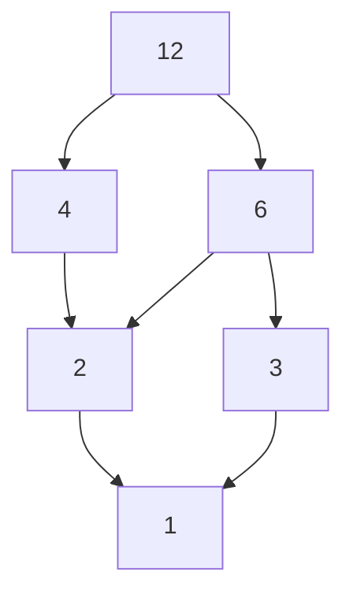

# Estructuras Discretas - Relaciones

## 4.4 Relaciones de orden: órdenes parciales y lineales, ordenación topológica, elementos minimales y maximales, retículas.

---

### 1. Órdenes Parciales

#### Definición Formal

Una relación $R \subseteq A \times A$ es un **orden parcial** si es:

1. **Reflexiva**: $\forall a \in A, (a,a) \in R$
2. **Antisimétrica**: $(a,b) \in R \land (b,a) \in R \Rightarrow a = b$
3. **Transitiva**: $(a,b) \in R \land (b,c) \in R \Rightarrow (a,c) \in R$

**Notación**: Usualmente se denota por $\preceq$

**Ejemplo**:

- $(\mathbb{N}, \mid)$ (divisibilidad)
- $(\mathcal{P}(A), \subseteq)$ (conjuntos potencia)

### 2. Órdenes Lineales (Totales)

Un orden parcial $\preceq$ es **total** si:  

$$ \forall a,b \in A, a \preceq b \lor b \preceq a $$

**Ejemplo**:

- $(\mathbb{R}, \leq)$ es total
- $(\mathbb{N}, \mid)$ no es total (ej: 2 y 3 no son comparables)

### 3. Diagramas de Hasse

Representación simplificada de órdenes parciales:

- Nodos: Elementos del conjunto
- Aristas: Cubrimiento inmediato ( $a \prec b$ sin intermediarios )

**Ejemplo para $(\{1,2,3,4,6,12\}, \mid)$**:



### 4. Elementos Especiales

| Tipo        | Definición                     | Ejemplo en $(\mathcal{P}(\{a,b\}), \subseteq)$ |
| ----------- | ------------------------------ | ---------------------------------------------- |
| **Mínimo**  | $\forall x \in A, m \preceq x$ | $\emptyset$                                    |
| **Máximo**  | $\forall x \in A, x \preceq M$ | $\{a,b\}$                                      |
| **Minimal** | $\nexists x \in A, x \prec m$  | $\{a\}$, $\{b\}$ (si no existe mínimo)         |
| **Maximal** | $\nexists x \in A, M \prec x$  | $\{a,b\}$ (si es máximo)                       |

### 5. Ordenación Topológica

Un **orden topológico** es una extensión lineal de un orden parcial que preserva las relaciones originales.

**Algoritmo (Kahn)**:

```python
def topological_sort(graph):
    in_degree = {u:0 for u in graph}
    for u in graph:
        for v in graph[u]:
            in_degree[v] += 1

    queue = [u for u in graph if in_degree[u] == 0]
    top_order = []

    while queue:
        u = queue.pop(0)
        top_order.append(u)
        for v in graph[u]:
            in_degree[v] -= 1
            if in_degree[v] == 0:
                queue.append(v)
    return top_order
```

### 6. Retículas (Lattices)

Un orden parcial $(A, \preceq)$ es **retícula** si:

$$ \forall a,b \in A, \exists \quad \text{sup}\{a,b\} \text{ e ínf}\{a,b\} $$

**Tipos**:

- **Retícula completa**: Todo subconjunto tiene ínfimo y supremo
- **Retícula distributiva**: Cumple $a \vee (b \wedge c) = (a \vee b) \wedge (a \vee c)$

**Ejemplo**:

- $(\mathcal{P}(A), \subseteq)$ con $\sup = \cup$ e $\inf = \cap$

### 7. Fórmulas Clave

- **Ley de Absorción**:  
  $ a \vee (a \wedge b) = a $

  $ a \wedge (a \vee b) = a $

- **Complemento en retículas acotadas**:

$$ a \vee \neg a = 1 \quad \text{y} \quad a \wedge \neg a = 0 $$

### 8. Aplicaciones

- **Sistemas de archivos**: Estructuras de directorios
- **Planificación de tareas**: Dependencias entre actividades
- **Teoría de circuitos**: Álgebra de Boole

### Ejercicio Propuesto

Para el orden parcial $ (\{1,2,3,4,6,8,12,24\}, \mid) $:

1. Dibujar el diagrama de Hasse
2. Identificar minimales, maximales, mínimo y máximo
3. Verificar si es retícula

### Recursos Adicionales

- Libro: _"Introduction to Lattices and Order_" - Davey & Priestley
- Herramientas:
  - Graphviz (para diagramas de Hasse)
  - Python con `networkx` para ordenación topológica

### Ver también

- **4.2** Propiedades de relaciones — las relaciones de orden son un caso especial.
- **Álgebra Superior I 1.1** — $\subseteq$ como ejemplo de orden parcial.
- **Gráficas y Juegos 7.1** (Sem. 2) — grafos de Hasse y ordenación topológica.
- **Estructuras de Datos 4.1** (Sem. 2) — orden topológico en algoritmos de scheduling.

### Referencias

- Rosen, K. H. (2019). _Discrete Mathematics and Its Applications_ (8.ª ed.). McGraw-Hill. Sección 9.6.
- Davey, B. A., & Priestley, H. A. (2002). _Introduction to Lattices and Order_ (2.ª ed.). Cambridge.
