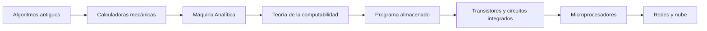

# Introducción a las Ciencias de la Computación - Conceptos generales de computación

## 1.1 Historia de la computación.

---

La computación moderna es el resultado de dos historias que se entrelazan: la de las **máquinas** que automatizan el cálculo, desde el ábaco hasta el microprocesador, y la de las **ideas** que explican qué significa calcular, desde los algoritmos de la antigüedad hasta la máquina de Turing. Conocerla ayuda a entender por qué las computadoras actuales tienen la forma que tienen y de dónde vienen conceptos como programa almacenado, compilador o sistema operativo.

### 1. Antes de las máquinas: algoritmos y ayudas para el cálculo

- **Ábaco** (alrededor del 2500 a. C. en Mesopotamia, con versiones posteriores en China, Grecia y Roma): un instrumento para hacer aritmética moviendo cuentas; el cálculo lo sigue haciendo la persona.
- **Algoritmo de Euclides** (alrededor del 300 a. C.): un procedimiento para calcular el máximo común divisor que se sigue enseñando y usando, por ejemplo en criptografía.
- **Al-Juarismi** (siglo IX): matemático persa cuyos libros difundieron el sistema de numeración posicional indio en el mundo árabe y luego en Europa. De su nombre deriva la palabra **algoritmo**.
- **Mecanismo de Anticitera** (alrededor del 100 a. C.): un artefacto griego de engranes que calculaba posiciones astronómicas y eclipses. Es una calculadora analógica de propósito específico.

### 2. Calculadoras mecánicas (siglos XVII a XIX)

- **Wilhelm Schickard** (1623) y **Blaise Pascal** (1642) construyeron calculadoras de engranes para sumar y restar. La *Pascalina* llevaba los acarreos automáticamente.
- **Gottfried Leibniz** (1673) construyó una máquina que también multiplicaba, y estudió el sistema binario como sistema de numeración.
- **Telar de Jacquard** (1804): un telar controlado por **tarjetas perforadas**, que fue la primera forma de "programar" una máquina para hacer tareas distintas sin modificarla.
- **Charles Babbage** diseñó la *Máquina Diferencial* (1822), para calcular tablas de polinomios, y la *Máquina Analítica* (1837), que tenía unidad aritmética, memoria, tarjetas perforadas como programa y saltos condicionales. Nunca se terminó de construir, pero su diseño ya contenía las partes de una computadora de propósito general.
- **Ada Lovelace** (1843) publicó notas sobre la Máquina Analítica con un procedimiento para calcular números de Bernoulli, considerado el primer programa publicado. Además intuyó que la máquina podía manipular símbolos en general, no solo números.
- **Herman Hollerith** (1890) usó máquinas tabuladoras de tarjetas perforadas para procesar el censo de Estados Unidos. Su empresa daría origen a IBM.

### 3. Los fundamentos teóricos (décadas de 1930 y 1940)

- **George Boole** (1854) había formalizado la lógica como un álgebra. **Claude Shannon** (1937) mostró que los circuitos de relevadores obedecen esa álgebra, lo que permite diseñar circuitos con lógica (Estructuras Discretas, subtema 2.2).
- **Kurt Gödel** (1931) demostró que hay enunciados verdaderos de la aritmética que no se pueden demostrar dentro de un sistema formal consistente.
- **Alan Turing** (1936) y **Alonzo Church** (1936) dieron definiciones precisas de lo que significa "calculable", con la máquina de Turing y el cálculo lambda, respectivamente, y demostraron que hay problemas que ningún procedimiento mecánico puede resolver. Turing describió además una **máquina universal** capaz de simular a cualquier otra a partir de su descripción: la idea abstracta del programa almacenado.

### 4. Las primeras computadoras (décadas de 1940 y 1950)

| Año  | Máquina                 | Lugar           | Importancia                                                            |
| ---- | ----------------------- | --------------- | ---------------------------------------------------------------------- |
| 1941 | Z3, de Konrad Zuse      | Alemania        | primera computadora programable y automática, electromecánica          |
| 1943 | Colossus                | Reino Unido     | electrónica, para descifrar comunicaciones alemanas; propósito específico |
| 1945 | ENIAC                   | Estados Unidos  | electrónica y de propósito general; se programaba recableando          |
| 1948 | Manchester Baby         | Reino Unido     | primera en ejecutar un programa almacenado en su memoria                |
| 1949 | EDSAC                   | Reino Unido     | primera de programa almacenado de uso regular                          |
| 1951 | UNIVAC I                | Estados Unidos  | primera computadora comercial en Estados Unidos                        |

La ENIAC se diseñó durante la Segunda Guerra Mundial para calcular tablas de tiro de artillería, aunque se terminó a finales de 1945. Tenía unos 18 mil bulbos y cambiar de programa implicaba reconectar cables durante días. El informe de **John von Neumann** sobre su sucesora, la EDVAC (1945), describió una máquina que guarda **instrucciones y datos en la misma memoria**. Esa organización, la arquitectura de Von Neumann, es la del subtema 1.2.

### 5. Generaciones de hardware

| Generación | Época aproximada | Tecnología                     | Consecuencia                                             |
| ---------- | ---------------- | ------------------------------ | -------------------------------------------------------- |
| Primera    | 1945 a 1956      | bulbos o tubos de vacío        | máquinas enormes, de alto consumo y poco confiables       |
| Segunda    | 1956 a 1964      | transistores                   | más pequeñas, rápidas y confiables                       |
| Tercera    | 1964 a 1971      | circuitos integrados           | familias de computadoras compatibles, como la IBM 360     |
| Cuarta     | 1971 a la fecha  | microprocesadores (VLSI)       | computadoras personales, luego teléfonos inteligentes    |

El **Intel 4004** (1971) fue el primer microprocesador comercial: toda una unidad de procesamiento en un solo circuito integrado con unos 2 300 transistores. Un procesador actual tiene decenas de miles de millones.

**Ley de Moore.** En 1965 Gordon Moore observó que el número de transistores que se pueden integrar en un circuito se duplicaba cada año, y en 1975 corrigió la estimación a cada dos años. No es una ley física sino una tendencia de la industria, que se ha desacelerado en las últimas décadas y motivó el paso a procesadores con varios núcleos (subtema 1.3).

### 6. La historia del software

- **Lenguajes ensambladores** (fines de los 40): nombres simbólicos para las instrucciones de máquina.
- **Grace Hopper** desarrolló el A-0 (1952), uno de los primeros **compiladores**, y FLOW-MATIC, que inspiró a COBOL (1959), un lenguaje para aplicaciones de negocios.
- **FORTRAN** (1957), de John Backus en IBM, fue el primer lenguaje de alto nivel de uso amplio, pensado para cálculo científico. **LISP** (1958), de John McCarthy, introdujo la programación funcional y la recolección de basura.
- **Simula** (1967) introdujo las clases y los objetos, y **Smalltalk** (década de 1970) desarrolló la programación orientada a objetos que se estudia en este curso. **C** (1972) se creó junto con el sistema operativo **Unix**.
- **C++** (1985), **Python** (1991) y **Java** (1995) llevaron los objetos a la programación de uso general.

### 7. Redes, computadoras personales y la nube

- **ARPANET** (1969) conectó las primeras computadoras en red, y los protocolos **TCP/IP** (1983) se convirtieron en la base de Internet.
- Las computadoras personales se popularizaron con la Apple II (1977) y la IBM PC (1981), y las interfaces gráficas con ventanas y ratón, desarrolladas en Xerox PARC, llegaron al público con la Macintosh (1984).
- **Tim Berners-Lee** propuso la **World Wide Web** en 1989, en el CERN.
- Desde la década de 2000, la **computación en la nube**, los **teléfonos inteligentes** y el **aprendizaje automático** a gran escala cambiaron la forma de usar y programar las computadoras.

### 8. La computación en México

En 1958 la UNAM instaló una IBM 650, la primera computadora electrónica en México y una de las primeras en América Latina, en lo que después sería el Centro de Cálculo Electrónico. A partir de ahí se formaron los primeros programadores del país, y en las décadas siguientes surgieron las carreras de computación en universidades públicas.

> **Conexión con CC.** Muchas decisiones de diseño actuales son herencia histórica: el teclado QWERTY, los 8 bits por byte, la terminal de texto de Unix o el tamaño de 80 columnas que todavía usan algunas guías de estilo de código, que proviene de las tarjetas perforadas de IBM. Entender esa historia ayuda a distinguir qué es esencial y qué es convención.

### Preguntas de repaso

1. ¿Por qué la Máquina Analítica se considera un hito aunque no se construyó? ¿Qué componentes de una computadora moderna ya tenía?
2. ¿Qué diferencia hay entre una calculadora, como la Pascalina, y una computadora programable?
3. ¿Qué aportó la máquina de Turing que no aportaron las máquinas físicas de su época?
4. Explique el cambio que significó el programa almacenado respecto a la forma de programar la ENIAC.
5. Elija una generación de hardware y explique cómo cambió el tamaño, el costo y la confiabilidad de las computadoras.
6. Investigue qué fue el Centro de Cálculo Electrónico de la UNAM y qué tipo de problemas resolvía.

### Ver también

- **1.2** Arquitectura de Von Neumann — el modelo de programa almacenado.
- **1.3** Arquitecturas modernas con multiprocesadores — qué pasó cuando la ley de Moore dejó de dar procesadores más rápidos.
- **1.6** Principios de lenguajes de programación — la evolución de los lenguajes.
- **Autómatas y Lenguajes Formales 5 y 7** (Sem. 4) — máquinas de Turing e indecidibilidad.
- **Organización y Arquitectura de Computadoras 1.1** (Sem. 4) — tendencias tecnológicas.

### Referencias

- Ceruzzi, P. E. (2003). _A History of Modern Computing_ (2.ª ed.). MIT Press.
- Isaacson, W. (2014). _The Innovators_. Simon & Schuster.
- Petzold, C. (2000). _Code: The Hidden Language of Computer Hardware and Software_. Microsoft Press.
- Patterson, D., & Hennessy, J. (2014). _Computer Organization and Design_ (5.ª ed.). Morgan Kaufmann. Cap. 1.
