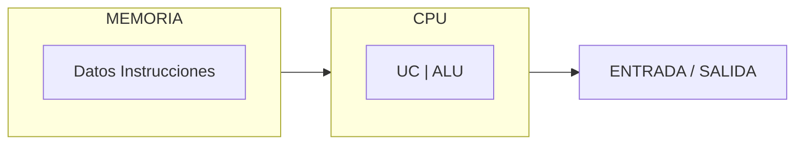
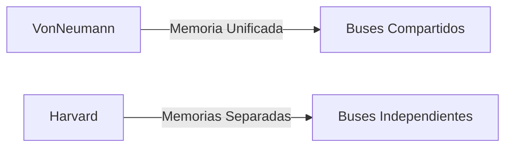

# Introducción a las Ciencias de la Computación - Conceptos generales de computación

## 1.2 Arquitectura de Von-Neumann.

---

### 1. Introducción

La **Arquitectura de Von Neumann** es el modelo fundamental en el diseño de computadoras modernas, propuesto por John von Neumann en 1945. Establece una estructura donde programas y datos comparten el mismo espacio de memoria.

### 2. Componentes Principales

#### 2.1 Unidad Central de Procesamiento (CPU)

- **Unidad de Control (UC)**: Coordina las operaciones
- **Unidad Aritmético-Lógica (ALU)**: Realiza cálculos ( $ a + b, a \land b $ )

#### 2.2 Memoria Principal

- Almacena **datos** e **instrucciones** en celdas direccionables
- Ejemplo: "`MOV A, 5`" (instrucción) y "`5`" (dato) coexisten en memoria

#### 2.3 Dispositivos de E/S

- Teclado (entrada), Monitor (salida)

#### 2.4 Buses

- **Bus de datos**: Transfiere información (ej: 32 bits)
- **Bus de direcciones**: Selecciona ubicaciones ( $\text{dirección} = 2^n$ )



### 3. Ciclo de Instrucción

#### 3.1 Pasos

1. **Fetch**: Obtener instrucción de memoria ( $PC \rightarrow Memoria[PC]$ )
2. **Decode**: Interpretar la instrucción
3. **Execute**: Ejecutar en la ALU ( $A \leftarrow A + B$ )

**Fórmula de tiempo de ciclo**:

$$ T_{ciclo} = T_{fetch} + T_{decode} + T_{execute} $$

#### 3.2 Ejemplo en Pseudocódigo

```
while True:
    instrucción = Memoria[PC]  # Fetch
    PC += 1
    opcode, operandos = decodificar(instrucción)  # Decode
    ejecutar(opcode, operandos)  # Execute
```

### 4. Características Clave

#### 4.1 Memoria Unificada

- Ventaja: Flexibilidad para almacenar programas como datos
- Desventaja: **Cuello de botella de Von Neumann** (ancho de banda limitado)

**Fórmula de ancho de banda requerido**:

$$ BW \geq \frac{\text{Instrucciones/ciclo} \times \text{Tamaño instrucción}}{T_{ciclo}} $$

#### 4.2 Programa Almacenado

- Las instrucciones se representan en binario (ej: "`ADD`" = "`0001`")

### 5. Ejemplos Prácticos

#### 5.1 Simulación Básica en C

```c
#include <stdio.h>
int main() {
    int memoria[256] = {0x1050, 0x2060, ...}; // Código y datos
    int PC = 0; // Contador de programa
    while (1) {
        int instruccion = memoria[PC++];
        // Decodificar y ejecutar...
    }
}
```

#### 5.2 Comparación con Arquitectura Harvard



### 6. Impacto y Limitaciones

#### 6.1 Ventajas

- Sencillez de diseño
- Permite autoreprogramación

#### 6.2 Desventajas

- Ancho de banda compartido limita el rendimiento
- Vulnerable a ataques de inyección de código

### 7. Ejercicios

1. ¿Por qué el cuello de botella afecta el rendimiento?
2. Convierte la instrucción "`ADD R1, R2`" a código máquina hipotético (ej: "`0001 0001 0010`").
3. Explica cómo la memoria unificada permite compiladores en tiempo de ejecución.

### Ver también

- **1.1** Historia — contexto histórico de esta arquitectura.
- **1.3** Arquitecturas modernas — evolución del modelo de Von Neumann.
- **Organización y Arquitectura 6.1** (Sem. 4) — datapath y ciclo de instrucción.

### Referencias

- Patterson, D., & Hennessy, J. (2014). _Computer Organization and Design_ (5.ª ed.). Morgan Kaufmann. Cap. 1.
- Tanenbaum, A. S. (2013). _Structured Computer Organization_ (6.ª ed.). Pearson. Cap. 2.
