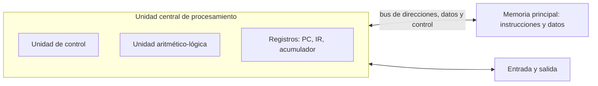

# Introducción a las Ciencias de la Computación - Conceptos generales de computación

## 1.2 Arquitectura de Von-Neumann.

---

En 1945 John von Neumann describió, en un informe sobre la computadora EDVAC, una organización de la máquina que resolvía el gran problema de la ENIAC: cambiar de programa no debía requerir recablear nada. La idea central es el **programa almacenado**: las instrucciones se codifican como números y se guardan en la misma memoria que los datos. Casi todas las computadoras actuales, desde un microcontrolador hasta un servidor, siguen en lo esencial esta organización.

### 1. Componentes



- **Unidad aritmético-lógica (ALU):** realiza las operaciones aritméticas, como sumar, y lógicas, como AND bit a bit o comparar.
- **Unidad de control (UC):** lee las instrucciones, las interpreta y genera las señales que hacen que los demás componentes actúen en el orden correcto.
- **Registros:** pequeñas memorias muy rápidas dentro del procesador. Los más importantes son el **contador de programa** (PC), que guarda la dirección de la siguiente instrucción, el **registro de instrucción** (IR), que guarda la instrucción que se está ejecutando, y los registros de datos, como el **acumulador**.
- **Memoria principal:** un arreglo de celdas numeradas. El número de cada celda es su **dirección**. Una celda puede contener un dato o una instrucción, y la memoria no distingue entre ambos.
- **Entrada y salida:** los dispositivos para comunicarse con el exterior, como teclado, pantalla, disco o red.
- **Buses:** conjuntos de líneas que comunican los componentes. El **bus de direcciones** indica qué celda se quiere usar, el **bus de datos** transporta el contenido y el **bus de control** indica si se lee o se escribe.

**Tamaño de la memoria direccionable.** Con un bus de direcciones de $n$ líneas se pueden formar $2^n$ direcciones distintas. Con 16 líneas se direccionan $2^{16} = 65\,536$ celdas, y con 32 líneas, $2^{32}$ celdas, que si cada una guarda un byte son 4 GiB. Por eso los sistemas de 32 bits no podían usar directamente más de 4 GiB de memoria.

### 2. El ciclo de instrucción

La unidad de control repite indefinidamente el mismo ciclo:

1. **Búsqueda (fetch):** se lee de la memoria la instrucción cuya dirección está en el PC, se coloca en el IR y se incrementa el PC para que apunte a la siguiente.
2. **Decodificación (decode):** se interpreta el código de operación y se identifican los operandos.
3. **Ejecución (execute):** se realiza la operación, que puede usar la ALU, leer o escribir memoria, o cambiar el PC en el caso de un salto.

```text
repetir:
    IR <- Memoria[PC]          # búsqueda
    PC <- PC + 1
    (op, dir) <- decodificar(IR)
    ejecutar op con dir         # puede modificar acumulador, memoria o PC
```

Los **saltos** son instrucciones que cambian el valor del PC. Con un salto condicional, que salta solo si el acumulador cumple una condición, la máquina puede tomar decisiones y repetir instrucciones: así se implementan los `if` y los ciclos de los lenguajes de alto nivel.

### 3. Un ejemplo completo: una máquina de acumulador

Considere una máquina con una memoria de 100 celdas, un acumulador y estas instrucciones, cada una con un código de operación y una dirección:

| Código | Instrucción  | Efecto                                         |
| ------ | ------------ | ---------------------------------------------- |
| 1      | `CARGA d`    | acumulador $\leftarrow$ Memoria[d]             |
| 2      | `GUARDA d`   | Memoria[d] $\leftarrow$ acumulador             |
| 3      | `SUMA d`     | acumulador $\leftarrow$ acumulador + Memoria[d] |
| 4      | `RESTA d`    | acumulador $\leftarrow$ acumulador − Memoria[d] |
| 5      | `SALTA d`    | PC $\leftarrow$ d                              |
| 6      | `SALTA0 d`   | si acumulador = 0, PC $\leftarrow$ d           |
| 0      | `ALTO`       | detiene la máquina                             |

Una instrucción se codifica como el número $100 \cdot \text{código} + \text{dirección}$: por ejemplo, `SUMA 21` es 321. El siguiente programa suma $n + (n-1) + \cdots + 1$ con $n$ guardado en la celda 20, acumulando el resultado en la celda 21:

| Dirección | Contenido | Significado     |
| --------- | --------- | --------------- |
| 0         | 120       | `CARGA 20`      |
| 1         | 607       | `SALTA0 7`      |
| 2         | 321       | `SUMA 21`       |
| 3         | 221       | `GUARDA 21`     |
| 4         | 120       | `CARGA 20`      |
| 5         | 422       | `RESTA 22`      |
| 6         | 508       | `SALTA 8`       |
| 7         | 0         | `ALTO`          |
| 8         | 220       | `GUARDA 20`     |
| 9         | 500       | `SALTA 0`       |
| 20        | 4         | dato: $n$       |
| 21        | 0         | dato: la suma   |
| 22        | 1         | dato: la constante 1 |

Observe que en las celdas 0 a 9 hay instrucciones y en las 20 a 22 hay datos, pero todas son simplemente números. Un simulador en Java ejecuta el ciclo de instrucción:

```java
public class MaquinaAcumulador {
    public static void main(String[] args) {
        int[] mem = new int[100];
        int[] programa = {120, 607, 321, 221, 120, 422, 508, 0, 220, 500};
        System.arraycopy(programa, 0, mem, 0, programa.length);
        mem[20] = 4;   // n
        mem[21] = 0;   // suma
        mem[22] = 1;   // constante

        int pc = 0, acc = 0;
        while (true) {
            int ir = mem[pc];                  // busqueda
            pc++;
            int op = ir / 100, dir = ir % 100; // decodificacion
            switch (op) {                      // ejecucion
                case 1 -> acc = mem[dir];
                case 2 -> mem[dir] = acc;
                case 3 -> acc += mem[dir];
                case 4 -> acc -= mem[dir];
                case 5 -> pc = dir;
                case 6 -> { if (acc == 0) pc = dir; }
                case 0 -> { System.out.println("Suma: " + mem[21]); return; }
                default -> throw new IllegalStateException("Instrucción inválida: " + ir);
            }
        }
    }
}
```

Al ejecutarlo se imprime `Suma: 10`, que es $4 + 3 + 2 + 1$. Un compilador hace exactamente esto: traduce un ciclo `while` de alto nivel a una secuencia de instrucciones con saltos.

### 4. Consecuencias del programa almacenado

**Ventajas.**

- Cambiar de programa es solo cargar otros números en memoria.
- Los programas pueden tratar a otros programas como datos: así funcionan los **compiladores**, que producen programas, los **cargadores**, que los copian a memoria, y los **sistemas operativos**, que los administran.
- Una sola máquina física puede ejecutar cualquier programa, como la máquina universal de Turing.

**Desventajas.**

- **Cuello de botella de Von Neumann.** Instrucciones y datos viajan por el mismo bus entre la memoria y el procesador. Como el procesador es mucho más rápido que la memoria, pasa gran parte del tiempo esperando. Por eso los procesadores modernos usan **memorias caché**, pequeñas y rápidas, que guardan las instrucciones y los datos usados recientemente.
- **Seguridad.** Si un programa puede escribir en cualquier parte de la memoria, un error o un ataque puede sobrescribir instrucciones. Los sistemas actuales marcan las zonas de memoria como "solo ejecutable" o "solo datos" para impedirlo.

### 5. La arquitectura Harvard

En la **arquitectura Harvard** las instrucciones y los datos están en memorias separadas, con buses independientes, de modo que pueden leerse al mismo tiempo.

| Característica             | Von Neumann                       | Harvard                               |
| -------------------------- | --------------------------------- | ------------------------------------- |
| Memoria                    | una sola para instrucciones y datos | dos memorias separadas              |
| Buses                      | compartidos                       | independientes                        |
| Acceso simultáneo          | no                                | sí                                    |
| Programa modificable como dato | sí                            | no directamente                       |
| Uso típico                 | computadoras de propósito general | microcontroladores, procesadores de señales |

Los procesadores modernos usan una **arquitectura Harvard modificada**: la memoria principal es única, como en Von Neumann, pero dentro del procesador hay cachés separadas para instrucciones y para datos.

> **Conexión con CC.** El modelo de Von Neumann es también el modelo mental con el que se programa: una memoria de celdas numeradas, variables que son direcciones y un flujo de instrucciones que avanza paso a paso salvo cuando hay saltos. Los apuntadores de C, los arreglos y la pila de ejecución del tema 6 solo tienen sentido en este modelo. Las máquinas virtuales como la JVM de Java repiten en software el mismo ciclo de búsqueda, decodificación y ejecución.

### Ejercicios propuestos

1. ¿Cuántas celdas puede direccionar un procesador con un bus de direcciones de 20 líneas? ¿Y uno de 64?
2. Explique con sus palabras por qué el cuello de botella de Von Neumann limita el rendimiento y cómo lo atenúa una memoria caché.
3. Ejecute a mano el programa de la sección 3 con $n = 3$, anotando en cada paso los valores de PC, acumulador y las celdas 20 y 21.
4. Escriba un programa para la máquina de acumulador que calcule el producto de los números de las celdas 30 y 31 mediante sumas repetidas, y pruébelo con el simulador.
5. ¿Qué pasaría si, por error, el programa guardara un valor en la celda 2? Relacione su respuesta con los problemas de seguridad del programa almacenado.
6. Compare las arquitecturas Von Neumann y Harvard y explique por qué un microcontrolador de una lavadora suele usar la segunda.

### Ver también

- **1.1** Historia de la computación — el origen del programa almacenado.
- **1.3** Arquitecturas modernas con multiprocesadores — varias unidades de procesamiento.
- **1.5** Representación digital de la información — cómo se codifican datos e instrucciones en binario.
- **6.1** La memoria durante la ejecución de aplicaciones — cómo usa un programa la memoria.
- **Organización y Arquitectura de Computadoras 5 y 6** (Sem. 4) — conjunto de instrucciones, datapath y unidad de control.

### Referencias

- von Neumann, J. (1945). _First Draft of a Report on the EDVAC_. Moore School of Electrical Engineering.
- Patterson, D., & Hennessy, J. (2014). _Computer Organization and Design_ (5.ª ed.). Morgan Kaufmann. Cap. 1 y 2.
- Tanenbaum, A. S. (2013). _Structured Computer Organization_ (6.ª ed.). Pearson. Cap. 2.
- Petzold, C. (2000). _Code: The Hidden Language of Computer Hardware and Software_. Microsoft Press.
