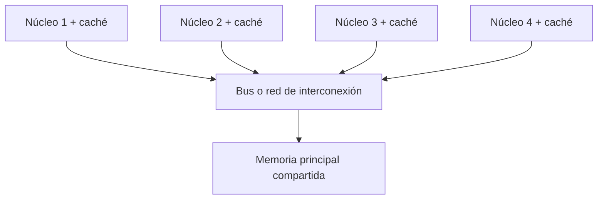
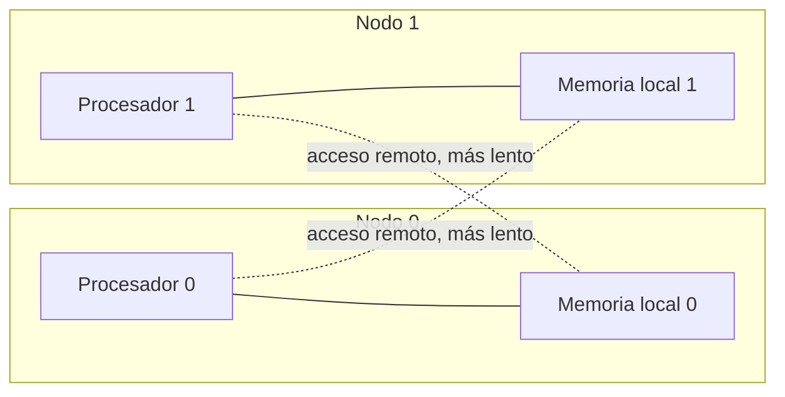

# Introducción a las Ciencias de la Computación - Conceptos generales de computación

## 1.3 Arquitecturas modernas con multiprocesadores.

---

Durante décadas, los programas se volvían más rápidos sin cambiar una línea de código: cada nueva generación de procesadores tenía un reloj más rápido. Alrededor de 2005 esa tendencia se detuvo, porque aumentar la frecuencia elevaba el consumo de energía y el calor más allá de lo que un chip puede disipar. La industria siguió aprovechando la ley de Moore de otra manera: colocando **varios procesadores en un mismo chip**. Desde entonces, para que un programa sea más rápido hay que dividir su trabajo entre varias unidades de procesamiento, y entender cómo están organizadas es parte del trabajo del programador.

### 1. Conceptos básicos

- **Núcleo (core):** una unidad de procesamiento completa, con su propia unidad de control, ALU y registros, capaz de ejecutar un flujo de instrucciones.
- **Procesador multinúcleo (multicore):** un chip con varios núcleos. Un procesador de escritorio actual tiene entre 4 y 24; uno de servidor, hasta más de 100.
- **Multiprocesador:** un sistema con varios procesadores, cada uno posiblemente multinúcleo, que comparten la memoria principal.
- **Hilos por hardware (SMT, Hyper-Threading):** un núcleo que alterna rápidamente entre dos flujos de instrucciones para aprovechar los momentos en que uno espera a la memoria. El sistema operativo ve el doble de "procesadores lógicos" que de núcleos físicos.
- **Concurrencia y paralelismo:** hay **concurrencia** cuando varias tareas avanzan en periodos de tiempo traslapados, aunque sea alternándose en un solo núcleo. Hay **paralelismo** cuando se ejecutan literalmente al mismo tiempo en núcleos distintos.

### 2. Clasificación de Flynn

Michael Flynn clasificó en 1966 las arquitecturas según cuántos flujos de instrucciones y de datos procesan a la vez:

| Clase | Instrucciones | Datos    | Ejemplo                                                      |
| ----- | ------------- | -------- | ------------------------------------------------------------ |
| SISD  | uno           | uno      | el procesador de Von Neumann clásico                         |
| SIMD  | uno           | varios   | instrucciones vectoriales (SSE, AVX), tarjetas gráficas      |
| MISD  | varios        | uno      | poco común; sistemas redundantes de control de vuelo         |
| MIMD  | varios        | varios   | procesadores multinúcleo, clusters                           |

Un procesador moderno combina varias: es MIMD porque tiene varios núcleos, y cada núcleo tiene unidades SIMD que suman, por ejemplo, ocho números a la vez con una sola instrucción.

### 3. Organización de la memoria

#### 3.1 Memoria compartida uniforme (UMA o SMP)

En un **multiprocesador simétrico** todos los procesadores acceden a la misma memoria con el mismo tiempo de acceso, a través de un bus o una red común.



Es sencillo de programar, porque todos los hilos ven las mismas variables, pero el bus compartido se satura cuando hay muchos procesadores: es el cuello de botella de Von Neumann multiplicado.

**Coherencia de caché.** Cada núcleo tiene su propia caché. Si dos núcleos guardan en caché la misma variable y uno la modifica, la copia del otro queda desactualizada. El hardware implementa **protocolos de coherencia**, como MESI, que invalidan las copias obsoletas. Esto es transparente para el programador, pero tiene un costo: si dos hilos escriben con frecuencia en variables que están en el mismo bloque de caché, el bloque "rebota" entre núcleos y el programa se vuelve lento, un problema conocido como *false sharing*.

#### 3.2 Memoria compartida no uniforme (NUMA)

En sistemas con muchos procesadores, la memoria se divide en **nodos**: cada procesador tiene memoria local de acceso rápido, y puede acceder a la memoria de otros nodos, pero más lentamente.



El sistema operativo procura que cada hilo use memoria de su propio nodo. Si un programa ignora esta organización, puede tardar notablemente más aunque haga el mismo número de operaciones.

#### 3.3 Memoria distribuida: clusters

Un **cluster** es un conjunto de computadoras independientes, cada una con su propia memoria, conectadas por una red rápida. No comparten variables: se comunican enviando **mensajes**. Los supercomputadores actuales son clusters de miles de nodos, y los servicios en la nube corren sobre clusters de servidores. Se programan con bibliotecas de paso de mensajes como MPI o con plataformas de procesamiento distribuido.

#### 3.4 Procesadores gráficos (GPU)

Una GPU tiene miles de núcleos sencillos que ejecutan la misma instrucción sobre muchos datos. Es ideal para problemas muy regulares, como procesar los píxeles de una imagen o multiplicar matrices, y por eso es la base del entrenamiento de modelos de aprendizaje automático.

### 4. ¿Cuánto se gana? Aceleración y ley de Amdahl

La **aceleración** (speedup) con $p$ procesadores y la **eficiencia** son

$$S(p) = \frac{T_1}{T_p} \qquad E(p) = \frac{S(p)}{p}$$

donde $T_1$ es el tiempo con un procesador y $T_p$ con $p$. Idealmente $S(p) = p$ y $E(p) = 1$, pero casi nunca se logra.

**Ley de Amdahl.** Si una fracción $f$ del programa puede paralelizarse perfectamente y el resto, $1 - f$, es secuencial, entonces

$$S(p) = \frac{1}{(1 - f) + \dfrac{f}{p}}$$

y cuando $p$ crece, la aceleración tiende a $\frac{1}{1 - f}$: **la parte secuencial limita la ganancia**, sin importar cuántos procesadores se agreguen.

**Ejemplo.** Con $f = 0.8$ y $p = 4$:

$$S(4) = \frac{1}{0.2 + 0.8/4} = \frac{1}{0.4} = 2.5$$

Con infinitos procesadores, la aceleración nunca superaría $1/0.2 = 5$.

| Fracción paralela $f$ | $p = 4$ | $p = 16$ | $p = 1024$ | límite |
| --------------------- | ------- | -------- | ---------- | ------ |
| 0.50                  | 1.60    | 1.88     | 2.00       | 2      |
| 0.80                  | 2.50    | 4.00     | 4.98       | 5      |
| 0.95                  | 3.48    | 9.14     | 19.64      | 20     |
| 0.99                  | 3.88    | 13.91    | 91.18      | 100    |

**Ley de Gustafson.** Amdahl supone que el problema tiene tamaño fijo. En la práctica, con más procesadores se resuelven problemas más grandes, y la parte paralela crece con el problema mientras la secuencial se mantiene. Desde ese punto de vista el paralelismo es más prometedor: es lo que permite simular el clima con mayor resolución o entrenar modelos más grandes.

### 5. Programación paralela en Java

Java permite repartir trabajo entre núcleos con hilos (tema 9) y, de forma más sencilla, con flujos paralelos:

```java
import java.util.stream.LongStream;

public class SumaParalela {
    public static void main(String[] args) {
        int nucleos = Runtime.getRuntime().availableProcessors();
        System.out.println("Procesadores lógicos disponibles: " + nucleos);

        long n = 200_000_000L;

        long inicio = System.nanoTime();
        long secuencial = LongStream.rangeClosed(1, n).map(x -> x % 7).sum();
        long t1 = System.nanoTime() - inicio;

        inicio = System.nanoTime();
        long paralela = LongStream.rangeClosed(1, n).parallel().map(x -> x % 7).sum();
        long tp = System.nanoTime() - inicio;

        System.out.println(secuencial == paralela ? "Mismo resultado" : "Resultados distintos");
        System.out.printf("Aceleración aproximada: %.2f%n", (double) t1 / tp);
    }
}
```

El método `parallel()` divide el rango en bloques, los suma en distintos núcleos y combina los resultados parciales. La aceleración medida depende del equipo y normalmente es menor que el número de núcleos, por la parte secuencial de dividir y combinar y por la competencia por la memoria. Medir tiempos en Java requiere cuidado: la primera ejecución de un fragmento incluye el tiempo que tarda la máquina virtual en compilarlo, así que en una medición seria se repite cada versión varias veces y se descartan las primeras.

**El riesgo: las condiciones de carrera.** Si varios hilos modifican una misma variable sin coordinarse, el resultado puede ser incorrecto. La instrucción `total = total + x` consiste en leer, sumar y escribir, y si dos hilos la intercalan, una de las sumas se pierde. Evitarlo requiere mecanismos de **sincronización**, que se estudian en el subtema 9.3, o diseñar el cálculo, como en el ejemplo, para que cada hilo trabaje con sus propios datos y solo al final se combinen.

> **Conexión con CC.** Escribir programas que aprovechen varios núcleos es hoy una habilidad básica, no especializada: los servidores web atienden miles de peticiones concurrentes, los navegadores separan cada pestaña en su propio proceso y los motores de videojuegos reparten física, sonido y gráficos entre núcleos. La ley de Amdahl explica por qué no basta con comprar más núcleos: hay que reducir la parte secuencial del algoritmo.

### Preguntas de repaso

1. Explique por qué los fabricantes dejaron de aumentar la frecuencia del reloj y empezaron a agregar núcleos.
2. ¿Cuál es la diferencia entre SMP y NUMA? ¿Cuál escala mejor a muchos procesadores y por qué?
3. Clasifique según Flynn: una GPU, un procesador de cuatro núcleos y un cluster.
4. Use la ley de Amdahl: si el 90 % de un programa es paralelizable, ¿qué aceleración se obtiene con 8 núcleos? ¿Cuántos núcleos se necesitan para acelerar 8 veces?
5. ¿Por qué en un cluster no hay condiciones de carrera sobre variables compartidas? ¿Qué problema de coordinación aparece en su lugar?
6. Ejecute el programa `SumaParalela` en su computadora y compare la aceleración obtenida con el número de procesadores lógicos.

### Ver también

- **1.2** Arquitectura de Von Neumann — el modelo que los multiprocesadores replican.
- **9.1 a 9.5** Hilos de ejecución — cómo se programan tareas concurrentes en Java.
- **Organización y Arquitectura de Computadoras 9.5 y 11** (Sem. 4) — coherencia de caché y sistemas multiprocesador.
- **Computación Concurrente** (Sem. 8) — algoritmos de sincronización y exclusión mutua.

### Referencias

- Patterson, D., & Hennessy, J. (2014). _Computer Organization and Design_ (5.ª ed.). Morgan Kaufmann. Cap. 6.
- Herlihy, M., & Shavit, N. (2012). _The Art of Multiprocessor Programming_ (ed. revisada). Morgan Kaufmann. Cap. 1.
- Amdahl, G. M. (1967). Validity of the single processor approach to achieving large scale computing capabilities. _AFIPS Conference Proceedings_, 30, 483-485.
- Sutter, H. (2005). The free lunch is over. _Dr. Dobb's Journal_, 30(3).
