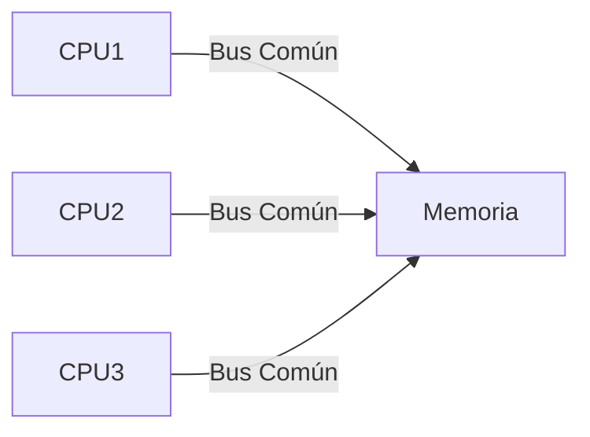
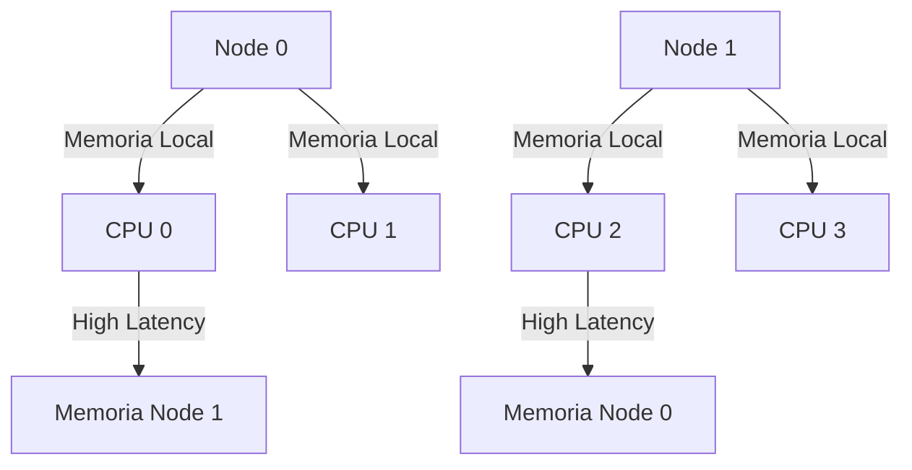
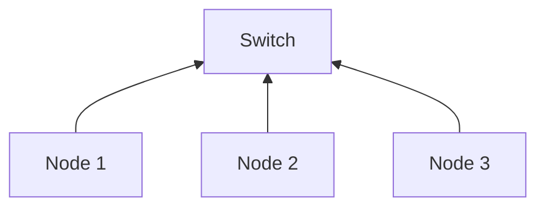

# Introducción a las Ciencias de la Computación - Conceptos generales de computación

## 1.3 Arquitecturas modernas con multiprocesadores.

---

### 1. Introducción

Las arquitecturas multiprocesador permiten ejecutar múltiples tareas en paralelo mediante el uso de varios procesadores o núcleos, mejorando significativamente el rendimiento en aplicaciones que requieren alto poder computacional.

### 2. Conceptos Clave

#### 2.1 Multiprocesador

Sistema que contiene dos o más CPUs físicas compartiendo recursos.

**Ejemplo:**  
Servidores con múltiples CPUs Intel Xeon o AMD EPYC.

#### 2.2 Multicore

Procesador con múltiples núcleos de ejecución en un solo chip.

**Fórmula de speedup:**  
$$ Speedup = \frac{T_1}{T_n} $$

Donde $T_1$ es el tiempo en un núcleo y $T_n$ en $n$ núcleos.

#### 2.3 Paralelismo

Ejecución simultánea de procesos o instrucciones.

### 3. Tipos de Arquitecturas

#### 3.1 SMP (Symmetric Multi-Processing)

Todos los procesadores comparten la misma memoria y tienen igual acceso a los recursos.



**Ventaja:** Sencillez de implementación  
**Desventaja:** Cuello de botella en el bus compartido

#### 3.2 NUMA (Non-Uniform Memory Access)

Cada procesador tiene memoria local y puede acceder (más lentamente) a memoria remota.



**Fórmula de latencia:**  
$$ L_{total} = L_{local} + \beta \times L_{remote} $$

#### 3.3 Clusters

Conjunto de computadoras independientes conectadas por red.



### 4. Sincronización

#### 4.1 Problemas de concurrencia

- Condiciones de carrera
- Deadlocks

#### 4.2 Soluciones

**Semáforos:**

```c
#include <semaphore.h>
sem_t sem;
sem_init(&sem, 0, 1); // Inicializar semáforo
sem_wait(&sem); // Sección crítica
sem_post(&sem);
```

### 5. Ejemplos Prácticos

#### 5.1 OpenMP (Paralelismo en C)

```c
#include <omp.h>
void suma_paralela(int* array, int size) {
    int total = 0;
    #pragma omp parallel for reduction(+:total)
    for(int i=0; i<size; i++) {
        total += array[i];
    }
}
```

#### 5.2 MPI (Message Passing Interface)

```c
MPI_Init(&argc, &argv);           // Inicializa el entorno MPI
int rank;
MPI_Comm_rank(MPI_COMM_WORLD, &rank);  // Obtiene el identificador (rank) del proceso actual
printf("Hello from process %d", rank); // Cada proceso imprime su identificador
MPI_Finalize();                    // Finaliza el entorno MPI
```

### 6. Preguntas de Repaso

1. ¿Cuál es la diferencia principal entre SMP y NUMA?
2. ¿Por qué es importante la sincronización en multiprocesamiento?
3. Calcular el speedup teórico para 4 núcleos si el 80% del código es paralelizable (Usar Ley de Amdahl).

### Ver también

- **1.2** Von Neumann — arquitectura base que los multiprocesadores extienden.
- **Organización y Arquitectura 7.1** (Sem. 4) — paralelismo a nivel de instrucción (ILP).

### Referencias

- Patterson, D., & Hennessy, J. (2014). _Computer Organization and Design_ (5.ª ed.). Morgan Kaufmann. Cap. 6.
- Culler, D., Singh, J. P., & Gupta, A. (1999). _Parallel Computer Architecture_. Morgan Kaufmann.
