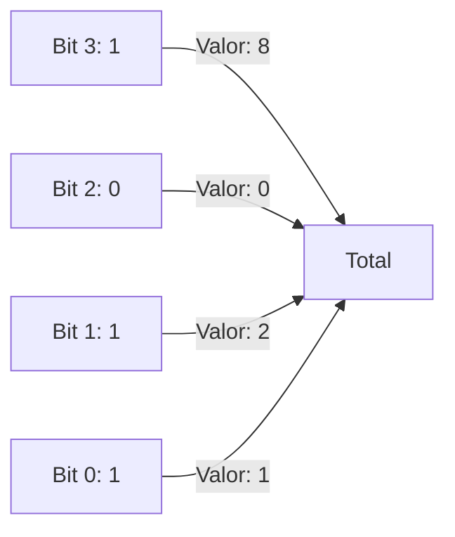
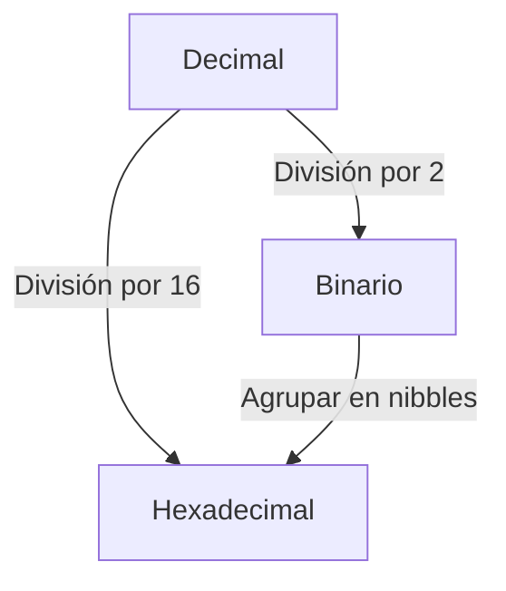

# Introducción a las Ciencias de la Computación - Conceptos generales de computación

## 1.4 Sistema binario y cambios de base.

---

### 1. Introducción

El sistema binario (base 2) es fundamental en computación, ya que los dispositivos electrónicos procesan información usando dos estados (0 y 1). Entender cómo convertir entre bases numéricas es esencial para programación y diseño de hardware.

### 2. Sistema Binario

#### 2.1 Definición

Sistema de numeración posicional que usa solo dos dígitos:

- $0$: Apagado/Sin voltaje
- $1$: Encendido/Con voltaje

**Ejemplo:**  
$1011_2 = 1 \times 2^3 + 0 \times 2^2 + 1 \times 2^1 + 1 \times 2^0 = 11_{10}$

#### 2.2 Diagrama de Bits



### 3. Cambios de Base

#### 3.1 De Binario a Decimal

Fórmula:

$$ \text{Decimal} = \sum_{i=0}^{n} b_i \times 2^i $$

**Ejemplo:**

$1101_2 = 1 \times 2^3 + 1 \times 2^2 + 0 \times 2^1 + 1 \times 2^0 = 13_{10}$

#### 3.2 De Decimal a Binario

Método de divisiones sucesivas:

```python
def decimal_a_binario(n):
    if n == 0: return '0'
    binario = ''
    while n > 0:
        binario = str(n % 2) + binario
        n = n // 2
    return binario
```

**Ejemplo:**  
$25_{10} = 11001_2$

### 4. Otras Bases

#### 4.1 Hexadecimal (Base 16)

- Dígitos: $0-9$, $A-F$
- **Ejemplo:**  
  $3F_{16} = 3 \times 16^1 + 15 \times 16^0 = 63_{10}$

#### 4.2 Conversión entre Bases



### 5. Operaciones Binarias

#### 5.1 Suma Binaria

Reglas:

- $0 + 0 = 0$
- $1 + 0 = 1$
- $1 + 1 = 10$ (0 con acarreo 1)

**Ejemplo:**

$$ \begin{align*} & 1011_2 \\\ + & 1101_2 \\ \hline & 11000_2 \\\ \end{align*} $$

#### 5.2 Desplazamiento de Bits

- **Left shift $(<<)$**: Multiplica por $2^n$

$1010_2 << 1 = 10100_2$ (20 en decimal)

### 6. Aplicaciones

#### 6.1 Representación de Datos

- **Enteros**: Complemento a 2
- **Texto**: ASCII/Unicode

#### 6.2 Máscaras de Bits

```c
unsigned int mascara = 0x1F; // 00011111 en binario
int resultado = valor & mascara;
```

### 7. Ejercicios

1. Convierte $47_{10}$ a binario y hexadecimal.
2. Suma $101101_2 + 11011_2$.
3. Explica por qué el sistema binario es usado en computación.

### Ver también

- **1.5** Representación digital — cómo se almacena información en binario.
- **Organización y Arquitectura 2.1** (Sem. 4) — sistemas numéricos posicionales en profundidad.

### Referencias

- Tanenbaum, A. S. (2013). _Structured Computer Organization_ (6.ª ed.). Pearson. Ap. B.
- Patterson, D., & Hennessy, J. (2014). _Computer Organization and Design_ (5.ª ed.). Morgan Kaufmann. Ap. B.
