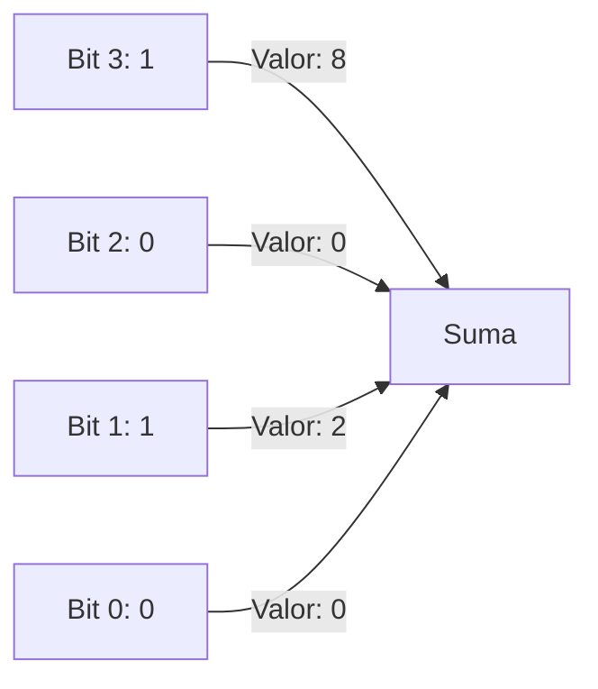
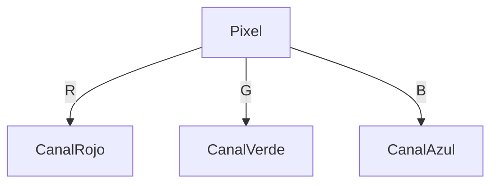

# Introducción a las Ciencias de la Computación - Conceptos generales de computación

## 1.5 Representación digital de la información.

---

### 1. Introducción

La información en sistemas digitales se representa mediante bits (0 y 1). Esta sección cubre cómo se codifican números, texto, imágenes y sonido en formato digital.

### 2. Representación de Números

#### 2.1 Enteros sin Signo

- **Fórmula**: $$ \text{Valor} = \sum_{i=0}^{n-1} b_i \times 2^i $$
- **Ejemplo**: $1010_2 = 10_{10}$



#### 2.2 Complemento a 2 (Enteros con Signo)

- **Rango**: $-2^{n-1}$ a $2^{n-1}-1$
- **Ejemplo 8 bits**: $-128$ a $127$

```c
int8_t num = -5; // Representación: 11111011
```

### 3. Representación de Texto

#### 3.1 ASCII (7 bits)

- **Ejemplo**:
  - 'A' = $65_{10}$ = $01000001_2$
  - 'a' = $97_{10}$ = $01100001_2$

#### 3.2 Unicode (UTF-8)

- **Ejemplo**: 'ñ' = `0xC3 0xB1`

```python
print(hex(ord('ñ'))) # Output: 0xf1
```

### 4. Representación de Imágenes

#### 4.1 Mapas de Bits

- **Fórmula de resolución**: $$ \text{Tamaño} = \text{ancho} \times \text{alto} \times \text{ppp} $$
- **Ejemplo**: Imagen 640x480 en 24 bits = 921.6 KB



### 5. Representación de Sonido

#### 5.1 Muestreo Digital

- **Teorema Nyquist**: $$ f_{\text{muestreo}} > 2 \times f_{\text{máx}} $$
- **Ejemplo**: Audio CD = 44.1 kHz, 16 bits/muestra

```python
import numpy as np
muestras = np.linspace(0, 1, 44100) # 1 segundo de audio
```

### 6. Ejercicios

1. Convierte $255_{10}$ a binario (8 bits) y hexadecimal.
2. ¿Cuántos bytes ocupa un texto de 100 caracteres en UTF-8?
3. Explica por qué el muestreo a 44.1 kHz es suficiente para audio humano.

### Ver también

- **1.4** Sistema binario — base numérica para la representación.
- **Organización y Arquitectura 2.1** (Sem. 4) — representación de enteros y punto flotante.

### Referencias

- Tanenbaum, A. S. (2013). _Structured Computer Organization_ (6.ª ed.). Pearson. Cap. 2.
- IEEE 754-2019. _Standard for Floating-Point Arithmetic_.
