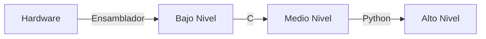
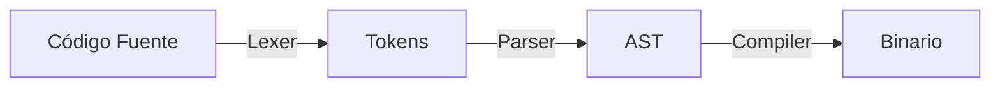

# Introducción a las Ciencias de la Computación - Conceptos generales de computación

## 1.6 Principios de lenguajes de programación.

---

### 1. Introducción

Los lenguajes de programación son sistemas estructurados para comunicar instrucciones a una computadora. Esta guía cubre sus fundamentos, paradigmas y elementos esenciales.

### 2. Conceptos Básicos

#### 2.1 Definición

"Lenguaje de programación": Conjunto de reglas sintácticas y semánticas para escribir programas ejecutables por computadoras.

#### 2.2 Niveles de Abstracción

1. **Bajo nivel**: Cercano al hardware (ej: Assembly)  
   $$ \text{Eficiencia} \propto \frac{1}{\text{Abstracción}} $$
2. **Alto nivel**: Más humano-legible (ej: Python)



### 3. Elementos Clave

#### 3.1 Sintaxis vs Semántica

- **Sintaxis**: Reglas gramaticales

```python
if x > 0:  # Sintaxis válida
    print(x)
```

- **Semántica**: Significado lógico

#### 3.2 Tipos de Datos

| Tipo      | Ejemplo | Tamaño (bits) |
| --------- | ------- | ------------- |
| `int`     | `42`    | 32            |
| `float`   | `3.14`  | 64            |
| `boolean` | `True`  | 1             |

#### 3.3 Estructuras de Control

- **Secuencia**: Ejecución lineal
- **Condicional**:

```c
    if (edad >= 18) {
        printf("Mayor");
    }
```

- **Iteración**:

```python
    for i in range(5):
        print(i)
```

### 4. Paradigmas de Programación

#### 4.1 Imperativo

- **Enfoque**: Instrucciones secuenciales
- **Ejemplo**:

```c
    int suma = 0;
    for(int i=1; i<=10; i++){
        suma += i;
    }
```

#### 4.2 Orientado a Objetos

- **Pilares**:
  1. Encapsulamiento
  2. Herencia
  3. Polimorfismo

```
classDiagram
    class Animal {
        +String nombre
        +hablar()
    }
    class Perro {
        +ladrar()
    }
    Animal <|-- Perro
```

#### 4.3 Funcional

- **Concepto**: Funciones como ciudadanos de primera clase
- **Ejemplo**:

```haskell
    suma :: Int -> Int -> Int
    suma x y = x + y
```

### 5. Proceso de Compilación

#### 5.1 Fases

1. **Análisis léxico**: Tokens
2. **Análisis sintáctico**: Árbol AST
3. **Generación de código**: Binario ejecutable



#### 5.2 Tiempos

- **Compilado** (C, Java):

  $$ t_{\text{ejecución}} = t_{\text{compilación}} + t_{\text{ejecución-binario}} $$

- **Interpretado** (Python, JS):

  $$ t_{\text{ejecución}} = t_{\text{interpretación}} $$

### 6. Ejercicios

1. Compara ventajas entre programación imperativa y funcional.
2. Escribe un diagrama de clases para `Vehiculo` y `Automovil`.
3. ¿Por qué los lenguajes de alto nivel necesitan compiladores/interpretes?

### Ver también

- **2.1** Definiciones de POO — primer paradigma de programación del curso.
- **Modelado y Programación 1.1** (Sem. 3) — paradigmas de programación en profundidad.

### Referencias

- Sebesta, R. W. (2019). _Concepts of Programming Languages_ (12.ª ed.). Pearson.
- Scott, M. L. (2016). _Programming Language Pragmatics_ (4.ª ed.). Morgan Kaufmann.
