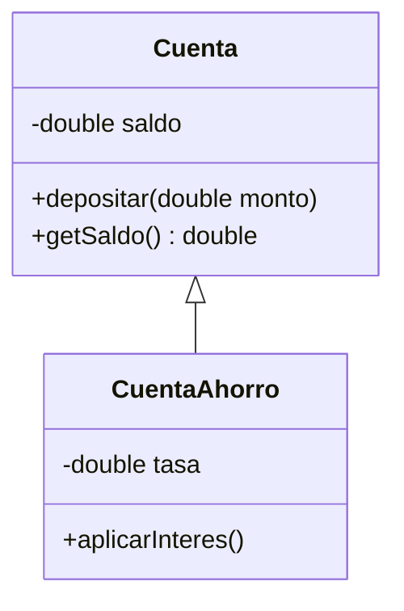
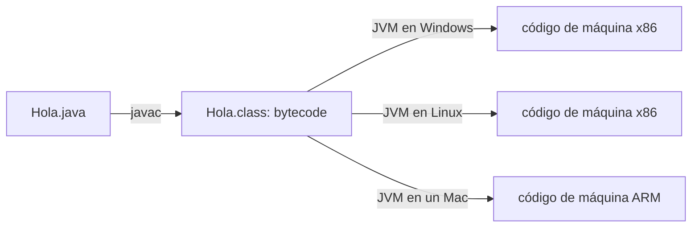
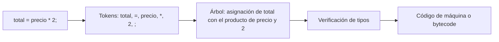

# Introducción a las Ciencias de la Computación - Conceptos generales de computación

## 1.6 Principios de lenguajes de programación.

---

Un procesador solo entiende instrucciones de máquina: secuencias de bits que suman registros o copian valores de memoria. Un **lenguaje de programación** es una notación formal, legible para las personas, que permite describir cálculos con precisión y que una herramienta traduce a esas instrucciones. Todos los lenguajes comparten algunos principios, como la separación entre sintaxis y semántica, el uso de tipos y las estructuras de control, y se diferencian en el **paradigma**, la forma de pensar los programas que promueven. Este subtema presenta esos principios y la forma en que un programa pasa del texto a la ejecución.

### 1. Niveles de abstracción

| Nivel                 | Ejemplo                                     | Características                                         |
| --------------------- | ------------------------------------------- | ------------------------------------------------------- |
| Lenguaje de máquina   | `10110000 01100001`                         | binario, específico de cada procesador                   |
| Ensamblador           | `mov al, 61h`                               | nombres simbólicos para cada instrucción de máquina      |
| Alto nivel            | `total = precio * cantidad;`                | independiente del procesador, cercano al problema       |

Un lenguaje de **alto nivel** permite expresar ideas como variables con nombre, expresiones, funciones, objetos o colecciones, sin preocuparse por registros ni direcciones. El costo es que debe traducirse, y el programador pierde control fino sobre lo que hace la máquina. Lenguajes como C se describen a veces como de "nivel medio", porque permiten manipular directamente la memoria con apuntadores.

### 2. Sintaxis y semántica

La **sintaxis** de un lenguaje es el conjunto de reglas que dice qué textos son programas válidos. Se describe con gramáticas como las de Estructuras Discretas (subtema 1.3). La **semántica** dice qué significa cada programa válido, es decir, qué hace al ejecutarse.

- `int x = "hola";` es sintácticamente correcto en Java pero tiene un **error semántico**: los tipos no coinciden, y el compilador lo rechaza.
- `x = x / 0;` puede ser sintáctica y semánticamente válido para el compilador, pero produce un **error en tiempo de ejecución**.
- `promedio = suma / n - 1;` compila y se ejecuta, pero si se quería `suma / (n - 1)` es un **error lógico**: el programa hace algo distinto de lo que se pretendía. Ninguna herramienta lo detecta automáticamente.

### 3. Elementos comunes a los lenguajes

**Valores, tipos y variables.** Un **tipo** es un conjunto de valores junto con las operaciones permitidas sobre ellos. Una **variable** es un nombre asociado a un lugar donde se guarda un valor.

- En lenguajes con **tipado estático**, como Java o C, el tipo de cada variable se conoce antes de ejecutar, y el compilador detecta los errores de tipo.
- En lenguajes con **tipado dinámico**, como Python o JavaScript, los tipos se verifican durante la ejecución.

```java
int edad = 20;           // entero de 32 bits
double precio = 199.90;  // punto flotante de 64 bits
boolean activo = true;   // verdadero o falso
char inicial = 'A';      // carácter Unicode de 16 bits
String nombre = "Ana";   // cadena: un objeto, no un tipo primitivo
```

**Expresiones y operadores.** Combinan valores para producir otros: `precio * cantidad`, `edad >= 18 && activo`.

**Estructuras de control.** Corrado Böhm y Giuseppe Jacopini demostraron en 1966 que cualquier algoritmo puede escribirse con solo tres estructuras: **secuencia**, **selección** y **repetición**.

```java
int suma = 0;                         // secuencia
for (int i = 1; i <= 10; i++) {       // repetición
    if (i % 2 == 0) {                 // selección
        suma += i;
    }
}
System.out.println(suma);             // 30: la suma de los pares del 1 al 10
```

**Abstracción.** Las **funciones** o **métodos** dan nombre a un cálculo y lo parametrizan, y los **tipos definidos por el usuario**, como las clases, agrupan datos con sus operaciones. La abstracción permite usar algo sabiendo **qué** hace, sin saber **cómo** lo hace.

### 4. Paradigmas de programación

Un **paradigma** es un estilo de organizar los programas. La mayoría de los lenguajes modernos admite varios.

**Imperativo.** El programa es una secuencia de instrucciones que modifican el estado, como el modelo de Von Neumann. Ejemplos: C, Pascal.

**Orientado a objetos.** El programa es un conjunto de **objetos** que guardan su propio estado y se comunican mediante mensajes. Sus principios son el encapsulamiento, la herencia y el polimorfismo. Ejemplos: Java, C#, Python. Es el paradigma central de este curso, a partir del tema 2.



**Funcional.** El programa es una composición de **funciones** sin efectos secundarios, y los datos no se modifican sino que se crean nuevos. Ejemplos: Haskell, Lisp; Java lo admite desde la versión 8 con lambdas y flujos.

```java
int sumaPares = java.util.stream.IntStream.rangeClosed(1, 10)
        .filter(i -> i % 2 == 0)
        .sum();                       // 30, sin variables que cambien
```

**Lógico.** El programa es un conjunto de hechos y reglas, y la ejecución consiste en deducir respuestas. Ejemplo: Prolog.

```prolog
padre(juan, ana).
padre(ana, luis).
abuelo(X, Z) :- padre(X, Y), padre(Y, Z).
% ?- abuelo(juan, Quien).   responde Quien = luis
```

**Declarativo** es el nombre general de los estilos en que se describe **qué** se quiere, no **cómo** obtenerlo, como SQL, HTML o los paradigmas funcional y lógico.

### 5. De código fuente a ejecución

Hay tres estrategias principales para ejecutar un programa de alto nivel.

**Compilación.** Un **compilador** traduce todo el programa a código de máquina antes de ejecutarlo. La ejecución es rápida, pero el ejecutable depende del procesador y del sistema operativo. Ejemplos: C, C++, Rust.

**Interpretación.** Un **intérprete** lee el programa y ejecuta cada instrucción conforme la encuentra. Es flexible y portable, pero más lento. Ejemplo clásico: las primeras versiones de BASIC, y en buena medida Python.

**Esquema híbrido.** El compilador traduce a un **código intermedio** independiente del procesador, que luego ejecuta una **máquina virtual**. Es el caso de Java:



El mismo archivo `.class` se ejecuta en cualquier sistema con una máquina virtual de Java (JVM), lo que se resume en el lema "escríbelo una vez, ejecútalo en cualquier lugar". La JVM además incluye un **compilador justo a tiempo** (JIT) que traduce a código de máquina las partes del programa que se ejecutan con frecuencia, de modo que el rendimiento se acerca al de un lenguaje compilado.

**Fases de un compilador.**

1. **Análisis léxico:** divide el texto en **tokens**, como palabras clave, identificadores, números y símbolos.
2. **Análisis sintáctico:** verifica la gramática y construye el **árbol de sintaxis abstracta**.
3. **Análisis semántico:** verifica tipos y declaraciones.
4. **Generación de código intermedio y optimización.**
5. **Generación de código** final.



### 6. Criterios para comparar lenguajes

- **Legibilidad:** qué tan fácil es entender un programa escrito por otro.
- **Facilidad de escritura:** qué tan directo es expresar una idea.
- **Confiabilidad:** cuántos errores detecta el lenguaje antes de ejecutar, por ejemplo con tipos estáticos.
- **Eficiencia:** tiempo y memoria que consumen los programas.
- **Portabilidad y ecosistema:** en cuántas plataformas funciona y qué bibliotecas existen.

Ningún lenguaje es el mejor en todos los criterios. C es muy eficiente pero permite errores de memoria difíciles de encontrar; Python es muy fácil de escribir pero más lento; Java busca un equilibrio entre confiabilidad, portabilidad y eficiencia.

> **Conexión con CC.** El estudio formal de los lenguajes, cómo se definen su sintaxis y su semántica y cómo se implementan, es el contenido de materias posteriores: Autómatas y Lenguajes Formales estudia las gramáticas, Lenguajes de Programación compara paradigmas y semánticas, y Compiladores construye un traductor completo. Conocer varios paradigmas hace mejor programador incluso en un solo lenguaje.

### Ejercicios propuestos

1. Clasifique cada error como sintáctico, semántico, de ejecución o lógico: (a) olvidar un punto y coma en Java; (b) acceder a la posición 10 de un arreglo de 5 elementos; (c) calcular el área de un círculo como `2 * Math.PI * r`; (d) asignar un `String` a una variable `int`.
2. Escriba la suma de los cuadrados de los números del 1 al 100 en estilo imperativo, con un ciclo, y en estilo funcional, con `IntStream`.
3. Explique por qué un programa compilado para Windows no se ejecuta en un Mac, mientras que un archivo `.class` de Java sí.
4. Identifique los tokens de la línea `if (x >= 10) y = y + 1;` y dibuje su árbol de sintaxis.
5. Compare Java y Python según los criterios de la sección 6, con un ejemplo concreto para cada criterio.

### Ver también

- **1.1** Historia de la computación — la evolución de los lenguajes.
- **1.7** Ambientes de desarrollo — las herramientas para escribir, compilar y depurar.
- **2.1** Definiciones — el paradigma orientado a objetos.
- **Estructuras Discretas 1.3** — gramáticas y árboles de derivación.
- **Lenguajes de Programación** (Sem. 5) y **Compiladores** (Sem. 7) — estudio formal de los lenguajes y su implementación.

### Referencias

- Sebesta, R. W. (2019). _Concepts of Programming Languages_ (12.ª ed.). Pearson. Cap. 1 y 2.
- Scott, M. L. (2016). _Programming Language Pragmatics_ (4.ª ed.). Morgan Kaufmann. Cap. 1.
- Böhm, C., & Jacopini, G. (1966). Flow diagrams, Turing machines and languages with only two formation rules. _Communications of the ACM_, 9(5), 366-371.
