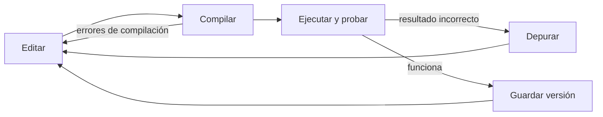

# Introducción a las Ciencias de la Computación - Conceptos generales de computación

## 1.7 Ambientes de desarrollo de la programación.

---

Escribir un programa es solo una parte del trabajo: también hay que compilarlo, ejecutarlo, encontrar sus errores, probarlo, guardar su historia y compartirlo. Un **ambiente de desarrollo** es el conjunto de herramientas que acompañan ese ciclo. Este subtema describe esas herramientas, desde la terminal hasta los entornos integrados, y el flujo de trabajo básico con Java que se usará durante el curso.

### 1. El ciclo de desarrollo



Programar es iterar: se escribe una parte pequeña, se compila, se prueba, se corrige y se repite. Cuanto más corto es cada ciclo, más pronto se detectan los errores y más barato es corregirlos.

### 2. Las herramientas básicas

| Herramienta               | Función                                                         | Ejemplos para Java                           |
| ------------------------- | --------------------------------------------------------------- | -------------------------------------------- |
| Editor de texto           | escribir el código con resaltado de sintaxis                     | VS Code, Vim, Sublime Text                   |
| Compilador                | traducir el código fuente y reportar errores                     | `javac`                                      |
| Entorno de ejecución      | ejecutar el programa compilado                                    | la JVM, con el comando `java`                |
| Depurador                 | ejecutar paso a paso e inspeccionar variables                    | `jdb`, el depurador del IDE                  |
| Herramienta de construcción | compilar proyectos grandes y manejar dependencias              | Maven, Gradle                                |
| Control de versiones      | guardar la historia de los cambios y colaborar                   | Git, con servicios como GitHub o GitLab      |
| Pruebas automáticas       | verificar que el código hace lo esperado                          | JUnit                                        |

Para Java se necesita el **JDK** (Java Development Kit), que incluye el compilador `javac`, la máquina virtual y la biblioteca estándar. El **JRE** solo permite ejecutar programas ya compilados.

### 3. Trabajar desde la terminal

Conviene saber compilar y ejecutar sin un IDE, para entender qué hace este por nosotros:

```java
// Archivo: Saludo.java  (el nombre del archivo debe coincidir con la clase pública)
public class Saludo {
    public static void main(String[] args) {
        String nombre = args.length > 0 ? args[0] : "mundo";
        System.out.println("Hola, " + nombre);
    }
}
```

```bash
javac Saludo.java        # compila y genera Saludo.class
java Saludo              # ejecuta: Hola, mundo
java Saludo Ana          # con un argumento: Hola, Ana
java Saludo.java Ana     # desde Java 11: compila en memoria y ejecuta en un paso
```

Si hay un error, el compilador indica el archivo, la línea y una descripción:

```text
Saludo.java:4: error: ';' expected
        String nombre = "mundo"
                               ^
1 error
```

Leer con atención el **primer** mensaje de error es la habilidad más útil al empezar: los siguientes suelen ser consecuencia de él.

### 4. Entornos de desarrollo integrados (IDE)

Un **IDE** reúne todas las herramientas en una sola aplicación. Para Java los más usados son IntelliJ IDEA, Eclipse, NetBeans y VS Code con extensiones para Java. Además de editar, compilar y ejecutar, ofrecen:

- **Compilación continua:** subrayan los errores mientras se escribe.
- **Autocompletado:** sugieren métodos y atributos disponibles para un objeto.
- **Navegación:** saltar a la definición de una clase o encontrar dónde se usa un método.
- **Refactorización:** renombrar una variable en todo el proyecto, extraer un método, cambiar firmas de forma segura.
- **Depurador gráfico:** ver el estado del programa mientras se ejecuta.

| Aspecto            | IDE completo                          | Editor con extensiones               |
| ------------------ | ------------------------------------- | ------------------------------------ |
| Configuración      | casi nula                             | hay que elegir y ajustar extensiones |
| Consumo de recursos | alto                                 | bajo a moderado                      |
| Funciones de análisis | muy completas                      | dependen de las extensiones          |
| Varios lenguajes   | suele especializarse en uno           | muy flexible                         |

Una advertencia para quien aprende: el autocompletado y la generación automática de código son útiles, pero conviene entender cada línea que se escribe. Un error en código que no se entiende es mucho más difícil de corregir.

### 5. Depuración

**Depurar** es encontrar la causa de un comportamiento incorrecto. El depurador permite:

- colocar **puntos de interrupción** (breakpoints) en líneas donde se quiere detener la ejecución;
- avanzar **paso a paso**, entrando o no a los métodos que se llaman;
- **inspeccionar** los valores de las variables y la pila de llamadas en cada momento;
- evaluar expresiones mientras el programa está detenido.

Una estrategia sistemática es más eficaz que hacer cambios al azar: reproducir el error con una entrada concreta, formular una hipótesis sobre su causa, verificarla con el depurador o con mensajes, y corregir. Explicar el código línea por línea en voz alta, a otra persona o a un objeto, suele revelar el error: es la técnica conocida como "depuración con patito de hule".

### 6. Control de versiones con Git

Un sistema de **control de versiones** guarda la historia de los cambios de un proyecto: quién cambió qué, cuándo y por qué. Permite volver a versiones anteriores, trabajar en paralelo en **ramas** y combinar el trabajo de varias personas.

```bash
git init                         # crea un repositorio en la carpeta actual
git add Saludo.java              # prepara el archivo para la siguiente versión
git commit -m "Primer saludo"    # guarda una versión con un mensaje descriptivo
git log --oneline                # muestra la historia
git switch -c argumentos         # crea una rama para un cambio experimental
git push origin main             # sube los cambios a un repositorio remoto
```

Conviene hacer versiones pequeñas y frecuentes con mensajes que expliquen el motivo del cambio, y no incluir en el repositorio archivos generados, como los `.class`, que se excluyen con un archivo `.gitignore`.

### 7. Pruebas automáticas

En lugar de verificar a mano un programa después de cada cambio, se escriben **pruebas** que lo hacen automáticamente:

```java
import static org.junit.jupiter.api.Assertions.assertEquals;
import org.junit.jupiter.api.Test;

class CalculadoraTest {
    @Test
    void sumaDosNumeros() {
        assertEquals(5, Calculadora.suma(2, 3));
    }

    @Test
    void sumaConNegativos() {
        assertEquals(-1, Calculadora.suma(2, -3));
    }
}
```

Ejecutar las pruebas tras cada cambio confirma que no se rompió algo que antes funcionaba. Los servicios de **integración continua** las ejecutan automáticamente cada vez que alguien sube cambios al repositorio.

### 8. Otras herramientas del ambiente

- **Herramientas de construcción** como Maven y Gradle descargan las bibliotecas que el proyecto necesita, compilan todos sus archivos en el orden correcto, ejecutan las pruebas y empaquetan el resultado en un archivo `.jar`.
- **Analizadores estáticos** como Checkstyle o SpotBugs revisan el código sin ejecutarlo y señalan malas prácticas o errores probables.
- **Formateadores** aplican automáticamente un estilo uniforme de sangrías y espacios.
- **Contenedores** como Docker empaquetan el programa junto con todo lo que necesita para ejecutarse, de modo que funcione igual en cualquier máquina.

> **Conexión con CC.** En la industria, el ambiente de desarrollo es tan importante como el lenguaje: un equipo profesional comparte repositorio, convenciones de estilo, pruebas automáticas e integración continua. Estos temas se profundizan en Ingeniería de Software (Sem. 6). Aprender desde el inicio a compilar en la terminal, leer mensajes de error y usar Git ahorra mucho tiempo en todos los cursos posteriores.

### Ejercicios prácticos

1. Instale el JDK y verifique la instalación con `javac -version` y `java -version`.
2. Escriba, compile y ejecute desde la terminal el programa `Saludo`. Introduzca deliberadamente tres errores distintos y anote los mensajes del compilador.
3. Abra el mismo programa en un IDE, coloque un punto de interrupción en la línea del `println` y observe el valor de `args` y de `nombre` al ejecutarlo con y sin argumentos.
4. Cree un repositorio de Git para sus ejercicios del curso, haga al menos tres versiones con mensajes descriptivos y revise la historia con `git log`.
5. Escriba la clase `Calculadora` con un método estático `suma` que haga pasar las pruebas de la sección 7, y agregue una prueba para un método `division` que verifique qué ocurre al dividir entre cero.

### Ver también

- **1.6** Principios de lenguajes de programación — compilación, interpretación y máquinas virtuales.
- **2.3** Organización general de un programa — la estructura de un programa en Java.
- **2.5** Uso de bibliotecas — cómo se incorporan bibliotecas a un proyecto.
- **9.5** Depuración en hilos de ejecución — depurar programas concurrentes.
- **Ingeniería de Software** (Sem. 6) — procesos de desarrollo, pruebas y control de versiones en equipo.

### Referencias

- Chacon, S., & Straub, B. (2014). _Pro Git_ (2.ª ed.). Apress. Disponible en git-scm.com/book.
- Hunt, A., & Thomas, D. (2019). _The Pragmatic Programmer_ (20th anniversary ed.). Addison-Wesley. Cap. 3.
- Oracle. _The Java Tutorials: Getting Started_. https://docs.oracle.com/javase/tutorial/
