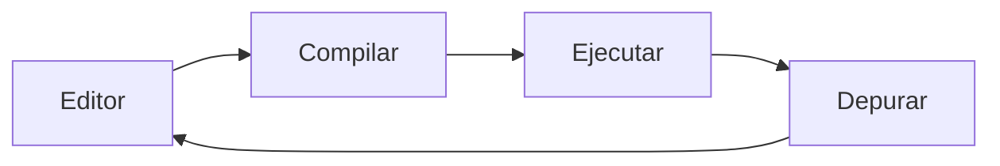
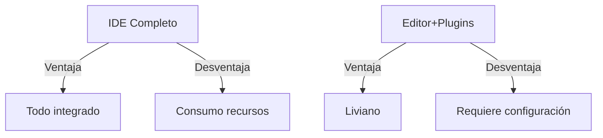

# Introducción a las Ciencias de la Computación - Conceptos generales de computación

## 1.7 Ambientes de desarrollo de la programación.

---

### 1. Introducción

Un ambiente de desarrollo integrado (IDE) es un conjunto de herramientas que facilitan la escritura, depuración y ejecución de código. Esta guía explora sus componentes esenciales y flujos de trabajo.

### 2. Componentes Clave

#### 2.1 Estructura Básica


#### 2.2 Elementos Fundamentales

| Componente     | Función                                                      | Ejemplo               |
| -------------- | ------------------------------------------------------------ | --------------------- |
| **Editor**     | Soporte para escritura de código con resaltado de sintaxis   | VS Code, Sublime Text |
| **Compilador** | Traduce código fuente a lenguaje máquina                     | GCC (C), javac (Java) |
| **Depurador**  | Permite inspeccionar y corregir errores durante la ejecución | GDB, pdb (Python)     |
| **Terminal**   | Interfaz para ejecutar comandos del sistema                  | Bash, PowerShell      |

### 3. Tipos de Ambientes

#### 3.1 IDEs Complejos

- **Características**:
  - Integración de todas las herramientas en una interfaz
  - Soporte para múltiples lenguajes $(\text{Productividad} \propto \frac{1}{\text{Herramientas Externas}})$

**Ejemplo JetBrains:**

```java
// Uso de IntelliJ IDEA para Java
public class Main {
    public static void main(String[] args) {
        System.out.println("Hello IDE");
    }
}
```

#### 3.2 Editores con Plugins

- **Ventaja**: Personalización extrema
- **Fórmula de eficiencia**:

$$ \text{Eficiencia} = \sum (\text{Plugins Esenciales}) - \text{Overhead Configuración} $$

**Configuración VS Code (JSON):**

```json
{
  "editor.fontSize": 14,
  "python.linting.enabled": true
}
```

### 4. Flujo de Trabajo Típico

#### 4.1 Ciclo de Desarrollo



#### 4.2 Control de Versiones

- **Git Integration**:

```bash
git add .
git commit -m "Fix bug"
git push
```

### 5. Herramientas Adicionales

#### 5.1 Entornos Virtuales

**Python (venv):**

```bash
python -m venv myenv
source myenv/bin/activate
```

#### 5.2 Contenedores

**Docker (Ejemplo):**

```dockerfile
FROM python:3.9
COPY . /app
WORKDIR /app
RUN pip install -r requirements.txt
```

### 6. Comparativa IDE vs Editores



### 7. Ejercicios Prácticos

1. Instala VS Code y configura el plugin para Python
2. Crea un entorno virtual y ejecuta un script simple
3. Explica cómo Git se integra en un flujo de desarrollo moderno

### Ver también

- **1.6** Principios de lenguajes de programación — el contexto teórico del entorno de desarrollo.
- **2.1** Definiciones de POO — los entornos modernos están centrados en la POO.

### Referencias

- Eckel, B. (2006). _Thinking in Java_ (4.ª ed.). Prentice Hall.
- Bloch, J. (2018). _Effective Java_ (3.ª ed.). Addison-Wesley.
