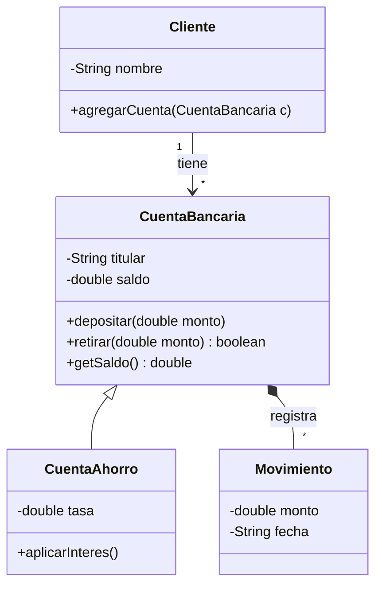

# Introducción a las Ciencias de la Computación - Vista panorámica de la programación orientada a objetos

## 2.1 Definiciones.

---

La **programación orientada a objetos** (POO) organiza un programa como un conjunto de **objetos** que colaboran enviándose mensajes, en lugar de como una larga secuencia de instrucciones que manipulan datos sueltos. La idea, que surgió con Simula en 1967 y se desarrolló con Smalltalk en la década de 1970, es que el código refleje la estructura del problema: si el problema habla de cuentas, clientes y transferencias, el programa tendrá objetos que representan cuentas, clientes y transferencias. Este subtema fija el vocabulario básico que se usará en el resto del curso.

### 1. Objeto

Un **objeto** es una entidad de un programa que tiene:

- **Estado:** los datos que guarda en un momento dado, almacenados en sus **atributos**. Una cuenta bancaria tiene un número, un titular y un saldo.
- **Comportamiento:** las operaciones que sabe realizar, llamadas **métodos**. Una cuenta sabe depositar, retirar e informar su saldo.
- **Identidad:** cada objeto es distinto de cualquier otro, aunque su estado sea igual. Dos cuentas con el mismo saldo siguen siendo dos cuentas.

El estado de un objeto cambia solo a través de su comportamiento: para modificar el saldo no se asigna directamente un número, sino que se le pide a la cuenta que deposite o retire.

### 2. Clase e instancia

Una **clase** es la descripción de un tipo de objetos: qué atributos tienen y qué métodos ofrecen. Cada objeto concreto creado a partir de una clase es una **instancia** de ella. La clase es como el plano de una casa; los objetos son las casas construidas con ese plano, cada una con sus propios habitantes.

```java
public class CuentaBancaria {
    // Atributos: el estado de cada cuenta
    private final String titular;
    private double saldo;

    // Constructor: inicializa el estado de un objeto nuevo
    public CuentaBancaria(String titular) {
        this.titular = titular;
        this.saldo = 0;
    }

    // Métodos: el comportamiento
    public void depositar(double monto) {
        if (monto <= 0) {
            throw new IllegalArgumentException("El monto debe ser positivo");
        }
        saldo += monto;
    }

    public boolean retirar(double monto) {
        if (monto <= 0 || monto > saldo) {
            return false;            // la cuenta protege su propio estado
        }
        saldo -= monto;
        return true;
    }

    public double getSaldo() { return saldo; }
    public String getTitular() { return titular; }
}
```

```java
public class Banco {
    public static void main(String[] args) {
        CuentaBancaria a = new CuentaBancaria("Ana");   // una instancia
        CuentaBancaria b = new CuentaBancaria("Luis");  // otra instancia, con su propio saldo
        a.depositar(500);
        b.depositar(200);
        a.retirar(150);
        System.out.println(a.getTitular() + ": " + a.getSaldo());   // Ana: 350.0
        System.out.println(b.getTitular() + ": " + b.getSaldo());   // Luis: 200.0
        System.out.println(a.retirar(1000));                         // false
    }
}
```

### 3. Mensajes

En POO, invocar un método se describe como **enviar un mensaje** a un objeto: `a.depositar(500)` le pide al objeto `a` que deposite 500. El objeto que envía el mensaje no necesita saber cómo lo resuelve el receptor, solo qué mensajes entiende. El conjunto de mensajes que un objeto acepta es su **interfaz pública**.

### 4. Los cuatro principios

**Abstracción.** Un modelo conserva solo los rasgos relevantes para el problema. Para un banco, una persona es un nombre, un número de cliente y unas cuentas; su estatura o su color favorito no importan. Elegir bien qué incluir es la primera decisión de diseño.

**Encapsulamiento.** Los atributos de un objeto se ocultan (`private`) y solo se acceden mediante sus métodos públicos. Así el objeto **protege sus invariantes**: en el ejemplo, ningún código externo puede dejar el saldo negativo, porque la única forma de cambiarlo pasa por `retirar`, que lo verifica. Además, la representación interna puede cambiar sin afectar a quien usa la clase.

**Herencia.** Una clase puede definirse como **extensión** de otra, heredando sus atributos y métodos y agregando o modificando algunos. Una `CuentaAhorro` es una `CuentaBancaria` que además genera intereses. La herencia expresa la relación "es un" y evita repetir código (tema 5).

**Polimorfismo.** Un mismo mensaje puede producir comportamientos distintos según el tipo real del objeto que lo recibe. Si `CuentaAhorro` y `CuentaCheques` definen de forma diferente el método `cobrarComision()`, un programa que recorre una lista de cuentas y les envía ese mensaje obtiene el comportamiento correcto para cada una, sin preguntar de qué tipo es (subtema 5.3).

### 5. Relaciones entre clases

| Relación          | Significado                                                  | Ejemplo                                       |
| ----------------- | ------------------------------------------------------------ | --------------------------------------------- |
| Asociación        | un objeto conoce a otro y le envía mensajes                   | un `Cliente` tiene cuentas                    |
| Agregación        | un objeto agrupa a otros que pueden existir por separado      | un `Equipo` agrupa `Jugador`es                |
| Composición       | un objeto está formado por partes que no existen sin él       | una `Factura` tiene `Renglon`es               |
| Herencia          | una clase es un caso particular de otra                       | `CuentaAhorro` es una `CuentaBancaria`        |
| Dependencia       | una clase usa a otra de forma temporal, por ejemplo como parámetro | `Banco` usa `CuentaBancaria`             |

En notación **UML**, el estándar para diagramar software:



El signo `-` indica un miembro privado y `+` uno público. La flecha con triángulo es herencia, el rombo relleno es composición y los números indican cuántos objetos participan: un cliente tiene muchas (`*`) cuentas.

### 6. Comparación con la programación estructurada

| Aspecto            | Estructurada                                 | Orientada a objetos                              |
| ------------------ | -------------------------------------------- | ------------------------------------------------ |
| Unidad principal   | la función o procedimiento                   | el objeto, que une datos y operaciones           |
| Datos              | separados de las funciones que los usan       | encapsulados dentro de los objetos               |
| Cambios            | modificar un dato puede afectar muchas funciones | el cambio queda dentro de la clase          |
| Reutilización      | bibliotecas de funciones                      | clases, herencia y composición                   |

La POO no reemplaza a la programación estructurada: dentro de cada método se siguen usando secuencias, condicionales y ciclos. Lo que cambia es cómo se organiza el programa completo.

> **Conexión con CC.** La mayoría de las bibliotecas y marcos de trabajo actuales están diseñados con objetos: las colecciones de Java, las interfaces gráficas, los componentes de Angular o los modelos de un sistema web. Entender las ideas de este subtema permite leer y usar esas bibliotecas. Los principios de diseño más avanzados, como los patrones de diseño y los principios SOLID, se estudian en Modelado y Programación (Sem. 3).

### Ejercicios propuestos

1. Para un sistema de préstamos de una biblioteca, identifique al menos cuatro clases, con dos atributos y dos métodos para cada una.
2. Agregue a `CuentaBancaria` un método `transferir(double monto, CuentaBancaria destino)` que solo transfiera si hay saldo suficiente. ¿Por qué conviene que use `retirar` y `depositar` en lugar de modificar directamente los saldos?
3. Explique qué invariante protege la clase `CuentaBancaria` y qué pasaría si el atributo `saldo` fuera público.
4. Clasifique cada relación como asociación, agregación, composición o herencia: (a) un automóvil y sus llantas; (b) un profesor y los cursos que imparte; (c) un perro y un animal; (d) un libro y sus páginas.
5. Escriba la clase `Estudiante`, con nombre, número de cuenta y una lista de calificaciones, y un método que calcule el promedio. Cree tres instancias en un `main`.

### Ver también

- **1.6** Principios de lenguajes de programación — el paradigma orientado a objetos entre los demás.
- **2.2** Diseño orientado a objetos — cómo encontrar las clases y sus responsabilidades.
- **2.3** Organización general de un programa — la estructura de un programa en Java.
- **3.1 y 3.4** Atributos, visibilidad y tipos de métodos — los elementos de una clase en detalle.
- **Tema 5** Herencia — extensión de clases, polimorfismo e interfaces.
- **Modelado y Programación** (Sem. 3) — diseño orientado a objetos avanzado.

### Referencias

- Eckel, B. (2006). _Thinking in Java_ (4.ª ed.). Prentice Hall. Cap. 1.
- Booch, G., et al. (2007). _Object-Oriented Analysis and Design with Applications_ (3.ª ed.). Addison-Wesley. Cap. 1 a 3.
- Fowler, M. (2003). _UML Distilled_ (3.ª ed.). Addison-Wesley.
- Oracle. _The Java Tutorials: Object-Oriented Programming Concepts_. https://docs.oracle.com/javase/tutorial/java/concepts/
