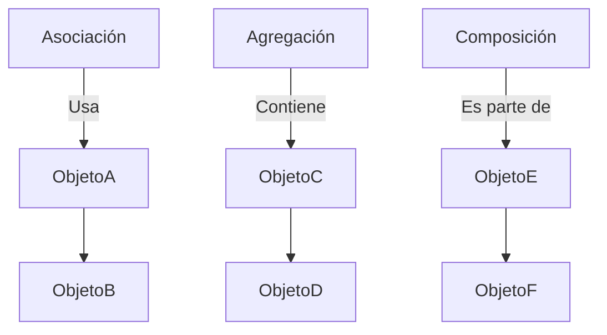

# Introducción a las Ciencias de la Computación - Vista panorámica de la programación orientada a objetos

## 2.1 Definiciones.

---

### 1. Concepto Fundamental

**POO (Programación Orientada a Objetos):** Paradigma de programación que organiza el código en "objetos" que contienen **datos** (atributos) y **comportamientos** (métodos).

$$ \text{Objeto} = \text{Estado (Atributos)} + \text{Comportamiento (Métodos)} $$

### 2. Pilares de la POO

#### 2.1 Encapsulamiento

Ocultar los detalles internos de un objeto y exponer solo lo necesario.

**Ejemplo en Java:**

```java
public class CuentaBancaria {
    private double saldo; // Atributo encapsulado

    public void depositar(double monto) {
        if (monto > 0) {
            this.saldo += monto;
        }
    }
}
```

#### 2.2 Herencia

Crear nuevas clases basadas en clases existentes.

```
classDiagram
    class Vehiculo {
        +String marca
        +arrancar()
    }
    class Automovil {
        +int puertas
    }
    Vehiculo <|-- Automovil
```

#### 2.3 Polimorfismo

Un objeto puede tomar muchas formas.

**Fórmula de relación:**  
$$ \text{Polimorfismo} \approx \sum_{i=1}^{n} \text{Métodos}(ClaseBase) \rightarrow \text{Implementaciones}(ClasesDerivadas) $$

#### 2.4 Abstracción

Simplificar la complejidad mediante modelos.

### 3. Elementos Clave

#### 3.1 Clase vs Objeto

| **Clase**            | **Objeto**         |
| -------------------- | ------------------ |
| Plantilla/Definición | Instancia concreta |
| "Receta"             | "Plato cocinado"   |

**Ejemplo en Python:**

```python
class Perro:  # Clase
    def __init__(self, nombre):
        self.nombre = nombre

mi_perro = Perro("Fido")  # Objeto
```

#### 3.2 Métodos Especiales

- Constructor (`__init__`, `new`)
- Destructor (`__del__`)

### 4. Relaciones entre Objetos

#### 4.1 Tipos de Relaciones



**Ejemplo Composición:**

```typescript
class Motor {
  encender() {
    /* ... */
  }
}

class Auto {
  private motor: Motor;
  constructor() {
    this.motor = new Motor();
  }
}
```

### 5. Principios SOLID (Base teórica)

1. **S**RP: Una clase, una responsabilidad
2. **O**CP: Abierto a extensión, cerrado a modificación
3. **L**SP: Subtipos deben ser sustituibles
4. **I**SP: Interfaces específicas > generales
5. **D**IP: Depender de abstracciones

### 6. Ejercicios

1. Crea una clase `Estudiante` con herencia de `Persona`
2. Explica cómo aplicar encapsulamiento en un sistema de reservas de hotel
3. Dibuja un diagrama de clases para una biblioteca

### Ver también

- **2.2** Diseño orientado a objetos — aplicación práctica de los conceptos definidos aquí.
- **2.3** Organización de un programa OO — estructura en paquetes y clases.
- **Estructuras de Datos 1.1** (Sem. 2) — los TDA son la manifestación formal de la abstracción.

### Referencias

- Eckel, B. (2006). _Thinking in Java_ (4.ª ed.). Prentice Hall. Cap. 1-2.
- Gamma, E., Helm, R., Johnson, R., & Vlissides, J. (1994). _Design Patterns_. Addison-Wesley.
- Martin, R. C. (2017). _Clean Architecture_. Prentice Hall.
