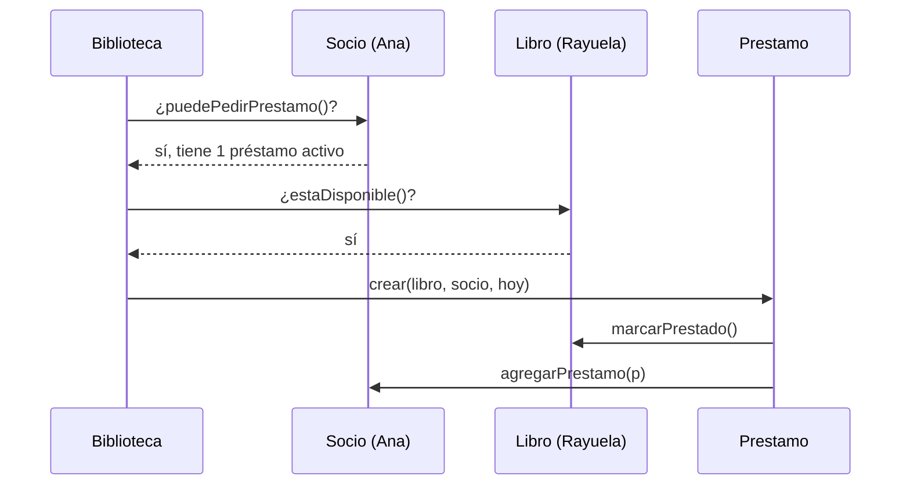

# Introducción a las Ciencias de la Computación - Vista panorámica de la programación orientada a objetos

## 2.2 Diseño orientado a objetos (tarjetas de responsabilidades).

---

Antes de escribir código hay que decidir qué clases tendrá el programa y qué le toca hacer a cada una. Las **tarjetas CRC** (Clase, Responsabilidades, Colaboradores), propuestas por Kent Beck y Ward Cunningham en 1989, son una técnica sencilla para tomar esas decisiones: cada clase se describe en una ficha pequeña, y el diseño se pone a prueba recorriendo escenarios de uso. Que la ficha sea pequeña es intencional: obliga a que cada clase tenga pocas responsabilidades y bien definidas.

### 1. La tarjeta CRC

Cada tarjeta tiene tres partes:

- **Clase:** el nombre, en singular, de un tipo de objetos.
- **Responsabilidades:** lo que la clase **sabe** (información que guarda) y lo que **hace** (servicios que ofrece). Se escriben como frases cortas, sin detalles de implementación.
- **Colaboradores:** las otras clases a las que necesita pedir ayuda para cumplir sus responsabilidades.

**Ejemplo:**

| **Préstamo**                                   |                  |
| ---------------------------------------------- | ---------------- |
| *Responsabilidades*                            | *Colaboradores*  |
| conocer el libro y el socio                    | Libro, Socio     |
| conocer la fecha de préstamo y de vencimiento  |                  |
| calcular si está vencido                       |                  |
| calcular la multa por retraso                  |                  |
| registrar la devolución                        | Libro            |

### 2. El proceso de diseño

**Paso 1: identificar clases candidatas.** Se lee la descripción del problema y se subrayan los **sustantivos**: son posibles clases o atributos. Los **verbos** sugieren responsabilidades.

> *Enunciado:* "La biblioteca presta **libros** a sus **socios**. Cada socio puede tener a lo sumo tres **préstamos** activos. Un préstamo dura 14 días; si el libro se **devuelve** tarde, el socio paga una **multa** de 5 pesos por día. El **bibliotecario** **registra** los préstamos y las devoluciones y puede **consultar** qué libros están disponibles."

Sustantivos: biblioteca, libro, socio, préstamo, día, multa, bibliotecario. Verbos: prestar, devolver, pagar, registrar, consultar.

**Paso 2: filtrar.** No todo sustantivo es una clase:

- *Día* y *multa* son valores simples, mejor como atributos o resultados de un cálculo.
- *Bibliotecario* es quien usa el sistema, no un objeto que el sistema necesite modelar, salvo que haya que registrar quién hizo cada operación.
- *Biblioteca* puede ser la clase que coordina todo, el **catálogo**.

Quedan: `Biblioteca`, `Libro`, `Socio` y `Prestamo`.

**Paso 3: asignar responsabilidades.** Una regla útil es el principio del **experto en información**: la responsabilidad se asigna a la clase que tiene la información necesaria para cumplirla. ¿Quién calcula la multa? El préstamo, porque conoce las fechas. ¿Quién sabe si un socio puede pedir otro libro? El socio, porque conoce sus préstamos activos.

**Paso 4: recorrer escenarios.** Se toma un caso de uso concreto y se simula paso a paso, señalando qué tarjeta actúa en cada momento. Si alguna responsabilidad no tiene dueño, o una tarjeta necesita información de otra que no figura como colaboradora, el diseño se corrige.

*Escenario: Ana pide prestado "Rayuela".*



### 3. Las tarjetas del ejemplo

| **Biblioteca**                               |                         |
| -------------------------------------------- | ----------------------- |
| conocer el catálogo de libros y los socios   | Libro, Socio            |
| prestar un libro a un socio                  | Socio, Libro, Prestamo  |
| registrar una devolución                     | Prestamo                |
| listar los libros disponibles                | Libro                   |

| **Libro**                                    |                         |
| -------------------------------------------- | ----------------------- |
| conocer título, autor e ISBN                 |                         |
| saber si está disponible                     |                         |
| marcarse como prestado o disponible          |                         |

| **Socio**                                    |                         |
| -------------------------------------------- | ----------------------- |
| conocer nombre y número de socio             |                         |
| conocer sus préstamos activos                | Prestamo                |
| decidir si puede pedir otro préstamo         |                         |

### 4. De las tarjetas al código

Las responsabilidades de "conocer" se vuelven atributos, y las de "hacer", métodos públicos.

```java
import java.time.LocalDate;
import java.time.temporal.ChronoUnit;

class Libro {
    private final String titulo;
    private boolean disponible = true;

    Libro(String titulo) { this.titulo = titulo; }
    boolean estaDisponible() { return disponible; }
    void marcarPrestado() { disponible = false; }
    void marcarDisponible() { disponible = true; }
    String getTitulo() { return titulo; }
}

class Prestamo {
    static final int DIAS_PRESTAMO = 14;
    static final int MULTA_POR_DIA = 5;

    private final Libro libro;
    private final LocalDate vencimiento;

    Prestamo(Libro libro, LocalDate fecha) {
        this.libro = libro;
        this.vencimiento = fecha.plusDays(DIAS_PRESTAMO);
        libro.marcarPrestado();
    }

    /** Multa en pesos si el libro se devuelve en la fecha indicada. */
    long multa(LocalDate devolucion) {
        long retraso = ChronoUnit.DAYS.between(vencimiento, devolucion);
        return Math.max(0, retraso) * MULTA_POR_DIA;
    }

    long devolver(LocalDate fecha) {
        libro.marcarDisponible();
        return multa(fecha);
    }
}

public class PruebaBiblioteca {
    public static void main(String[] args) {
        Libro rayuela = new Libro("Rayuela");
        Prestamo p = new Prestamo(rayuela, LocalDate.of(2025, 3, 1));
        System.out.println(rayuela.estaDisponible());                   // false
        System.out.println(p.devolver(LocalDate.of(2025, 3, 18)));      // 15: tres días tarde
        System.out.println(rayuela.estaDisponible());                   // true
    }
}
```

### 5. Criterios de un buen diseño

**Alta cohesión.** Las responsabilidades de una clase deben estar relacionadas entre sí. Si una tarjeta mezcla "calcular la multa" con "enviar correos" y "dibujar la pantalla", hay que dividirla. Una clase cohesiva es más fácil de entender, probar y reutilizar.

**Bajo acoplamiento.** Cada clase debe depender de pocas otras, y a través de sus interfaces públicas. Si al cambiar la forma en que `Libro` guarda su disponibilidad hubiera que modificar `Biblioteca`, `Socio` y `Prestamo`, el acoplamiento es excesivo.

**Señales de alerta:**

- **Clase dios:** una tarjeta llena de responsabilidades de todo tipo mientras las demás casi no hacen nada.
- **Clase anémica:** una clase que solo guarda datos, con métodos para leerlos y escribirlos, mientras toda la lógica vive en otra parte.
- **Demasiados colaboradores:** una clase que necesita a casi todas las demás suele estar haciendo trabajo que no le corresponde.

### 6. Ventajas de la técnica

- Es barata: se hace con fichas de papel o en un pizarrón, y descartar una tarjeta no cuesta nada.
- Favorece el trabajo en equipo: cada persona "actúa" como una clase al recorrer los escenarios.
- Se concentra en el **comportamiento** y no en los datos, lo que lleva a clases con responsabilidades claras.
- Produce un diseño que se traduce directamente a diagramas UML y a código.

> **Conexión con CC.** El diseño guiado por responsabilidades es la base de metodologías de análisis y diseño más completas y de los patrones de diseño que se estudian en Modelado y Programación e Ingeniería de Software. En el desarrollo ágil, las tarjetas CRC se usan en sesiones cortas al inicio de cada iteración para acordar el diseño antes de programar.

### Ejercicios propuestos

1. Elabore las tarjetas CRC de un carrito de compras en línea con las clases `Carrito`, `Producto`, `Cliente` y `Pedido`. ¿Quién debe calcular el total? ¿Quién aplica un cupón de descuento?
2. Recorra con las tarjetas de la biblioteca el escenario "Luis intenta pedir un cuarto libro". ¿Qué tarjeta detecta el problema? ¿Hace falta alguna responsabilidad nueva?
3. Complete el código de la sección 4 con la clase `Socio`, incluyendo el límite de tres préstamos, y la clase `Biblioteca` con el método `prestar`.
4. Identifique en el siguiente enunciado las clases candidatas, filtre las que no lo son y escriba sus tarjetas: "Un cine tiene varias salas. Cada sala tiene filas de asientos. Los clientes compran boletos para una función, que es la proyección de una película en una sala a una hora determinada."
5. Explique por qué una clase `Utilerias` con métodos para calcular multas, validar correos y formatear fechas tiene baja cohesión, y proponga cómo reorganizarla.

### Ver también

- **2.1** Definiciones — objetos, clases, encapsulamiento y relaciones.
- **2.3** Organización general de un programa — cómo se organiza el código resultante.
- **3.4** Distintos tipos de métodos — constructores, de acceso, de actualización y auxiliares.
- **Estructuras de Datos 1.3** (Sem. 2) — encapsulación, acoplamiento y cohesión.
- **Modelado y Programación** (Sem. 3) e **Ingeniería de Software** (Sem. 6) — análisis y diseño orientado a objetos.

### Referencias

- Beck, K., & Cunningham, W. (1989). A laboratory for teaching object-oriented thinking. _OOPSLA '89 Proceedings_, 1-6.
- Wirfs-Brock, R., & McKean, A. (2003). _Object Design: Roles, Responsibilities, and Collaborations_. Addison-Wesley.
- Larman, C. (2004). _Applying UML and Patterns_ (3.ª ed.). Prentice Hall. Cap. 17 y 18.
