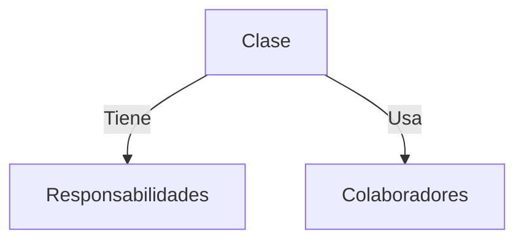
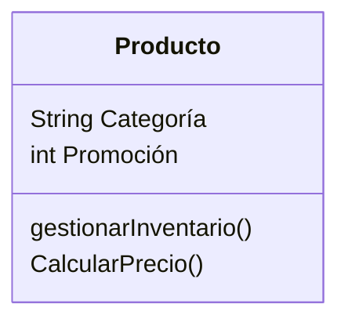
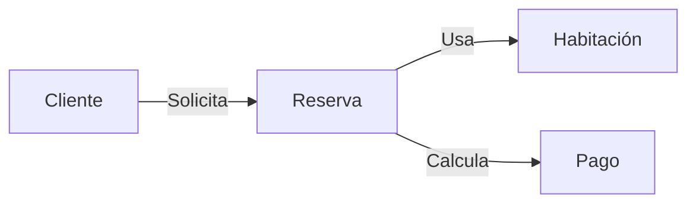
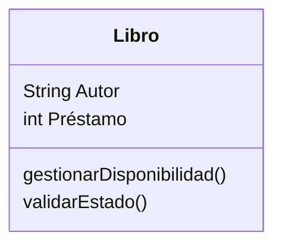

# Introducción a las Ciencias de la Computación - Vista panorámica de la programación orientada a objetos

## 2.2 Diseño orientado a objetos (tarjetas de responsabilidades).

---

### 1. Concepto Fundamental

**Tarjetas de Responsabilidades (CRC Cards):** Técnica de diseño que utiliza fichas físicas o digitales para:

- Identificar **Clases**
- Definir sus **Responsabilidades**
- Establecer **Colaboraciones**

$$ \text{CRC} = \text{Clase} + \text{Responsabilidades} + \text{Colaboradores} $$

### 2. Estructura de una Tarjeta CRC



**Ejemplo Físico:**



### 3. Proceso de Diseño

#### 3.1 Identificación de Clases

- Sustantivos en requisitos → Candidatos a clases
- **Ejemplo:** Sistema de Reservas → `Hotel`, `Habitación`, `Cliente`

#### 3.2 Asignación de Responsabilidades

Principio GRASP: **Alta Cohesión** y **Bajo Acoplamiento**



### 4. Ejemplo Completo

#### 4.1 Sistema de Biblioteca

**Tarjeta 1:**



**Tarjeta 2:**

```typescript
class Libro {
  private disponible: boolean;

  public prestar(): void {
    if (this.disponible) {
      this.disponible = false;
    }
  }
}
```

### 5. Buenas Prácticas

#### 5.1 Reglas para Responsabilidades

1. **Única Responsabilidad** (SRP)

   $$ \text{Cohesión} = \frac{1}{\text{N° de responsabilidades}} $$

2. **Delegación clara**

#### 5.2 Anti-patrones

- **Clase Dios**: Muchas responsabilidades
- **Anémica**: Solo datos, sin comportamiento

### 6. Ejercicios

1. Diseña tarjetas CRC para un carrito de compras:
   - Clases: `Carrito`, `Producto`, `Usuario`
2. Implementa en código 1 colaboración identificada
3. Explica cómo evitar acoplamiento fuerte entre `Pedido` y `Pago`

### Ver también

- **2.1** Definiciones de POO — fundamento conceptual del diseño.
- **2.3** Organización general de un programa OO — de las tarjetas al código.

### Referencias

- Wirfs-Brock, R., Wilkerson, B., & Wiener, L. (1990). _Designing Object-Oriented Software_. Prentice Hall.
- Martin, R. C. (2003). _Agile Software Development_. Prentice Hall.
