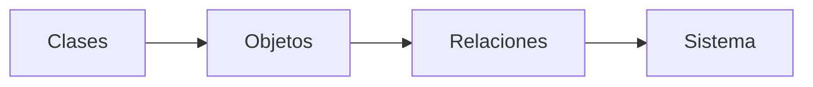
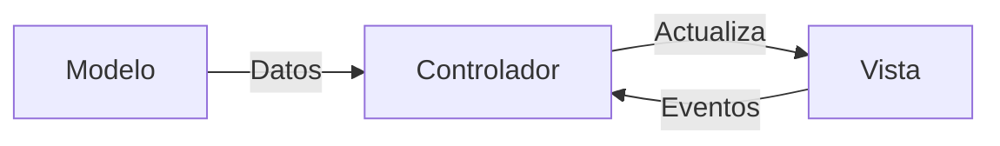
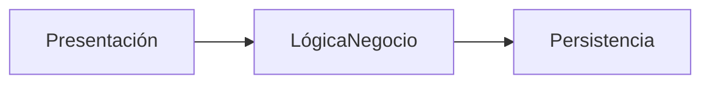

# Introducción a las Ciencias de la Computación - Vista panorámica de la programación orientada a objetos

## 2.3 Organización general de un programa en un lenguaje orientado a objetos.

---

### 1. Estructura Básica

Un programa OO se organiza en:

- **Clases**: Plantillas para crear objetos
- **Objetos**: Instancias con estado y comportamiento
- **Relaciones**: Herencia, composición, dependencias



### 2. Componentes Clave

#### 2.1 Paquetes/Módulos

Agrupan clases relacionadas:

$$ \text{Paquete} = \sum_{\text{clases relacionadas}} \text{Cohesión} - \text{Acoplamiento} $$

**Ejemplo Java:**

```java
package com.ejemplo.ventas;
public class Producto { /*...*/ }
```

#### 2.2 Jerarquía de Clases

```
classDiagram
    class Vehiculo {
        +mover()
    }
    class Auto {
        +numPuertas
    }
    Vehiculo <|-- Auto
```

### 3. Flujo de Ejecución

#### 3.1 Punto de Entrada

- **Método main**: Inicia la ejecución

```java
public class Main {
    public static void main(String[] args) {
        Sistema sistema = new Sistema();
        sistema.iniciar();
    }
}
```

#### 3.2 Ciclo de Vida


### 4. Patrones de Organización

#### 4.1 MVC (Modelo-Vista-Controlador)



#### 4.2 Capas



### 5. Ejemplo Completo

#### 5.1 Sistema Académico

**Estructura de paquetes:**

```
/src
  /modelos
    Estudiante.java
    Curso.java
  /vistas
    MenuPrincipal.java
  /controladores
    RegistroControlador.java
```

**Código de relación:**

```typescript
class Estudiante {
  cursos: Curso[] = [];
  matricular(curso: Curso) {
    this.cursos.push(curso);
  }
}
```

### 6. Buenas Prácticas

1. **Bajo acoplamiento**:  
   $$ \text{Acoplamiento} \propto \frac{1}{\text{Mantenibilidad}} $$
2. **Alta cohesión**
3. **Principio SOLID**

### 7. Ejercicios

1. Diseña la estructura de paquetes para un sistema de reservas de hotel
2. Implementa una relación de agregación entre `Hotel` y `Habitación`
3. Explica cómo el MVC organiza responsabilidades

### 8. Recursos

- **Libro:** "Clean Architecture" - Robert C. Martin
- **Herramienta:** [StarUML](https://staruml.io/)

### Ver también

- **2.1** Definiciones — clases y objetos como unidades de organización.
- **2.2** Diseño OO — el diseño se concreta en la organización del programa.
- **5.1** Extensión de clases — la organización en jerarquías de herencia.

### Referencias

- Eckel, B. (2006). _Thinking in Java_ (4.ª ed.). Prentice Hall. Cap. 4.
- Bloch, J. (2018). _Effective Java_ (3.ª ed.). Addison-Wesley.
