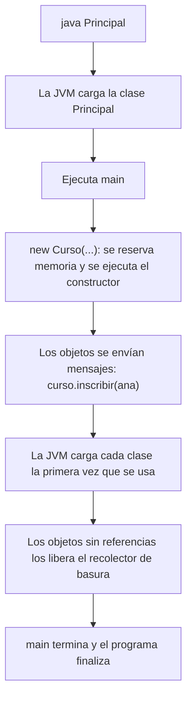
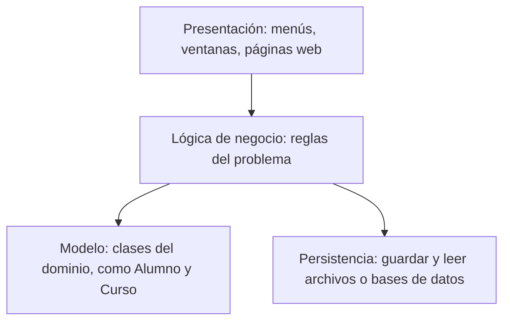

# Introducción a las Ciencias de la Computación - Vista panorámica de la programación orientada a objetos

## 2.3 Organización general de un programa en un lenguaje orientado a objetos.

---

Un programa orientado a objetos de tamaño real tiene decenas o cientos de clases. Para que siga siendo comprensible se organiza en varios niveles: los miembros dentro de cada clase, las clases dentro de archivos, los archivos dentro de **paquetes** y los paquetes dentro de **capas** con responsabilidades distintas. Este subtema describe esa organización en Java y cómo se pone en marcha la ejecución de un programa.

### 1. Anatomía de una clase en Java

Por convención, los elementos de una clase se escriben en este orden:

```java
package mx.unam.ciencias.escuela;           // 1. paquete al que pertenece

import java.util.ArrayList;                  // 2. clases de otros paquetes que se usan
import java.util.List;

/** Un curso con sus alumnos inscritos. */   // 3. comentario de documentación
public class Curso {                         // 4. declaración de la clase

    public static final int CUPO_MAXIMO = 40;     // 5. constantes de clase

    private final String clave;                    // 6. atributos de instancia
    private final String nombre;
    private final List<Alumno> inscritos = new ArrayList<>();

    public Curso(String clave, String nombre) {    // 7. constructores
        this.clave = clave;
        this.nombre = nombre;
    }

    public boolean inscribir(Alumno a) {           // 8. métodos públicos
        if (inscritos.size() >= CUPO_MAXIMO || inscritos.contains(a)) {
            return false;
        }
        inscritos.add(a);
        return true;
    }

    public int getNumeroInscritos() { return inscritos.size(); }

    @Override
    public String toString() { return clave + " " + nombre; }
}
```

**Convenciones de nombres de Java:**

| Elemento                | Convención           | Ejemplo                    |
| ----------------------- | -------------------- | -------------------------- |
| Clase e interfaz        | `PascalCase`, sustantivo | `CuentaBancaria`, `Comparable` |
| Método                  | `camelCase`, verbo   | `calcularPromedio`         |
| Atributo y variable     | `camelCase`          | `numeroDeCuenta`           |
| Constante               | `MAYUSCULAS_CON_GUION` | `CUPO_MAXIMO`            |
| Paquete                 | minúsculas, dominio invertido | `mx.unam.ciencias.escuela` |

Seguir las convenciones no es obligatorio para el compilador, pero sí para cualquier persona que lea el código: permite saber a primera vista si un nombre es una clase, un método o una constante.

### 2. Archivos y paquetes

- Cada clase pública va en un archivo con **su mismo nombre** y extensión `.java`: la clase `Curso` en `Curso.java`.
- Un **paquete** agrupa clases relacionadas y define un espacio de nombres: puede haber una clase `Fecha` en dos paquetes distintos sin conflicto.
- La estructura de carpetas debe reflejar la de los paquetes:

```text
src/
└── mx/unam/ciencias/escuela/
    ├── Principal.java              paquete mx.unam.ciencias.escuela
    ├── modelo/
    │   ├── Alumno.java             paquete mx.unam.ciencias.escuela.modelo
    │   └── Curso.java
    ├── servicio/
    │   └── ServicioInscripcion.java
    └── vista/
        └── MenuConsola.java
```

Para usar una clase de otro paquete se **importa**: `import mx.unam.ciencias.escuela.modelo.Curso;`. Las clases del paquete `java.lang`, como `String`, `Math` o `System`, se importan automáticamente.

**Visibilidad entre paquetes.** Un miembro sin modificador de acceso solo es visible dentro de su paquete. Así, los paquetes funcionan también como unidades de encapsulamiento: lo que es detalle interno de un paquete no se marca como `public`. Los niveles de visibilidad se estudian en detalle en el subtema 3.1.

### 3. El punto de entrada

La ejecución de un programa Java comienza en un método con esta firma exacta:

```java
public static void main(String[] args)
```

- `public`: la máquina virtual debe poder invocarlo desde fuera.
- `static`: se ejecuta sin crear antes un objeto de la clase.
- `void`: no regresa un valor; para indicar un código de salida se usa `System.exit`.
- `String[] args`: los argumentos escritos en la línea de comandos.

Un buen `main` es corto: crea los objetos principales, los conecta y les envía el primer mensaje. La lógica del programa vive en las clases.

```java
public class Principal {
    public static void main(String[] args) {
        Curso curso = new Curso("ICC-01", "Introducción a CC");
        Alumno ana = new Alumno("Ana", 3192);
        Alumno luis = new Alumno("Luis", 3201);
        curso.inscribir(ana);
        curso.inscribir(luis);
        System.out.println(curso + ": " + curso.getNumeroInscritos() + " inscritos");
    }
}
```

### 4. Qué ocurre durante la ejecución



Las clases se cargan **bajo demanda**, la primera vez que se necesitan. Los objetos se crean con `new` en una zona de memoria llamada heap, y cuando ningún otro objeto ni variable los referencia, el **recolector de basura** recupera su memoria automáticamente. Estos mecanismos se estudian en el tema 6.

### 5. Organización en capas

Para que un programa sea mantenible, se separan las clases según su papel:



- La **presentación** interactúa con el usuario, pero no decide reglas: no sabe cuál es el cupo de un curso.
- La **lógica de negocio** aplica las reglas: inscribir solo si hay cupo y el alumno cumple requisitos.
- El **modelo** representa los conceptos del problema.
- La **persistencia** guarda y recupera datos.

Cada capa solo usa a las de abajo. Así, cambiar la interfaz de consola por una página web no obliga a tocar las reglas del negocio. El patrón **Modelo-Vista-Controlador** (MVC) es una variante de esta idea muy usada en interfaces gráficas y aplicaciones web.

### 6. Documentación

Los comentarios que empiezan con `/**` se llaman **Javadoc** y sirven para generar automáticamente la documentación HTML de una biblioteca:

```java
/**
 * Inscribe a un alumno en el curso.
 *
 * @param a el alumno que se quiere inscribir
 * @return {@code true} si se inscribió; {@code false} si no había cupo o ya estaba inscrito
 */
public boolean inscribir(Alumno a) { /* ... */ return false; }
```

Un buen comentario explica **qué** hace un método y **por qué** existe, no repite lo que el código ya dice.

> **Conexión con CC.** En proyectos reales, una herramienta de construcción como Maven impone una estructura de carpetas estándar (`src/main/java`, `src/test/java`) para que cualquier desarrollador encuentre todo en el mismo lugar. Desde Java 9, los **módulos** agregan un nivel por encima de los paquetes para declarar explícitamente qué partes de una biblioteca son públicas. Estas ideas de modularidad se profundizan en Ingeniería de Software.

### Ejercicios propuestos

1. Escriba la clase `Alumno` con nombre y número de cuenta que necesita el ejemplo, de modo que el programa `Principal` compile y se ejecute. Sobrescriba `equals` para que dos alumnos con el mismo número de cuenta se consideren iguales, y verifique que `inscribir` ya no acepta duplicados.
2. Diseñe la estructura de paquetes y clases de un sistema de reservaciones de un hotel, separando modelo, servicio, persistencia y presentación.
3. Corrija los nombres para que sigan las convenciones de Java: `class cuenta_bancaria`, `int NumeroDeCuenta`, `void Depositar()`, `final double tasa_iva = 0.16`.
4. Explique qué ocurre si en el archivo `Curso.java` se declara `public class Materia`.
5. Escriba los comentarios Javadoc de la clase `Curso` y genere la documentación con el comando `javadoc`.

### Ver también

- **1.7** Ambientes de desarrollo — compilación y ejecución desde la terminal y en un IDE.
- **2.1** Definiciones — clases, objetos y relaciones.
- **2.5** Uso de bibliotecas — importar y usar clases de bibliotecas.
- **3.1** Variables locales y atributos. Niveles de visibilidad.
- **6.1 y 6.2** La memoria durante la ejecución y la recolección de basura.

### Referencias

- Oracle. _Code Conventions for the Java Programming Language_.
- Bloch, J. (2018). _Effective Java_ (3.ª ed.). Addison-Wesley. Cap. 4.
- Martin, R. C. (2008). _Clean Code_. Prentice Hall. Cap. 2 a 4.
- Oracle. _The Java Tutorials: Packages_. https://docs.oracle.com/javase/tutorial/java/package/
