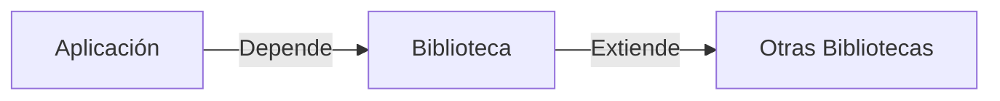

# Introducción a las Ciencias de la Computación - Vista panorámica de la programación orientada a objetos

## 2.5 Uso de bibliotecas.

---

### 1. Conceptos Fundamentales

#### 1.1 Definición

**Biblioteca**: Conjunto de clases/métodos pre-implementados que proporcionan funcionalidades específicas:

$$ \text{Productividad} = \frac{\text{Código Reutilizado}}{\text{Código Total}} $$

#### 1.2 Tipos de Bibliotecas

| Tipo        | Ejemplo               | Uso Típico            |
| ----------- | --------------------- | --------------------- |
| Estándar    | `java.util`, `System` | Funcionalidades base  |
| Externas    | `Apache Commons`      | Utilidades extendidas |
| Específicas | `Spring Framework`    | Dominio particular    |

### 2. Gestión de Dependencias

#### 2.1 Maven (Java)

```xml
<dependency>
    <groupId>org.apache.commons</groupId>
    <artifactId>commons-math3</artifactId>
    <version>3.6.1</version>
</dependency>
```

#### 2.2 npm (JavaScript)

```json
{
  "dependencies": {
    "lodash": "^4.17.21"
  }
}
```

### 3. Ejemplos Prácticos

#### 3.1 Uso de Collections (Java)

```java
import java.util.ArrayList;
import java.util.Collections;

public class EjemploBiblioteca {
    public static void main(String[] args) {
        ArrayList<Integer> numeros = new ArrayList<>();
        numeros.add(5);
        numeros.add(2);
        Collections.sort(numeros); // Usa método de biblioteca
    }
}
```

#### 3.2 Diagrama de Relaciones



### 4. Patrones de Uso

#### 4.1 Factory Method

```typescript
import { HttpClient } from '@angular/common/http';

class ApiService {
  constructor(private http: HttpClient) {} // Inyección de dependencia
}
```

#### 4.2 Facade

```
classDiagram
    class SistemaComplejo {
        +operacionA()
        +operacionB()
    }
    class Fachada {
        -sistema: SistemaComplejo
        +operacionSimple()
    }
    Fachada --> SistemaComplejo
```

### 5. Buenas Prácticas

1. **Control de Versiones**:  

   $$ \text{Version} \geq \text{Estable} $$

2. **Documentación**: Siempre consultar Javadoc/npm docs
3. **Licencias**: Verificar compatibilidad (MIT, GPL, Apache)

### 6. Ejercicios

1. Implementa una lista ordenada usando `Collections.sort()`
2. Crea un servicio que consuma `java.time` para manejo de fechas
3. Explica cómo evitar "Dependency Hell"

### 7. Recursos

- **Sitios**:
  - [Maven Repository](https://mvnrepository.com/)
  - [npmjs](https://www.npmjs.com/)
- **Libro**: "Effective Java" (Bloch) - Item 56

### Ver también

- **2.4** Entrada y salida — uso de bibliotecas de E/S.
- **2.3** Organización OO — las bibliotecas como paquetes.
- **1.6** Principios de lenguajes — gestión de dependencias y módulos.

### Referencias

- Eckel, B. (2006). _Thinking in Java_ (4.ª ed.). Prentice Hall.
- Oracle. _Java Platform SE 8 API Documentation_. https://docs.oracle.com/javase/8/docs/api/
