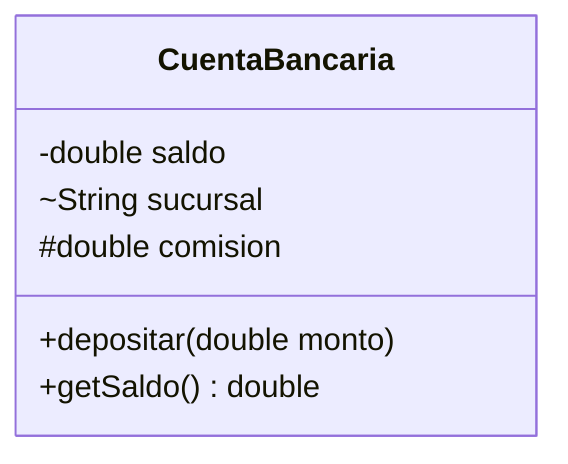

# Introducción a las Ciencias de la Computación - Objetos, estados y servicios

## 3.1 Variables locales y atributos. Niveles de visibilidad.

---

En un programa orientado a objetos conviven varios tipos de variables que se parecen en la sintaxis pero se comportan de forma muy distinta: algunas guardan el estado de un objeto mientras este exista, otras solo viven mientras se ejecuta un método, y otras pertenecen a la clase completa. Además, cada miembro de una clase tiene un **nivel de visibilidad** que decide quién puede usarlo. Dominar estas distinciones es la base del encapsulamiento.

### 1. Los cuatro tipos de variables

```java
public class Contador {
    private static int totalCreados = 0;    // variable de clase (static)
    private int valor;                       // atributo o variable de instancia
    private final String nombre;             // atributo constante tras la construcción

    public Contador(String nombre) {         // nombre: parámetro
        this.nombre = nombre;
        totalCreados++;
    }

    public void incrementarVarias(int veces) {   // veces: parámetro
        for (int i = 0; i < veces; i++) {         // i: variable local del ciclo
            valor++;
        }
        int doble = valor * 2;                    // doble: variable local
        System.out.println(nombre + " vale " + valor + ", el doble es " + doble);
    }

    public static int getTotalCreados() { return totalCreados; }
}
```

| Tipo                 | Dónde se declara                  | Cuánto vive                                   | Valor inicial                             | Cuántas copias hay      |
| -------------------- | --------------------------------- | --------------------------------------------- | ----------------------------------------- | ----------------------- |
| Atributo de instancia | en la clase, fuera de los métodos | mientras exista el objeto                     | automático: 0, `false` o `null`            | una por objeto          |
| Variable de clase (`static`) | en la clase, con `static`  | mientras el programa tenga cargada la clase   | automático                                | una para toda la clase  |
| Parámetro            | en la firma de un método          | durante la ejecución del método               | el argumento recibido                      | una por llamada         |
| Variable local       | dentro de un método o bloque      | hasta que termina su bloque                   | **ninguno**: hay que asignarla antes de usarla | una por llamada    |

```java
public class PruebaContador {
    public static void main(String[] args) {
        Contador a = new Contador("a");
        Contador b = new Contador("b");
        a.incrementarVarias(3);    // a vale 3, el doble es 6
        b.incrementarVarias(1);    // b vale 1, el doble es 2
        a.incrementarVarias(2);    // a vale 5, el doble es 10
        System.out.println(Contador.getTotalCreados());   // 2
    }
}
```

Cada objeto tiene su propio `valor`, que **persiste entre llamadas**: la segunda llamada a `a.incrementarVarias` parte de 3. En cambio, `doble` e `i` se crean de nuevo en cada llamada y desaparecen al terminar. `totalCreados` es compartido: hay una sola copia para todos los contadores.

### 2. Alcance y sombreado

El **alcance** de una variable es la región del código donde su nombre es válido. Para una variable local, va desde su declaración hasta el final del bloque `{ ... }` que la contiene:

```java
for (int i = 0; i < 3; i++) {
    int cuadrado = i * i;
}
// System.out.println(cuadrado);   error: cuadrado no existe fuera del ciclo
// System.out.println(i);          error: i tampoco
```

**Sombreado.** Si un parámetro o variable local tiene el mismo nombre que un atributo, dentro del método el nombre se refiere a la variable local, que **oculta** al atributo. Para referirse al atributo se usa `this`, que es una referencia al objeto que está ejecutando el método:

```java
public Contador(String nombre) {
    this.nombre = nombre;    // atributo = parámetro
    // nombre = nombre;      // error lógico: asigna el parámetro a sí mismo
}
```

**Buena práctica:** declarar cada variable local en el alcance más pequeño posible, justo donde se necesita, y darle valor al declararla. Así se reduce el código donde puede usarse por error.

### 3. Niveles de visibilidad

Java tiene cuatro niveles de acceso para los miembros de una clase:

| Modificador     | Símbolo UML | La misma clase | El mismo paquete | Subclases en otro paquete | Cualquier clase |
| --------------- | ----------- | -------------- | ---------------- | ------------------------- | --------------- |
| `private`       | `-`         | sí             | no               | no                        | no              |
| sin modificador | `~`         | sí             | sí               | no                        | no              |
| `protected`     | `#`         | sí             | sí               | sí                        | no              |
| `public`        | `+`         | sí             | sí               | sí                        | sí              |



Las clases mismas pueden ser `public`, visibles desde cualquier paquete, o sin modificador, visibles solo dentro de su paquete.

**Visibilidad de clase, no de objeto.** `private` restringe el acceso por **clase**: un método de `CuentaBancaria` puede leer el saldo privado de **otra** cuenta, por ejemplo en un método `transferir(CuentaBancaria destino)`.

### 4. Encapsulamiento en la práctica

La regla general es: **atributos privados, métodos públicos solo los necesarios**.

```java
public class Termometro {
    private double celsius;            // representación interna

    public void setCelsius(double c) {
        if (c < -273.15) {
            throw new IllegalArgumentException("Por debajo del cero absoluto");
        }
        celsius = c;
    }

    public double getCelsius() { return celsius; }
    public double getFahrenheit() { return celsius * 9 / 5 + 32; }
}
```

Este diseño tiene dos ventajas:

1. **Proteger invariantes.** Ningún código externo puede asignar una temperatura imposible.
2. **Cambiar la representación.** Si después se decide guardar la temperatura en kelvin, basta modificar el interior de la clase: quien la usa sigue llamando a `getCelsius` y `getFahrenheit` sin enterarse.

Si `celsius` fuera público, cualquier parte del programa podría escribir `t.celsius = -500`, y cambiar su representación obligaría a modificar todo el código que la usa.

**Constantes.** Una variable `static final` de un tipo inmutable, como `public static final double IVA = 0.16;`, puede ser pública sin romper el encapsulamiento, porque nadie puede modificarla.

**El modificador `final`.** En un atributo, `final` indica que se asigna una sola vez, en la declaración o en el constructor. Hacer `final` todo atributo que no deba cambiar documenta la intención y permite al compilador detectar asignaciones por error.

> **Conexión con CC.** Las variables de clase compartidas son una fuente frecuente de errores en programas concurrentes, porque varios hilos pueden modificarlas a la vez (tema 9). Las variables locales, en cambio, viven en la pila de cada hilo y no se comparten. Por eso el consejo de minimizar el estado compartido y preferir variables locales y objetos inmutables reaparece en casi todas las guías de diseño.

### Ejercicios propuestos

1. Escriba la clase `Persona` con atributos privados `nombre` y `anioNacimiento`, y un método `edadEn(int anio)` que use una variable local. ¿Por qué la edad no debería ser un atributo?
2. Identifique en el siguiente código cada variable y su tipo, y diga qué imprime:

```java
public class Misterio {
    private int x = 10;
    public void metodo(int x) {
        int y = x + this.x;
        x = 0;
        System.out.println(x + " " + y + " " + this.x);
    }
    public static void main(String[] args) { new Misterio().metodo(5); }
}
```

3. Explique por qué este diseño viola el encapsulamiento y corríjalo:

```java
public class Cliente {
    public String rfc;
    public double limiteCredito;
}
```

4. Agregue a `Contador` un atributo de clase que lleve la suma de los valores de **todos** los contadores. ¿En qué métodos debe actualizarse?
5. Indique qué miembros de la clase `CuentaBancaria` del diagrama son accesibles desde: (a) otra clase del mismo paquete; (b) una subclase en otro paquete; (c) una clase cualquiera de otro paquete.

### Ver también

- **2.1** Definiciones — estado, comportamiento y encapsulamiento.
- **3.3** Variables y referencias — qué contiene una variable de tipo objeto.
- **3.4** Distintos tipos de métodos — métodos de acceso y de actualización.
- **5.2** Aspectos principales de la herencia — `protected` y la herencia.
- **6.3** La pila de ejecución — dónde viven las variables locales.

### Referencias

- Bloch, J. (2018). _Effective Java_ (3.ª ed.). Addison-Wesley. Ítems 15, 16 y 17.
- Eckel, B. (2006). _Thinking in Java_ (4.ª ed.). Prentice Hall. Cap. 6.
- Oracle. _The Java Tutorials: Controlling Access to Members of a Class_.
