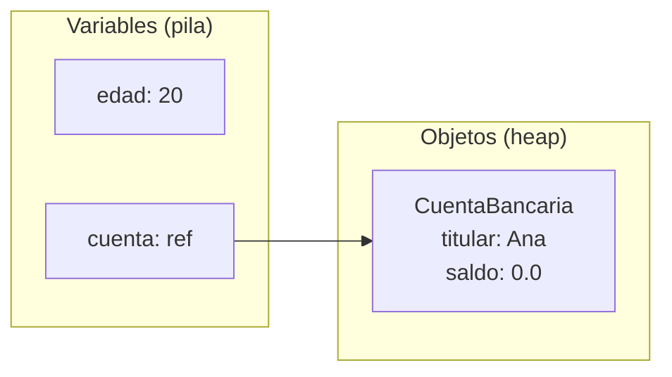
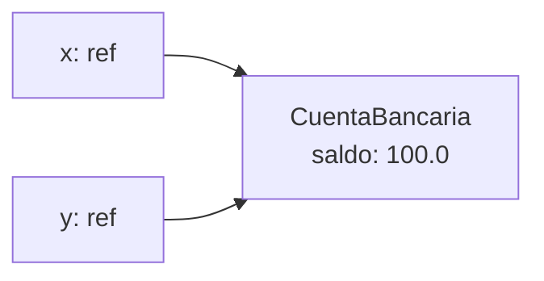

# Introducción a las Ciencias de la Computación - Objetos, estados y servicios

## 3.3 Variables y referencias.

---

En Java hay dos clases de variables que se ven iguales al declararlas pero se comportan de manera muy diferente. Una variable de **tipo primitivo**, como `int` o `double`, guarda directamente un valor. Una variable de **tipo objeto**, como `String` o `CuentaBancaria`, guarda una **referencia**: la ubicación en memoria de un objeto que vive en otra parte. Casi todos los comportamientos sorprendentes de los programas con objetos, como cambios que aparecen "solos" en otra variable o el temido `NullPointerException`, se explican con esta distinción.

### 1. Tipos primitivos y tipos referencia

Java tiene ocho tipos primitivos: `byte`, `short`, `int`, `long`, `float`, `double`, `char` y `boolean`. Todos los demás tipos, incluidos `String`, los arreglos y cualquier clase definida por el programador, son **tipos referencia**.

```java
int edad = 20;
CuentaBancaria cuenta = new CuentaBancaria("Ana");
```



- `edad` contiene el número 20.
- `cuenta` no contiene la cuenta: contiene una referencia, una especie de dirección, al objeto creado por `new`, que vive en una zona de memoria llamada **heap**.

### 2. La asignación copia lo que hay en la variable

Asignar una variable a otra copia **su contenido**. Con primitivos se copia el valor; con referencias se copia la referencia, y ambas variables quedan apuntando **al mismo objeto**.

```java
int a = 5;
int b = a;          // b recibe una copia del 5
b = 10;
System.out.println(a);                    // 5: a no cambió

CuentaBancaria x = new CuentaBancaria("Ana");
CuentaBancaria y = x;                     // y recibe una copia de la referencia
y.depositar(100);
System.out.println(x.getSaldo());         // 100.0: x e y son el mismo objeto
```



Cuando dos variables se refieren al mismo objeto se dice que son **alias**. El aliasing es útil, porque permite que varias partes del programa compartan un objeto, pero también es una fuente de errores cuando no se tiene presente.

Para obtener un objeto **independiente** hay que crearlo explícitamente, por ejemplo con un constructor de copia: `CuentaBancaria z = new CuentaBancaria(x);`.

### 3. Comparar: identidad e igualdad

- `x == y` compara las **referencias**: es verdadero si ambas variables apuntan al mismo objeto. Es la **identidad**.
- `x.equals(y)` compara el **contenido**, según lo defina la clase. Es la **igualdad**.

```java
String s1 = new String("hola");
String s2 = new String("hola");
String s3 = s1;
System.out.println(s1 == s2);        // false: dos objetos distintos
System.out.println(s1.equals(s2));   // true: mismo contenido
System.out.println(s1 == s3);        // true: alias
```

Las clases propias heredan un `equals` que se comporta como `==`. Si se quiere que dos objetos con el mismo contenido se consideren iguales, hay que **sobrescribir** `equals`, y con él `hashCode`, como se verá en el tema 5.

### 4. La referencia nula

Una variable de tipo referencia puede valer `null`, que significa "no se refiere a ningún objeto". Los atributos de tipo objeto se inicializan con `null` si no se les asigna otra cosa. Enviar un mensaje a `null` produce una `NullPointerException` en tiempo de ejecución:

```java
CuentaBancaria c = null;
c.depositar(100);          // NullPointerException
```

Es uno de los errores más frecuentes en Java. Su inventor, Tony Hoare, lo llamó su "error de mil millones de dólares". Las defensas son inicializar siempre los atributos en el constructor, validar los parámetros que no deben ser nulos, por ejemplo con `Objects.requireNonNull`, y no regresar `null` cuando se puede regresar una colección vacía.

### 5. Referencias y métodos

Como se vio en el subtema 2.4, Java pasa los argumentos **por valor**. Para un objeto, el valor que se copia es la referencia, de modo que:

- el método **puede modificar** el objeto al que apunta el parámetro, y el cambio es visible fuera;
- el método **no puede** hacer que la variable del que lo llamó apunte a otro objeto.

**Por eso no se puede escribir un método `intercambiar` para dos variables:**

```java
static void intercambiar(CuentaBancaria p, CuentaBancaria q) {
    CuentaBancaria tmp = p;
    p = q;
    q = tmp;              // solo se intercambian las copias locales
}
```

Después de llamar `intercambiar(x, z)`, `x` y `z` siguen apuntando a los mismos objetos que antes.

### 6. Objetos mutables e inmutables

Un objeto es **inmutable** si su estado no puede cambiar después de crearlo, como `String`, `Integer` o `LocalDate`. Con objetos inmutables el aliasing no causa problemas: si nadie puede modificar el objeto, da igual cuántas variables lo compartan.

Con objetos **mutables** hay que tener cuidado al guardarlos o devolverlos:

```java
import java.util.ArrayList;
import java.util.List;

public class Grupo {
    private final List<String> alumnos;

    public Grupo(List<String> alumnos) {
        this.alumnos = new ArrayList<>(alumnos);   // copia defensiva al recibir
    }

    public List<String> getAlumnos() {
        return List.copyOf(alumnos);               // copia no modificable al devolver
    }

    public static void main(String[] args) {
        List<String> lista = new ArrayList<>(List.of("Ana", "Luis"));
        Grupo g = new Grupo(lista);
        lista.add("Intruso");                      // no afecta al grupo
        System.out.println(g.getAlumnos());        // [Ana, Luis]
    }
}
```

Sin las copias defensivas, quien creó la lista podría modificar el grupo desde fuera, saltándose cualquier validación de la clase.

### 7. Arreglos

Los arreglos también son objetos, así que las variables de tipo arreglo guardan referencias:

```java
int[] a = {1, 2, 3};
int[] b = a;            // alias
b[0] = 99;
System.out.println(a[0]);                                 // 99
int[] c = a.clone();    // copia independiente
c[1] = 0;
System.out.println(java.util.Arrays.toString(a));         // [99, 2, 3]
```

### 8. ¿Qué pasa con los objetos sin referencias?

Si ninguna variable ni objeto alcanzable se refiere a un objeto, este ya no puede usarse. El **recolector de basura** de la JVM detecta esos objetos y recupera su memoria automáticamente:

```java
CuentaBancaria c = new CuentaBancaria("Ana");
c = new CuentaBancaria("Luis");   // la cuenta de Ana queda sin referencias
```

El programador no libera la memoria explícitamente, como en C, pero sí debe evitar conservar referencias innecesarias, por ejemplo en listas que nunca se vacían, porque impiden que la memoria se recupere. El tema 6 explica este mecanismo.

> **Conexión con CC.** El modelo de referencias es el mismo en Python, JavaScript, C# y la mayoría de los lenguajes orientados a objetos. En C y C++ existen además los **apuntadores**, referencias que el programador puede manipular aritméticamente, lo que da más control pero también permite errores graves de memoria. Las estructuras de datos enlazadas de Estructuras de Datos, como listas y árboles, están construidas enteramente con referencias entre objetos.

### Ejercicios propuestos

1. Dibuje el diagrama de variables y objetos después de ejecutar:

```java
CuentaBancaria a = new CuentaBancaria("Ana");
CuentaBancaria b = new CuentaBancaria("Luis");
CuentaBancaria c = a;
a = b;
c.depositar(50);
```

¿Cuántos objetos hay? ¿Qué saldo tiene cada uno? ¿Algún objeto quedó sin referencias?

2. Prediga la salida y explíquela:

```java
StringBuilder s1 = new StringBuilder("ab");
StringBuilder s2 = s1;
s2.append("c");
String t1 = "ab";
String t2 = t1;
t2 = t2 + "c";
System.out.println(s1 + " " + t1);
```

3. Escriba un constructor de copia para `CuentaBancaria` y verifique que la copia es independiente del original.
4. Explique por qué el método `intercambiar` de la sección 5 no funciona, y escriba un método que sí intercambie dos elementos dentro de un arreglo, `intercambiar(int[] arr, int i, int j)`.
5. Encuentre el error en este código y corríjalo:

```java
import java.util.List;

public class Agenda {
    private List<String> contactos;
    public void agregar(String c) { contactos.add(c); }
}
```

### Ver también

- **2.4** Entrada y salida — el paso de parámetros por valor.
- **3.2** Expresiones y cadenas — `equals` frente a `==` con cadenas.
- **4.2** Objetos y referencias — estructuras de objetos enlazados.
- **6.1 y 6.2** La memoria durante la ejecución, el heap y la recolección de basura.

### Referencias

- Eckel, B. (2006). _Thinking in Java_ (4.ª ed.). Prentice Hall. Cap. 2.
- Bloch, J. (2018). _Effective Java_ (3.ª ed.). Addison-Wesley. Ítems 10, 17 y 50.
- Hoare, T. (2009). _Null References: The Billion Dollar Mistake_. Conferencia en QCon London.
