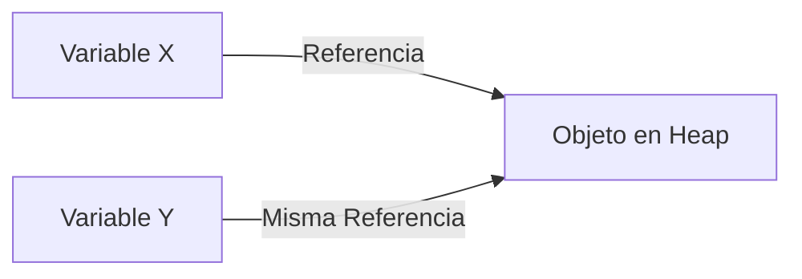

# Introducción a las Ciencias de la Computación - Objetos, estados y servicios

## 3.3 Variables y referencias.

---

### 1. Definiciones Fundamentales

#### 1.1 Variables

- **Definición:** Contenedores que almacenan valores en memoria
- **Características:**
  - Tienen un **tipo** (int, String, etc.)
  - Poseen un **nombre** (identificador)
  - Ocupan un **espacio en memoria**

$$ \text{Variable} = (\text{Tipo}, \text{Nombre}, \text{Valor}, \text{Dirección-Memoria}) $$

#### 1.2 Referencias

- **Definición:** Punteros a objetos en memoria (en lenguajes OO)
- **Comportamiento:**
  - No contienen el objeto, sino su dirección
  - Múltiples referencias pueden apuntar al mismo objeto

### 2. Tipos de Variables

#### 2.1 Por Alcance

| Tipo          | Alcance                         | Ejemplo                   |
| ------------- | ------------------------------- | ------------------------- |
| **Local**     | Dentro de un método/bloque      | `int x = 10;` (en método) |
| **Instancia** | Accesible en toda la clase      | `private String nombre;`  |
| **Clase**     | Compartida por todas instancias | `static int contador;`    |

#### 2.2 Diagrama de Memoria



### 3. Ejemplos Prácticos

#### 3.1 Java (Tipos por Valor vs Referencia)

```java
public class Ejemplo {
    public static void main(String[] args) {
        // Tipo primitivo (por valor)
        int a = 5;
        int b = a;  // Copia el valor

        // Objeto (por referencia)
        String s1 = new String("Hola");
        String s2 = s1;  // Ambas apuntan al mismo objeto
    }
}
```

#### 3.2 Python (Inmutabilidad)

```python
lista1 = [1, 2, 3]
lista2 = lista1  # Misma referencia
lista2.append(4)  # Modifica ambas referencias
```

### 4. Paso de Parámetros

#### 4.1 Comparativa

| Lenguaje   | Tipos Primitivos | Objetos        |
| ---------- | ---------------- | -------------- |
| **Java**   | Por valor        | Por referencia |
| **Python** | Por referencia   | Por referencia |

#### 4.2 Fórmula de Aliasing

$$ \text{Aliasing} = \frac{\text{Referencias a un objeto}}{\text{Total referencias}} $$

### 5. Ejercicios

1. Dibuja el diagrama de memoria para:

```java
String a = "Hola";
String b = a;
```

2. Explica por qué este código modifica el objeto original:

```typescript
let obj1 = { x: 1 };
let obj2 = obj1;
obj2.x = 2;
```

3. Implementa un método que intercambie dos variables (¿funciona con objetos?)

### Ver también

- **3.2** Expresiones y cadenas — las cadenas son objetos en Java.
- **4.2** Objetos y referencias — el mecanismo general de referencias.
- **6.1** La memoria durante la ejecución — cómo se almacenan las referencias en el heap.

### Referencias

- Eckel, B. (2006). _Thinking in Java_ (4.ª ed.). Prentice Hall. Cap. 2.
- Bloch, J. (2018). _Effective Java_ (3.ª ed.). Addison-Wesley. Ítem 50.
