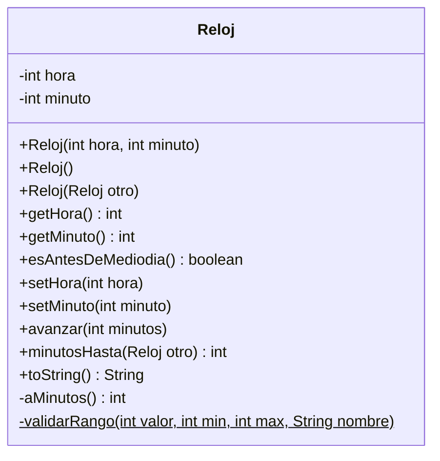

# Introducción a las Ciencias de la Computación - Objetos, estados y servicios

## 3.4 Distintos tipos de métodos: constructores, de acceso, de actualización, de implementación y auxiliares.

---

Los métodos de una clase cumplen papeles distintos: unos preparan al objeto para existir, otros informan sobre su estado, otros lo cambian, otros ofrecen los servicios para los que la clase fue creada, y otros solo ayudan a los anteriores desde dentro. Reconocer estos papeles ayuda a diseñar clases con una interfaz pública pequeña y clara, y a decidir qué debe ser público y qué privado.

| Tipo                | Propósito                                     | Visibilidad típica | Ejemplo                       |
| ------------------- | --------------------------------------------- | ------------------ | ----------------------------- |
| Constructor         | dar un estado inicial válido al objeto        | público            | `new Reloj(9, 30)`            |
| De acceso (getter)  | informar sobre el estado sin modificarlo      | público            | `getHora()`                   |
| De actualización (setter) | modificar el estado de forma controlada | público          | `setHora(10)`                 |
| De implementación   | ofrecer los servicios propios de la clase     | público            | `avanzar(15)`, `toString()`   |
| Auxiliar            | apoyar internamente a los demás               | privado            | `normalizar()`                |

### 1. Un ejemplo completo: la clase `Reloj`

```java
public class Reloj {
    private int hora;      // 0 a 23
    private int minuto;    // 0 a 59

    // ---------- Constructores ----------
    public Reloj(int hora, int minuto) {
        setHora(hora);
        setMinuto(minuto);
    }

    public Reloj() {
        this(0, 0);                         // delega en el otro constructor
    }

    public Reloj(Reloj otro) {              // constructor de copia
        this(otro.hora, otro.minuto);
    }

    // ---------- De acceso ----------
    public int getHora() { return hora; }
    public int getMinuto() { return minuto; }
    public boolean esAntesDeMediodia() { return hora < 12; }

    // ---------- De actualización ----------
    public void setHora(int hora) {
        validarRango(hora, 0, 23, "hora");
        this.hora = hora;
    }

    public void setMinuto(int minuto) {
        validarRango(minuto, 0, 59, "minuto");
        this.minuto = minuto;
    }

    // ---------- De implementación ----------
    public void avanzar(int minutos) {
        int total = aMinutos() + minutos;
        total = Math.floorMod(total, 24 * 60);   // da la vuelta al pasar la medianoche
        hora = total / 60;
        minuto = total % 60;
    }

    public int minutosHasta(Reloj otro) {
        return Math.floorMod(otro.aMinutos() - aMinutos(), 24 * 60);
    }

    @Override
    public String toString() {
        return String.format("%02d:%02d", hora, minuto);
    }

    // ---------- Auxiliares ----------
    private int aMinutos() { return hora * 60 + minuto; }

    private static void validarRango(int valor, int min, int max, String nombre) {
        if (valor < min || valor > max) {
            throw new IllegalArgumentException(nombre + " fuera de rango: " + valor);
        }
    }

    public static void main(String[] args) {
        Reloj r = new Reloj(23, 40);
        r.avanzar(45);
        System.out.println(r);                                   // 00:25
        System.out.println(r.minutosHasta(new Reloj(1, 0)));     // 35
        System.out.println(new Reloj().esAntesDeMediodia());     // true
    }
}
```

### 2. Constructores

Un **constructor** se ejecuta al crear un objeto con `new` y su trabajo es dejarlo en un **estado válido**. Se escribe con el mismo nombre de la clase y sin tipo de regreso.

- Si una clase no declara ningún constructor, Java le da uno **por omisión**, sin parámetros, que deja los atributos con sus valores iniciales automáticos: 0, `false` o `null`.
- Puede haber varios constructores **sobrecargados**. Para no repetir código, uno puede llamar a otro con `this(...)`, que debe ser su primera instrucción.
- Un constructor debe **validar** sus parámetros: si un objeto pudiera nacer con una hora 25, todos los demás métodos tendrían que desconfiar de su estado.

**Métodos de fábrica estáticos.** A veces conviene, en lugar de un constructor, un método `static` que crea el objeto y tiene un nombre descriptivo:

```java
public static Reloj mediodia() { return new Reloj(12, 0); }
public static Reloj deMinutos(int minutos) { Reloj r = new Reloj(); r.avanzar(minutos); return r; }
```

Así se escribe `Reloj.mediodia()` en lugar de `new Reloj(12, 0)`. La biblioteca estándar los usa mucho: `List.of(...)`, `LocalDate.of(...)`, `Integer.valueOf(...)`.

### 3. Métodos de acceso

Un **método de acceso** regresa información sobre el estado del objeto **sin modificarlo**. Por convención se llaman `getAtributo`, o `isPropiedad` y `esPropiedad` si regresan un `boolean`.

No todo atributo necesita un método de acceso, y no todo método de acceso corresponde a un atributo: `esAntesDeMediodia()` se calcula a partir de la hora. Quien usa la clase no sabe ni necesita saber si un valor está guardado o calculado.

Un método de acceso no debe tener efectos visibles: llamar `getHora()` dos veces seguidas debe dar el mismo resultado.

### 4. Métodos de actualización

Un **método de actualización** modifica el estado. Por convención se llaman `setAtributo`, pero muchas veces es mejor un nombre que exprese una operación del dominio: `depositar`, `avanzar`, `inscribir`.

**Un método de actualización debe preservar los invariantes de la clase.** El siguiente es peligroso, porque permite poner a la cuenta en cualquier estado sin pasar por ninguna regla:

```java
public void setSaldo(double saldo) { this.saldo = saldo; }
```

Lo correcto es ofrecer `depositar` y `retirar`, que validan. Más aún, **no todo atributo debe tener un método de actualización**: en una cuenta bancaria el titular o el número de cuenta no deberían cambiar después de crearla. Una clase sin métodos de actualización y con atributos `final` es **inmutable**, como `String`; las clases inmutables son más fáciles de usar correctamente.

### 5. Métodos de implementación

Son los que ofrecen los **servicios** que justifican la existencia de la clase: `avanzar` y `minutosHasta` en `Reloj`, `calcularMulta` en un préstamo, `inscribir` en un curso. Suelen combinar consulta y modificación del estado siguiendo reglas del problema.

Algunos métodos de implementación los hereda toda clase de `Object` y conviene sobrescribirlos:

- `toString()`: una representación legible del objeto, que usan `println` y la concatenación con cadenas.
- `equals(Object o)` y `hashCode()`: la noción de igualdad entre objetos de la clase (tema 5).

### 6. Métodos auxiliares

Un **método auxiliar** es privado y existe para que otros métodos sean más claros: factoriza código repetido, como `validarRango`, o da nombre a un paso intermedio, como `aMinutos`. Que sea privado tiene dos ventajas: no aumenta la interfaz pública, y puede cambiarse o eliminarse sin afectar a quien usa la clase.

Si un método auxiliar no usa atributos del objeto, puede declararse `static`, como `validarRango`.

### 7. Métodos de instancia y métodos de clase

Los métodos sin `static` son **de instancia**: se invocan sobre un objeto y pueden usar sus atributos mediante `this`. Los métodos `static` son **de clase**: se invocan sobre la clase, como `Math.sqrt(2)` o `Reloj.mediodia()`, y no tienen un `this`, así que no pueden usar atributos de instancia directamente.

### 8. Diagrama de la clase



El signo `$` al final indica un método estático.

> **Conexión con CC.** Las bibliotecas que convierten objetos en JSON o los guardan en bases de datos suelen basarse en las convenciones `get` y `set` para descubrir los atributos de una clase, por eso seguirlas tiene consecuencias prácticas. Al mismo tiempo, las guías de diseño modernas recomiendan no generar automáticamente un `set` para cada atributo, sino preguntarse qué operaciones tienen sentido en el dominio del problema.

### Ejercicios propuestos

1. Agregue a `Reloj` un método `retroceder(int minutos)` reutilizando `avanzar`, y un método de fábrica `Reloj.desdeCadena("14:05")`.
2. Escriba una clase inmutable `Fraccion` con un constructor que reduzca la fracción usando un método auxiliar privado `mcd`, métodos de acceso para numerador y denominador, métodos `sumar` y `multiplicar` que regresen una fracción nueva, y `toString`. El constructor debe rechazar el denominador cero.
3. Explique por qué el método `setSaldo` de la sección 4 es peligroso y qué métodos lo deberían reemplazar.
4. Clasifique los métodos de la clase `String` que conozca como de acceso, de implementación o de fábrica. ¿Por qué `String` no tiene métodos de actualización?
5. Escriba la clase `Triangulo` con tres lados; su constructor debe verificar la desigualdad del triángulo. Agregue métodos `perimetro`, `area`, usando la fórmula de Herón, y `esEquilatero`.

### Ver también

- **2.2** Diseño orientado a objetos — de las responsabilidades a los métodos.
- **3.1** Variables locales y atributos — visibilidad y `final`.
- **3.3** Variables y referencias — constructores de copia y objetos inmutables.
- **5.3** Polimorfismo — sobrescritura de métodos como `toString`.
- **7.2** Definición de errores — excepciones para parámetros inválidos.

### Referencias

- Bloch, J. (2018). _Effective Java_ (3.ª ed.). Addison-Wesley. Ítems 1, 2, 10, 12 y 17.
- Eckel, B. (2006). _Thinking in Java_ (4.ª ed.). Prentice Hall. Cap. 5.
- Martin, R. C. (2008). _Clean Code_. Prentice Hall. Cap. 3.
