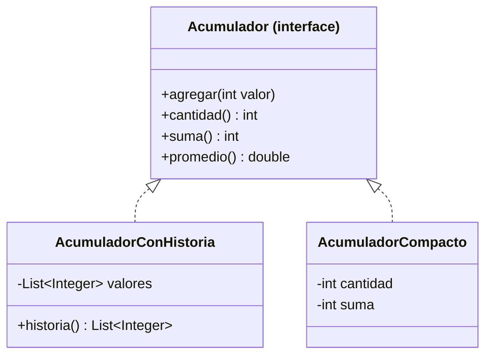

# Introducción a las Ciencias de la Computación - Datos estructurados

## 4.1 Interfaces.

---

Cuando se usa una estructura de datos, lo que importa es **qué** operaciones ofrece y qué garantiza cada una: agregar un elemento, obtener el que está en cierta posición, saber cuántos hay. **Cómo** lo hace, con un arreglo, con nodos enlazados o con otra técnica, es un detalle de implementación. Una **interfaz** de Java captura exactamente la primera parte: es un contrato que enumera operaciones sin implementarlas. Programar contra interfaces permite cambiar una implementación por otra sin modificar el código que la usa, y es la idea que organiza todas las colecciones de Java.

### 1. Qué es una interfaz

Una interfaz declara métodos **sin cuerpo**. Una clase que la **implementa** se compromete a dar un cuerpo a todos ellos:

```java
/** Una colección de enteros a la que se pueden agregar elementos y consultar su suma. */
public interface Acumulador {
    void agregar(int valor);
    int cantidad();
    int suma();

    default double promedio() {                  // método con implementación por omisión
        if (cantidad() == 0) throw new IllegalStateException("Sin elementos");
        return (double) suma() / cantidad();
    }
}
```

- Los métodos de una interfaz son públicos y abstractos, salvo los marcados `default` o `static`, que sí tienen cuerpo.
- Una interfaz **no tiene estado**: no declara atributos de instancia, solo constantes.
- No se pueden crear objetos de una interfaz: `new Acumulador()` es un error. Sí se pueden declarar **variables** de tipo interfaz.

### 2. Dos implementaciones del mismo contrato

```java
import java.util.ArrayList;
import java.util.List;

/** Guarda todos los valores agregados. */
class AcumuladorConHistoria implements Acumulador {
    private final List<Integer> valores = new ArrayList<>();

    public void agregar(int valor) { valores.add(valor); }
    public int cantidad() { return valores.size(); }
    public int suma() {
        int s = 0;
        for (int v : valores) s += v;
        return s;
    }
    public List<Integer> historia() { return List.copyOf(valores); }   // servicio extra
}

/** Solo guarda la cuenta y la suma: usa memoria constante. */
class AcumuladorCompacto implements Acumulador {
    private int cantidad;
    private int suma;

    public void agregar(int valor) { cantidad++; suma += valor; }
    public int cantidad() { return cantidad; }
    public int suma() { return suma; }
}

public class PruebaAcumuladores {
    static void cargar(Acumulador a, int... datos) {     // funciona con cualquier implementación
        for (int d : datos) a.agregar(d);
    }

    public static void main(String[] args) {
        Acumulador a = new AcumuladorConHistoria();
        Acumulador b = new AcumuladorCompacto();
        cargar(a, 8, 9, 10);
        cargar(b, 8, 9, 10);
        System.out.println(a.promedio() + " " + b.promedio());   // 9.0 9.0
    }
}
```



La flecha punteada con triángulo indica "implementa". El método `cargar` no sabe ni le importa qué implementación recibe: depende solo del contrato. Las dos clases hacen distintos compromisos: la primera permite consultar la historia a cambio de usar memoria proporcional al número de datos; la segunda usa memoria constante pero no recuerda los valores.

### 3. Tipo estático y tipo dinámico

En `Acumulador a = new AcumuladorConHistoria();`:

- el **tipo estático** de `a`, el que conoce el compilador, es `Acumulador`;
- el **tipo dinámico**, el del objeto real, es `AcumuladorConHistoria`.

El compilador solo permite enviar a `a` los mensajes de `Acumulador`: `a.historia()` es un error de compilación aunque el objeto sí tenga ese método. Al ejecutar, en cambio, se usa la implementación del tipo dinámico. Esta separación es la base del polimorfismo, que se estudia en el subtema 5.3.

### 4. Interfaces y tipos de datos abstractos

Un **tipo de dato abstracto** (TDA) es un tipo definido por sus operaciones y sus propiedades, independientemente de su representación. Una interfaz de Java es la forma de escribir la parte sintáctica de un TDA; las propiedades se documentan en los comentarios.

**Ejemplo: el TDA pila.** Una pila guarda elementos y solo permite acceder al último que se agregó.

```java
/** Pila de elementos de tipo T: el último en entrar es el primero en salir. */
public interface Pila<T> {
    /** Agrega x en el tope. */
    void apilar(T x);

    /** Quita y regresa el elemento del tope. Lanza una excepción si la pila está vacía. */
    T desapilar();

    /** Regresa el elemento del tope sin quitarlo. */
    T tope();

    boolean esVacia();
}
```

Las propiedades que toda implementación debe respetar son, por ejemplo: después de `apilar(x)`, `tope()` regresa `x`; y `apilar(x)` seguido de `desapilar()` deja la pila como estaba. La letra `T` es un **parámetro de tipo**: la misma interfaz sirve para pilas de cadenas, de números o de cualquier objeto.

### 5. Las interfaces de las colecciones de Java

La biblioteca estándar está organizada alrededor de interfaces, cada una con varias implementaciones:

| Interfaz       | Contrato                                                 | Implementaciones comunes            |
| -------------- | -------------------------------------------------------- | ----------------------------------- |
| `List<E>`      | secuencia con posiciones; admite repetidos               | `ArrayList`, `LinkedList`           |
| `Set<E>`       | conjunto sin repetidos                                   | `HashSet`, `TreeSet`                |
| `Map<K, V>`    | asociación de llaves con valores                         | `HashMap`, `TreeMap`                |
| `Deque<E>`     | se agrega y quita por ambos extremos; sirve como pila o cola | `ArrayDeque`, `LinkedList`      |
| `Queue<E>`     | cola                                                     | `ArrayDeque`, `PriorityQueue`       |
| `Comparable<T>`| objetos con un orden natural                             | `String`, `Integer`, `LocalDate`    |

La recomendación es **declarar las variables y parámetros con el tipo de la interfaz** y elegir la implementación solo al crear el objeto:

```java
List<String> nombres = new ArrayList<>();   // si luego conviene LinkedList, solo cambia esta línea
Map<String, Integer> edades = new HashMap<>();
```

### 6. Ventajas de programar contra interfaces

- **Intercambiabilidad:** se puede cambiar la implementación por una más eficiente para el caso concreto sin tocar el resto del programa.
- **Pruebas:** en una prueba se puede sustituir una implementación real, como una base de datos, por una falsa y sencilla que implemente la misma interfaz.
- **Trabajo en equipo:** una vez acordada la interfaz, unos pueden implementarla mientras otros escriben el código que la usa.
- **Bajo acoplamiento:** el código que usa la interfaz no depende de los detalles internos de ninguna clase.

> **Conexión con CC.** La separación entre especificación e implementación es una de las ideas centrales de la computación: la arquitectura de un procesador es la interfaz de su circuito, una API web es la interfaz de un servicio y un protocolo de red es la interfaz entre computadoras. En Estructuras de Datos (Sem. 2) se definen y se implementan de varias formas los TDA lista, pila y cola, comparando el costo de sus operaciones.

### Ejercicios propuestos

1. Agregue a la interfaz `Acumulador` un método `default` que regrese el máximo, y explique por qué no puede implementarse en términos de los otros métodos. ¿Qué cambio en el contrato lo permitiría?
2. Implemente la interfaz `Pila<T>` usando un `ArrayList<T>` y escriba un `main` que verifique sus propiedades.
3. Escriba una interfaz `Figura` con métodos `area()` y `perimetro()`, impleméntela con `Circulo` y `Rectangulo`, y escriba un método que reciba un arreglo de figuras y regrese la suma de sus áreas.
4. Explique por qué es preferible declarar `List<String> l = new ArrayList<>();` en lugar de `ArrayList<String> l = new ArrayList<>();`.
5. Diseñe la interfaz de un TDA `Conjunto` de enteros con operaciones para agregar, eliminar, consultar pertenencia, unión e intersección, y documente al menos tres propiedades que deban cumplir sus implementaciones.

### Ver también

- **2.1** Definiciones — abstracción y encapsulamiento.
- **4.3** Listas simples — una implementación de una interfaz de lista.
- **5.3** Polimorfismo — enlace dinámico de métodos.
- **5.5** Uso de interfaces — interfaces y herencia, `Comparable` y métodos por omisión.
- **Estructuras de Datos 1.1** (Sem. 2) — definición, especificación e implementación de tipos de datos abstractos.

### Referencias

- Bloch, J. (2018). _Effective Java_ (3.ª ed.). Addison-Wesley. Ítems 20, 21 y 64.
- Liskov, B., & Guttag, J. (2000). _Program Development in Java: Abstraction, Specification, and Object-Oriented Design_. Addison-Wesley. Cap. 5.
- Oracle. _The Java Tutorials: Interfaces_ y _Collections_.
