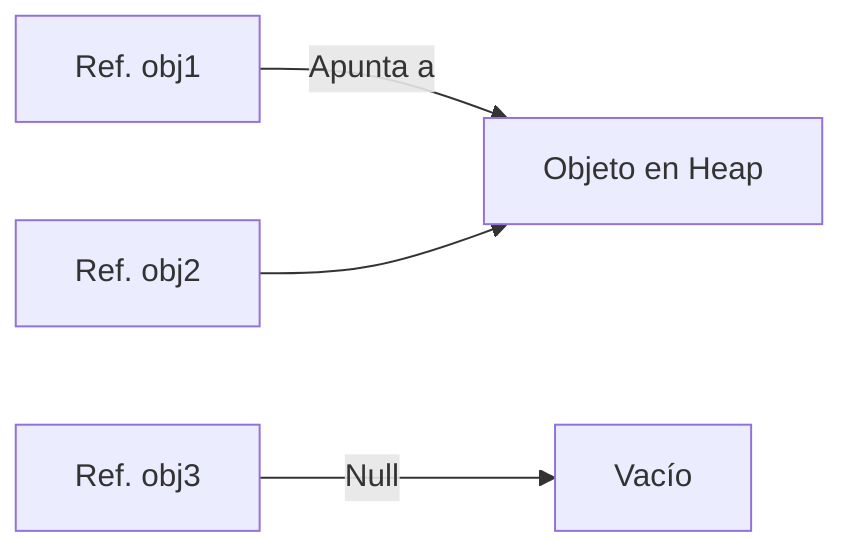
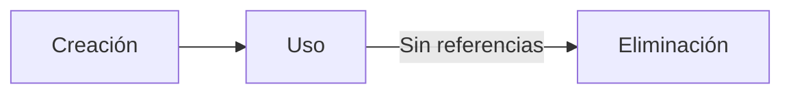

# Introducción a las Ciencias de la Computación - Datos estructurados

## 4.2 Objetos y referencias.

---

### 1. Conceptos Fundamentales

#### 1.1 Objetos

Entidades que encapsulan **estado** (atributos) y **comportamiento** (métodos):

$$ \text{Objeto} = \langle \text{Atributos}, \text{Métodos} \rangle $$

#### 1.2 Referencias

Punteros a la ubicación de memoria donde se almacena un objeto:

$$ \text{Referencia} \rightarrow \text{Dirección}_\text{Memoria} $$

### 2. Mecánica de Referencias

#### 2.1 Diagrama de Memoria



#### 2.2 Ejemplo en Java

```java
public class Persona {
    String nombre;

    public static void main(String[] args) {
        Persona p1 = new Persona();  // Creación de objeto
        Persona p2 = p1;             // p2 referencia al MISMO objeto
        p1.nombre = "Ana";
        System.out.println(p2.nombre);  // Imprime "Ana"
    }
}
```

### 3. Tipos de Datos y Referencias

#### 3.1 Comparativa

| Característica     | Tipos Primitivos  | Objetos                    |
| ------------------ | ----------------- | -------------------------- |
| **Almacenamiento** | Directo en stack  | Heap (referenciado)        |
| **Asignación**     | Por valor (copia) | Por referencia             |
| **Ejemplo**        | `int x = 5;`      | `String s = new String();` |

#### 3.2 Paso de Parámetros

- **Primitivos:** Se pasan por valor (copia)
- **Objetos:** Se pasa la referencia (original modificable)

```typescript
function modificar(obj: { x: number }) {
  obj.x = 10; // Modifica el original
}
let o = { x: 5 };
modificar(o);
console.log(o.x); // 10
```

### 4. Gestión de Memoria

#### 4.1 Algoritmo de Garbage Collection

$$ \text{Objeto eliminable} \iff \text{Referencias} = 0 $$

#### 4.2 Ciclo de Vida



### 5. Ejercicios

1. Dibuja el diagrama de memoria para:

```java
String a = "Hola";
String b = a;
String c = new String("Hola");
```

2. Explica la salida de:

```python
lista1 = [1, 2]
lista2 = lista1
lista1.append(3)
print(lista2)
```

3. Implementa una clase `Contador` que muestre referencias activas

### 6. Recursos

- **Libro:** "Effective Java" (Bloch) - Ítem 7
- **Visualizador:** [Python Tutor](https://pythontutor.com/)

### Ver también

- **3.3** Variables y referencias — distinción clave que aplica a todos los objetos.
- **6.1** La memoria durante la ejecución — dónde viven los objetos (heap).
- **4.1** Interfaces — los objetos son instancias de clases que implementan interfaces.

### Referencias

- Eckel, B. (2006). _Thinking in Java_ (4.ª ed.). Prentice Hall. Cap. 2.
- Bloch, J. (2018). _Effective Java_ (3.ª ed.). Addison-Wesley. Ítem 50.
