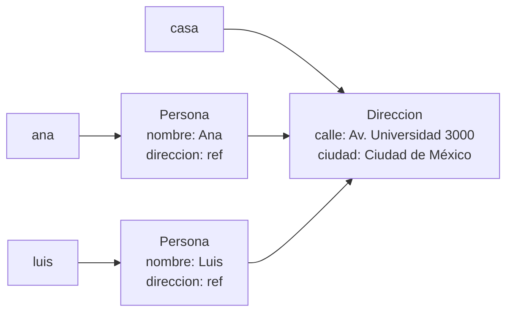
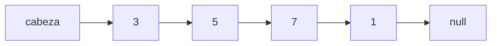

# Introducción a las Ciencias de la Computación - Datos estructurados

## 4.2 Objetos y referencias.

---

Los datos estructurados se construyen haciendo que unos objetos guarden referencias a otros. Un curso conoce a sus alumnos, un pedido a sus productos, un nodo de una lista al siguiente nodo. El resultado es una **red de objetos** en memoria, y razonar sobre ella requiere tener claro qué variables y atributos apuntan a qué objetos. Este subtema aplica el modelo de referencias del subtema 3.3 a objetos que contienen otros objetos, y prepara el terreno para las listas del subtema siguiente.

### 1. Objetos que contienen referencias

Un atributo de tipo objeto no contiene al objeto, sino una referencia a él:

```java
class Direccion {
    String calle;
    String ciudad;
    Direccion(String calle, String ciudad) { this.calle = calle; this.ciudad = ciudad; }
}

class Persona {
    String nombre;
    Direccion direccion;
    Persona(String nombre, Direccion direccion) { this.nombre = nombre; this.direccion = direccion; }
}

public class RedDeObjetos {
    public static void main(String[] args) {
        Direccion casa = new Direccion("Av. Universidad 3000", "CDMX");
        Persona ana = new Persona("Ana", casa);
        Persona luis = new Persona("Luis", casa);      // comparten la misma dirección

        casa.ciudad = "Ciudad de México";
        System.out.println(ana.direccion.ciudad);      // Ciudad de México
        System.out.println(luis.direccion.ciudad);     // Ciudad de México
        System.out.println(ana.direccion == luis.direccion);   // true
    }
}
```



Hay **tres** objetos y cinco referencias. Que Ana y Luis compartan el objeto `Direccion` puede ser exactamente lo que se quiere, si viven en la misma casa, o un error, si cada uno debía tener su propia copia. La decisión es de diseño, y hay que tomarla conscientemente.

### 2. Navegar por referencias

La expresión `ana.direccion.ciudad` sigue dos referencias: de la variable `ana` al objeto `Persona`, de su atributo `direccion` al objeto `Direccion`, y de ahí al atributo `ciudad`. Cada punto es un salto. Si alguna referencia intermedia es `null`, el salto falla con una `NullPointerException`:

```java
Persona eva = new Persona("Eva", null);
// eva.direccion.ciudad   -> NullPointerException: eva.direccion es null
String ciudad = (eva.direccion != null) ? eva.direccion.ciudad : "sin dirección";
```

Las cadenas largas de saltos, como `pedido.getCliente().getDireccion().getCiudad()`, acoplan el código a la estructura interna de varios objetos. La **ley de Deméter** recomienda que un método hable solo con sus "vecinos inmediatos": por ejemplo, agregar a `Pedido` un método `ciudadDeEntrega()`.

### 3. Copia superficial y copia profunda

Copiar un objeto que contiene referencias plantea la pregunta de qué hacer con los objetos referidos:

- Una **copia superficial** crea un objeto nuevo cuyos atributos de referencia apuntan a **los mismos** objetos que el original.
- Una **copia profunda** crea también copias nuevas de los objetos referidos, recursivamente.

```java
// Copia superficial: ana2 es otra Persona, pero comparte la Direccion
Persona ana2 = new Persona(ana.nombre, ana.direccion);

// Copia profunda: ana3 tiene su propia Direccion
Persona ana3 = new Persona(ana.nombre, new Direccion(ana.direccion.calle, ana.direccion.ciudad));
```

Tras `ana.direccion.calle = "Otra calle"`, la copia superficial `ana2` ve el cambio y la copia profunda `ana3` no. Las cadenas de texto pueden compartirse sin problema en ambos casos porque `String` es inmutable.

### 4. Igualdad superficial y profunda

De forma análoga, comparar dos objetos estructurados puede significar cosas distintas:

- **Identidad:** `p == q`, el mismo objeto.
- **Igualdad superficial:** los atributos son referencias a los mismos objetos.
- **Igualdad profunda:** los atributos tienen contenidos iguales, comparados a su vez con `equals`.

La implementación de `equals` en una clase define cuál se usa. Para valores como direcciones, fechas o fracciones, lo natural es la igualdad profunda.

### 5. Estructuras que se refieren a sí mismas

Una clase puede tener atributos de **su propio tipo**. Así se construyen las estructuras enlazadas:

```java
class Nodo {
    int dato;
    Nodo siguiente;            // referencia a otro Nodo, o null si es el último
    Nodo(int dato, Nodo siguiente) { this.dato = dato; this.siguiente = siguiente; }
}

public class Cadena {
    public static void main(String[] args) {
        Nodo cabeza = new Nodo(3, new Nodo(7, new Nodo(1, null)));   // 3 -> 7 -> 1

        // recorrer siguiendo las referencias hasta llegar a null
        int suma = 0;
        for (Nodo n = cabeza; n != null; n = n.siguiente) {
            suma += n.dato;
        }
        System.out.println(suma);                                     // 11

        // insertar un 5 después del primer nodo: solo se cambian referencias
        cabeza.siguiente = new Nodo(5, cabeza.siguiente);
        for (Nodo n = cabeza; n != null; n = n.siguiente) System.out.print(n.dato + " ");
        System.out.println();                                         // 3 5 7 1
    }
}
```



Insertar un elemento no movió a ningún otro de lugar: solo se crearon un nodo nuevo y se redirigió una referencia. Esta es la ventaja fundamental de las estructuras enlazadas frente a los arreglos, y es la idea de la lista simple del subtema 4.3.

**Ciclos de referencias.** Nada impide que las referencias formen ciclos: `n3.siguiente = cabeza` convierte la cadena en un anillo, y el ciclo `for` anterior nunca terminaría. Las estructuras con ciclos, como las gráficas, requieren marcar los objetos ya visitados al recorrerlas.

### 6. Objetos inalcanzables

Un objeto puede seguir existiendo en memoria aunque ya no sirva, si nadie puede llegar a él. El recolector de basura de Java no cuenta cuántas referencias tiene cada objeto: determina cuáles son **alcanzables** partiendo de las variables del programa y siguiendo referencias. Todo lo demás se libera, **incluidos los ciclos** de objetos que se refieren entre sí pero que ya nadie alcanza.

```java
Nodo a = new Nodo(1, null);
Nodo b = new Nodo(2, a);
a.siguiente = b;     // a y b forman un ciclo
a = null;
b = null;            // el ciclo completo es inalcanzable y puede recolectarse
```

### 7. Inmutabilidad y estructuras compartidas

Cuando los objetos de una estructura son inmutables, compartir partes es seguro y ahorra memoria. Si una lista enlazada inmutable `3 -> 7 -> 1` se extiende al frente con un 9, la nueva lista `9 -> 3 -> 7 -> 1` puede reutilizar los nodos de la anterior sin copiarlos, porque nadie podrá modificarlos. Los lenguajes funcionales usan esta técnica intensivamente.

> **Conexión con CC.** Las bases de datos orientadas a gráficas, los árboles de sintaxis de un compilador, el DOM de una página web y las estructuras de un sistema de archivos son redes de objetos enlazados por referencias. Las herramientas de depuración permiten inspeccionar esas redes, y visualizadores como Python Tutor o el depurador del IDE ayudan a construir la intuición de los diagramas de esta página.

### Ejercicios propuestos

1. Dibuje el diagrama de objetos y referencias después de ejecutar el siguiente código, e indique qué imprime:

```java
Direccion d1 = new Direccion("A", "X");
Direccion d2 = new Direccion("B", "Y");
Persona p = new Persona("P", d1);
Persona q = new Persona("Q", d1);
q.direccion = d2;
d1.ciudad = "Z";
System.out.println(p.direccion.ciudad + " " + q.direccion.ciudad);
```

2. Escriba un constructor de copia profunda para `Persona` y verifique con un ejemplo que modificar la dirección del original no afecta a la copia.
3. Implemente `equals` en `Direccion` y en `Persona` para que comparen por contenido. ¿Qué pasa si `direccion` es `null` en alguna de las dos personas?
4. Con la clase `Nodo`, escriba métodos estáticos que, dada la cabeza de una cadena, calculen su longitud, encuentren el máximo y regresen una nueva cadena con los elementos en orden inverso.
5. Escriba un método que detecte si una cadena de nodos tiene un ciclo. Sugerencia: avance dos referencias, una de uno en uno y otra de dos en dos, y observe si se encuentran.

### Ver también

- **3.3** Variables y referencias — el modelo de referencias, alias y `null`.
- **4.3** Listas simples — una estructura de datos completa basada en nodos enlazados.
- **6.2** El heap y la recolección de basura — alcanzabilidad y liberación de memoria.
- **Estructuras de Datos 6** (Sem. 2) — listas y sus variantes.

### Referencias

- Bloch, J. (2018). _Effective Java_ (3.ª ed.). Addison-Wesley. Ítems 10, 13 y 50.
- Sedgewick, R., & Wayne, K. (2011). _Algorithms_ (4.ª ed.). Addison-Wesley. Sección 1.3.
- Lieberherr, K., & Holland, I. (1989). Assuring good style for object-oriented programs. _IEEE Software_, 6(5), 38-48.
