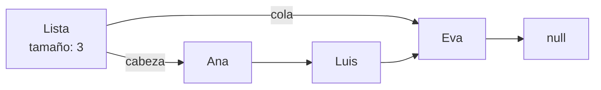
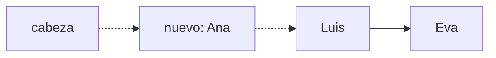
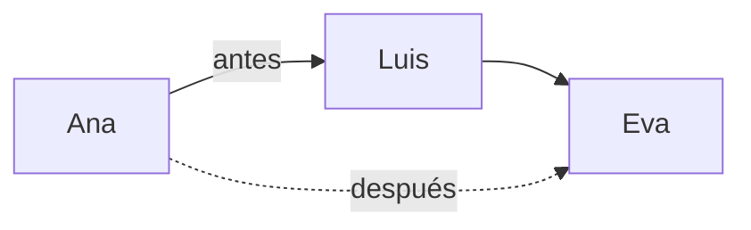

# Introducción a las Ciencias de la Computación - Datos estructurados

## 4.3 Listas simples.

---

Una **lista simplemente ligada** guarda una sucesión de elementos en nodos dispersos en memoria, cada uno con una referencia al siguiente. A diferencia de un arreglo, no necesita conocer de antemano cuántos elementos tendrá ni reservar un bloque contiguo de memoria, y agregar o quitar al principio es inmediato. A cambio, para llegar a una posición hay que recorrer la lista desde el inicio. Es la primera estructura de datos dinámica que se construye a mano en el curso, y combina todo lo visto: clases, referencias, ciclos y encapsulamiento.

### 1. Estructura

Cada **nodo** guarda un elemento y una referencia al siguiente nodo; el último apunta a `null`. La lista guarda una referencia al primer nodo, la **cabeza**, y conviene guardar también una al último, la **cola**, y el número de elementos.



### 2. Implementación

```java
import java.util.NoSuchElementException;

public class ListaSimple<T> {

    /** Nodo de la lista. Es una clase interna privada: nadie fuera de la lista la ve. */
    private static class Nodo<T> {
        T dato;
        Nodo<T> siguiente;
        Nodo(T dato, Nodo<T> siguiente) { this.dato = dato; this.siguiente = siguiente; }
    }

    private Nodo<T> cabeza;
    private Nodo<T> cola;
    private int tamanio;

    public int tamanio() { return tamanio; }
    public boolean esVacia() { return tamanio == 0; }

    /** Agrega al inicio. Tiempo constante. */
    public void agregarAlInicio(T dato) {
        cabeza = new Nodo<>(dato, cabeza);
        if (cola == null) cola = cabeza;          // era vacía
        tamanio++;
    }

    /** Agrega al final. Tiempo constante gracias a la referencia a la cola. */
    public void agregarAlFinal(T dato) {
        Nodo<T> nuevo = new Nodo<>(dato, null);
        if (esVacia()) {
            cabeza = nuevo;
        } else {
            cola.siguiente = nuevo;
        }
        cola = nuevo;
        tamanio++;
    }

    /** Regresa el elemento en la posición i, contando desde 0. Recorre i nodos. */
    public T obtener(int i) {
        return nodoEn(i).dato;
    }

    /** Regresa la posición de la primera aparición de dato, o -1. */
    public int indiceDe(T dato) {
        int i = 0;
        for (Nodo<T> n = cabeza; n != null; n = n.siguiente, i++) {
            if (n.dato.equals(dato)) return i;
        }
        return -1;
    }

    /** Elimina y regresa el primer elemento. */
    public T eliminarPrimero() {
        if (esVacia()) throw new NoSuchElementException("Lista vacía");
        T dato = cabeza.dato;
        cabeza = cabeza.siguiente;
        if (cabeza == null) cola = null;          // quedó vacía
        tamanio--;
        return dato;
    }

    /** Elimina la primera aparición de dato. Regresa true si la encontró. */
    public boolean eliminar(T dato) {
        if (esVacia()) return false;
        if (cabeza.dato.equals(dato)) {
            eliminarPrimero();
            return true;
        }
        Nodo<T> anterior = cabeza;
        while (anterior.siguiente != null && !anterior.siguiente.dato.equals(dato)) {
            anterior = anterior.siguiente;
        }
        if (anterior.siguiente == null) return false;   // no estaba
        if (anterior.siguiente == cola) cola = anterior;
        anterior.siguiente = anterior.siguiente.siguiente; // se "salta" el nodo
        tamanio--;
        return true;
    }

    @Override
    public String toString() {
        StringBuilder sb = new StringBuilder("[");
        for (Nodo<T> n = cabeza; n != null; n = n.siguiente) {
            sb.append(n.dato).append(n.siguiente != null ? ", " : "");
        }
        return sb.append("]").toString();
    }

    // ---------- auxiliar ----------
    private Nodo<T> nodoEn(int i) {
        if (i < 0 || i >= tamanio) throw new IndexOutOfBoundsException("Índice " + i);
        Nodo<T> n = cabeza;
        for (int k = 0; k < i; k++) n = n.siguiente;
        return n;
    }

    public static void main(String[] args) {
        ListaSimple<String> l = new ListaSimple<>();
        l.agregarAlFinal("Luis");
        l.agregarAlFinal("Eva");
        l.agregarAlInicio("Ana");
        System.out.println(l + " tamaño " + l.tamanio());   // [Ana, Luis, Eva] tamaño 3
        System.out.println(l.obtener(1));                   // Luis
        l.eliminar("Luis");
        System.out.println(l + " " + l.indiceDe("Eva"));    // [Ana, Eva] 1
        l.agregarAlFinal("Sol");
        System.out.println(l);                              // [Ana, Eva, Sol]
    }
}
```

**Detalles a observar.**

- La clase `Nodo` es **privada**: quien usa la lista solo ve elementos, nunca nodos. Así nadie puede romper la estructura, por ejemplo creando un ciclo.
- La lista es **genérica**: `ListaSimple<String>`, `ListaSimple<Integer>`, etc.
- Los casos especiales, lista vacía o eliminar el primero o el último, son la fuente más común de errores. Siempre hay que preguntarse qué pasa con `cabeza`, `cola` y `tamanio`.

### 3. Las operaciones paso a paso

**Insertar al inicio.** El nodo nuevo apunta a la cabeza actual y se convierte en la nueva cabeza. No importa cuántos elementos haya: son dos asignaciones.



**Eliminar un nodo intermedio.** Se busca el nodo **anterior** al que se quiere eliminar y se le hace apuntar al siguiente del eliminado. El nodo eliminado queda inalcanzable y lo libera el recolector de basura.



En una lista simple no se puede ir hacia atrás, por eso el recorrido de `eliminar` se detiene un nodo **antes** del que busca.

### 4. Costo de las operaciones

Si la lista tiene $n$ elementos:

| Operación               | Lista simple con cola | Arreglo dinámico (`ArrayList`) |
| ----------------------- | --------------------- | ------------------------------ |
| agregar al inicio       | constante             | proporcional a $n$, hay que recorrer los elementos |
| agregar al final        | constante             | constante en promedio          |
| obtener el elemento $i$ | proporcional a $i$    | constante                      |
| buscar un valor         | proporcional a $n$    | proporcional a $n$             |
| eliminar el primero     | constante             | proporcional a $n$             |
| eliminar el último      | proporcional a $n$, hay que encontrar al penúltimo | constante |
| memoria extra por elemento | una referencia     | ninguna, salvo espacio libre al final |

En la notación que se estudia en Estructuras de Datos, *constante* se escribe $O(1)$ y *proporcional a $n$* se escribe $O(n)$. Ninguna estructura es mejor en todo: la lista simple conviene cuando se agrega y quita mucho al principio, como en una pila; el arreglo, cuando se accede mucho por posición.

### 5. Recorridos

El patrón para visitar todos los elementos es siempre el mismo:

```java
for (Nodo<T> n = cabeza; n != null; n = n.siguiente) {
    // procesar n.dato
}
```

Un error frecuente es escribir `obtener(i)` dentro de un ciclo de `i = 0` a `n - 1`: cada llamada recorre desde el principio, de modo que el ciclo completo hace del orden de $n^2 / 2$ pasos en lugar de $n$. Para recorrer una lista desde fuera de la clase sin exponer los nodos se usa un **iterador**, que es lo que permite escribir `for (String s : lista)` con las colecciones de Java.

### 6. Variantes

- **Lista doblemente ligada:** cada nodo apunta también al anterior. Permite recorrer en ambos sentidos y eliminar un nodo conociendo solo ese nodo, a cambio de una referencia más por nodo. Es la implementación de `java.util.LinkedList`.
- **Lista circular:** el último nodo apunta a la cabeza. Útil para recorridos cíclicos, como turnos entre jugadores.
- **Lista con nodo centinela:** un nodo vacío fijo al inicio elimina los casos especiales de lista vacía.

> **Conexión con CC.** Las listas ligadas aparecen en los sistemas operativos para mantener las listas de procesos listos para ejecutarse, en los asignadores de memoria para la lista de bloques libres, y en las tablas hash para guardar los elementos que caen en la misma posición. Su estudio completo, con análisis de complejidad e iteradores, es el tema 6 de Estructuras de Datos.

### Ejercicios propuestos

1. Dibuje paso a paso el estado de la lista, con cabeza, cola y tamaño, después de: agregar al final 5, 3 y 7; eliminar 3; agregar al inicio 1; eliminar 7.
2. Agregue a `ListaSimple` los métodos `contiene(T dato)`, `eliminarUltimo()` y `insertar(int i, T dato)`. ¿Cuál es el costo de cada uno?
3. Escriba un método `invertir()` que invierta la lista **cambiando las referencias**, sin crear nodos nuevos. Su costo debe ser proporcional a $n$.
4. Escriba un método estático que reciba dos listas ordenadas de enteros y regrese una nueva lista ordenada con los elementos de ambas.
5. Explique por qué el siguiente ciclo es ineficiente y reescríbalo dentro de la clase usando los nodos directamente:

```java
int suma = 0;
for (int i = 0; i < lista.tamanio(); i++) suma += lista.obtener(i);
```

6. Haga que `ListaSimple<T>` implemente `Iterable<T>` para que pueda recorrerse con `for (T x : lista)`.

### Ver también

- **4.1** Interfaces — el contrato de una lista y sus implementaciones.
- **4.2** Objetos y referencias — nodos enlazados y recolección de basura.
- **4.5** Arreglos — la alternativa con acceso directo por posición.
- **4.6** Funciones y recursión — versiones recursivas de los recorridos.
- **Estructuras de Datos 6** (Sem. 2) — TDA lista, variantes, complejidad e iteradores.

### Referencias

- Sedgewick, R., & Wayne, K. (2011). _Algorithms_ (4.ª ed.). Addison-Wesley. Sección 1.3.
- Cormen, T. H., Leiserson, C. E., Rivest, R. L., & Stein, C. (2022). _Introduction to Algorithms_ (4.ª ed.). MIT Press. Sección 10.2.
- Goodrich, M. T., Tamassia, R., & Goldwasser, M. H. (2014). _Data Structures and Algorithms in Java_ (6.ª ed.). Wiley. Cap. 3.
