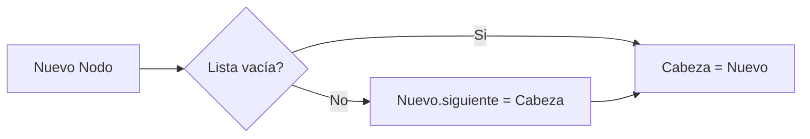

# Introducción a las Ciencias de la Computación - Datos estructurados

## 4.3 Listas simples.

---

### 1. Definición y Conceptos Clave

#### 1.1 Lista Simple

Estructura lineal que almacena elementos secuencialmente, donde cada nodo contiene:

- **Dato**: Valor almacenado
- **Enlace**: Referencia al siguiente nodo

$$ \text{Lista} = \langle \text{Nodo}_1 \rightarrow \text{Nodo}_2 \rightarrow \cdots \rightarrow \text{Nodo}_n \rangle $$

#### 1.2 Complejidad Temporal

| Operación | Complejidad                     |
| --------- | ------------------------------- |
| Inserción | $O(1)$ (cabeza) / $O(n)$ (cola) |
| Búsqueda  | $O(n)$                          |

### 2. Implementación Básica

#### 2.1 Clase Nodo

```java
public class Nodo<T> {
    T dato;
    Nodo<T> siguiente;

    public Nodo(T dato) {
        this.dato = dato;
        this.siguiente = null;
    }
}
```

#### 2.2 Clase Lista

```typescript
class ListaSimple<T> {
  private cabeza: Nodo<T> | null;

  constructor() {
    this.cabeza = null;
  }

  agregarAlInicio(dato: T): void {
    const nuevoNodo = new Nodo(dato);
    nuevoNodo.siguiente = this.cabeza;
    this.cabeza = nuevoNodo;
  }
}
```

### 3. Diagrama de Estructura

```
classDiagram
    class Nodo {
        +dato: T
        +siguiente: Nodo
    }
    class ListaSimple {
        -cabeza: Nodo
        +agregarAlInicio(dato: T): void
        +buscar(dato: T): boolean
    }
    ListaSimple --> Nodo
```

### 4. Operaciones Principales

#### 4.1 Inserción



#### 4.2 Búsqueda

```python
def buscar(self, valor):
    actual = self.cabeza
    while actual:
        if actual.dato == valor:
            return True
        actual = actual.siguiente
    return False
```

### 5. Ejercicios

1. Implementa el método `eliminar(valor)` en TypeScript
2. Dibuja cómo queda la memoria tras estas operaciones:
   - Insertar 5 → 3 → 7
   - Eliminar 3
3. Calcula la complejidad de acceder al i-ésimo elemento

### 6. Aplicaciones Reales

- Historial de navegación
- Pilas de ejecución (call stack)
- Playlists de música

### Ver también

- **4.2** Objetos y referencias — los nodos de una lista son objetos.
- **4.5** Arreglos — alternativa de implementación a las listas dinámicas.
- **Estructuras de Datos 6.1** (Sem. 2) — TDA Lista: definición y alternativas.

### Referencias

- Eckel, B. (2006). _Thinking in Java_ (4.ª ed.). Prentice Hall. Cap. 11.
- Cormen, T. H. et al. (2022). _Introduction to Algorithms_ (4.ª ed.). MIT Press. Cap. 10.
