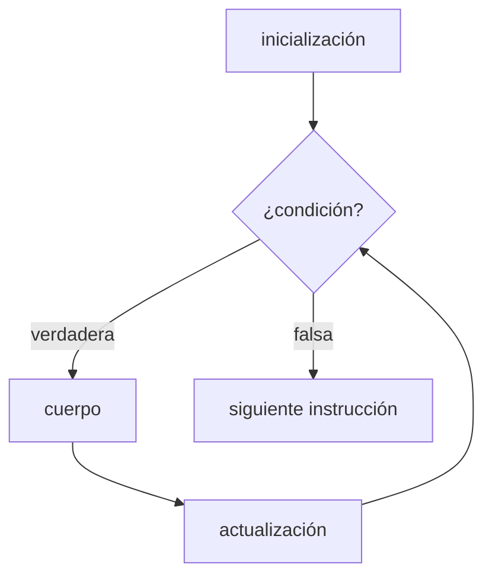

# Introducción a las Ciencias de la Computación - Datos estructurados

## 4.4 Ciclos y condicionales.

---

Las instrucciones de un método se ejecutan una tras otra, salvo cuando una **estructura de control** decide otra cosa: un **condicional** elige entre caminos según una condición, y un **ciclo** repite un bloque mientras una condición se cumpla. Con secuencia, selección y repetición puede escribirse cualquier algoritmo, según el teorema de Böhm y Jacopini. Este subtema presenta las formas que tienen en Java, los patrones típicos para procesar datos estructurados y cómo razonar sobre la corrección de un ciclo.

### 1. Condicionales

**`if` y `else`.**

```java
static String clasificar(double calificacion) {
    if (calificacion < 0 || calificacion > 10) {
        throw new IllegalArgumentException("Fuera de rango: " + calificacion);
    } else if (calificacion >= 9) {
        return "MB";
    } else if (calificacion >= 8) {
        return "B";
    } else if (calificacion >= 6) {
        return "S";
    } else {
        return "NA";
    }
}
```

Las condiciones se evalúan **en orden** y se ejecuta solo la rama de la primera que se cumple. Por eso `calificacion >= 8` no necesita decir "y menor que 9": si fuera 9 o más ya habría entrado a la rama anterior.

**Buenas prácticas.**

- Usar siempre llaves, aunque el bloque tenga una sola instrucción, para evitar errores al agregar líneas después.
- Comparar booleanos directamente: `if (activo)` en lugar de `if (activo == true)`.
- Atender primero los casos especiales o inválidos y salir, en lugar de anidar todo el método dentro de varios `if`.

**`switch`.** Cuando se elige según el valor de una variable entre varios casos, `switch` es más claro. Desde Java 14 existe la forma con flecha, que no necesita `break` y puede usarse como expresión:

```java
static String nombreDelDia(int dia) {
    return switch (dia) {
        case 1 -> "lunes";
        case 2 -> "martes";
        case 3 -> "miércoles";
        case 4 -> "jueves";
        case 5 -> "viernes";
        case 6, 7 -> "fin de semana";
        default -> throw new IllegalArgumentException("Día inválido: " + dia);
    };
}
```

En la forma clásica con dos puntos, olvidar el `break` hace que la ejecución "caiga" al siguiente caso, una fuente famosa de errores.

### 2. Ciclos

| Ciclo           | Cuándo usarlo                                                          |
| --------------- | ---------------------------------------------------------------------- |
| `for` clásico   | se conoce el número de iteraciones o se recorre por índices            |
| `for` mejorado  | se recorren todos los elementos de un arreglo o colección              |
| `while`         | se repite mientras se cumpla una condición, sin saber cuántas veces    |
| `do-while`      | el cuerpo debe ejecutarse al menos una vez                             |



```java
// for clásico: los cuadrados del 1 al 5
for (int i = 1; i <= 5; i++) {
    System.out.print(i * i + " ");
}

// for mejorado: recorrer un arreglo
int[] datos = {4, 8, 15, 16, 23, 42};
int suma = 0;
for (int d : datos) {
    suma += d;
}

// while: cuántas veces se puede dividir entre 2
int n = 1000, pasos = 0;
while (n > 1) {
    n /= 2;
    pasos++;
}                                   // pasos = 9

// do-while: pedir un dato hasta que sea válido
java.util.Scanner sc = new java.util.Scanner(System.in);
int edad;
do {
    System.out.print("Edad: ");
    edad = sc.nextInt();
} while (edad < 0 || edad > 130);
```

**`break` y `continue`.** `break` termina el ciclo más interno de inmediato; `continue` salta al final de la iteración actual. Son útiles con moderación, pero un ciclo con muchos `break` es difícil de entender.

### 3. Patrones de procesamiento

Casi todos los ciclos sobre datos siguen unos pocos patrones:

```java
public class Patrones {
    public static void main(String[] args) {
        int[] c = {7, 9, 5, 10, 8, 6};

        // Acumulación
        int total = 0;
        for (int x : c) total += x;

        // Conteo con condición
        int aprobados = 0;
        for (int x : c) if (x >= 6) aprobados++;

        // Máximo y su posición
        int posMax = 0;
        for (int i = 1; i < c.length; i++) {
            if (c[i] > c[posMax]) posMax = i;
        }

        // Búsqueda con salida temprana
        int buscado = 10, pos = -1;
        for (int i = 0; i < c.length && pos == -1; i++) {
            if (c[i] == buscado) pos = i;
        }

        // Verificación de que todos cumplen
        boolean todosAprobaron = true;
        for (int x : c) {
            if (x < 6) { todosAprobaron = false; break; }
        }

        System.out.printf("total=%d aprobados=%d max=%d en %d, 10 en %d, todos=%b%n",
                total, aprobados, c[posMax], posMax, pos, todosAprobaron);
        // total=45 aprobados=5 max=10 en 3, 10 en 3, todos=false
    }
}
```

**Ciclos anidados.** Un ciclo dentro de otro ejecuta el interno completo por cada iteración del externo. Con $n$ iteraciones en cada uno, el cuerpo se ejecuta $n^2$ veces:

```java
for (int i = 1; i <= 3; i++) {
    for (int j = 1; j <= 3; j++) {
        System.out.print(i * j + "\t");
    }
    System.out.println();
}
```

### 4. Razonar sobre ciclos: invariantes y terminación

Para convencerse de que un ciclo es correcto se responden dos preguntas:

1. **¿Qué es cierto en cada iteración?** Un **invariante** es una afirmación que vale antes del ciclo y que cada iteración conserva. Al terminar, el invariante junto con la condición de salida debe implicar el resultado deseado.
2. **¿Termina?** Se identifica una cantidad entera no negativa que disminuye en cada iteración.

**Ejemplo.** En el cálculo del máximo, el invariante es: *"`c[posMax]` es el mayor de `c[0]`, …, `c[i-1]`"*. Es cierto al inicio con $i = 1$. Si vale al iniciar una iteración, después de comparar con `c[i]` vale para el siguiente $i$. Al salir, $i$ = `c.length`, así que `c[posMax]` es el máximo de todo el arreglo. Termina porque `c.length - i` disminuye en uno cada vez.

Esta forma de razonar, que es una inducción sobre el número de iteraciones, se estudia en Estructuras Discretas (subtema 3.1) y se formaliza en Estructuras de Datos.

### 5. Errores frecuentes

- **Error por uno** (*off-by-one*): usar `i <= c.length` en lugar de `i < c.length` provoca `ArrayIndexOutOfBoundsException`; empezar en 1 en lugar de 0 omite el primer elemento.
- **Ciclo infinito:** olvidar actualizar la variable de la condición, como en `while (i < n) { suma += i; }`.
- **Punto y coma de más:** `for (int i = 0; i < n; i++);` tiene un cuerpo vacío, y el bloque que sigue se ejecuta una sola vez.
- **Comparar flotantes con igualdad** en la condición: `for (double x = 0; x != 1.0; x += 0.1)` no termina nunca, porque por redondeo `x` nunca vale exactamente 1.0.
- **Modificar una colección mientras se recorre** con el `for` mejorado produce una `ConcurrentModificationException`.

> **Conexión con CC.** El número de veces que se ejecuta el cuerpo de un ciclo, en función del tamaño de los datos, es la base del análisis de algoritmos: un ciclo simple sobre $n$ datos hace un trabajo proporcional a $n$, dos ciclos anidados, proporcional a $n^2$. Con un millón de datos, la diferencia es entre un millón de operaciones y un billón. Reducir el anidamiento de ciclos es una de las optimizaciones más importantes.

### Ejercicios propuestos

1. Escriba un programa que lea números enteros hasta que se ingrese 0 e imprima su suma, el mayor y el promedio de los positivos.
2. Escriba un método que diga si un número es primo probando divisores hasta su raíz cuadrada. ¿Por qué basta con llegar a la raíz?
3. Reescriba con `switch` en forma de expresión un método que reciba el número de un mes y regrese cuántos días tiene en un año no bisiesto.
4. Escriba con ciclos anidados un programa que imprima un triángulo de asteriscos de altura $n$, con una línea de $1, 2, \ldots, n$ asteriscos.
5. Escriba el invariante y el argumento de terminación del ciclo `while` de la sección 2 que cuenta cuántas veces se puede dividir entre 2.
6. Encuentre y corrija los errores:

```java
int suma = 0;
for (int i = 1; i <= datos.length; i++);
{
    suma += datos[i];
}
```

### Ver también

- **1.6** Principios de lenguajes de programación — secuencia, selección y repetición.
- **3.2** Expresiones y cadenas — expresiones booleanas y cortocircuito.
- **4.5** Arreglos — los ciclos son la forma natural de recorrerlos.
- **4.6** Funciones y recursión — la recursión como alternativa a los ciclos.
- **Estructuras Discretas 3.1** — inducción e invariantes de ciclo.
- **Estructuras de Datos 3.1** (Sem. 2) — pruebas de corrección basadas en invariantes.

### Referencias

- Eckel, B. (2006). _Thinking in Java_ (4.ª ed.). Prentice Hall. Cap. 4.
- Gries, D. (1981). _The Science of Programming_. Springer. Cap. 11.
- Böhm, C., & Jacopini, G. (1966). Flow diagrams, Turing machines and languages with only two formation rules. _Communications of the ACM_, 9(5), 366-371.
