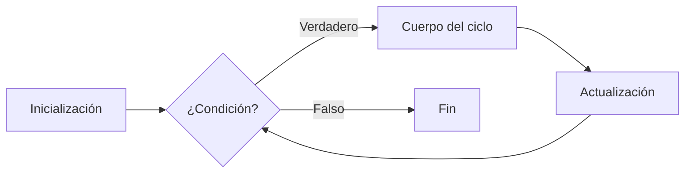

# Introducción a las Ciencias de la Computación - Datos estructurados

## 4.4 Ciclos y condicionales.

---

### 1. Estructuras de Control Básicas

#### 1.1 Condicionales

Toman decisiones basadas en condiciones booleanas:

**Fórmula general:**

$$ \text{Flujo} = \begin{cases} \text{Bloque}_1 & \text{si } \text{condición} \\\ \text{Bloque}_2 & \text{en otro caso} \end{cases} $$

##### 1.1.1 `if-else` en Java

```java
if (edad >= 18) {
    System.out.println("Mayor de edad");
} else {
    System.out.println("Menor de edad");
}
```

##### 1.1.2 `switch` en JavaScript

```javascript
switch (diaSemana) {
  case 1:
    console.log('Lunes');
    break;
  case 2:
    console.log('Martes');
    break;
  default:
    console.log('Fin de semana');
}
```

### 2. Ciclos Iterativos

#### 2.1 Tipos de Ciclos

| Tipo       | Uso típico                   | Ejemplo                   |
| ---------- | ---------------------------- | ------------------------- |
| `for`      | Iteración con contador       | `for(int i=0; i<10; i++)` |
| `while`    | Condición de parada dinámica | `while(x > 0)`            |
| `do-while` | Ejecución mínima garantizada | `do { ... } while(cond);` |

#### 2.2 Diagrama de Flujo `for`



#### 2.3 Ejemplo en Python

```python
for i in range(5):  # 0 a 4
    if i % 2 == 0:
        print(f"{i} es par")
    else:
        print(f"{i} es impar")
```

### 3. Anidamiento y Control

#### 3.1 Bucles Anidados

```java
for (int i = 1; i <= 3; i++) {
    for (int j = 1; j <= 2; j++) {
        System.out.println(i + "x" + j + "=" + (i*j));
    }
}
```

#### 3.2 Palabras Clave

- `break`: Termina el ciclo inmediatamente
- `continue`: Salta a la siguiente iteración

**Complejidad de ciclos anidados:**

$$ O(\text{n}^k) \quad \text{para } k \text{ niveles de anidamiento} $$

### 4. Ejercicios Prácticos

1. Implementa un bucle que sume números hasta que se ingrese 0
2. Dibuja un diagrama de flujo para validar contraseñas (3 intentos)
3. Optimiza este código con `continue`:

```typescript
for (let i = 0; i < 10; i++) {
  if (i % 2 !== 0) {
    console.log(i);
  }
}
```

### 5. Recursos Adicionales

- **Libro:** "Eloquent JavaScript" (Cap. 2)
- **Herramienta:** [Flowchart Designer](https://app.diagrams.net/)

#### Ver también

- **3.2** Expresiones — las condiciones son expresiones booleanas.
- **4.3** Listas simples — los ciclos se usan para recorrer listas.
- **4.6** Funciones y recursión — alternativa recursiva a los ciclos iterativos.

#### Referencias

- Eckel, B. (2006). _Thinking in Java_ (4.ª ed.). Prentice Hall. Cap. 4.
- Knuth, D. E. (1997). _The Art of Computer Programming_ (3.ª ed.). Vol. 1. Addison-Wesley.
