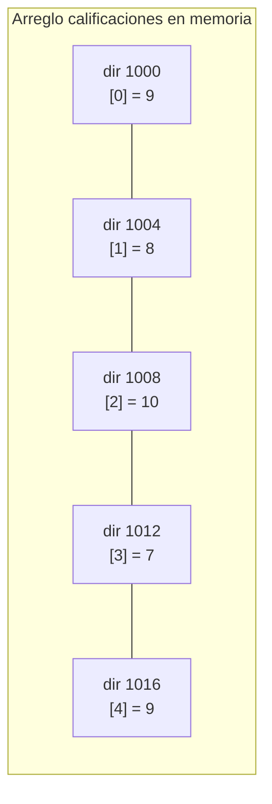

# Introducción a las Ciencias de la Computación - Datos estructurados

## 4.5 Arreglos.

---

Un **arreglo** guarda una cantidad fija de elementos del mismo tipo en posiciones consecutivas de memoria, numeradas desde 0. Gracias a esa organización, llegar al elemento en cualquier posición cuesta lo mismo que llegar al primero: basta un cálculo de dirección. Es la estructura de datos más básica y eficiente, la que el hardware ofrece directamente, y sobre ella se construyen muchas otras, como las listas de `ArrayList`, las tablas hash o los montículos.

### 1. Arreglos en Java

```java
int[] calificaciones = new int[5];            // 5 enteros, todos inicializados en 0
String[] nombres = {"Ana", "Luis", "Eva"};    // inicialización con valores
double[] precios = new double[]{9.5, 12.0};

calificaciones[0] = 9;                        // escribir en la posición 0
int primera = calificaciones[0];              // leer
int n = nombres.length;                       // longitud: 3 (atributo, sin paréntesis)
```

- El tamaño se fija al crear el arreglo y **no puede cambiar**.
- Los índices válidos van de `0` a `length - 1`. Acceder fuera de ese rango lanza una `ArrayIndexOutOfBoundsException`: Java siempre verifica los límites, a diferencia de C, donde un acceso fuera de rango lee o escribe memoria ajena sin aviso.
- Los elementos se inicializan automáticamente con 0, `false` o `null` según su tipo.
- Un arreglo es un **objeto**: la variable guarda una referencia (subtema 3.3). Asignar un arreglo a otra variable crea un alias, no una copia.

### 2. Por qué el acceso es inmediato

Si el arreglo empieza en la dirección de memoria $b$ y cada elemento ocupa $t$ bytes, el elemento de índice $i$ está en

$$\text{dirección}(i) = b + i \cdot t$$

Para un arreglo de `int`, con $t = 4$, que empiece en la dirección 1000, el elemento 25 está en $1000 + 25 \cdot 4 = 1100$. Calcular esa dirección cuesta lo mismo para cualquier $i$, por eso el acceso por índice toma **tiempo constante**. Que los índices empiecen en 0 se debe justamente a esta fórmula: el índice es el desplazamiento desde el inicio.



### 3. Operaciones habituales

```java
import java.util.Arrays;

public class OperacionesArreglos {
    public static void main(String[] args) {
        int[] a = {7, 3, 9, 1, 5};

        // Recorrer
        for (int i = 0; i < a.length; i++) System.out.print(a[i] + " ");
        System.out.println();

        // Copiar: copyOf crea un arreglo nuevo, = solo copia la referencia
        int[] copia = Arrays.copyOf(a, a.length);
        int[] alias = a;
        alias[0] = 100;
        System.out.println(a[0] + " " + copia[0]);          // 100 7

        // Invertir en el mismo arreglo
        for (int i = 0, j = a.length - 1; i < j; i++, j--) {
            int tmp = a[i]; a[i] = a[j]; a[j] = tmp;
        }
        System.out.println(Arrays.toString(a));             // [5, 1, 9, 3, 100]

        // Utilidades de la biblioteca
        Arrays.sort(a);
        System.out.println(Arrays.toString(a));             // [1, 3, 5, 9, 100]
        System.out.println(Arrays.binarySearch(a, 9));      // 3
        System.out.println(Arrays.equals(a, copia));        // false: compara contenido
    }
}
```

Para comparar el **contenido** de dos arreglos se usa `Arrays.equals`; el operador `==` solo dice si son el mismo objeto.

### 4. Búsqueda

**Búsqueda lineal.** Revisa los elementos uno por uno. Sirve para cualquier arreglo, y en el peor caso revisa los $n$ elementos.

**Búsqueda binaria.** Si el arreglo está **ordenado**, se compara con el elemento de en medio y se descarta la mitad en la que no puede estar:

```java
static int busquedaBinaria(int[] a, int x) {
    int izq = 0, der = a.length - 1;
    while (izq <= der) {
        int medio = izq + (der - izq) / 2;     // evita desbordamiento de izq + der
        if (a[medio] == x) return medio;
        if (a[medio] < x) izq = medio + 1;     // x solo puede estar a la derecha
        else der = medio - 1;                  // x solo puede estar a la izquierda
    }
    return -1;
}
```

Cada iteración reduce a la mitad el intervalo, así que con un millón de elementos basta con unas 20 comparaciones, frente al millón de la búsqueda lineal. El invariante es: *si $x$ está en el arreglo, está entre las posiciones `izq` y `der`*.

### 5. Ordenamiento

**Ordenamiento por inserción.** Se recorre el arreglo y cada elemento se inserta en su lugar dentro de la parte ya ordenada, a su izquierda, desplazando a la derecha los mayores:

```java
static void insercion(int[] a) {
    for (int i = 1; i < a.length; i++) {
        int actual = a[i];
        int j = i - 1;
        while (j >= 0 && a[j] > actual) {
            a[j + 1] = a[j];          // desplaza a la derecha
            j--;
        }
        a[j + 1] = actual;
    }
}
```

| Paso      | Arreglo           | Parte ordenada  |
| --------- | ----------------- | --------------- |
| inicio    | 7 3 9 1 5         | 7               |
| $i = 1$   | 3 7 9 1 5         | 3 7             |
| $i = 2$   | 3 7 9 1 5         | 3 7 9           |
| $i = 3$   | 1 3 7 9 5         | 1 3 7 9         |
| $i = 4$   | 1 3 5 7 9         | todo            |

En el peor caso, un arreglo en orden inverso, hace del orden de $n^2 / 2$ comparaciones. Para arreglos grandes se usan algoritmos más rápidos, del orden de $n \log n$, como los que usa `Arrays.sort`, que se estudian en Estructuras de Datos.

### 6. Arreglos de dos dimensiones

En Java, una matriz es un **arreglo de arreglos**:

```java
int[][] m = new int[3][4];          // 3 filas, 4 columnas, todo en 0
m[1][2] = 5;                        // fila 1, columna 2
int filas = m.length;               // 3
int columnas = m[0].length;         // 4

int[][] identidad = new int[4][4];
for (int i = 0; i < 4; i++) identidad[i][i] = 1;

int[][] triangulo = new int[4][];   // filas de distinto tamaño
for (int i = 0; i < 4; i++) triangulo[i] = new int[i + 1];
```

Como cada fila es un arreglo independiente, las filas pueden tener longitudes distintas. En memoria, una matriz guardada **por filas** coloca el elemento $(i, j)$ de una matriz de $m \times n$ en la posición $i \cdot n + j$ desde el inicio, fórmula que se generaliza a más dimensiones con los **polinomios de direccionamiento** de Estructuras de Datos.

### 7. Arreglos dinámicos

Como un arreglo no puede crecer, cuando se necesita una colección de tamaño variable se usa un **arreglo dinámico**, como `ArrayList`. Internamente guarda un arreglo más grande que el número de elementos; cuando se llena, crea uno nuevo, aproximadamente 1.5 veces mayor en Java, y copia los elementos.

Copiar es costoso, pero como la capacidad crece de forma geométrica, ocurre pocas veces: para agregar $n$ elementos se copian en total del orden de $n$ elementos, así que agregar al final cuesta, **en promedio**, tiempo constante.

| Operación                 | Arreglo        | `ArrayList`                    |
| ------------------------- | -------------- | ------------------------------ |
| acceder por índice        | constante      | constante                      |
| agregar al final          | imposible      | constante en promedio          |
| insertar al inicio        | imposible      | proporcional a $n$             |
| tamaño                    | fijo           | variable                       |
| elementos primitivos      | sí, `int[]`    | no, usa `Integer`              |

> **Conexión con CC.** Que los elementos estén contiguos en memoria tiene un beneficio adicional que no aparece en el análisis teórico: las memorias caché cargan bloques de bytes vecinos, así que recorrer un arreglo en orden es mucho más rápido que seguir nodos dispersos de una lista. Por eso, en la práctica, los arreglos dinámicos suelen ganarle a las listas ligadas incluso en operaciones en las que la teoría favorece a las listas.

### Ejercicios propuestos

1. Escriba métodos que reciban un arreglo de `double` y regresen su promedio, su desviación estándar y un arreglo nuevo con los elementos mayores que el promedio.
2. Escriba un método que rote un arreglo $k$ posiciones a la derecha: `{1, 2, 3, 4, 5}` con $k = 2$ queda `{4, 5, 1, 2, 3}`.
3. Ejecute a mano la búsqueda binaria de 23 en `{2, 5, 8, 12, 16, 23, 38, 56, 72, 91}`, anotando `izq`, `der` y `medio` en cada paso.
4. Escriba un método que multiplique dos matrices dadas como `int[][]`, verificando que sus dimensiones sean compatibles.
5. Implemente una clase `ArregloDinamico` con métodos `agregar`, `obtener` y `tamanio`, que duplique su capacidad al llenarse. Cuente cuántas copias de elementos se hacen al agregar 1000 elementos.
6. ¿Qué imprime el siguiente código? Explique con un diagrama de referencias.

```java
int[][] m = new int[2][2];
int[] fila = m[0];
fila[1] = 7;
m[1] = fila;
m[1][0] = 3;
System.out.println(java.util.Arrays.deepToString(m));
```

### Ver también

- **1.2** Arquitectura de Von Neumann — la memoria como arreglo de celdas.
- **3.3** Variables y referencias — los arreglos son objetos.
- **4.3** Listas simples — la alternativa enlazada.
- **4.4** Ciclos y condicionales — recorridos e invariantes.
- **Álgebra Superior I 5.1** — matrices y sus operaciones.
- **Estructuras de Datos 4** (Sem. 2) — instrumentación de arreglos y polinomios de direccionamiento.

### Referencias

- Sedgewick, R., & Wayne, K. (2011). _Algorithms_ (4.ª ed.). Addison-Wesley. Secciones 1.1, 1.4 y 2.1.
- Bentley, J. (1999). _Programming Pearls_ (2.ª ed.). Addison-Wesley. Cap. 4 y 11.
- Oracle. _The Java Tutorials: Arrays_. https://docs.oracle.com/javase/tutorial/java/nutsandbolts/arrays.html
