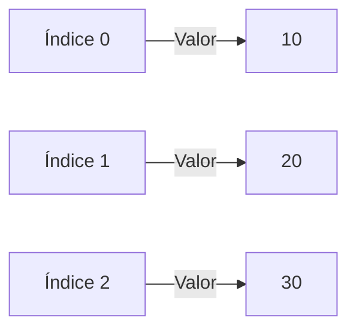
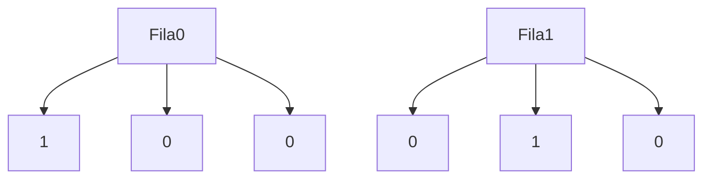

# Introducción a las Ciencias de la Computación - Datos estructurados

## 4.5 Arreglos.

---

### 1. Definición y Características

#### 1.1 Concepto Básico

Estructura que almacena elementos de **mismo tipo** en posiciones contiguas de memoria:

$$ \text{Arreglo} = [a_0, a_1, \dots, a_{n-1}] \quad \text{donde} \quad a_i \in \text{TipoDato} $$

**Propiedades:**

- Tamaño fijo (en la mayoría de lenguajes)
- Acceso directo por índice $(O(1))$
- Índices comienzan en 0 (cero-based)

### 2. Operaciones Fundamentales

#### 2.1 Declaración e Inicialización

##### Java:

```java
int[] numeros = new int[5];  // Arreglo de 5 enteros
String[] nombres = {"Ana", "Juan", "Luis"};
```

##### Python:

```python
lista = [1, 2, 3]  # En Python son listas dinámicas
arreglo = array('i', [1, 2, 3])  # Arreglo estático (módulo array)
```

#### 2.2 Acceso y Modificación

$$ \text{Elemento}_i = \text{arreglo}[\text{índice}] $$

```typescript
let frutas: string[] = ['manzana', 'banana'];
frutas[1] = 'pera'; // Modifica el segundo elemento
console.log(frutas[0]); // Accede al primero
```

### 3. Representación en Memoria

#### 3.1 Diagrama de Almacenamiento



#### 3.2 Fórmula de Direccionamiento

Para un arreglo unidimensional:

$$ \text{Dirección}(a_i) = \text{base} + i \times \text{tamaño}_{\text{tipo}} $$

### 4. Arreglos Multidimensionales

#### 4.1 Matriz 2D (Java)

```java
int[][] matriz = new int[3][3];  // 3 filas x 3 columnas
matriz[0][0] = 1;  // Primera fila, primera columna
```

#### 4.2 Diagrama de Matriz



### 5. Algoritmos Comunes

#### 5.1 Búsqueda Lineal

```python
def buscar(arr, valor):
    for i in range(len(arr)):
        if arr[i] == valor:
            return i
    return -1
```

#### 5.2 Ordenamiento Burbuja

$$ \text{Complejidad}: O(n^2) $$

```typescript
function ordenarBurbuja(arr: number[]): void {
  for (let i = 0; i < arr.length; i++) {
    for (let j = 0; j < arr.length - 1; j++) {
      if (arr[j] > arr[j + 1]) {
        [arr[j], arr[j + 1]] = [arr[j + 1], arr[j]]; // Swap
      }
    }
  }
}
```

### 6. Ejercicios

1. Implementa una función que calcule el promedio de un arreglo de números
2. Crea una matriz identidad 4x4 en tu lenguaje favorito
3. Explica por qué el acceso a un elemento es $O(1)$

### Ver también

- **4.3** Listas simples — listas como alternativa dinámica a los arreglos.
- **4.4** Ciclos y condicionales — ciclos para recorrer arreglos.
- **Estructuras de Datos 4.1** (Sem. 2) — instrumentación de arreglos y polinomios de direccionamiento.

### Referencias

- Eckel, B. (2006). _Thinking in Java_ (4.ª ed.). Prentice Hall. Cap. 16.
- Cormen, T. H. et al. (2022). _Introduction to Algorithms_ (4.ª ed.). MIT Press. Cap. 10.
