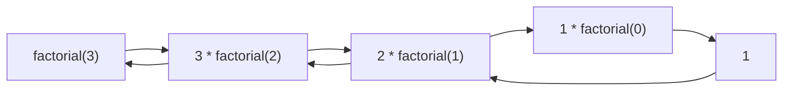
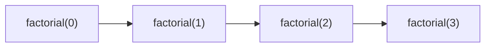

# Introducción a las Ciencias de la Computación - Datos estructurados

## 4.6 Funciones y recursión.

---

### 1. Funciones en Programación

#### 1.1 Definición

Unidad de código que:

- Recibe **parámetros** de entrada
- Realiza una tarea específica
- Devuelve un resultado (opcional)

$$ \text{Función} : \text{Inputs} \rightarrow \text{Output} $$

#### 1.2 Componentes


**Ejemplo en Python:**

```python
def suma(a: int, b: int) -> int:
    return a + b
```

### 2. Recursión

#### 2.1 Concepto

Función que se llama a sí misma hasta alcanzar un **caso base**:

$$ \text{Recursión} = \begin{cases} \text{Caso Base} & \text{(Condición de parada)} \\\ \text{Caso Recursivo} & \text{(Llamada a sí misma)} \end{cases} $$

#### 2.2 Ejemplo: Factorial

```java
public static int factorial(int n) {
    if (n == 0) {  // Caso base
        return 1;
    }
    return n * factorial(n - 1);  // Caso recursivo
}
```

**Flujo de ejecución:**



### 3. Pila de Llamadas (Call Stack)

#### 3.1 Modelo de Ejecución

Estructura LIFO que registra llamadas a funciones:

$$ \text{Pila} = \langle \text{Marco}_1, \text{Marco}_2, \dots, \text{Marco}_n \rangle $$

**Diagrama:**



#### 3.2 Ejemplo en JavaScript

```javascript
function fibonacci(n) {
  if (n <= 1) return n;
  return fibonacci(n - 1) + fibonacci(n - 2);
}
```

### 4. Recursión vs Iteración

#### 4.1 Comparación

| Característica | Recursión                              | Iteración     |
| -------------- | -------------------------------------- | ------------- |
| Legibilidad    | Alta (problemas recursivos)            | Media         |
| Memoria        | Usa pila de llamadas (puede desbordar) | Uso constante |
| Velocidad      | Más lento (overhead llamadas)          | Más rápido    |

#### 4.2 Conversión a Iterativo

```typescript
function factorialIterativo(n: number): number {
  let resultado = 1;
  for (let i = 1; i <= n; i++) {
    resultado *= i;
  }
  return resultado;
}
```

### 5. Ejercicios

1. Implementa una función recursiva para calcular la suma de dígitos de un número
2. Dibuja la pila de llamadas para `fibonacci(4)`
3. Convierte esta función recursiva a iterativa:

```python
def potencia(base, exp):
    if exp == 0: return 1
    return base * potencia(base, exp - 1)
```

### Ver también

- **4.4** Ciclos — la recursión como alternativa a la iteración.
- **6.4** Implementación de la recursividad — cómo el runtime maneja la recursión.
- **Estructuras de Datos 5.1** (Sem. 2) — divide y vencerás y recursión.

### Referencias

- Eckel, B. (2006). _Thinking in Java_ (4.ª ed.). Prentice Hall. Cap. 4.
- Sedgewick, R., & Wayne, K. (2011). _Algorithms_ (4.ª ed.). Addison-Wesley. Cap. 1.
