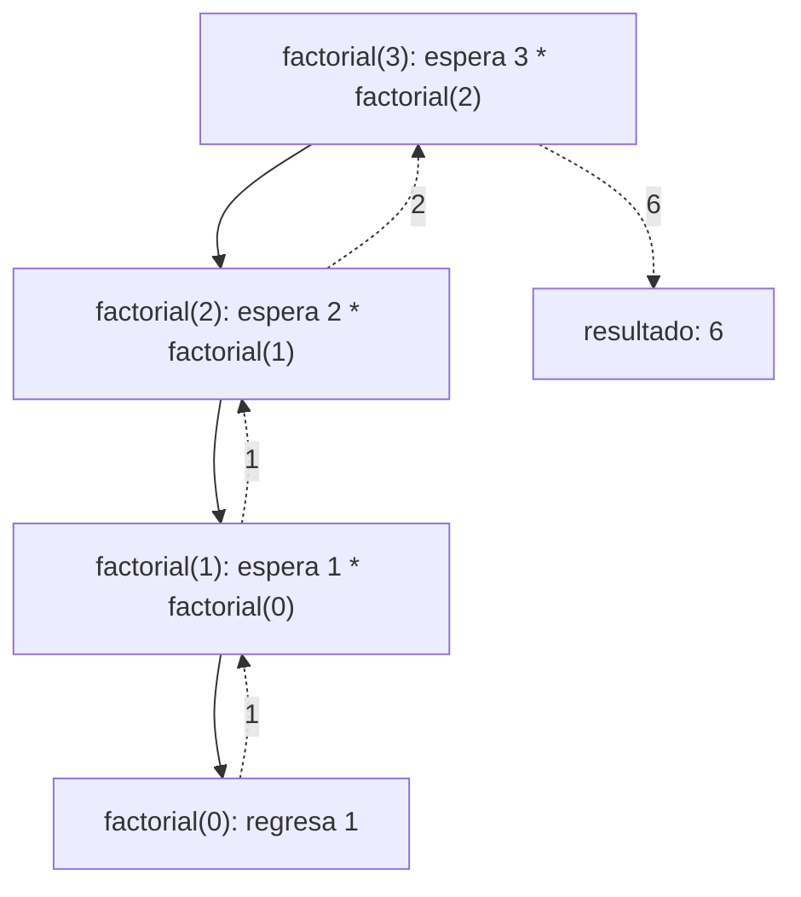

# Introducción a las Ciencias de la Computación - Datos estructurados

## 4.6 Funciones y recursión.

---

Una **función** encapsula un cálculo: recibe datos, produce un resultado y puede usarse sin conocer su interior. Cuando una función se define en términos de **sí misma**, aplicada a un caso más pequeño, se dice que es **recursiva**. La recursión es la forma natural de procesar estructuras definidas recursivamente, como listas, árboles y expresiones, y de expresar algoritmos que dividen un problema en subproblemas del mismo tipo. Es la contraparte en programación de la inducción matemática.

### 1. Funciones y métodos

En Java las funciones son **métodos**. Un método `static` que solo depende de sus parámetros se comporta como una función matemática:

```java
static double hipotenusa(double a, double b) {
    return Math.sqrt(a * a + b * b);
}
```

Una función es **pura** si su resultado depende únicamente de sus argumentos y no tiene efectos secundarios: no modifica atributos, no imprime, no lee archivos. Las funciones puras son fáciles de probar, porque para los mismos argumentos siempre dan lo mismo, y fáciles de combinar. Un buen diseño separa los cálculos puros de las partes del programa que interactúan con el exterior.

### 2. Anatomía de una función recursiva

Toda función recursiva correcta tiene:

1. Uno o más **casos base**, que se resuelven directamente sin recursión.
2. Uno o más **casos recursivos**, que reducen el problema a uno o más problemas **más pequeños** del mismo tipo y combinan sus soluciones.

```java
/** n! = n · (n-1)!, con 0! = 1. */
static long factorial(int n) {
    if (n < 0) throw new IllegalArgumentException("n negativo");
    if (n == 0) return 1;              // caso base
    return n * factorial(n - 1);       // caso recursivo: problema de tamaño n - 1
}
```

**Cómo pensar una función recursiva.** No hay que seguir mentalmente todas las llamadas. Basta con:

- verificar que los casos base son correctos;
- **suponer** que la llamada recursiva resuelve correctamente el problema más pequeño, que es la hipótesis de inducción;
- verificar que con esa respuesta se resuelve el problema original;
- verificar que cada llamada se acerca a un caso base, para que el proceso termine.

### 3. Qué ocurre al ejecutar

Cada llamada a un método crea un **registro de activación** en la **pila de ejecución**, con sus parámetros y variables locales. Una llamada recursiva crea un registro nuevo encima del anterior; al terminar, su registro se elimina y la ejecución continúa en la llamada que la invocó.



La pila tiene un tamaño limitado. Si la recursión es demasiado profunda, por ejemplo por un caso base que nunca se alcanza, el programa termina con un `StackOverflowError`. El mecanismo completo se estudia en el subtema 6.4.

### 4. Ejemplos

**Recursión sobre números: potencia rápida.** Usando $b^{2k} = (b^k)^2$ se reduce el exponente a la mitad en cada paso:

```java
static long potencia(long b, int e) {
    if (e == 0) return 1;
    long mitad = potencia(b, e / 2);
    return (e % 2 == 0) ? mitad * mitad : mitad * mitad * b;
}
```

Calcular $b^{1000}$ requiere unas 10 llamadas en lugar de 1000 multiplicaciones.

**Recursión sobre arreglos: búsqueda binaria.** El subproblema es buscar en la mitad correspondiente:

```java
static int buscar(int[] a, int x, int izq, int der) {
    if (izq > der) return -1;                       // intervalo vacío
    int medio = izq + (der - izq) / 2;
    if (a[medio] == x) return medio;
    return (a[medio] < x) ? buscar(a, x, medio + 1, der)
                          : buscar(a, x, izq, medio - 1);
}
```

Los parámetros `izq` y `der` describen el subproblema. Un método público `buscar(a, x)` puede ocultarlos llamando a `buscar(a, x, 0, a.length - 1)`.

**Recursión sobre cadenas: palíndromos.** Una cadena es palíndromo si está vacía o tiene un carácter, o si su primer y último caracteres coinciden y lo de en medio es palíndromo:

```java
static boolean esPalindromo(String s) {
    if (s.length() <= 1) return true;
    return s.charAt(0) == s.charAt(s.length() - 1)
        && esPalindromo(s.substring(1, s.length() - 1));
}
```

**Recursión sobre estructuras enlazadas.** Con los nodos del subtema 4.2, una lista es `null` o un nodo seguido de una lista, y las funciones siguen esa forma:

```java
static int suma(Nodo n) {
    if (n == null) return 0;                  // lista vacía
    return n.dato + suma(n.siguiente);        // primer dato más la suma del resto
}
```

**Varias llamadas recursivas: Torres de Hanoi.** Para mover $n$ discos del poste `origen` al `destino`, se mueven $n - 1$ al auxiliar, el mayor al destino, y los $n - 1$ del auxiliar al destino:

```java
static void hanoi(int n, char origen, char destino, char auxiliar) {
    if (n == 0) return;
    hanoi(n - 1, origen, auxiliar, destino);
    System.out.println("Mover disco " + n + " de " + origen + " a " + destino);
    hanoi(n - 1, auxiliar, destino, origen);
}
```

Esta solución, casi imposible de escribir con ciclos sin pensarla recursivamente, hace $2^n - 1$ movimientos, como se demostró por inducción en Estructuras Discretas (subtema 3.1).

### 5. Cuidado con los subproblemas repetidos

La definición de Fibonacci, $F_0 = 0$, $F_1 = 1$ y $F_n = F_{n-1} + F_{n-2}$, se traduce directamente:

```java
static long fib(int n) {
    return (n < 2) ? n : fib(n - 1) + fib(n - 2);
}
```

Pero esta versión es extremadamente lenta: `fib(5)` llama a `fib(3)` dos veces y a `fib(2)` tres veces, y el número de llamadas crece aproximadamente como $1.6^n$. Para $n = 50$ son decenas de miles de millones de llamadas. La solución es **recordar** los resultados ya calculados, técnica llamada **memorización**, o calcular de abajo hacia arriba:

```java
import java.util.HashMap;
import java.util.Map;

public class Fibonacci {
    private static final Map<Integer, Long> memo = new HashMap<>();

    static long fibMemo(int n) {
        if (n < 2) return n;
        Long guardado = memo.get(n);
        if (guardado != null) return guardado;
        long r = fibMemo(n - 1) + fibMemo(n - 2);
        memo.put(n, r);
        return r;
    }

    static long fibIterativo(int n) {
        long a = 0, b = 1;               // invariante: a = F(i), b = F(i + 1)
        for (int i = 0; i < n; i++) {
            long c = a + b;
            a = b;
            b = c;
        }
        return a;
    }

    public static void main(String[] args) {
        System.out.println(fibMemo(80) + " " + fibIterativo(80));   // 23416728348467685 dos veces
    }
}
```

### 6. Recursión o iteración

Toda función recursiva puede escribirse con ciclos y una pila explícita, y todo ciclo puede escribirse como recursión.

| Aspecto           | Recursión                                              | Iteración                                  |
| ----------------- | ------------------------------------------------------ | ------------------------------------------ |
| Claridad          | natural para estructuras recursivas y divide y vencerás | natural para recorridos lineales          |
| Memoria           | un registro en la pila por cada llamada pendiente      | constante                                  |
| Riesgo            | desbordamiento de pila con profundidad grande          | ciclos infinitos                           |
| Velocidad         | cada llamada tiene un pequeño costo extra              | sin ese costo                              |

En la práctica: usar recursión cuando el problema tiene estructura recursiva, como árboles, gramáticas o divide y vencerás, y la profundidad es moderada; usar iteración para recorridos lineales largos, como sumar un millón de elementos de una lista.

> **Conexión con CC.** Muchos de los algoritmos más importantes son recursivos: el ordenamiento por mezcla y el rápido, los recorridos de árboles y gráficas, el análisis sintáctico de los compiladores y la búsqueda con retroceso en problemas como el sudoku. Los lenguajes funcionales, como Haskell, no tienen ciclos: toda repetición se expresa con recursión.

### Ejercicios propuestos

1. Escriba funciones recursivas para: la suma de los dígitos de un entero positivo, el máximo común divisor con el algoritmo de Euclides, $\mathrm{mcd}(a, b) = \mathrm{mcd}(b, a \bmod b)$, y la cantidad de veces que aparece un carácter en una cadena.
2. Dibuje la pila de llamadas de `potencia(2, 10)` y cuente cuántas multiplicaciones se hacen.
3. Escriba una función recursiva que imprima todas las cadenas binarias de longitud $n$. ¿Cuántas imprime?
4. Ejecute `hanoi(3, 'A', 'C', 'B')` a mano y verifique que hace 7 movimientos válidos.
5. Mida el tiempo de `fib(40)` con la versión directa y con `fibMemo(40)`. Cuente con un atributo estático cuántas llamadas hace cada una.
6. Convierta a iterativa la función

```java
static long potencia(long base, int exp) {
    if (exp == 0) return 1;
    return base * potencia(base, exp - 1);
}
```

¿Qué ocurre con la versión recursiva si se llama con `exp = 100000`?

### Ver también

- **2.4** Entrada y salida — métodos, parámetros y valores de regreso.
- **4.2** Objetos y referencias — las estructuras enlazadas que se recorren recursivamente.
- **4.4** Ciclos y condicionales — la alternativa iterativa.
- **6.3 y 6.4** La pila de ejecución y la implementación de la recursividad.
- **Estructuras Discretas 3.1 a 3.3** — inducción, definiciones recursivas e inducción estructural.
- **Estructuras de Datos 5** (Sem. 2) — divide y vencerás y búsqueda con retroceso.

### Referencias

- Sedgewick, R., & Wayne, K. (2011). _Algorithms_ (4.ª ed.). Addison-Wesley. Sección 2.3.
- Abelson, H., & Sussman, G. J. (1996). _Structure and Interpretation of Computer Programs_ (2.ª ed.). MIT Press. Sección 1.2.
- Roberts, E. (1986). _Thinking Recursively_. Wiley.
