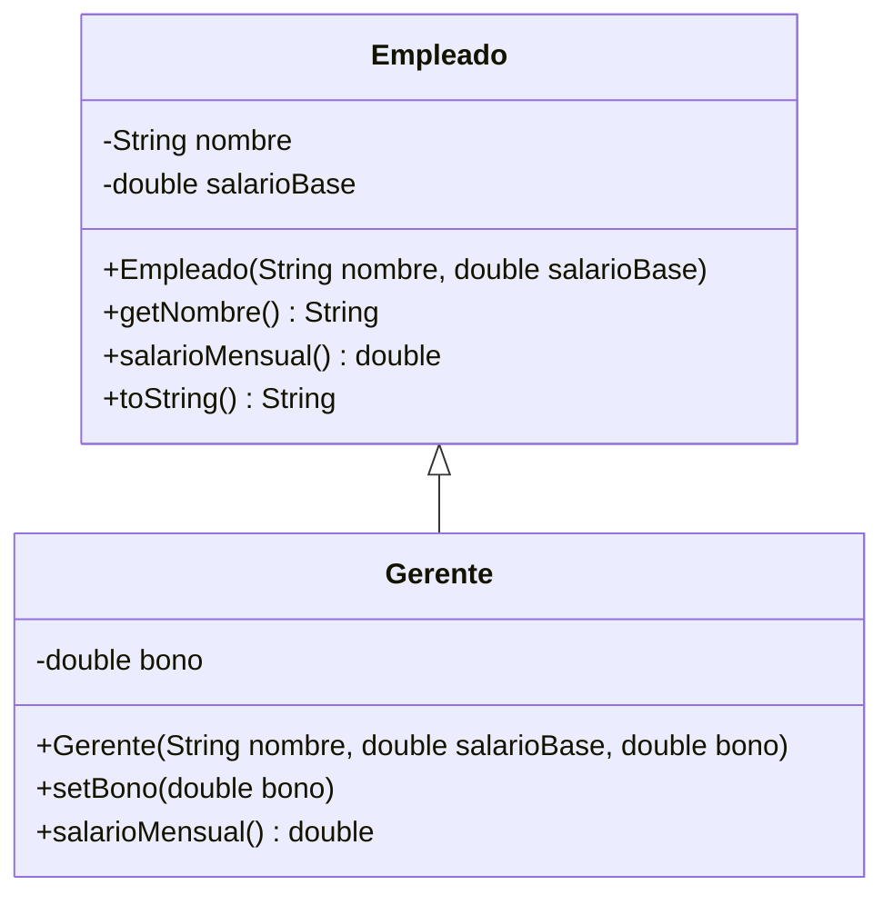
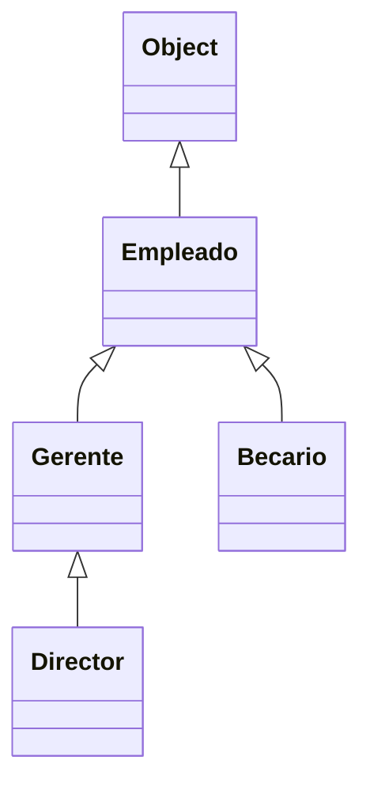

# Introducción a las Ciencias de la Computación - Herencia

## 5.1 Extensión de clases.

---

Muchas veces una clase nueva es un caso particular de otra que ya existe: un gerente es un empleado con un bono, una cuenta de ahorro es una cuenta que genera intereses. La **herencia** permite definir la clase nueva **extendiendo** la existente: se heredan sus atributos y métodos, y solo se escribe lo que es distinto. Esto evita repetir código y, sobre todo, expresa en el programa la relación "es un" que existe en el problema.

### 1. Superclase y subclase

```java
public class Empleado {
    private final String nombre;
    private final double salarioBase;

    public Empleado(String nombre, double salarioBase) {
        if (salarioBase < 0) throw new IllegalArgumentException("Salario negativo");
        this.nombre = nombre;
        this.salarioBase = salarioBase;
    }

    public String getNombre() { return nombre; }
    public double getSalarioBase() { return salarioBase; }

    public double salarioMensual() { return salarioBase; }

    @Override
    public String toString() {
        return String.format("%s: %.2f", nombre, salarioMensual());
    }
}
```

```java
public class Gerente extends Empleado {
    private double bono;                                   // atributo nuevo

    public Gerente(String nombre, double salarioBase, double bono) {
        super(nombre, salarioBase);                        // construye la parte de Empleado
        this.bono = bono;
    }

    public void setBono(double bono) { this.bono = bono; } // método nuevo

    @Override
    public double salarioMensual() {                       // método redefinido
        return super.salarioMensual() + bono;
    }
}
```

- `Empleado` es la **superclase** o clase base; `Gerente` es la **subclase** o clase derivada.
- La palabra `extends` indica la herencia. Un `Gerente` **es un** `Empleado`: tiene nombre, salario base y todos los métodos públicos de `Empleado`, más lo que agrega.
- La subclase puede **agregar** atributos y métodos, como `bono` y `setBono`, y **redefinir** métodos heredados, como `salarioMensual`.



### 2. Qué se hereda

- Se heredan los atributos y métodos de la superclase. Los **privados** también forman parte del objeto, pero la subclase **no puede accederlos por nombre**: `Gerente` no puede escribir `salarioBase` directamente, sino que usa `getSalarioBase()` o los métodos heredados. Así la superclase conserva el control de sus invariantes.
- Los miembros `protected` sí son accesibles desde las subclases (subtema 3.1).
- Los **constructores no se heredan**: cada clase define los suyos.

### 3. Constructores y `super(...)`

Un objeto de la subclase contiene una "parte" de la superclase que también debe inicializarse. Por eso, la primera instrucción de un constructor de la subclase es una llamada a un constructor de la superclase con `super(...)`:

```java
public Gerente(String nombre, double salarioBase, double bono) {
    super(nombre, salarioBase);   // primero se construye el Empleado
    this.bono = bono;             // después lo propio del Gerente
}
```

Si no se escribe, Java inserta `super()` automáticamente, y si la superclase no tiene un constructor sin parámetros, el programa no compila. La construcción sigue el orden de la jerarquía, de la clase más general a la más particular.

### 4. Redefinir métodos

Una subclase **sobrescribe** (*override*) un método cuando declara uno con la misma firma que uno heredado. Al enviar ese mensaje a un objeto de la subclase se ejecuta la versión nueva.

- La anotación `@Override` le pide al compilador verificar que realmente se está sobrescribiendo un método heredado. Si por error se escribe `salariomensual()` o se cambia un parámetro, el compilador lo señala en lugar de crear silenciosamente un método distinto.
- Dentro del método redefinido, `super.salarioMensual()` invoca la versión de la superclase. Esto permite **extender** el comportamiento heredado en lugar de reemplazarlo por completo.
- El método redefinido no puede ser menos visible que el original: si era `public`, debe seguir siendo `public`.

```java
public class Nomina {
    public static void main(String[] args) {
        Empleado ana = new Empleado("Ana", 20000);
        Gerente luis = new Gerente("Luis", 30000, 8000);

        System.out.println(ana);                     // Ana: 20000.00
        System.out.println(luis);                    // Luis: 38000.00
        System.out.println(luis.getNombre());        // Luis: método heredado
        luis.setBono(10000);
        System.out.println(luis.salarioMensual());   // 40000.0
    }
}
```

Observe que `toString` está definido en `Empleado` e invoca `salarioMensual()`. Para `luis`, esa llamada ejecuta la versión de `Gerente`, y por eso imprime 38000 aunque `Gerente` no redefinió `toString`. Este comportamiento, el **enlace dinámico**, es la base del polimorfismo del subtema 5.3.

### 5. Jerarquías de clases

Una subclase puede a su vez ser extendida, formando una jerarquía:



- En Java toda clase que no declara `extends` hereda implícitamente de `Object`, la raíz de la jerarquía. Por eso todos los objetos tienen métodos como `toString`, `equals` y `hashCode`.
- Java tiene **herencia simple** de clases: cada clase extiende exactamente a una. Para que una clase cumpla varios contratos se usan **interfaces** (subtema 5.5).
- Una clase declarada `final`, como `String`, no puede extenderse.

### 6. Cuándo usar herencia

La herencia es apropiada cuando la subclase **es un** caso particular de la superclase y puede usarse en cualquier lugar donde se espera un objeto de la superclase. Algunas preguntas para decidir:

- ¿Toda afirmación verdadera sobre un objeto de la superclase sigue siendo verdadera para la subclase?
- ¿La subclase usa y respeta todos los métodos heredados, o "desactivaría" algunos?
- ¿La relación es realmente "es un" o en realidad es "tiene un"?

Un `Automovil` **tiene un** `Motor`, no **es un** motor: ahí corresponde composición, un atributo de tipo `Motor`, no herencia. El subtema 5.2 profundiza en estos criterios.

> **Conexión con CC.** Las bibliotecas de Java están organizadas en jerarquías de herencia: todas las excepciones extienden `Throwable`, los componentes gráficos de Swing extienden `JComponent`, y las colecciones abstractas como `AbstractList` dan implementaciones parciales que se completan extendiéndolas. Saber leer una jerarquía en la documentación permite saber qué métodos tiene un objeto.

### Ejercicios propuestos

1. Agregue a la jerarquía una clase `Becario` que extienda `Empleado` y cuyo salario mensual sea el 60 % del salario base. Pruébela en `Nomina`.
2. Explique por qué el siguiente constructor no compila y corríjalo:

```java
public class Becario extends Empleado {
    public Becario(String nombre) {
        this.nombre = nombre;
    }
}
```

3. Escriba una clase `CuentaAhorro` que extienda la `CuentaBancaria` del subtema 2.1 con una tasa de interés anual y un método `aplicarInteresMensual()`. ¿Qué métodos de `CuentaBancaria` necesita usar?
4. ¿Qué pasa si en `Gerente` se escribe `public double salarioMensual(int meses)` con `@Override`? ¿Y sin `@Override`?
5. Para cada par indique si corresponde herencia o composición, y por qué: (a) `Estudiante` y `Persona`; (b) `Biblioteca` y `Libro`; (c) `Triangulo` y `Figura`; (d) `Pila` y `ArrayList`.

### Ver también

- **2.1** Definiciones — la herencia como uno de los principios de la POO.
- **3.1** Niveles de visibilidad — `protected` y `private` en la herencia.
- **5.2** Aspectos principales de la herencia — composición, `Object`, conversiones y el principio de sustitución.
- **5.3** Polimorfismo — enlace dinámico de los métodos redefinidos.
- **7.2** Definición de errores aprovechando la herencia — jerarquías de excepciones.

### Referencias

- Eckel, B. (2006). _Thinking in Java_ (4.ª ed.). Prentice Hall. Cap. 7.
- Bloch, J. (2018). _Effective Java_ (3.ª ed.). Addison-Wesley. Ítems 18 y 19.
- Oracle. _The Java Tutorials: Inheritance_. https://docs.oracle.com/javase/tutorial/java/IandI/subclasses.html
